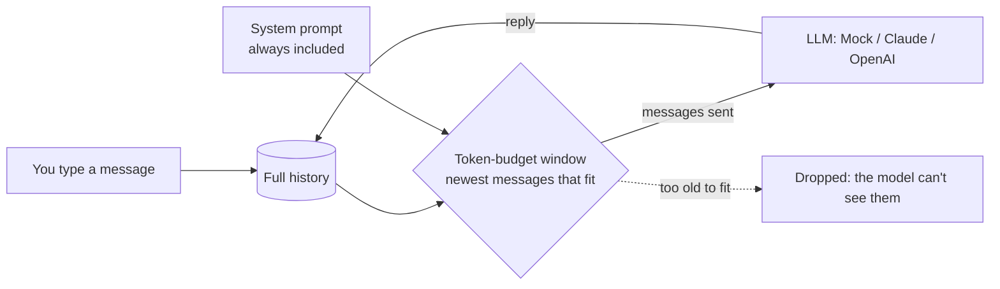

# 01 · First LLM Chat with Memory

Build a chat CLI that remembers the conversation, and watch it forget, in ~400 lines of standard-library Python.

**Level:** Beginner

**You'll learn:**
- Why an LLM API has **no memory**: you resend the conversation every time
- How to count tokens and keep a conversation inside a **context budget**
- The **sliding window**: keep the newest messages, drop the oldest
- How to put a **swappable model** behind one tiny interface (offline mock, Claude, or OpenAI)
- How to **save and resume** a chat session as JSON

## Why this matters

Every chatbot you have used (a bank's support bot, a coding assistant, ChatGPT itself) runs this loop. A support bot that
"forgets" your order number halfway through a long chat isn't broken. Your order number fell out of its context
window. Once you understand the window, you can design around it: shorter system prompts, summaries, or long-term memory
(that's project 07).

## Architecture



`ConversationMemory` stores the **full** transcript. Before each call it builds a `Window`: the system prompt plus as many
of the newest messages as fit in the token budget. Only the window goes to the model. `ChatSession` ties memory and model
together with one method, `send()`. The model sits behind a one-method interface, `complete(system, messages)`. The
default backend is an offline `MockLLM` that, like a real model, only "knows" what's in the messages it is sent.

## Quickstart

**Windows (PowerShell)**
```powershell
cd projects/01-first-llm-chat-with-memory
python -m venv .venv; .\.venv\Scripts\Activate.ps1
pip install -r requirements.txt
python demo.py
python -m pytest -q
```

**macOS / Linux**
```bash
cd projects/01-first-llm-chat-with-memory
python3 -m venv .venv && source .venv/bin/activate
pip install -r requirements.txt
python demo.py
python -m pytest -q
```

Expected output (shortened):
```
+-- turn 4 --------------------------------------------------------------+
| you : What's my name?                                                  |
| bot : Your name is Priya.                                              |
| ctx : [################....] 115/140 tokens | 7 msgs sent | 0 dropped  |
+------------------------------------------------------------------------+
...
+-- turn 7 --------------------------------------------------------------+
| you  : What's my name?                                                 |
| bot  : I don't know. If you told me, it has scrolled out of my context |
|        window.                                                         |
| ctx  : [####################] 138/140 tokens | 9 msgs sent | 4 dropped |
| lost : fell out of the window: "I live in Pune."                       |
+------------------------------------------------------------------------+
```

Same question, two different answers. Nothing was deleted. The name simply no longer fits in the window.

More to try:
```bash
python demo.py --budget 1000                          # big window: it never forgets
python demo.py --chat --budget 200                    # chat yourself
python demo.py --chat --session my_chat.json          # resume the same chat later
```

## How it works

**1. Count tokens** (`tokens.py`). Real tokenizers are learned, but a regex approximation is enough to see a budget fill up:

```python
_PIECE = re.compile(r"\w+|[^\w\s]")
MESSAGE_OVERHEAD = 4  # role markers cost tokens too

def count_tokens(text: str) -> int:
    return sum(1 + len(piece) // 6 for piece in _PIECE.findall(text))
```

**2. Build the window** (`memory.py`). Pay for the system prompt first, then walk backwards from the newest message:

```python
remaining = self.budget - self.system_tokens
kept: list[Message] = []
for message in reversed(self.history):
    if kept and message.tokens > remaining:
        break                      # stop at the first misfit: no gaps in the dialogue
    kept.append(message)
    remaining -= message.tokens
kept.reverse()
while len(kept) > 1 and kept[0].role != "user":
    kept.pop(0)                    # chat APIs expect a user turn first
```

The `if kept` guard means the newest message is always sent, even if it alone exceeds the budget.

**3. Send only the window** (`chat.py`):

```python
self.memory.add("user", text)
window = self.memory.window()
reply = self.llm.complete(self.memory.system_prompt, [m.as_dict() for m in window.messages])
self.memory.add("assistant", reply)
```

**4. A mock that is honest about memory** (`llm.py`). `MockLLM` extracts facts ("my name is ...") only from the
messages it receives, so when a message leaves the window, the fact leaves with it. That's how a real model behaves too.

## Build it yourself

1. **Make the folders.** `src/chat_memory/`, `tests/`, `examples/`. Add `pyproject.toml` with
   `[tool.pytest.ini_options] pythonpath = ["src"]` so tests can import the package.
2. **Write `count_tokens()`.** One regex, one `sum`. Test it on `"Hello, world!"` (4 tokens). Why: you can't manage a
   budget you can't measure.
3. **Write `Message` and `ConversationMemory.add()`.** A frozen dataclass with `role`, `content` and a `tokens` property
   that adds the per-message overhead.
4. **Write `window()`.** System prompt first, then newest to oldest, stop at the first misfit, then trim a leading
   assistant message. Return a `Window` with `messages`, `dropped` and `tokens_used`. Why a dataclass: the trace needs
   all three.
5. **Define the `LLM` interface and `MockLLM`.** One method: `complete(system, messages) -> str`. Make the mock answer
   "what's my name?" only from messages it was given.
6. **Write `ChatSession.send()`.** Add user message → build window → call model → store reply.
7. **Draw the trace** (`ui.py`, `__main__.py`). A box per turn, a token meter, and a "lost" row whenever a message falls
   out of the window.
8. **Add `save()` / `load()`.** Dump the full history to JSON so `--session` can resume a chat.
9. **Write tests**: the window respects the budget, drops oldest first, stays contiguous, and the mock forgets when the
   budget is small.

## Use a real LLM

The demo uses `MockLLM` unless you set `LLM_PROVIDER`:

```bash
pip install anthropic                     # or: pip install openai
export LLM_PROVIDER=anthropic             # PowerShell: $env:LLM_PROVIDER="anthropic"
export ANTHROPIC_API_KEY=sk-ant-...       # PowerShell: $env:ANTHROPIC_API_KEY="sk-ant-..."
python demo.py --chat --budget 300
```

`LLM_PROVIDER=openai` uses `OPENAI_API_KEY`. `LLM_MODEL` overrides the model (defaults: `claude-opus-5-5`, `gpt-4.1-mini`).
See `.env.example`. Never commit real keys. The Claude backend enables server-side refusal fallbacks
(`fallbacks: "default"`), so if a safety classifier declines a request, the API retries it on a fallback model.

## Production notes / pitfalls

- **Use the real tokenizer** for real budgets (`count_tokens` endpoints or the provider's tokenizer library). Our regex is
  a teaching approximation and can be off by 20–30%.
- **Cost grows with every turn.** You resend the whole window each time, so a 50-turn chat costs far more than 50 single
  questions. The budget is also a **cost cap**.
- **Sliding windows break prompt caching.** When the oldest message drops, the prompt prefix changes and the cache misses.
  Providers offer server-side compaction for long chats. Prefer it in production.
- **Never trim the system prompt.** It holds your instructions and guardrails. Budget for it first, as `window()` does.
- **Session files contain user data.** Treat saved transcripts like any other personal data (retention, encryption).

## Extend it

1. **Pinned facts:** let the user `/pin` a message so it is always included, like a second system prompt.
2. **Summarise instead of drop:** when messages fall out, ask the model to fold them into a running summary message.
3. **Streaming:** print the reply token by token (both SDKs support streaming).

**Next project:** [02 · Tool calling from scratch](../02-tool-calling-from-scratch/README.md). Give the model hands.

---
Part of [AI Agent Builds](../../README.md) by [exe_404.ai](https://www.youtube.com/@exe_404ai) — one agentic-AI project a day.
