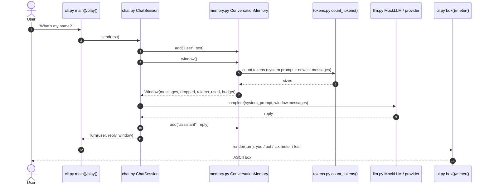

# Architecture · 01 First LLM Chat with Memory

## Components

| File | Component | Responsibility |
|------|-----------|----------------|
| `src/chat_memory/cli.py` | `main()`, `run_script()`, `run_chat()`, `render()` | Parse flags, build the session, print one ASCII box per turn. |
| `src/chat_memory/config.py` | `Settings.from_env()` | Typed settings from env (`LLM_PROVIDER`, `LLM_MODEL`, `CHAT_BUDGET`). Single source of truth. |
| `src/chat_memory/chat.py` | `ChatSession.send()` | One turn: append the user message, build the window, call the model, append the reply. |
| `src/chat_memory/memory.py` | `ConversationMemory`, `Window`, `Message` | Keep the full transcript; pick the newest messages that fit the token budget; save/load JSON. |
| `src/chat_memory/tokens.py` | `count_tokens()` | Dependency-free token estimate plus a fixed per-message overhead. |
| `src/chat_memory/llm.py` | `make_llm()`, `MockLLM`, `AnthropicLLM`, `OpenAILLM` | One-method `complete(system, messages)` interface; offline mock by default. |
| `src/chat_memory/ui.py` | `banner()`, `box()`, `meter()` | Plain-ASCII rendering for terminals and video. |

## Data flow: one full request

## Design decisions

- **Keep everything, send a window.** The transcript is never trimmed; only the request is. This makes "forgetting"
  observable (the `lost` row) and keeps `save()` lossless.
- **Contiguous window, newest first.** `window()` walks backwards and stops at the first message that doesn't fit, so the
  model never sees a dialogue with holes in it.
- **System prompt is paid first and always sent.** Its tokens come off the budget before any history.
- **Approximate tokenizer.** `count_tokens()` avoids a tokenizer dependency; exactness doesn't matter for teaching the
  budget, but a production system should use the provider's token counter.
- **Settings read at call time.** `Settings.from_env()` runs inside `main()`/`make_llm()`, so tests and shells can
  change env vars without re-importing.

## Failure modes and handling

| Failure | Handling |
|---------|----------|
| Newest message alone exceeds the budget | It is kept anyway (a request with no user turn is useless); `tokens_used` shows the overflow. |
| Window would start with an assistant turn | Leading assistant messages are dropped; chat APIs expect a user turn first. |
| Unknown `LLM_PROVIDER` / bad `CHAT_BUDGET` | `Settings.from_env()` raises `ValueError` with the allowed values. |
| Provider SDK missing | Imported lazily inside the backend, so the offline path never needs it; real use fails fast with `ImportError`. |
| Model refuses (Claude) | `stop_reason == "refusal"` returns a readable placeholder; server-side fallbacks are enabled. |
| Session file missing | `--session` starts a fresh `ConversationMemory` and creates the file on the first save. |

## How to extend

- **Summarise instead of drop:** when `window.dropped` grows, ask the LLM for a summary and prepend it as a system note.
- **Real tokenizer:** swap `count_tokens()` for the provider's counter; nothing else changes.
- **New backend:** add a class with `complete(system, messages) -> str` and a branch in `make_llm()` plus a value in
  `config.PROVIDERS`.
