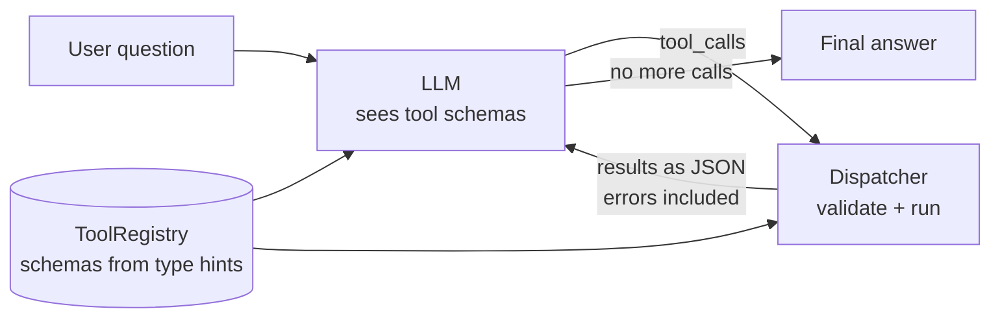
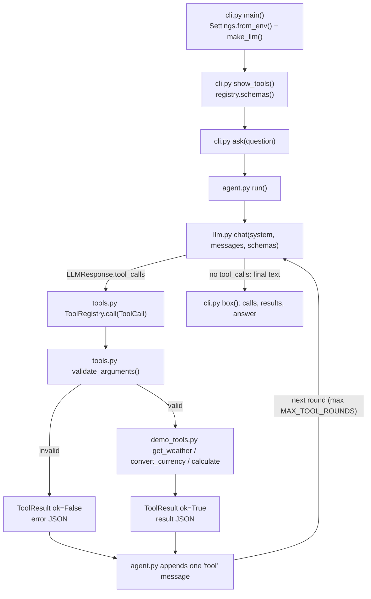

# 02 · Tool Calling from Scratch

Give an LLM real tools (weather, currency, a safe calculator) with no framework, in ~400 lines of Python.

**Level:** Beginner

**You'll learn:**
- What "function calling" actually is: the model **asks**, your code **runs**
- How to turn a typed Python function into a **JSON Schema** the model can read
- Why you **validate arguments** before running anything, and send errors back as results
- The **result-feeding loop**: call → run tools → append results → call again
- How the same loop maps onto both the **Claude** and **OpenAI** wire formats

## Why this matters

An LLM can't check today's exchange rate or do exact arithmetic. It predicts text. Tool calling is how a model gets
hands. A travel-booking assistant that quotes "250 USD is about 230 EUR" should get that number from a rates API, not
from memory. Every agent framework (LangChain, the OpenAI Agents SDK, Claude's tool runner) wraps the ~50-line loop you
build here. Once you've written it yourself, those frameworks stop being magic.

## Architecture



A `ToolRegistry` turns decorated Python functions into JSON Schemas. The model only ever sees those schemas, never your
code. When the model replies with tool calls, the dispatcher validates each call's arguments against the schema, runs
the function, and packages the result, or the error, as JSON. All results go back to the model in one message, and the
loop repeats until the model answers in plain text (or a round limit is hit).

## Flow



Every box is a real function: `agent.run()` is the loop, `ToolRegistry.call()` is the safety boundary. See
[docs/ARCHITECTURE.md](docs/ARCHITECTURE.md) for the sequence diagram and failure modes.

## Project structure

```
02-tool-calling-from-scratch/
├── README.md                 # this tutorial
├── VIDEO.md                  # hooks + flow steps for the video
├── docs/ARCHITECTURE.md      # components, sequence diagram, design decisions, failure modes
├── pyproject.toml            # package metadata, `toolcall` script, pytest + ruff config
├── requirements.txt          # pinned deps (runtime is stdlib only)
├── Makefile                  # install / test / demo / ask / lint / docker / clean
├── Dockerfile                # python:3.12-slim, non-root, runs the demo
├── .dockerignore / .gitignore
├── .env.example              # every setting the code reads
├── demo.py                   # one-command demo, no install needed
├── src/toolcall/
│   ├── __init__.py           # __version__
│   ├── __main__.py           # `python -m toolcall`
│   ├── cli.py                # argparse entry: print schemas, run questions, draw the trace
│   ├── config.py             # Settings.from_env(): LLM_PROVIDER, LLM_MODEL, MAX_TOOL_ROUNDS
│   ├── agent.py              # run(): the tool-calling loop
│   ├── tools.py              # ToolRegistry: schema from type hints, validation, dispatch
│   ├── demo_tools.py         # get_weather, convert_currency, calculate (safe AST math)
│   ├── llm.py                # MockLLM + optional Anthropic / OpenAI backends
│   └── ui.py                 # ASCII banner and boxes
├── tests/
│   ├── test_tools.py         # unit tests: schemas, validation, loop, round limit
│   └── test_e2e.py           # end-to-end demo flow + config
└── examples/questions.txt    # the demo questions
```

Shortcuts: `make test`, `make demo`, `make ask Q="Convert 99 GBP to INR"`. Container:
`docker build -t toolcall . && docker run --rm toolcall`. The image runs the offline `MockLLM`; for a real model, build
with `--build-arg PROVIDER_SDK=anthropic` and run with `-e LLM_PROVIDER=anthropic -e ANTHROPIC_API_KEY=...`.

## Quickstart

**Windows (PowerShell)**
```powershell
cd projects/02-tool-calling-from-scratch
python -m venv .venv; .\.venv\Scripts\Activate.ps1
pip install -r requirements.txt
python demo.py
python -m pytest -q
```

**macOS / Linux**
```bash
cd projects/02-tool-calling-from-scratch
python3 -m venv .venv && source .venv/bin/activate
pip install -r requirements.txt
python demo.py
python -m pytest -q
```

Expected output (shortened):
```
+-- tools the model can see (it never sees our Python code) -----------------+
| get_weather      : (city: string)  Get the current weather for a city.     |
| convert_currency : (amount: number, from_currency: string, to_currency:    |
|                    string)  Convert money between currencies using today's |
| calculate        : (expression: string)  Evaluate an arithmetic expression |
+----------------------------------------------------------------------------+
+-- Q1 | 2 model call(s) ----------------------------------------------------+
| user     : What's the weather in Paris and Tokyo?                          |
| model -> : get_weather({"city": "Paris"})                                  |
| tool  <- : {"city": "Paris", "temp_c": 18, "conditions": "cloudy"}         |
| model -> : get_weather({"city": "Tokyo"})                                  |
| tool  <- : {"city": "Tokyo", "temp_c": 24, "conditions": "sunny"}          |
| answer   : Paris: 18 C and cloudy. Tokyo: 24 C and sunny.                  |
+----------------------------------------------------------------------------+
+-- Q4 | 2 model call(s) ----------------------------------------------------+
| user     : What's the weather in Atlantis?                                 |
| model -> : get_weather({"city": "Atlantis"})                               |
| error <- : {"error": "ValueError: no weather data for 'Atlantis'"}         |
| answer   : Sorry, get_weather failed (ValueError: no weather data for      |
|            'Atlantis').                                                    |
+----------------------------------------------------------------------------+
```

Ask your own: `python demo.py "Convert 99 GBP to INR"`.

## How it works

**1. A tool is just a typed, documented function** (`demo_tools.py`):

```python
@registry.register
def get_weather(city: str) -> dict:
    """Get the current weather for a city.

    Args:
        city: City name, e.g. "Paris".
    """
```

**2. The schema comes from the signature** (`tools.py`). Type hints become JSON types, parameters without defaults
become `required`, and the docstring supplies descriptions:

```python
for name, param in inspect.signature(fn).parameters.items():
    prop = {"type": _JSON_TYPES[hints[name]]}          # str -> "string", int -> "integer", ...
    if name in docs:
        prop["description"] = docs[name]
    properties[name] = prop
    if param.default is inspect.Parameter.empty:
        required.append(name)
```

**3. Validate, run, and never crash** (`ToolRegistry.call`). Unknown tool, missing argument, wrong type, or an exception
inside the tool all become an error *result* the model can read and react to:

```python
problems = validate_arguments(tool.parameters, call.arguments)
if problems:
    return self._error(call, "invalid arguments: " + "; ".join(problems))
try:
    value = tool.fn(**call.arguments)
except Exception as exc:
    return self._error(call, f"{type(exc).__name__}: {exc}")
```

**4. The loop** (`agent.py`, trace events omitted). Keep calling until the model stops asking for tools:

```python
for round_number in range(1, max_rounds + 1):
    response = llm.chat(SYSTEM_PROMPT, messages, registry.schemas())
    messages.append({"role": "assistant", ..., "tool_calls": response.tool_calls, "raw": response.raw})
    if not response.tool_calls:
        return Run(response.text, round_number, messages)
    results = [registry.call(call) for call in response.tool_calls]
    messages.append({"role": "tool", "results": results})
```

**5. Adapters** (`llm.py`). One neutral message format, translated per provider. Claude takes `tool_result` blocks inside
a user message. OpenAI takes one `role: "tool"` message per call. The Claude adapter resends the model's own assistant
blocks (`raw`) unchanged, which keeps its reasoning intact across tool rounds.

**6. Safe calculator.** `calculate` parses the expression into a syntax tree and allows only numbers and arithmetic
operators. Never pass model output to `eval()`.

## Build it yourself

1. **Write one tool function** with type hints and an `Args:` docstring. Why: the hints and docstring *are* your API
   contract with the model.
2. **Write `schema_from_function()`** using `inspect.signature` + `typing.get_type_hints`. Print the JSON and read it as
   if you were the model.
3. **Write `validate_arguments()`.** Required, unexpected, and type checks. Remember `bool` is an `int` in Python but not
   in JSON.
4. **Write `ToolRegistry`** with a `register` decorator, `schemas()`, and `call()` that returns a `ToolResult` instead of
   raising.
5. **Define `LLMResponse` and the `LLM` protocol**: `chat(system, messages, tools) -> LLMResponse(text, tool_calls, raw)`.
6. **Write `MockLLM`**: turn 1 maps the question to tool calls with regexes, turn 2 reads results and writes the answer.
   Make it call only tools it was offered.
7. **Write the loop** in `agent.py` with a `max_rounds` guard and an `on_event` callback for tracing.
8. **Draw the trace** in `__main__.py`: show the schemas, then a box per question.
9. **Add real adapters** for Claude and OpenAI (lazy imports, so the offline path needs neither SDK).
10. **Test the sharp edges**: bad arguments, unknown tools, `eval` injection, and a model that never stops calling tools.

## Use a real LLM

```bash
pip install anthropic                     # or: pip install openai
export LLM_PROVIDER=anthropic             # PowerShell: $env:LLM_PROVIDER="anthropic"
export ANTHROPIC_API_KEY=sk-ant-...       # PowerShell: $env:ANTHROPIC_API_KEY="sk-ant-..."
python demo.py "Is it warmer in Mumbai or London, and by how many degrees?"
```

A real model will often chain tools across rounds: weather for both cities, then `calculate` for the difference.
`LLM_PROVIDER=openai` uses `OPENAI_API_KEY`. `LLM_MODEL` overrides the model (defaults: `claude-opus-5-5`,
`gpt-4.1-mini`). The Claude backend enables server-side refusal fallbacks (`fallbacks: "default"`). Never commit keys.

## Production notes / pitfalls

- **Arguments are untrusted input.** The model can be steered by whatever text it reads. Validate types, ranges and
  permissions in the tool, not just the schema. Never `eval`, never build shell commands or SQL from raw arguments.
- **Return errors, don't raise.** A crash ends the conversation. An error result lets the model retry with fixed
  arguments or explain the problem to the user.
- **Always cap the rounds.** A confused model can loop forever, and every round costs tokens and latency.
- **Return all parallel results in one message.** Splitting them teaches the model to stop making parallel calls.
- **Descriptions are prompts.** Clear tool and parameter descriptions measurably improve which tool gets picked and how
  well arguments are filled. Keep tool results small: they are billed as input tokens on every later call.

## Extend it

1. **Add a tool with an enum** (e.g. `units: Literal["C", "F"]`) and map `Literal` to JSON Schema `enum`.
2. **Run parallel calls concurrently** with `concurrent.futures.ThreadPoolExecutor`. Matters once tools hit real APIs.
3. **Confirmation for risky tools:** mark a tool `dangerous=True` and ask the user before running it (see project 14).

**Next project:** [03 · ReAct agent loop](../03-react-agent-loop/README.md). Let the model think, act and observe over
many steps.

---
Part of [AI Agent Builds](../../README.md) by [exe_404.ai](https://www.youtube.com/@exe_404ai) — one agentic-AI project a day.
