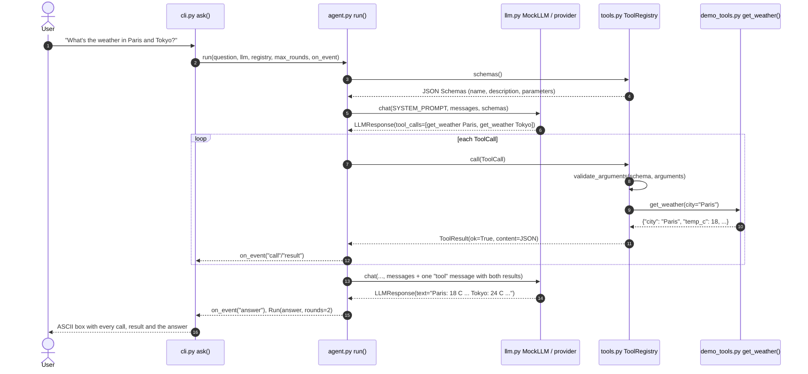

# Architecture · 02 Tool Calling from Scratch

## Components

| File | Component | Responsibility |
|------|-----------|----------------|
| `src/toolcall/cli.py` | `main()`, `show_tools()`, `ask()` | Parse args, print the tool schemas, run each question and draw the trace from `on_event` callbacks. |
| `src/toolcall/config.py` | `Settings.from_env()` | Typed settings (`LLM_PROVIDER`, `LLM_MODEL`, `MAX_TOOL_ROUNDS`). Single source of truth. |
| `src/toolcall/agent.py` | `run()`, `Run` | The loop: call the model with schemas, run requested tools, feed results back, stop on a plain answer or the round limit. |
| `src/toolcall/tools.py` | `ToolRegistry`, `schema_from_function()`, `validate_arguments()`, `ToolCall`, `ToolResult` | Describe Python functions as JSON Schema, validate model arguments, dispatch, and turn every failure into an error result. |
| `src/toolcall/demo_tools.py` | `get_weather`, `convert_currency`, `calculate` | Three typed, documented example tools registered with `@registry.register`. |
| `src/toolcall/llm.py` | `make_llm()`, `MockLLM`, `AnthropicLLM`, `OpenAILLM`, `LLMResponse` | One `chat(system, messages, tools)` interface; each backend translates the neutral message format to its API. |
| `src/toolcall/ui.py` | `banner()`, `box()` | Plain-ASCII rendering. |

## Data flow: one full request

## Design decisions

- **The model never runs code.** It only emits a `ToolCall` (name + JSON arguments). Our code decides whether and how
  to run it, which is the security boundary.
- **Schemas come from type hints and docstrings.** `schema_from_function()` keeps the tool's contract next to its code,
  so the description can't drift from the implementation.
- **Validate before running.** `validate_arguments()` catches missing, unexpected and wrongly typed arguments, so tool
  functions only ever see well-formed input.
- **Errors are results.** `ToolRegistry.call()` never raises; failures become `ToolResult(ok=False)` the model can read
  and explain or recover from.
- **Provider-neutral messages.** The loop speaks one format; each backend converts it (Claude wants all results of a
  round in one user message, OpenAI wants one `tool` message per call).
- **Events, not prints.** `run()` reports progress through `on_event`, so the loop is testable and the CLI owns output.

## Failure modes and handling

| Failure | Handling |
|---------|----------|
| Model asks for a tool that doesn't exist | Error result listing the available tools. |
| Missing / extra / wrongly typed argument | Error result with every problem, from `validate_arguments()`. |
| Tool raises (e.g. unknown city) | Caught; `ValueError: no weather data for 'Atlantis'` goes back to the model. |
| Model never stops asking for tools | `max_rounds` (env `MAX_TOOL_ROUNDS`, default 5) ends the loop with a clear message. |
| Malicious arithmetic (`__import__`, `9**9**9`) | `calculate()` walks the AST and allows only numbers and arithmetic, with an exponent cap. |
| Bad JSON arguments from OpenAI | Parsed as `{}`; the registry then reports the missing arguments. |
| Unknown `LLM_PROVIDER` | `Settings.from_env()` raises `ValueError`. |

## How to extend

- **New tool:** write a typed function with a Google-style `Args:` docstring and decorate it with `@registry.register`.
- **Richer schemas:** extend `_JSON_TYPES` / `schema_from_function()` for lists, enums and nested objects.
- **Parallel execution:** tool calls in one round are independent, so `run()` could execute them concurrently.
- **New backend:** implement `chat(system, messages, tools) -> LLMResponse` and add it to `make_llm()`.
