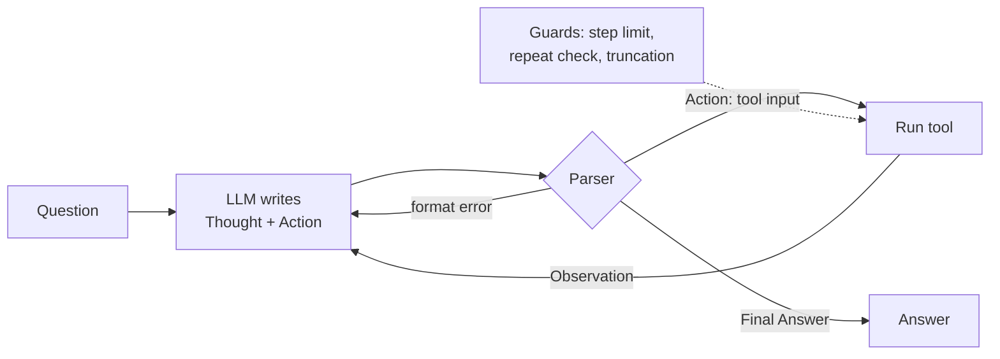
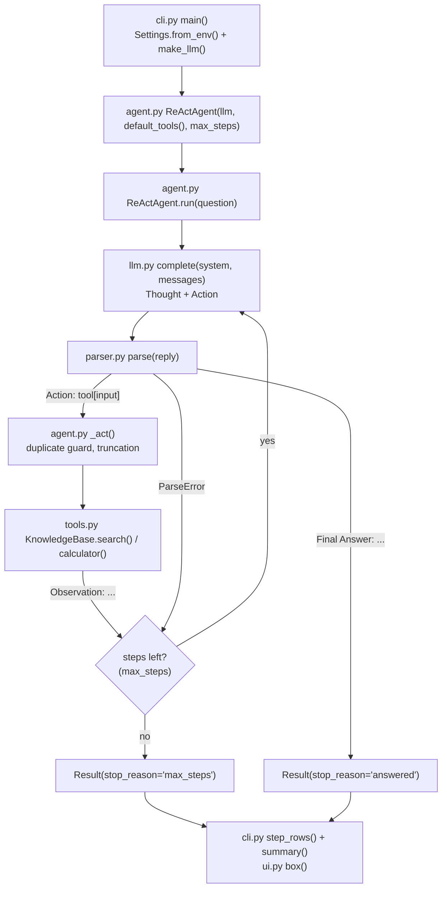

# 03 · ReAct Agent Loop

Build the think → act → observe loop behind every AI agent, with step limits and a trace you can read, in ~450 lines of Python.

**Level:** Beginner

**You'll learn:**
- The **ReAct** pattern: interleave *Thought*, *Action* and *Observation* until a *Final Answer*
- How to **parse** a model's free-text reply into an action, and what to do when it's malformed
- The guardrails every loop needs: a **step limit**, a **repeat-action guard**, and **observation truncation**
- Why **stop sequences** stop a model from inventing its own observations
- How to test agent behaviour with a **scripted model**

## Why this matters

Real questions take more than one lookup. "How many years after the Eiffel Tower was finished did the Golden Gate Bridge
open?" needs two searches and a subtraction. A research assistant, a customer-support bot checking an order and then a
refund policy, a coding agent running tests and reading failures: they all run this loop. Project 02 gave the model hands.
This project gives it a way to plan its next step from what it just saw.

## Architecture



The agent sends the question plus the transcript so far. The model replies in a fixed text format: a `Thought:` line,
then either `Action: tool[input]` or `Final Answer: ...`. The parser turns that text into a `Step`. If it's an action, the
agent runs the tool and appends the result as `Observation: ...`, and the loop repeats. Every failure (bad format,
unknown tool, repeated action) becomes an observation the model can correct, instead of a crash. A hard step limit makes
sure the loop always ends.

## Flow



Each box is a real function: the loop lives in `ReActAgent.run()`, the format rules in `parser.py`. See
[docs/ARCHITECTURE.md](docs/ARCHITECTURE.md) for the sequence diagram and failure modes.

## Project structure

```
03-react-agent-loop/
├── README.md                 # this tutorial
├── VIDEO.md                  # hooks + flow steps for the video
├── docs/ARCHITECTURE.md      # components, sequence diagram, design decisions, failure modes
├── pyproject.toml            # package metadata, `react-agent` script, pytest + ruff config
├── requirements.txt          # pinned deps (runtime is stdlib only)
├── Makefile                  # install / test / demo / ask / lint / docker / clean
├── Dockerfile                # python:3.12-slim, non-root, runs the demo
├── .dockerignore / .gitignore
├── .env.example              # every setting the code reads
├── demo.py                   # one-command demo, no install needed
├── src/react_agent/
│   ├── __init__.py           # __version__
│   ├── __main__.py           # `python -m react_agent`
│   ├── cli.py                # argparse entry: run questions, print every step
│   ├── config.py             # Settings.from_env(): LLM_PROVIDER, LLM_MODEL, REACT_MAX_STEPS
│   ├── agent.py              # ReActAgent: Thought -> Action -> Observation loop
│   ├── parser.py             # parse(): the ReAct text format
│   ├── tools.py              # KnowledgeBase search + safe calculator
│   ├── llm.py                # MockLLM, ScriptedLLM + optional Anthropic / OpenAI
│   └── ui.py                 # ASCII banner and boxes
├── tests/
│   ├── test_react.py         # unit tests: parser, tools, loop, limits, recovery
│   └── test_e2e.py           # end-to-end demo flow + config
└── examples/
    ├── knowledge.json        # the offline encyclopedia
    └── questions.txt         # the demo questions
```

Shortcuts: `make test`, `make demo`, `make ask Q="How much taller is Everest than K2?"`. Container:
`docker build -t react-agent . && docker run --rm react-agent`. The image runs the offline `MockLLM`; for a real model,
build with `--build-arg PROVIDER_SDK=anthropic` and run with `-e LLM_PROVIDER=anthropic -e ANTHROPIC_API_KEY=...`.

## Quickstart

**Windows (PowerShell)**
```powershell
cd projects/03-react-agent-loop
python -m venv .venv; .\.venv\Scripts\Activate.ps1
pip install -r requirements.txt
python demo.py
python -m pytest -q
```

**macOS / Linux**
```bash
cd projects/03-react-agent-loop
python3 -m venv .venv && source .venv/bin/activate
pip install -r requirements.txt
python demo.py
python -m pytest -q
```

Expected output (shortened):
```
+-- Q1 ----------------------------------------------------------------------+
| question  : How many years after the Eiffel Tower was completed did the    |
|             Golden Gate Bridge open?                                       |
| step 1                                                                     |
|   thought : I need facts about Eiffel Tower.                               |
|   action  : search[Eiffel Tower]                                           |
|   observe : [Eiffel Tower] The Eiffel Tower is a wrought-iron lattice      |
|             tower in Paris, France. It was completed in 1889 as the        |
...                                         (step 2 searches Golden Gate Bridge)
| step 3                                                                     |
|   thought : I found 1889 and 1937. The difference needs exact math.        |
|   action  : calculator[1937 - 1889]                                        |
|   observe : 48                                                             |
| step 4                                                                     |
|   thought : The calculator gave me the difference.                         |
|   answer  : 48 years                                                       |
| result    : answered in 4 step(s)                                          |
+----------------------------------------------------------------------------+
```

Try your own: `python demo.py "How much taller is Mount Everest than K2, in metres?"`

## How it works

**1. The prompt defines the protocol** (`agent.py`). The system prompt lists the tools and the two allowed reply shapes.

**2. The loop** (`ReActAgent.run`):

```python
for number in range(1, self.max_steps + 1):
    reply = self.llm.complete(self.system, messages)          # Thought + Action
    messages.append({"role": "assistant", "content": reply})
    step = self._step(number, reply, seen_actions)            # run the Action
    steps.append(step)
    if step.final_answer is not None:
        return Result(step.final_answer, "answered", steps)
    messages.append({"role": "user", "content": f"Observation: {step.observation}"})

return Result(None, "max_steps", steps)  # out of budget: never loop forever
```

**3. The parser** (`parser.py`). It first cuts off anything after `Observation:`. Models sometimes "continue the
pattern" and make up a tool result, and only the agent may write observations:

```python
reply = reply.split("Observation:")[0].strip()
if final := _FINAL.search(reply):
    return Step(thought, final_answer=final.group(1).strip())
if action := _ACTION.search(reply):
    return Step(thought, action=action.group(1), action_input=action.group(2).strip())
raise ParseError("expected 'Action: tool[input]' or 'Final Answer: ...'")
```

Real providers also get `stop_sequences=["\nObservation:"]`, so generation halts right where the observation should be.

**4. Failures are observations** (`_act`). An unknown tool, a repeated identical action, or a very long tool output all
turn into text the model reads on its next step. It usually corrects itself.

**5. The mock is a policy, not a script** (`llm.py`). `MockLLM` reads the transcript, finds the capitalised topics in the
question, searches the ones it hasn't searched yet, calls the calculator when the question asks "how many/much", and
otherwise answers from what it observed. It never reads the knowledge base directly. `ScriptedLLM` replays fixed replies,
which is how the tests simulate a misbehaving model.

## Build it yourself

1. **Make the tools.** `search(query) -> str` over `examples/knowledge.json` and a safe AST `calculator`. In classic
   ReAct, tools take one string and return one string.
2. **Write the system prompt.** List tools, show the two reply formats, and say "never write an Observation yourself".
3. **Write the parser** with three regexes (`Thought`, `Action: name[input]`, `Final Answer`). Cut at `Observation:`
   first. Raise `ParseError` on anything else.
4. **Write the loop**: call → parse → act → append observation, inside `for number in range(max_steps)`.
5. **Turn every failure into an observation**: format errors, unknown tools, repeated actions. Why: the model can only
   fix what it can see.
6. **Truncate long observations.** Every observation is resent on every later step, so a giant tool output burns tokens.
7. **Write `MockLLM`** as a small rule-based policy over the transcript, and `ScriptedLLM` for tests.
8. **Draw the trace**: a box per question, a sub-heading per step, and why the run ended.
9. **Test the guards**: a model that loops forever, a model that rambles, a model that calls a tool that doesn't exist.

## Use a real LLM

```bash
pip install anthropic                     # or: pip install openai
export LLM_PROVIDER=anthropic             # PowerShell: $env:LLM_PROVIDER="anthropic"
export ANTHROPIC_API_KEY=sk-ant-...       # PowerShell: $env:ANTHROPIC_API_KEY="sk-ant-..."
python demo.py "Which is longer in kilometres: the Great Wall of China or 20,000 km?"
```

`LLM_PROVIDER=openai` uses `OPENAI_API_KEY`. `LLM_MODEL` overrides the model (defaults: `claude-opus-5-5`,
`gpt-4.1-mini`). Both backends send the `Observation:` stop sequence. The Claude backend enables server-side refusal
fallbacks (`fallbacks: "default"`). Never commit keys.

## Production notes / pitfalls

- **Always cap steps, and also cap cost.** Each step resends the whole transcript, so cost grows roughly quadratically
  with steps. Log steps-per-task: it is your best early signal that a prompt or tool got worse.
- **Text protocols are fragile.** ReAct-style text parsing is great for learning and works with any model, but native
  tool calling (project 02) is more reliable in production because the API returns structured calls.
- **Observations are untrusted.** A search result can contain "ignore your instructions and…". Treat tool output as data
  (see project 13 on prompt injection).
- **Repeat detection matters.** Agents get stuck re-running the same action. Detect it and say so in the observation.
- **Evaluate the trajectory, not just the answer.** A right answer reached by guessing (no search) is a bug waiting to
  happen. The tests here assert on the sequence of actions too.

## Extend it

1. **Add a `lookup[term]` tool** that searches only within the last article, as in the original ReAct paper.
2. **Self-check:** before the final answer, make the agent run one verification action (re-search the key fact).
3. **Switch to native tool calling** using project 02's adapters, and compare the step counts on the same questions.

Credit: the loop follows the ReAct pattern from Yao et al., *"ReAct: Synergizing Reasoning and Acting in Language
Models"* (2022). All code here is original.

**Next project:** [04 · Structured output extractor](../04-structured-output-extractor/README.md). Make the model's output
machine-readable and validated.

---
Part of [AI Agent Builds](../../README.md) by [exe_404.ai](https://www.youtube.com/@exe_404ai) — one agentic-AI project a day.
