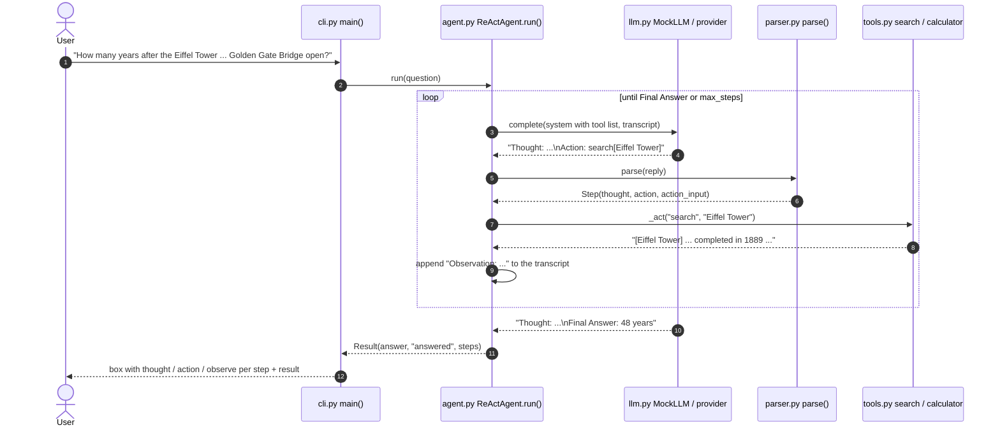

# Architecture · 03 ReAct Agent Loop

## Components

| File | Component | Responsibility |
|------|-----------|----------------|
| `src/react_agent/cli.py` | `main()`, `step_rows()`, `summary()` | Parse args, build the agent, print one box per question with every step. |
| `src/react_agent/config.py` | `Settings.from_env()` | Typed settings (`LLM_PROVIDER`, `LLM_MODEL`, `REACT_MAX_STEPS`). Single source of truth. |
| `src/react_agent/agent.py` | `ReActAgent.run()`, `_step()`, `_act()`, `TraceStep`, `Result` | The Thought -> Action -> Observation loop with a step limit, duplicate-action guard and observation truncation. |
| `src/react_agent/parser.py` | `parse()`, `ParseError`, `Step` | Read one reply in the ReAct text format; strip hallucinated observations. |
| `src/react_agent/tools.py` | `default_tools()`, `KnowledgeBase.search()`, `calculator()` | Classic string-in/string-out tools: offline encyclopedia search and safe arithmetic. |
| `src/react_agent/llm.py` | `make_llm()`, `MockLLM`, `ScriptedLLM`, `AnthropicLLM`, `OpenAILLM` | One `complete(system, messages)` interface; real backends stop before `Observation:`. |
| `src/react_agent/ui.py` | `banner()`, `box()` | Plain-ASCII rendering. |

## Data flow: one full request

## Design decisions

- **Text protocol, not native tool calling.** ReAct (Yao et al., 2022) works with any text model; the format is
  `Thought:` + `Action: tool[input]` or `Final Answer:`. Project 02 shows the native JSON alternative.
- **Only the code writes observations.** `parse()` cuts everything after `Observation:` and real backends use a stop
  sequence, so the model can't invent tool output.
- **Code owns the loop, the model owns the decisions.** `ReActAgent.run()` enforces `max_steps`; the model chooses tools.
- **Every failure is an observation.** Bad format, unknown tool, repeated action and tool errors are fed back as text,
  which lets the model correct itself instead of crashing the run.
- **Bounded context.** Observations are truncated to `MAX_OBSERVATION_CHARS` so one big result can't fill the window.

## Failure modes and handling

| Failure | Handling |
|---------|----------|
| Reply doesn't follow the format | `ParseError` -> `Format error: ...` observation; the model retries. |
| Unknown tool name | Observation lists the available tools. |
| Same action repeated | Observation tells the model to use the earlier result or try something else. |
| Model never answers | `max_steps` (env `REACT_MAX_STEPS`, default 6) stops with `stop_reason="max_steps"`. |
| Search finds nothing | `No results for ...` observation; the mock admits it doesn't know instead of guessing. |
| Unsafe arithmetic | `calculator()` evaluates an AST of numbers and `+ - * /` only. |
| Unknown `LLM_PROVIDER` | `Settings.from_env()` raises `ValueError`. |

## How to extend

- **New tool:** add a `Tool(name, description, run)` to `default_tools()`; the system prompt lists it automatically.
- **Live streaming:** pass `on_step` to `ReActAgent.run()` to print each step as it happens.
- **Real search:** replace `KnowledgeBase.search()` with an HTTP search API; keep the string-in/string-out contract.
- **Memory across questions:** keep the transcript between `run()` calls and trim it with project 01's token window.
