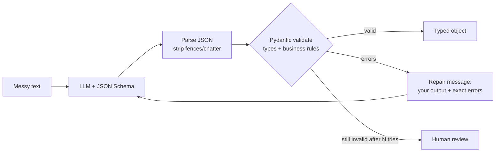
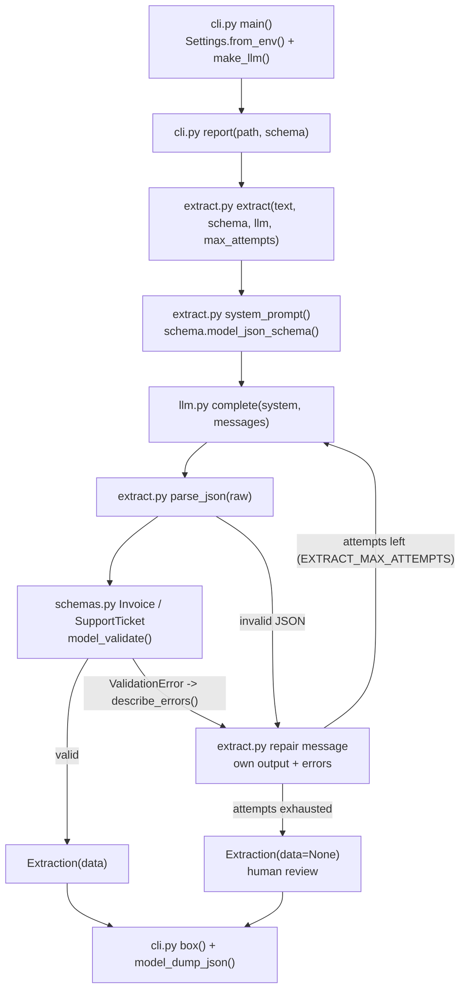

# 04 · Structured Output Extractor

Turn messy emails and invoices into validated JSON with pydantic and automatic repair retries, in ~400 lines of Python.

**Level:** Beginner

**You'll learn:**
- How to give a model an exact **JSON Schema** generated from a pydantic model
- How to **dig JSON out** of chatty replies and code fences
- How to validate **types and business rules** (does the invoice actually add up?)
- The **repair loop**: show the model its own output plus the exact errors, and let it fix them
- When to **stop retrying** and route the document to a human

## Why this matters

An accounts-payable team receives hundreds of invoices a week as emails and PDFs. An LLM can read them, but its output
is only useful if a program can trust it: dates as real dates, money as exact decimals, totals that match the line items.
This is the most common LLM job in real companies (invoices, support tickets, CVs, contracts, insurance claims). The
pattern here, *schema → extract → validate → repair → escalate*, is what production intake pipelines run (see project 27).

## Architecture



Pydantic models (`Invoice`, `SupportTicket`) are the contract. Their JSON Schema goes into the system prompt, so the
model sees exactly what is expected. The reply is parsed, then validated for field types *and* cross-field rules. If
validation fails, the model's reply and a short list of errors are appended to the conversation and the model tries
again. After `max_attempts` the extractor gives up honestly and returns no data, so bad numbers never flow downstream.

## Flow



Each box is a real function: the repair loop lives in `extract()`, the rules in `schemas.py`. See
[docs/ARCHITECTURE.md](docs/ARCHITECTURE.md) for the sequence diagram and failure modes.

## Project structure

```
04-structured-output-extractor/
├── README.md                 # this tutorial
├── VIDEO.md                  # hooks + flow steps for the video
├── docs/ARCHITECTURE.md      # components, sequence diagram, design decisions, failure modes
├── pyproject.toml            # package metadata (pydantic), `extractor` script, pytest + ruff config
├── requirements.txt          # pinned deps: pydantic, pytest
├── Makefile                  # install / test / demo / extract / lint / docker / clean
├── Dockerfile                # python:3.12-slim, non-root, runs the demo
├── .dockerignore / .gitignore
├── .env.example              # every setting the code reads
├── demo.py                   # one-command demo, no install needed
├── src/extractor/
│   ├── __init__.py           # __version__
│   ├── __main__.py           # `python -m extractor`
│   ├── cli.py                # argparse entry: extract files, print attempts and JSON
│   ├── config.py             # Settings.from_env(): LLM_PROVIDER, LLM_MODEL, EXTRACT_MAX_ATTEMPTS
│   ├── extract.py            # extract(): prompt -> parse -> validate -> repair loop
│   ├── schemas.py            # Invoice, LineItem, SupportTicket (pydantic contracts)
│   ├── llm.py                # MockLLM + optional Anthropic / OpenAI backends
│   └── ui.py                 # ASCII banner and boxes
├── tests/
│   ├── test_extractor.py     # unit tests: parsing, business rules, repair loop
│   └── test_e2e.py           # end-to-end demo flow + config
└── examples/
    ├── invoice_acme.txt      # messy invoice email (repaired on attempt 2)
    ├── email_late_order.txt  # support email -> SupportTicket
    └── invoice_bad_total.txt # totals don't add up -> human review
```

Shortcuts: `make test`, `make demo`, `make extract FILE=mail.txt SCHEMA=ticket`. Container:
`docker build -t structured-extractor . && docker run --rm structured-extractor`. The image runs the offline `MockLLM`;
for a real model, build with `--build-arg PROVIDER_SDK=anthropic` and run with
`-e LLM_PROVIDER=anthropic -e ANTHROPIC_API_KEY=...`.

## Quickstart

**Windows (PowerShell)**
```powershell
cd projects/04-structured-output-extractor
python -m venv .venv; .\.venv\Scripts\Activate.ps1
pip install -r requirements.txt
python demo.py
python -m pytest -q
```

**macOS / Linux**
```bash
cd projects/04-structured-output-extractor
python3 -m venv .venv && source .venv/bin/activate
pip install -r requirements.txt
python demo.py
python -m pytest -q
```

Expected output (shortened):
```
+-- invoice_acme.txt -> Invoice ---------------------------------------------+
| attempt 1 : invalid (3 error(s))                                           |
|             - invoice_date: Input should be a valid date or datetime,      |
|             invalid character in year (got 'March 3, 2026')                |
|             - total: Input should be a valid decimal (got '$725.75')       |
| attempt 2 : valid                                                          |
| result    : OK: a validated Invoice after 2 attempt(s)                     |
+----------------------------------------------------------------------------+
{ "vendor": "Acme Office Supplies", "invoice_date": "2026-03-03", "total": "725.75", ... }

+-- invoice_bad_total.txt -> Invoice ----------------------------------------+
| attempt 2 : invalid (1 error(s))                                           |
|             - (whole object): Value error, total 300.00 does not equal     |
|             line items + tax = 270.00                                      |
| attempt 3 : invalid (1 error(s))                                           |
| result    : FAILED: send to a human for review (bad data in, no valid data |
+----------------------------------------------------------------------------+
Valid: 2/3 documents. Routed to human review: 1.
```

Your own file: `python demo.py path/to/email.txt --schema ticket`.

## How it works

**1. The schema is the contract** (`schemas.py`). Field types catch format errors. A model validator catches business
errors:

```python
Money = Annotated[Decimal, Field(ge=0, decimal_places=2), AfterValidator(lambda v: v.quantize(Decimal("0.01")))]

class Invoice(BaseModel):
    invoice_date: date
    currency: str = Field(pattern=r"^[A-Z]{3}$")
    line_items: list[LineItem] = Field(min_length=1)
    total: Money

    @model_validator(mode="after")
    def check_business_rules(self) -> Invoice:
        expected = sum(item.quantity * item.unit_price for item in self.line_items) + self.tax
        if abs(expected - self.total) > Decimal("0.01"):
            raise ValueError(f"total {self.total} does not equal line items + tax = {expected}")
```

**2. Show the model the schema** (`extract.py`). `schema.model_json_schema()` goes into the system prompt, along with
format rules (ISO dates, plain numbers, `null` for missing values, never invent).

**3. Parse defensively.** Find a fenced block if there is one, then take the outermost `{...}`:

```python
fenced = _FENCE.search(raw)
candidate = fenced.group(1) if fenced else raw
start, end = candidate.find("{"), candidate.rfind("}")
return json.loads(candidate[start : end + 1])
```

**4. The repair loop.** On failure, append the model's own reply and a precise error list, then ask again:

```python
messages.append({"role": "assistant", "content": raw})
messages.append({"role": "user", "content": "Your JSON failed validation:\n- invoice_date: ...\n"
                                            "Return the corrected JSON object only."})
```

Short, specific errors (`field: problem (got value)`) fix far more replies than "that was wrong, try again".

**5. Know when to stop.** `invoice_bad_total.txt` has a hand-typed total that doesn't match its items. No amount of
retrying can fix bad source data, so after 3 attempts `Extraction.data` is `None` and the CLI routes it to a human.

**6. An honest mock** (`llm.py`). `MockLLM` extracts with regexes, but its first draft makes the mistakes real models make:
a chatty code fence, dates copied as written, `"$725.75"` strings, `#48213` instead of `ORD-48213`. When shown errors, it
fixes only the fields the errors name. It can't fix the wrong total, because the error is in the document.

## Build it yourself

1. **Write the pydantic models.** Start with types, then add constraints (`pattern`, `gt`, `max_length`), then one
   `model_validator` for a business rule. Why: every rule you encode is a bug you never ship.
2. **Print `Invoice.model_json_schema()`** and read it. That is literally what the model will see.
3. **Write `system_prompt(schema)`** with the schema plus 3–4 formatting rules.
4. **Write `parse_json()`** and test it on fenced, chatty, and broken replies.
5. **Write `describe_errors()`** to turn `ValidationError.errors()` into one short line per problem.
6. **Write `extract()`**: call → parse → validate. On failure append (assistant reply, repair message) and loop up to
   `max_attempts`. Return attempts too, for the trace.
7. **Write `MockLLM`** with a sloppy first draft and field-level repairs, so the loop can be demoed offline.
8. **Add example documents**, including one that *should* fail.
9. **Test**: the business rule, the repair path, the give-up path, and that the repair message contains the errors.

## Use a real LLM

```bash
pip install anthropic                     # or: pip install openai
export LLM_PROVIDER=anthropic             # PowerShell: $env:LLM_PROVIDER="anthropic"
export ANTHROPIC_API_KEY=sk-ant-...       # PowerShell: $env:ANTHROPIC_API_KEY="sk-ant-..."
python demo.py
```

`LLM_PROVIDER=openai` uses `OPENAI_API_KEY`. `LLM_MODEL` overrides the model (defaults: `claude-opus-5-5`,
`gpt-4.1-mini`). Real models usually pass on attempt 1, but the bad-total invoice should still fail validation. That's
the point. The Claude backend enables server-side refusal fallbacks (`fallbacks: "default"`). Never commit keys.

## Production notes / pitfalls

- **Use native structured outputs too.** Both providers can constrain replies to a JSON Schema (Claude:
  `output_config.format`; OpenAI: `response_format` with `json_schema`). That removes parse errors, but you still need
  pydantic for business rules like "totals must add up".
- **Never use float for money.** `Decimal` plus quantising to cents avoids `0.1 + 0.2 != 0.3` surprises in finance.
- **"Never invent values."** A model that can't find a due date may make one up. Make optional fields optional,
  instruct `null`, and spot-check extractions against the source in your evals.
- **Cap retries and log failures.** Each retry costs a full call. The failure log is your best dataset for improving
  prompts and schemas.
- **Documents carry PII.** Invoices and support emails hold names, emails and bank details. Mind retention and where
  you send them.

## Extend it

1. **Confidence routing:** ask the model for a `confidence` per field and send low-confidence documents to review.
2. **Add a `Receipt` schema** with a `Literal` payment method and a rule that `date` isn't in the future.
3. **Batch mode:** process a folder and write `valid.jsonl` and `needs_review.jsonl`.

**Next project:** [05 · RAG from scratch](../05-rag-from-scratch/README.md). Answer questions from your own documents,
with citations.

---
Part of [AI Agent Builds](../../README.md) by [exe_404.ai](https://www.youtube.com/@exe_404ai) — one agentic-AI project a day.
