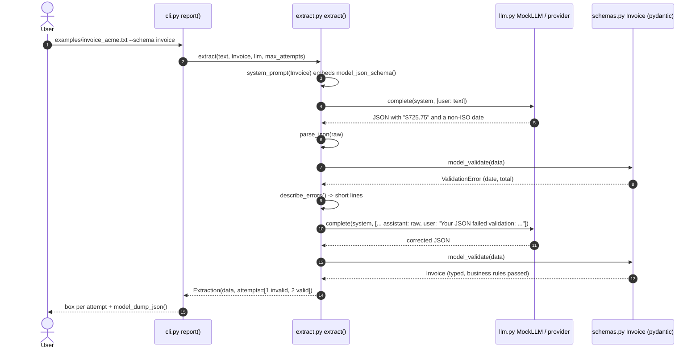

# Architecture · 04 Structured Output Extractor

## Components

| File | Component | Responsibility |
|------|-----------|----------------|
| `src/extractor/cli.py` | `main()`, `report()` | Parse args, run extraction on each document, print every attempt and the validated JSON. |
| `src/extractor/config.py` | `Settings.from_env()` | Typed settings (`LLM_PROVIDER`, `LLM_MODEL`, `EXTRACT_MAX_ATTEMPTS`). Single source of truth. |
| `src/extractor/extract.py` | `extract()`, `system_prompt()`, `parse_json()`, `describe_errors()`, `Extraction`, `Attempt` | Prompt with the JSON Schema, dig JSON out of the reply, validate, and repair with the exact errors. |
| `src/extractor/schemas.py` | `Invoice`, `LineItem`, `SupportTicket`, `SCHEMAS` | Pydantic models are the contract: types, constraints and business rules (totals must add up). |
| `src/extractor/llm.py` | `make_llm()`, `MockLLM`, `AnthropicLLM`, `OpenAILLM` | One `complete(system, messages)` interface; the mock makes realistic first-try mistakes and fixes them when shown errors. |
| `src/extractor/ui.py` | `banner()`, `box()` | Plain-ASCII rendering. |

## Data flow: one full request

## Design decisions

- **The schema is the contract.** The same pydantic model generates the JSON Schema in the prompt and validates the
  reply, so prompt and validator can never disagree.
- **Repair with evidence.** The retry message contains the model's own output and the exact validation errors; vague
  "try again" prompts fix far less.
- **Business rules in the model.** `Invoice.check_business_rules` checks that line items plus tax equal the total;
  type-correct but wrong data still fails.
- **Money is `Decimal`.** Never float; values are quantised to cents.
- **Give up honestly.** After `max_attempts` (env `EXTRACT_MAX_ATTEMPTS`, default 3) the result is `data=None` and the
  CLI routes it to human review instead of passing on bad data.
- **Tolerant parsing, strict validation.** `parse_json()` accepts fences and chatter around the object; the schema
  forbids extra fields.

## Failure modes and handling

| Failure | Handling |
|---------|----------|
| Reply has no JSON / invalid JSON | `invalid JSON: ...` error, fed back for repair. |
| Wrong types or formats (`$725.75`, a non-ISO date) | Pydantic errors via `describe_errors()`, fed back for repair. |
| Numbers don't add up | Business-rule error; if the source document itself is wrong, it never validates and goes to review. |
| Model invents extra fields | `extra="forbid"` rejects them. |
| Repairs exhausted | `Extraction(data=None)`; CLI prints `FAILED: send to a human for review`. |
| Unknown `LLM_PROVIDER` / bad `EXTRACT_MAX_ATTEMPTS` | `Settings.from_env()` raises `ValueError`. |

## How to extend

- **New document type:** add a pydantic model to `schemas.py` and register it in `SCHEMAS`; the CLI's `--schema` picks
  it up.
- **Native structured output:** pass the JSON Schema to a provider's structured-output mode; keep validation anyway.
- **Confidence and provenance:** add fields for source spans so reviewers can see where each value came from.
- **Batch mode:** run `extract()` over a folder and write valid results to JSONL and failures to a review queue.
