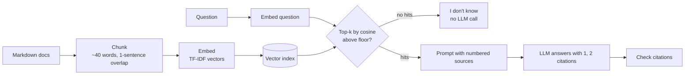
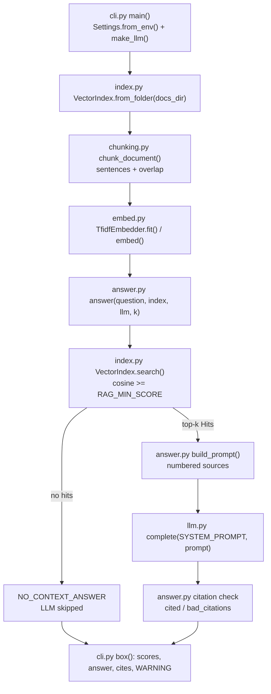

# 05 · RAG from Scratch

Answer questions from your own documents with citations (chunk → embed → retrieve → answer), no vector database
needed, in ~400 lines of Python.

**Level:** Beginner

**You'll learn:**
- **Chunking**: split documents into sentence-aligned pieces with overlap
- **Embedding**: turn text into vectors locally with **TF-IDF**, and why rare words matter more
- **Retrieval**: cosine similarity, top-k, and a **similarity floor** that lets the system say "I don't know"
- **Grounded prompting**: numbered sources, mandatory citations, no outside knowledge
- **Citation checking**: catch answers that cite sources that don't exist

## Why this matters

A coffee shop's support inbox gets the same questions every day: refunds, shipping, subscriptions. The answers are
already written in the help center, but the model has never read it. Retrieval-Augmented Generation (RAG) finds the
right paragraphs and hands them to the model with the question, so answers come from *your* documents and point to
where they came from. Internal wikis, legal search, HR policy bots and support assistants all start like this.

## Architecture



Indexing happens once: documents are split into chunks, and each chunk becomes a sparse TF-IDF vector. At question time
the question is embedded the same way and compared to every chunk. Chunks under the similarity floor are dropped. If
nothing survives, the system answers "I don't know" without calling the model at all. Otherwise the top chunks go into
the prompt as numbered sources, the model answers with `[n]` citations, and the code checks that every citation points
at a real source.

## Flow



Each box is a real function, in the order RAG runs: chunk, embed, retrieve, answer. See
[docs/ARCHITECTURE.md](docs/ARCHITECTURE.md) for the sequence diagram and failure modes.

## Project structure

```
05-rag-from-scratch/
├── README.md                 # this tutorial
├── VIDEO.md                  # hooks + flow steps for the video
├── docs/ARCHITECTURE.md      # components, sequence diagram, design decisions, failure modes
├── pyproject.toml            # package metadata, `rag` script, pytest + ruff config
├── requirements.txt          # pinned deps (runtime is stdlib only)
├── Makefile                  # install / test / demo / ask / lint / docker / clean
├── Dockerfile                # python:3.12-slim, non-root, runs the demo
├── .dockerignore / .gitignore
├── .env.example              # every setting the code reads
├── demo.py                   # one-command demo, no install needed
├── src/rag/
│   ├── __init__.py           # __version__
│   ├── __main__.py           # `python -m rag`
│   ├── cli.py                # argparse entry: index docs, answer questions, show citations
│   ├── config.py             # Settings.from_env(): provider, docs dir, top-k, chunk size, score floor
│   ├── chunking.py           # step 1: sentence-packed chunks with overlap
│   ├── embed.py              # step 2: local TF-IDF embedder + cosine
│   ├── index.py              # step 3: VectorIndex.search() with a similarity floor
│   ├── answer.py             # step 4: prompt with numbered sources, verify citations
│   ├── llm.py                # extractive MockLLM + optional Anthropic / OpenAI
│   └── ui.py                 # ASCII banner and boxes
├── tests/
│   ├── test_rag.py           # unit tests: chunking, TF-IDF, retrieval, citations
│   └── test_e2e.py           # end-to-end demo flow + config
└── examples/
    ├── docs/                 # 4 help-centre pages (refunds, shipping, subscriptions, brewing)
    └── questions.txt         # the demo questions
```

Shortcuts: `make test`, `make demo`, `make ask Q="How long should I steep a French press?"`. Container:
`docker build -t rag-from-scratch . && docker run --rm rag-from-scratch`. The image runs the offline `MockLLM`; for a
real model, build with `--build-arg PROVIDER_SDK=anthropic` and run with
`-e LLM_PROVIDER=anthropic -e ANTHROPIC_API_KEY=...`.

## Quickstart

**Windows (PowerShell)**
```powershell
cd projects/05-rag-from-scratch
python -m venv .venv; .\.venv\Scripts\Activate.ps1
pip install -r requirements.txt
python demo.py
python -m pytest -q
```

**macOS / Linux**
```bash
cd projects/05-rag-from-scratch
python3 -m venv .venv && source .venv/bin/activate
pip install -r requirements.txt
python demo.py
python -m pytest -q
```

Expected output (shortened):
```
Indexed 4 documents -> 12 chunks -> 118 distinct terms

+-- Q2 ----------------------------------------------------------------------+
| question : Do you ship to Canada, and how long does international delivery |
|            take?                                                           |
| retrieve : [1] 0.52 ######...... shipping.md#1                             |
|            [2] 0.34 ####........ shipping.md#2                             |
|            [3] 0.24 ###......... shipping.md#0                             |
| answer   : International delivery takes 7 to 12 business days and costs a  |
|            flat $15. [1] We ship to Canada and the United Kingdom. [1]     |
| cites    : shipping.md#1: "Standard shipping in the United States takes 3  |
|            to 5 business days ... International delivery takes 7 to 12 ..."|
+----------------------------------------------------------------------------+
+-- Q4 ----------------------------------------------------------------------+
| question : What is your CEO's favourite film?                              |
| retrieve : no chunk above the similarity floor -> skip the LLM entirely    |
| answer   : I don't know -- nothing in the documents matches that question. |
+----------------------------------------------------------------------------+
```

Your own question: `python demo.py "How long should I steep a French press?"`.
Your own docs: `python demo.py --docs path/to/folder "your question"` (any folder of `.md` files).

## How it works

**1. Chunk** (`chunking.py`). Pack whole sentences into chunks of at most `max_words`. Carry the last sentence into the
next chunk, so a fact on a boundary survives intact:

```python
for sentence in split_sentences(text):
    if current and _word_count(current + [sentence]) > max_words:
        groups.append(current)
        carry = current[-overlap:] if overlap else []
        current = carry if _word_count(carry + [sentence]) <= max_words else []
    current.append(sentence)
```

Chunk ids like `shipping.md#1` are stable and human-readable, which makes citations useful.

**2. Embed** (`embed.py`). TF-IDF: a word counts for more when it's frequent in this chunk but rare across the corpus.
Vectors are L2-normalised, so cosine similarity is just a dot product:

```python
self.idf = {term: math.log((1 + n) / (1 + df)) + 1 for term, df in doc_freq.items()}
...
return _normalise({t: c * self.idf[t] for t, c in counts.items() if t in self.idf})
```

The tokenizer drops stopwords and applies a tiny stemmer (`shipping → ship`, `returned → return`), so the question and
the docs meet halfway.

**3. Retrieve** (`index.py`). Score every chunk, keep those above `min_score`, return the top `k`. A brute-force scan is
fine for thousands of chunks. Vector databases exist for millions.

**4. Answer with citations** (`answer.py`):

```python
hits = index.search(question, k)
if not hits:
    return Answer(NO_CONTEXT_ANSWER)          # no context, no model call, no hallucination
reply = llm.complete(SYSTEM_PROMPT, [{"role": "user", "content": build_prompt(question, hits)}])
numbers = sorted({int(n) for n in re.findall(r"\[(\d+)\]", reply)})
cited = [hits[n - 1] for n in numbers if 1 <= n <= len(hits)]
bad = [n for n in numbers if not 1 <= n <= len(hits)]
```

The prompt lists sources as `[1] (shipping.md#1) ...text...` and the system prompt says: use only these, cite every
claim, say you don't know otherwise.

**5. An extractive mock** (`llm.py`). `MockLLM` quotes the source sentences that best match the question, weighting rare
matching words higher, and cites them. It only uses what's in the prompt, like a well-behaved real model.

## Build it yourself

1. **Collect documents.** Put a few `.md` help pages in `examples/docs/`. Write 3–4 questions, including one the docs
   can't answer.
2. **Write `split_sentences()` and `chunk_document()`.** Check that no chunk exceeds the limit and that the overlap
   sentence repeats. Why sentence-aligned: half-sentences retrieve badly and read badly.
3. **Write `tokenize()`**: lowercase, split, drop stopwords, stem.
4. **Write `TfidfEmbedder`** with `fit()` (document frequencies → IDF) and `embed()` (TF × IDF, normalised), plus
   `cosine()` over sparse dicts.
5. **Write `VectorIndex`** with `from_folder()` and `search(query, k, min_score)`. Print scores for your questions and
   tune `min_score` until the unanswerable one returns nothing.
6. **Write `build_prompt()` and `answer()`**: numbered sources, the grounding system prompt, the no-context shortcut,
   and the citation check.
7. **Write `MockLLM`** as an extractive answerer so the pipeline runs offline.
8. **Draw the trace**: retrieval scores as bars, the answer, the cited chunk text.
9. **Test each stage**: chunk sizes, TF-IDF ranking, retrieval hits, the no-call path, and invented citations.

## Use a real LLM

```bash
pip install anthropic                     # or: pip install openai
export LLM_PROVIDER=anthropic             # PowerShell: $env:LLM_PROVIDER="anthropic"
export ANTHROPIC_API_KEY=sk-ant-...       # PowerShell: $env:ANTHROPIC_API_KEY="sk-ant-..."
python demo.py
```

Retrieval stays local and free. Only the final answer uses the model. `LLM_PROVIDER=openai` uses `OPENAI_API_KEY`.
`LLM_MODEL` overrides the model (defaults: `claude-opus-5-5`, `gpt-4.1-mini`). The Claude backend enables server-side
refusal fallbacks (`fallbacks: "default"`). Never commit keys.

## Production notes / pitfalls

- **Retrieval quality caps answer quality.** If the right chunk isn't retrieved, no model can answer well. Build a small
  eval set of question → expected chunk, and measure recall@k before touching the prompt.
- **TF-IDF matches words, not meaning.** "Send back" won't match "return". Neural embeddings fix that. Hybrid search
  (keywords + embeddings) is a strong production default.
- **Tune chunk size and the floor on your data.** Chunks that are too small lose context. Chunks that are too large
  dilute the score and cost more tokens.
- **Documents can contain instructions.** A retrieved page saying "ignore previous instructions" is a prompt-injection
  vector. Treat sources as data (project 13).
- **Re-index when docs change**, and keep chunk ids stable so old citations still resolve.

## Extend it

1. **Hashing vectors:** replace the TF-IDF vocabulary with feature hashing (`hash(term) % 2**18`), so new documents can
   be added without refitting.
2. **Persist the index** to JSON and load it at startup instead of re-embedding every run.
3. **Real embeddings:** swap `TfidfEmbedder` for an embedding API behind the same `embed()` interface, and compare
   recall on your questions.

**Next project:** [06 · Web research agent](../06-web-research-agent/README.md). Multi-step research over many sources,
with a cited brief.

---
Part of [AI Agent Builds](../../README.md) by [exe_404.ai](https://www.youtube.com/@exe_404ai) — one agentic-AI project a day.
