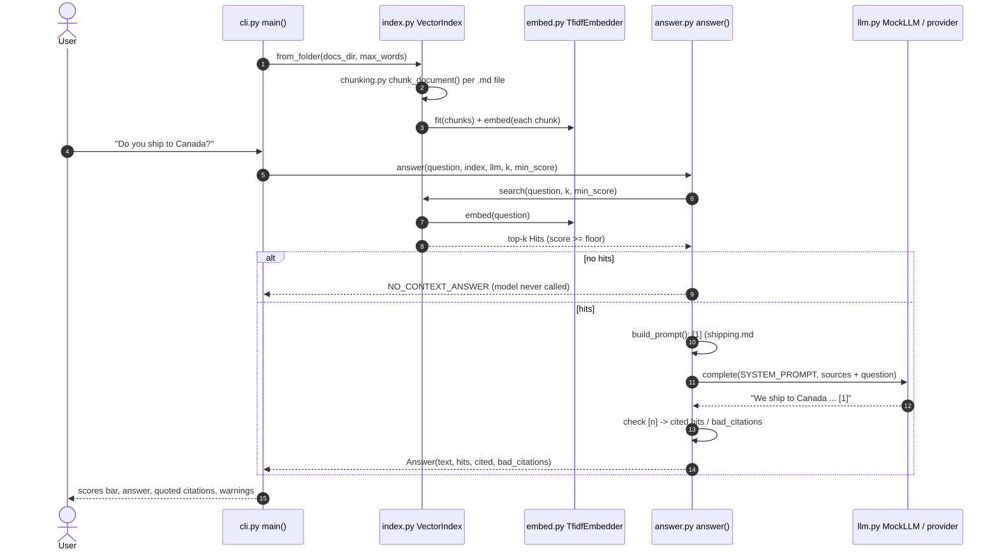

# Architecture · 05 RAG from Scratch

## Components

| File | Component | Responsibility |
|------|-----------|----------------|
| `src/rag/cli.py` | `main()`, `bar()` | Parse args, build the index, answer each question showing retrieval scores and citations. |
| `src/rag/config.py` | `Settings.from_env()` | Typed settings (`LLM_PROVIDER`, `LLM_MODEL`, `RAG_DOCS_DIR`, `RAG_TOP_K`, `RAG_CHUNK_WORDS`, `RAG_MIN_SCORE`). |
| `src/rag/chunking.py` | `chunk_document()`, `split_sentences()`, `Chunk` | Step 1: pack whole sentences into small chunks with one sentence of overlap; stable ids like `shipping.md#1`. |
| `src/rag/embed.py` | `TfidfEmbedder`, `tokenize()`, `cosine()` | Step 2: local TF-IDF vectors (stopwords, tiny stemmer), L2-normalised sparse dicts. |
| `src/rag/index.py` | `VectorIndex.from_folder()`, `VectorIndex.search()`, `Hit` | Step 3: one vector per chunk; rank by cosine above a similarity floor. |
| `src/rag/answer.py` | `answer()`, `build_prompt()`, `Answer` | Step 4: numbered sources in the prompt, call the model, verify every `[n]` citation. |
| `src/rag/llm.py` | `make_llm()`, `MockLLM`, `AnthropicLLM`, `OpenAILLM` | One `complete(system, messages)` interface; the mock is extractive and cites what it quotes. |
| `src/rag/ui.py` | `banner()`, `box()` | Plain-ASCII rendering. |

## Data flow: one full request

## Design decisions

- **Retrieval you can read.** TF-IDF needs no model download and its scores are explainable; swapping in neural
  embeddings changes only `embed.py`.
- **Sentence-packed chunks with overlap.** Whole sentences keep claims intact; one sentence of overlap means a fact on a
  boundary survives in at least one chunk.
- **Stable, human-readable chunk ids.** `refund-policy.md#2` is citable and debuggable.
- **No context, no call.** If nothing passes `min_score`, `answer()` returns a fixed "I don't know" without calling the
  model: the cheapest hallucination guard there is.
- **Verify citations.** Every `[n]` in the reply is checked against the sources actually sent; invented numbers are
  reported as `bad_citations`.

## Failure modes and handling

| Failure | Handling |
|---------|----------|
| Question unrelated to the docs | No hit above `RAG_MIN_SCORE` -> fixed refusal, no model call. |
| Retrieved chunks don't contain the answer | The prompt tells the model to say it doesn't know; the mock does exactly that. |
| Model cites a source that wasn't provided | Listed in `bad_citations`; the CLI prints a `WARNING` row. |
| Fact split across chunk boundary | Sentence overlap keeps it whole in one chunk. |
| Empty or missing docs folder | Index has no chunks; every question gets the no-context answer. |
| Bad `RAG_*` values | `Settings.from_env()` raises `ValueError` naming the variable. |

## How to extend

- **Neural embeddings:** implement `fit()`/`embed()` with an embedding API and keep `cosine()`.
- **Persist the index:** save chunks and vectors to JSON or SQLite so large corpora don't re-index on every run.
- **Hybrid search and reranking:** combine TF-IDF with embeddings, then rerank the top 20 before taking `k`.
- **Evals:** build a question -> expected-source set and measure retrieval hit rate when you change chunk size.
