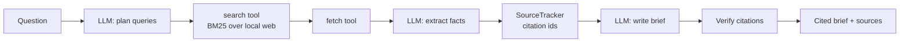
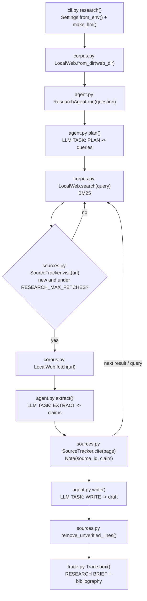

# 06 · Web Research Agent

Build an agent that plans searches, reads pages, tracks every source and writes a cited research brief, in ~450 lines of plain Python.

**Level:** Beginner

**You'll learn:**
- How a research agent breaks one question into several search queries
- How to build a tiny search engine (BM25) and a `fetch()` tool over a local "web"
- How to tie every extracted fact to a source and give it a stable citation number
- How to verify citations so a hallucinated `[42]` never reaches the reader
- Why a fetch budget and duplicate-skipping matter in real agents

## Why this matters

A consultant asked "Should our client switch its offices to heat pumps?" does not read one page. They run several searches, open the promising results, take notes with the source next to each note, ignore the off-topic pages and treat opinion pieces with care. Then they write a short brief where every claim can be checked. "Deep research" features in AI products work the same way. This project builds that workflow so you can see each step.

## Architecture



The code owns the loop and the budget, and the model makes the judgement calls. The planner turns the question into 2–4 queries covering the topic, the evidence and the drawbacks. For each query the agent searches, skips pages it has already read, fetches new ones and asks the model to copy out the facts that matter. A page only gets a citation number if it contributed a fact. The writer may only use the numbered notes, and a final check removes any line that cites a source the agent never read.

## Flow



Each box is a real function: `ResearchAgent.run()` drives the loop, `SourceTracker` keeps it honest. See
[docs/ARCHITECTURE.md](docs/ARCHITECTURE.md) for the sequence diagram and failure modes.

## Project structure

```
06-web-research-agent/
├── README.md                 # this tutorial
├── VIDEO.md                  # hooks + flow steps for the video
├── docs/ARCHITECTURE.md      # components, sequence diagram, design decisions, failure modes
├── pyproject.toml            # package metadata, `research-agent` script, pytest + ruff config
├── requirements.txt          # pinned deps (runtime is stdlib only)
├── Makefile                  # install / test / demo / ask / lint / docker / clean
├── Dockerfile                # python:3.12-slim, non-root, runs the demo
├── .dockerignore / .gitignore
├── .env.example              # every setting the code reads
├── demo.py                   # one-command demo, no install needed
├── src/research_agent/
│   ├── __init__.py           # public API + __version__
│   ├── __main__.py           # `python -m research_agent`
│   ├── cli.py                # argparse entry: question, --web-dir, --max-fetches
│   ├── config.py             # Settings.from_env(): provider, web dir, results per query, fetch budget
│   ├── agent.py              # ResearchAgent: plan -> search -> fetch -> extract -> write -> verify
│   ├── corpus.py             # LocalWeb: BM25 search + fetch over examples/web
│   ├── sources.py            # SourceTracker: citation ids, bibliography, citation check
│   ├── llm.py                # MockResearchLLM + optional Anthropic / OpenAI
│   └── trace.py              # tagged ASCII trace and boxes
├── tests/
│   ├── conftest.py           # `web` fixture over examples/web
│   ├── test_corpus.py        # unit tests: tokenizer, BM25, fetch
│   ├── test_agent.py         # unit tests: citations, budget, hallucination removal
│   └── test_e2e.py           # end-to-end demo flow + config
└── examples/web/             # 7 local pages: studies, guides, a rebate page, an opinion piece
```

Shortcuts: `make test`, `make demo`, `make ask Q="How much do heat pumps cost to install?"`. Container:
`docker build -t web-research-agent . && docker run --rm web-research-agent`. The image runs the offline mock; for a
real model, build with `--build-arg PROVIDER_SDK=anthropic` and run with
`-e LLM_PROVIDER=anthropic -e ANTHROPIC_API_KEY=...`.

## Quickstart

Windows (PowerShell):
```powershell
cd projects/06-web-research-agent
python -m venv .venv; .venv\Scripts\Activate.ps1
pip install -r requirements.txt
python demo.py
python -m pytest -q
```

macOS / Linux:
```bash
cd projects/06-web-research-agent
python3 -m venv .venv && source .venv/bin/activate
pip install -r requirements.txt
python demo.py
python -m pytest -q
```

Expected output (shortened):
```
[think ] plan -> 3 search queries
         1. heat pump cold climate
         2. heat pump cold climate evidence study
         3. heat pump cold climate cost drawbacks
[tool  ] search("heat pump cold climate evidence study")
          3.69  https://coldclimate-lab.example.org/field-study-2025
          1.78  https://hottakes.example.net/heat-pumps-fail
[read  ] fetch https://coldclimate-lab.example.org/field-study-2025  -> source [3] (study)
         "Across all homes, cold-climate heat pumps kept an average COP above 1.8 down to
         -20 C outdoor temperature."
[skip  ] already read https://hottakes.example.net/heat-pumps-fail
[check ] citations verified: 5 sources, 0 unsupported line(s) removed
| Key findings                                                                           |
| - Across all homes, cold-climate heat pumps kept an average COP above 1.8 down to -20  |
|   C outdoor temperature. [3]                                                           |
| Contested claims                                                                       |
| - Everyone knows heat pumps stop working once it drops below freezing in a cold        |
|   climate. [1] (opinion piece; check against the studies)                              |
```

Ask your own question: `python demo.py "How much do heat pumps cost to install?"`

## How it works

**1. A local web you can search** (`corpus.py`). Each page in `examples/web/` has a URL, title, type and body. `LocalWeb.search()` ranks pages with BM25, a classic formula that rewards rare query words and doesn't over-reward long pages:

```python
score += self._idf(term) * f * (self.k1 + 1) / norm
```

**2. A plan from the model** (`agent.py`). The planner gets a `TASK: PLAN` system prompt and must reply with JSON, which we parse defensively with `extract_json()`:

```python
queries = extract_json(self.llm.complete(PLAN_SYSTEM, f"Question: {question}"))["queries"]
```

**3. Read, extract and cite.** The agent visits each result once, within a fetch budget. A page gets a citation number only if the extractor found facts on it, so off-topic pages never show up in the sources list:

```python
if not tracker.visit(result.url):          # dedupe
    continue
claims = self.extract(question, query, page)
source_id = tracker.cite(page)             # [1], [2], ...
```

**4. Write from notes only, then verify.** The writer sees notes like `[3] (study) Across all homes...`. Afterwards `SourceTracker.remove_unverified_lines()` drops any line citing an unknown number. `tests/test_agent.py::LyingLLM` proves a hallucinated `[42]` is removed.

**5. Source type matters.** Pages carry a `Type:` (guide, study, news, opinion). The writer is told to put opinion claims under "Contested claims", so the brief does not present a rant with the same weight as a 40-home field study.

The "plan → gather → synthesise with citations" shape is the standard pattern described in public write-ups of deep-research agents. The code here is original.

## Build it yourself

1. **Make the folder.** Create `src/research_agent/`, `tests/`, `examples/web/`. Add 5–7 small `.txt` pages with `URL:`, `Title:`, `Type:` headers, a blank line and a body. Include one off-topic page and one opinion page so the agent has something to filter.
2. **Write `trace.py`.** A `Trace` class with `box()` and `event()` that prints aligned `[tag   ] text` lines. Build it first, because every later step uses it.
3. **Write `corpus.py`.** `tokenize()` (lowercase, stopwords, naive plural stripping), `parse_page()`, and `LocalWeb` with BM25 `search()` and `fetch()`. Test it alone: the evidence query should rank the field study first.
4. **Write `sources.py`.** `SourceTracker.visit()` for dedupe, `cite()` for stable numbers, `remove_unverified_lines()` for the citation check.
5. **Write `llm.py`.** Define the `complete(system, prompt)` interface, the `extract_json()` helper and `MockResearchLLM`, which answers `TASK: PLAN`, `TASK: EXTRACT` and `TASK: WRITE` with simple rules.
6. **Write `agent.py`.** Put the three system prompts at the top, then `ResearchAgent.run()`: plan → for each query search → fetch → extract → cite → write → verify.
7. **Write `demo.py`.** It loads the corpus, builds the agent with `make_llm()` and a printing `Trace`, and runs a default question.
8. **Write tests.** Check that every citation is real, opinion claims are flagged, the budget holds, and a lying model's fake citation is removed.

## Use a real LLM

```bash
pip install anthropic                 # or: pip install openai
export LLM_PROVIDER=anthropic         # PowerShell: $env:LLM_PROVIDER="anthropic"
export ANTHROPIC_API_KEY=...          # PowerShell: $env:ANTHROPIC_API_KEY="..."
python demo.py
```

`LLM_MODEL` overrides the model (default `claude-opus-5-5` for Anthropic, `gpt-4.1-mini` for OpenAI). The prompts already ask for JSON, and `extract_json()` handles models that wrap JSON in prose. To search the real web, replace `LocalWeb` with a class that has the same `search()` and `fetch()` methods backed by a search API.

## Production notes / pitfalls

- **Treat page content as untrusted input.** A real web page can contain "ignore previous instructions". Keep fetched text in the user message, never in the system prompt (project 13 covers this in depth).
- **Budget everything.** Fetches, tokens and wall-clock time. Long pages should be chunked and only relevant chunks sent to the model.
- **Verify, don't trust, citations.** The deterministic check here is cheap. A stronger check also confirms that the cited sentence actually appears on the page.
- **Source quality is a signal, not a filter.** Downranking opinion pieces is good. Silently dropping them can hide real disagreement.
- **Cache fetches** by URL with a TTL. Research agents revisit the same pages constantly.

## Extend it

1. Add a "gap check" step: after reading, ask the model which sub-question is still unanswered and run one more search.
2. Verify quotes: confirm each extracted claim appears verbatim in the page body before citing it.
3. Add a `published:` date to pages and prefer recent sources for time-sensitive questions.

**Next project: 07 · Agent Memory Systems**, which gives an agent a short-term buffer, a long-term SQLite memory and relevance-based recall.

---
Part of [AI Agent Builds](../../README.md) by [exe_404.ai](https://www.youtube.com/@exe_404ai) — one agentic-AI project a day.
