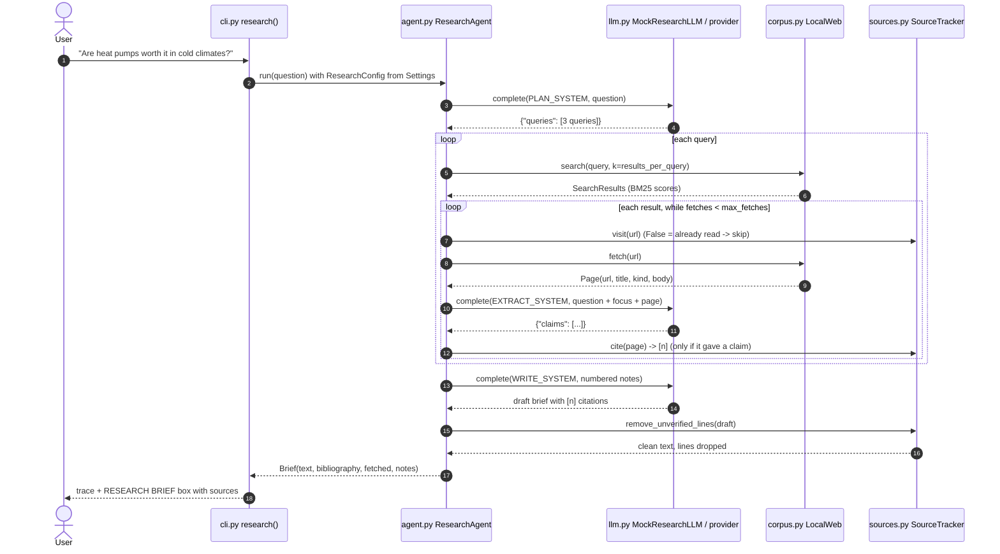

# Architecture · 06 Web Research Agent

## Components

| File | Component | Responsibility |
|------|-----------|----------------|
| `src/research_agent/cli.py` | `main()`, `research()` | Parse args, load settings, build `LocalWeb` + LLM + `ResearchAgent`, run one question. |
| `src/research_agent/config.py` | `Settings.from_env()`, `Settings.research_config()` | Typed settings (`LLM_PROVIDER`, `LLM_MODEL`, `RESEARCH_WEB_DIR`, `RESEARCH_RESULTS_PER_QUERY`, `RESEARCH_MAX_FETCHES`). |
| `src/research_agent/agent.py` | `ResearchAgent.run()`, `plan()`, `extract()`, `write()`, `ResearchConfig`, `Brief` | The workflow: plan queries, search, fetch within budget, extract notes, write, verify. |
| `src/research_agent/corpus.py` | `LocalWeb.search()` (BM25), `LocalWeb.fetch()`, `Page`, `PageNotFound` | The offline "web": `.txt` pages with URL, title and kind, searchable and fetchable. |
| `src/research_agent/sources.py` | `SourceTracker`, `Note`, `CITATION` | Visited URLs, stable citation numbers, bibliography, and removal of lines citing unknown sources. |
| `src/research_agent/llm.py` | `make_llm()`, `MockResearchLLM`, `AnthropicLLM`, `OpenAILLM`, `extract_json()` | One `complete(system, prompt)` interface; the mock answers each `TASK:` (PLAN / EXTRACT / WRITE) by rules. |
| `src/research_agent/trace.py` | `Trace.event()`, `Trace.box()` | Tagged, aligned ASCII trace lines (`[think ]`, `[tool  ]`, `[read  ]`, `[skip  ]`, `[check ]`). |

## Data flow: one full request

## Design decisions

- **Workflow-shaped agent.** The code owns the loop, order and budget; the model owns judgement (which queries, which
  facts, how to phrase). This is predictable and cheap compared with a free-form tool loop.
- **Cite on contribution.** A page gets a number only if it yielded a claim, so the bibliography lists only sources
  that actually support the brief.
- **Verify, don't trust.** `SourceTracker.remove_unverified_lines()` drops any line citing a number the agent never
  assigned, so hallucinated citations can't reach the reader.
- **Opinion vs evidence.** Page `kind` travels with each note; the writer puts opinion-sourced claims under
  "Contested claims".
- **Budget and dedupe.** `max_fetches` caps cost and latency; `visit()` skips URLs already read.
- **Pluggable web.** Anything with `search()` and `fetch()` can replace `LocalWeb`, such as a real search API.

## Failure modes and handling

| Failure | Handling |
|---------|----------|
| Model invents a citation (`[42]`) | The line is removed; the trace reports how many lines were dropped. |
| Page has nothing relevant | `no relevant facts -> not cited`; it uses budget but gets no citation number. |
| Same page found by several queries | `[skip  ] already read ...`; fetched once. |
| Budget exhausted | `[skip  ] budget reached, not fetching ...`; the agent writes from what it has. |
| Query matches nothing | `(no results)` in the trace; the next query continues. |
| Unknown URL | `LocalWeb.fetch()` raises `PageNotFound`. |
| Model wraps JSON in prose | `extract_json()` pulls out the first JSON object. |
| Claude refuses | `AnthropicLLM` raises `RuntimeError("model declined the request")`. |
| Bad `LLM_PROVIDER` / `RESEARCH_*` values | `Settings.from_env()` raises `ValueError` naming the variable. |

## How to extend

- **Real web:** implement `search()`/`fetch()` over a search API plus an HTML-to-text step; keep `Page.kind` labels.
- **Follow-up queries:** after extraction, ask the model which gaps remain and plan a second round within the budget.
- **Source quality scores:** weight claims by `kind` and recency, and show confidence per finding.
- **Parallel fetching:** fetches within one query are independent, so they can run concurrently.
