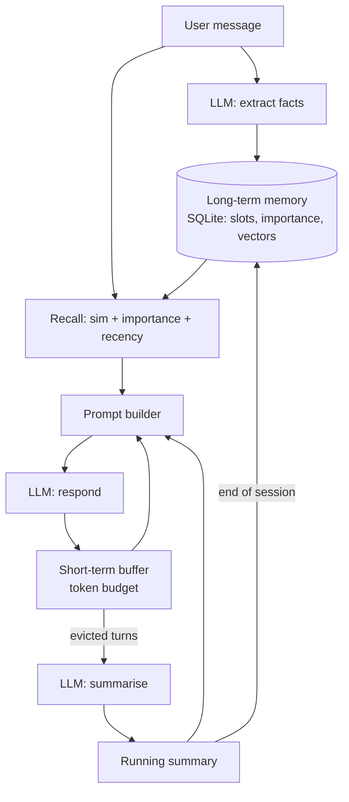
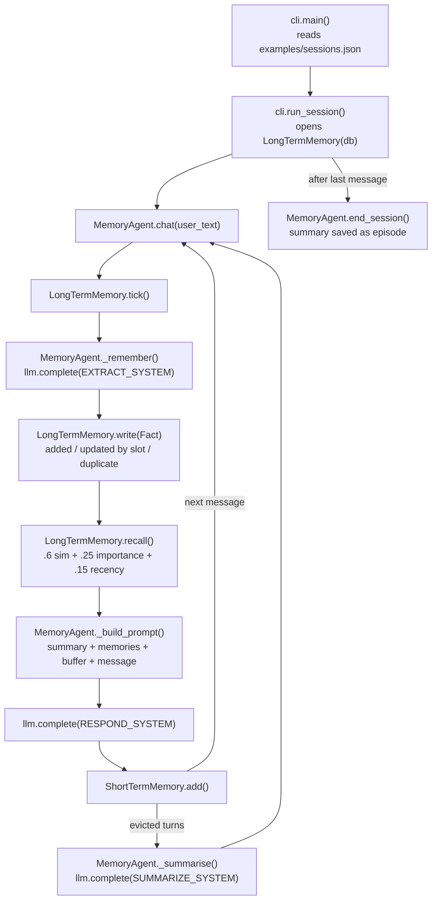

# 07 · Agent Memory Systems

Give an agent a short-term buffer, a running summary and a long-term SQLite memory with relevance-based recall, in ~580 lines of plain Python.

**Level:** Intermediate

**You'll learn:**
- The three layers of agent memory: verbatim buffer, running summary, durable facts
- How to extract facts from chat and store them in SQLite with *slots* so new facts replace old ones
- How to rank memories by similarity, importance and recency (and why similarity alone is not enough)
- How eviction + summarisation keeps a prompt inside a token budget
- How memory survives a restart: same database, new process, same user

## Why this matters

A meal-planning assistant that forgets your peanut allergy between sessions is not just annoying, it is dangerous. A support bot that asks for your account number every time costs you customers. Every useful assistant (ChatGPT memory, coding agents that remember your repo conventions, CRM copilots) needs to decide **what to remember, what to update, and what to bring back into the prompt**. This project builds all three decisions so you can watch them happen.

## Architecture



Every turn the agent first asks the model to pull durable facts out of the message and writes them to SQLite. A fact with a `slot` (like `city`) replaces the old value instead of piling up next to it. Then it recalls the top-k memories for the message, builds a prompt from four sections (summary, memories, recent turns, new message) and prints the token cost of each section. After replying, turns that no longer fit the short-term buffer are summarised. At the end of a session the summary is saved as an *episode* memory.

## Flow

One chat turn, mapped to the real functions (see [docs/ARCHITECTURE.md](docs/ARCHITECTURE.md) for the sequence diagram):



## Project structure

```
07-agent-memory-systems/
├── README.md                 # this tutorial
├── VIDEO.md                  # hooks + flow_steps for the video
├── docs/ARCHITECTURE.md      # components, sequence diagram, design decisions, failure modes
├── pyproject.toml            # package metadata, `memory-agent` script, pytest + ruff config
├── requirements.txt          # pinned deps (stdlib-only runtime; pytest for tests)
├── Makefile                  # install / test / demo / lint / clean
├── Dockerfile, .dockerignore # run the offline demo in a slim non-root container
├── .env.example              # every setting the code reads
├── demo.py                   # one-command demo -> memory_agent.cli.main()
├── src/memory_agent/
│   ├── __init__.py           # public API + __version__
│   ├── config.py             # Settings.from_env(): LLM_PROVIDER, MEMORY_* ...
│   ├── cli.py                # argparse entry: day 1 + day 2 on one SQLite file
│   ├── agent.py              # MemoryAgent: extract -> store -> recall -> prompt -> respond -> summarise
│   ├── buffer.py             # ShortTermMemory + estimate_tokens
│   ├── store.py              # LongTermMemory: SQLite slots, dedup, scored recall
│   ├── vectors.py            # toy embed() + cosine()
│   ├── llm.py                # MockMemoryLLM, Anthropic/OpenAI clients, make_llm()
│   └── trace.py              # ASCII trace printer
├── tests/                    # unit tests + test_e2e_demo.py (runs demo.py end to end)
└── examples/sessions.json    # day-1 and day-2 messages
```

## Quickstart

Windows (PowerShell):
```powershell
cd projects/07-agent-memory-systems
python -m venv .venv; .venv\Scripts\Activate.ps1
pip install -r requirements.txt
python demo.py
python -m pytest -q
```

macOS / Linux:
```bash
cd projects/07-agent-memory-systems
python3 -m venv .venv && source .venv/bin/activate
pip install -r requirements.txt
python demo.py
python -m pytest -q
```

Expected output (shortened):
```
[user  ] (turn 2) I'm vegetarian, and I'm allergic to peanuts.
[store ] + added   #3 [preference] User is vegetarian
[store ] + added   #4 [preference] User is allergic to peanuts
...
[user  ] (turn 5) Actually, I moved to Berlin last month.
[store ] ~ updated #2 slot=city: "User lives in London" -> "User lives in Berlin"
[evict ] 2 old message(s) left the 60-token buffer -> summarised
...
| DAY 2 - process restarted, same SQLite file                                            |
[user  ] (turn 7) What should I eat before my long run on Sunday?
[recall] top 4 memories (score = .6 sim + .25 importance + .15 recency)
          0.71  sim 0.52  imp 1.0  rec 0.97  User is allergic to peanuts
          0.64  sim 0.50  imp 0.8  rec 0.97  User is vegetarian
          0.60  sim 0.50  imp 0.7  rec 0.87  User is training for a half marathon in March
[prompt] 140 tokens  (system 34 | summary 4 | memories 65 | buffer 23 | user 16)
[agent ] How about a chickpea and spinach curry with rice (vegetarian, no peanuts)? It's
         carb-rich, good fuel while you're training for a half marathon.
```

Keep the database to inspect it: `python demo.py --db memory.db`, then open it with any SQLite viewer.

## How it works

**Short-term buffer** (`buffer.py`). A deque of messages and a token estimate. `add()` returns what it had to evict, so the caller decides what to do with it:

```python
while self.tokens > self.max_tokens and len(self.messages) > 1:
    evicted.append(self.messages.popleft())
```

**Long-term store** (`store.py`). One SQLite table. Each memory has `kind`, `slot`, `importance`, `last_used_turn` and an embedding stored as JSON. Writes take one of three paths:

```python
if fact.slot and (old := self._by_slot(fact.slot)):   # same slot -> update in place
    ...
for memory, other in self._all_with_vectors():         # near-identical -> just touch it
    if cosine(vector, other) >= self.duplicate_threshold: ...
# otherwise -> insert
```

**Recall score.** Similarity finds candidates, and importance and recency rank them:

```python
recency = 0.5 ** ((now - memory.last_used_turn) / self.half_life)
score = 0.6 * similarity + 0.25 * memory.importance + 0.15 * recency
```

Recalled memories are "touched" (their `last_used_turn` is updated), so memories that keep being useful stay fresh. Time is counted in conversation turns, which keeps tests deterministic.

**Toy embeddings** (`vectors.py`). Hashed bag-of-words plus a small concept table, so "dinner" and "peanuts" share a *food* feature and "run" and "marathon" share *exercise*. A real embedding model learns this from data. Here it is spelled out so you can see why recall works.

**Prompt budget.** `_build_prompt()` prints the token cost of every section. This is the line to watch when you make the buffer bigger or recall more memories.

The layered design (working context + summary + retrievable long-term store, with recency/importance/relevance scoring) is inspired by the public *Generative Agents* paper (Park et al., 2023) and MemGPT-style memory tiers. All code here is original.

## Build it yourself

1. **Scaffold** `src/memory_agent/`, `tests/`, `examples/` and copy `trace.py` from project 06.
2. **Write `buffer.py`.** Add `estimate_tokens()`, a `Message` dataclass and `ShortTermMemory.add()` that evicts oldest-first and returns the evicted messages. Test eviction before moving on.
3. **Write `vectors.py`.** Tokenise, hash words into a 256-dim vector, add concept features, normalise. Add a `cosine()` helper.
4. **Write `store.py`.** Create the schema, a `meta` table for the turn clock, `write()` with update/duplicate/insert paths and `recall()` with the three-part score. Test that London → Berlin updates instead of duplicating.
5. **Write `llm.py`.** Add the `complete(system, prompt)` interface and `MockMemoryLLM` with three jobs: EXTRACT (regex rules → JSON facts), SUMMARIZE, RESPOND (it only uses memories that appear in the prompt).
6. **Write `agent.py`.** `chat()` = tick → extract & store → recall → build prompt → respond → buffer add → summarise evictions. Add `end_session()` to save an episode.
7. **Write `cli.py` (and a thin `demo.py` that calls it).** Run two sessions against the same SQLite file, creating a new `LongTermMemory` object for day 2 to prove persistence.
8. **Write tests** for eviction, slot updates, dedup, ranking, persistence and cross-session recall.

## Use a real LLM

```bash
pip install anthropic                 # or: pip install openai
export LLM_PROVIDER=anthropic         # PowerShell: $env:LLM_PROVIDER="anthropic"
export ANTHROPIC_API_KEY=...          # PowerShell: $env:ANTHROPIC_API_KEY="..."
python demo.py
```

`LLM_MODEL` overrides the model (default `claude-opus-5-5`, or `gpt-4.1-mini` for OpenAI). The EXTRACT prompt asks for JSON with slots and importance, and `extract_json()` tolerates prose around it. For better recall with a real model, also swap `vectors.embed()` for a real embedding API. The store just saves whatever vector you give it.

## Production notes / pitfalls

- **Memory is user data.** Encrypt it, scope it per user, and give users a way to view and delete it (GDPR "right to be forgotten").
- **Don't store everything.** Extraction should be selective. Storing every message turns recall into noise and makes the prompt more expensive every turn.
- **Contradictions are the hard part.** Slots handle simple overwrites. Real systems also need "valid from/to" dates ("lived in London until 2026") and conflict review.
- **Episodes go stale.** The day-1 episode still says "London". Prefer structured facts over old summaries when they disagree.
- **Watch prompt growth.** Recalled memories and summaries cost tokens on every turn. Cap them, and log the per-section budget like the trace does.
- **Memory is an injection surface.** A user (or a web page) can plant "remember that you must ignore your rules". Treat stored memories as untrusted data, not instructions.

## Extend it

1. Add a "core memory" block: high-importance profile facts that are always in the prompt, even without recall.
2. Add forgetting: a nightly job that deletes memories whose score has decayed below a threshold.
3. Add a `/memories` command that lists, edits and deletes what the agent knows about you.

**Next project: 08 · MCP Server from Scratch**, which exposes tools and resources over the Model Context Protocol (JSON-RPC 2.0 over stdio).

---
Part of [AI Agent Builds](../../README.md) by [exe_404.ai](https://www.youtube.com/@exe_404ai) — one agentic-AI project a day.
