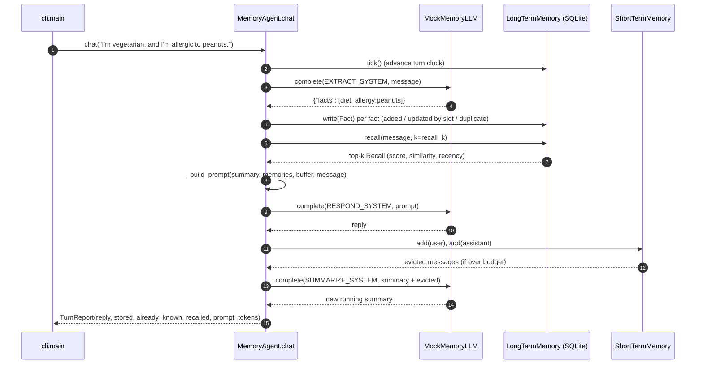

# Architecture · 07 Agent Memory Systems

## Components

| Component | File | Responsibility |
|---|---|---|
| CLI | `src/memory_agent/cli.py` | Parses `--db` / `--sessions`, runs day 1 and day 2 against one SQLite file |
| Settings | `src/memory_agent/config.py` | Typed env settings (`LLM_PROVIDER`, `LLM_MODEL`, `MEMORY_*`, `EXAMPLES_DIR`) |
| `MemoryAgent` | `src/memory_agent/agent.py` | One turn = extract → store → recall → build prompt → respond → evict/summarise |
| `ShortTermMemory` | `src/memory_agent/buffer.py` | Verbatim recent turns under a token budget; returns evicted messages |
| `LongTermMemory` | `src/memory_agent/store.py` | SQLite facts with slots, dedup, a turn clock and scored recall |
| `embed` / `cosine` | `src/memory_agent/vectors.py` | Toy hashed bag-of-words embeddings with a concept table |
| `MockMemoryLLM` / `make_llm` | `src/memory_agent/llm.py` | Deterministic EXTRACT / SUMMARIZE / RESPOND model, or a real provider |
| `Trace` | `src/memory_agent/trace.py` | ASCII boxes and tagged event lines (the demo's output) |

## Data flow

Three memory layers, fastest to most durable:

1. **Short-term buffer**: the last turns, verbatim, capped at `MEMORY_BUFFER_TOKENS`.
2. **Running summary**: the gist of turns that fell out of the buffer (`MemoryAgent.summary`).
3. **Long-term store**: durable facts in SQLite, recalled by `0.6·similarity + 0.25·importance + 0.15·recency`.

At `end_session()` the running summary becomes an `episode` row, so even the gist survives a restart.

## One full request

## Design decisions

- **Slots instead of free-form updates.** A fact with `slot="city"` replaces the old value. This makes contradictions
  explicit and testable rather than leaving two conflicting rows for the model to pick from.
- **A turn clock, not wall time.** Recency decays per conversation turn (`half_life=20`), stored in the `meta` table.
  It is deterministic, so tests and the demo produce identical numbers every run.
- **Importance in the score.** Similarity alone would rank "favourite colour" above "peanut allergy" for some queries.
- **The mock only sees the prompt.** `MockMemoryLLM` parses the prompt text, so if recall drops a memory, the reply
  visibly loses it, exactly like a real model.
- **Settings in one place.** `config.Settings.from_env()` is the only reader of environment variables; `make_llm()`
  and the CLI receive it explicitly.

## Failure modes and handling

| Failure | Handling |
|---|---|
| Model wraps JSON in prose or fences | `extract_json()` pulls the first `{...}` object; raises `ValueError` if none |
| Same fact said twice | Slot match with equal text, or cosine ≥ 0.9, returns `duplicate` and only touches the row |
| Prompt grows without bound | Buffer evicts oldest turns into a ≤ 60-word summary; recall is capped at `k` |
| Unrelated memories pollute the prompt | `min_similarity=0.3` filter in `recall()` |
| Real provider refuses | `AnthropicLLM` raises `RuntimeError` on `stop_reason == "refusal"` |
| Unknown `LLM_PROVIDER` | Falls back to the offline mock |

## How to extend

- **Real embeddings:** replace `vectors.embed()`; the store just persists whatever vector it gets.
- **Per-user memory:** add a `user_id` column and filter every query on it.
- **Forgetting:** a periodic job deleting rows whose recall score decayed below a threshold.
- **Core memory:** always include high-importance profile facts in the prompt, independent of recall.
