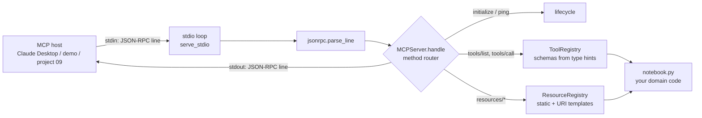
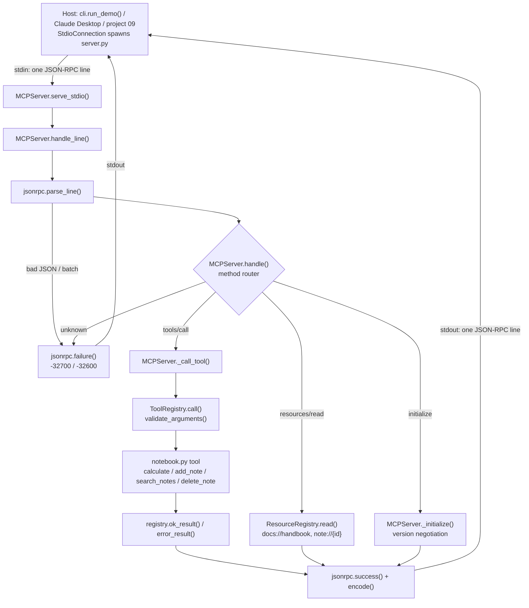

# 08 · MCP Server from Scratch

Build a real Model Context Protocol server (JSON-RPC 2.0 over stdio, tools + resources) that Claude Desktop, Claude Code and the official MCP SDKs can talk to, in ~550 lines of standard-library Python.

**Level:** Intermediate

**You'll learn:**
- What actually travels on the wire in MCP: JSON-RPC requests, responses and notifications, one per line
- The MCP lifecycle: `initialize` → version negotiation → `notifications/initialized` → normal operation
- How to turn a plain Python function into a tool with a JSON Schema generated from its type hints
- Resources (`resources/list`, `resources/read`, URI templates) and when to use them instead of tools
- The difference between a **protocol error** (JSON-RPC `error`) and a **tool error** (`isError: true`) the model can fix

## Why this matters

Every AI app wants to reach your data: a support bot needs order history, a coding agent needs your issue tracker, an ops assistant needs runbooks. Before MCP, each app wrote a custom plugin for each data source. MCP is the "USB-C port" in between: write one server for your system and every MCP host (Claude Desktop, Claude Code, IDEs, your own agents) can use it. A small team that wraps its internal wiki and ticket database as an MCP server gets AI access to both in an afternoon, with no vendor lock-in.

## Architecture



The host launches `python server.py` as a child process and owns its stdin/stdout. Each line is one JSON-RPC message. `MCPServer.handle()` is a pure function, one message in and at most one message out, so all protocol behaviour is tested without pipes. Tools and resources live in two small registries, and the only domain-specific file is `notebook.py`: a team notebook with 4 tools (`calculate`, `add_note`, `search_notes`, `delete_note`) and 3 resources (`docs://handbook`, `notes://index`, `note://{id}`). Logs go to **stderr**, because stdout belongs to the protocol.

## Flow

One `tools/call`, mapped to the real functions (full sequence in [docs/ARCHITECTURE.md](docs/ARCHITECTURE.md)):



## Project structure

```
08-mcp-server-from-scratch/
├── README.md                    # this tutorial
├── VIDEO.md                     # hooks + flow_steps for the video
├── docs/ARCHITECTURE.md         # components, sequence diagram, design decisions, failure modes
├── pyproject.toml               # package metadata, `mcp-notebook` script, pytest + ruff config
├── requirements.txt             # pinned deps (stdlib-only server; pytest for tests)
├── Makefile                     # install / test / demo / serve / lint / clean
├── Dockerfile, .dockerignore    # slim non-root image; runs the demo (or `python server.py`)
├── .env.example                 # MCP_NOTES_FILE, MCP_HANDBOOK_FILE
├── server.py                    # stdio entry point MCP hosts launch (project 09 uses it too)
├── demo.py                      # one-command demo -> mcp_from_scratch.cli.main(["demo"])
├── src/mcp_from_scratch/
│   ├── __init__.py              # public API + __version__
│   ├── config.py                # Settings.from_env(): seed data paths
│   ├── cli.py                   # argparse entry: `serve` and `demo`
│   ├── jsonrpc.py               # JSON-RPC 2.0 envelope + error codes
│   ├── server.py                # MCPServer: lifecycle, method router, stdio loop
│   ├── registry.py              # ToolRegistry (schemas from type hints), ResourceRegistry
│   ├── notebook.py              # build_server(): the team-notebook tools and resources
│   ├── host.py                  # StdioConnection + MockLLM used by the demo
│   └── trace.py                 # ASCII box / row / wire printers
├── tests/                       # protocol + stdio tests, test_e2e_demo.py (demo and `serve` end to end)
└── examples/                    # notes.json, handbook.md, claude_desktop_config.json
```

## Quickstart

Windows (PowerShell):
```powershell
cd projects/08-mcp-server-from-scratch
python -m venv .venv; .venv\Scripts\Activate.ps1
pip install -r requirements.txt
python demo.py
python -m pytest -q
```

macOS / Linux:
```bash
cd projects/08-mcp-server-from-scratch
python3 -m venv .venv && source .venv/bin/activate
pip install -r requirements.txt
python demo.py
python -m pytest -q
```

Expected output (shortened). `-->` is host to server, `<--` is server to host:
```
| 1. HANDSHAKE  (host launched `python server.py` as a subprocess)                         |
[-->   ] {"jsonrpc":"2.0","id":1,"method":"initialize","params":{"protocolVersion":"2025-...
[<--   ] {"jsonrpc":"2.0","id":1,"result":{"protocolVersion":"2025-06-18","capabilities":...
[-->   ] {"jsonrpc":"2.0","method":"notifications/initialized"}
[ok    ] talking to team-notebook 1.0.0, protocol 2025-06-18, capabilities: tools, resources
| 2. DISCOVERY  (the host learns what the server can do at runtime)                        |
[tool  ] calculate     (expression        ) read-only   Evaluate an arithmetic expressio...
[tool  ] delete_note   (note_id           ) DESTRUCTIVE Permanently delete a note by id....
| 3. TOOL CALLS  (MockLLM picks a tool from the discovered list)                           |
[user  ] What is 2340 * 0.175 + 12?
[think ] best tool: calculate  args: {'expression': '2340 * 0.175 + 12'}
[result] {"expression": "2340 * 0.175 + 12", "result": 421.5}
| 5. ERRORS  (protocol errors vs. tool errors the model can fix)                           |
[model ] isError=True: Error: Invalid arguments for calculate: missing required argument
         'expression'; unknown argument 'expr'
[error ] -32601 Method not found: prompts/list
[error ] -32700 Parse error: Expecting property name enclosed in double quotes
```

## How it works

**1. Framing (`jsonrpc.py`).** MCP over stdio is newline-delimited JSON. `parse_line()` turns a line into a dict or raises a `JsonRpcError` with the standard code (`-32700` parse error, `-32600` invalid request). Batches (JSON arrays) were removed from MCP in the 2025-06-18 revision, so arrays are rejected. `encode()` writes compact JSON with no embedded newlines.

**2. Lifecycle (`server.py`).** The first request must be `initialize`. The server echoes the client's `protocolVersion` if it supports it, otherwise it offers its own latest and lets the client decide:

```python
self.protocol_version = requested if requested in SUPPORTED_PROTOCOL_VERSIONS else LATEST_PROTOCOL_VERSION
...
"capabilities": {"tools": {"listChanged": False}, "resources": {"subscribe": False, "listChanged": False}},
```

Capabilities are a promise: we declare `tools` and `resources` and nothing else, so a client will not ask us for prompts or sampling. Any request before `initialize` (except `ping`) is refused. Notifications never get a reply, not even an error.

**3. Tools from type hints (`registry.py`).** A decorator reads the signature and the docstring's `Args:` section to build the JSON Schema the model sees:

```python
@server.tools.tool(title="Add note")
def add_note(title: str, body: str, tags: list[str] = []) -> dict:
    """Save a new note to the team notebook and return it with its id.

    Args:
        title: Short title for the note.
```
becomes `{"type": "object", "properties": {"title": {"type": "string", ...}, "tags": {"type": "array", ...}}, "required": ["title", "body"]}`. `read_only=` and `destructive=` become MCP `annotations` (`readOnlyHint`, `destructiveHint`), which hosts use to decide when to ask the user for approval.

**4. Two kinds of errors.** An unknown tool is a *protocol* error (`-32602`): the client asked for something that does not exist. Bad arguments, a division by zero or a missing note are *tool* errors: the call succeeds at the JSON-RPC level and returns `isError: true` with a readable message, because the model, not the client, is the one who can fix them.

```python
problems = validate_arguments(tool.input_schema, arguments)
if problems:
    return error_result(f"Invalid arguments for {name}: " + "; ".join(problems))
```

**5. Resources.** Tools are actions the model chooses. Resources are data the host can attach as context (a handbook, a file, a record). Static resources have a fixed URI; templates like `note://{id}` cover a whole family. A missing resource returns MCP's `-32002 Resource not found`.

**6. Safe tools.** `calculate` never calls `eval()`. It walks the Python syntax tree and only allows numbers and `+ - * / ** %`, so `__import__('os')` is rejected as a tool error.

**Interop check.** The server was also tested against the official MCP TypeScript SDK client (`Client` + `StdioClientTransport`): connect, `listTools`, `callTool`, `listResources`, `listResourceTemplates` and `readResource` all work, with the SDK negotiating protocol `2025-11-25`.

**Credits.** The design was informed by our architecture study of Microsoft's Playwright MCP server ([research/rea-playwright-mcp.md](../../research/rea-playwright-mcp.md)). From it we took the idea of keeping the protocol router separate from the tool backend, deriving `readOnlyHint`/`destructiveHint` from a tool's type, and returning tool failures as `isError` results the model can read. Protocol details follow the public MCP specification at modelcontextprotocol.io. All code here is original.

## Build it yourself

1. **Scaffold** `src/mcp_from_scratch/`, `tests/`, `examples/`, plus a 3-line `server.py` entry point that calls `build_server().serve_stdio()`.
2. **Write `jsonrpc.py`.** Define the error codes, a `JsonRpcError` exception, `parse_line()`, `success()`, `failure()` and `encode()`. Test that `{oops` gives `-32700`.
3. **Write `MCPServer.handle()`.** Start with a dict of method name → function. Return `None` for notifications, `-32601` for unknown methods, and wrap handler exceptions as `-32603` so one bug never kills the server.
4. **Add the lifecycle.** Implement `initialize` (version negotiation, capabilities, `serverInfo`) and refuse other requests until it has happened. Add `ping`.
5. **Write the tool registry.** `schema_from_signature()` maps `str/int/float/bool/list[...]` to JSON Schema types, `validate_arguments()` checks required/unknown/types, and `call()` turns return values into `content` blocks (plus `structuredContent` for dicts).
6. **Write the resource registry** with static resources and `{placeholder}` templates.
7. **Write your domain (`notebook.py`).** Register tools with the decorator and resources with `add()` / `add_template()`. Raise `ToolError` for anything the model should see.
8. **Add the stdio loop.** Read lines from stdin, write replies to stdout, flush after every line, and log to stderr only. Force UTF-8 and `\n` line endings so Windows works too.
9. **Write `host.py` and `cli.py` (a thin `demo.py` calls its `demo` command).** Launch the server with `subprocess.Popen`, do the handshake, list tools, call them and print every message on the wire.
10. **Test** in-process with `handle_line()` and once end-to-end over a real subprocess.

## Use a real LLM

The server does not call an LLM: the *host* does. The demo uses a keyword `MockLLM` as its host brain, so it runs offline. To let a real model use the server, register it with an MCP host.

**Claude Code:**
```bash
claude mcp add team-notebook -- python /absolute/path/to/08-mcp-server-from-scratch/server.py
```

**Claude Desktop** (`claude_desktop_config.json`, see `examples/claude_desktop_config.json`):
```json
{
  "mcpServers": {
    "team-notebook": {
      "command": "python",
      "args": ["C:/absolute/path/to/08-mcp-server-from-scratch/server.py"]
    }
  }
}
```

Restart the app, then ask "What does our handbook say about refunds?" or "Remember that the launch moved to Friday". Project **09** builds an agent that launches this same server and lets a real model (`LLM_PROVIDER=anthropic` or `openai`) pick the tools.

## Production notes / pitfalls

- **Never print to stdout.** A stray `print()` corrupts the stream and the host disconnects. Log to stderr (or a file).
- **Tool descriptions are prompts.** The model only sees name, description and schema. Vague descriptions cause wrong calls. Say *when* to use the tool, not just what it does.
- **Annotations are hints, not security.** `readOnlyHint` helps a host decide whether to ask for approval, but the server must still enforce permissions itself.
- **Validate everything.** Arguments come from a model that can be prompt-injected. Use allow-lists (like the AST calculator), never `eval`, and never build shell commands or SQL from raw arguments.
- **Keep results small.** Large tool results eat the context window on every turn. Paginate, summarise, or return a resource URI instead.
- **Remote servers need more.** Over HTTP (Streamable HTTP transport) you also need authentication (OAuth), Origin/Host checks and per-session state. stdio is local-only by design.

## Extend it

1. Add `prompts/list` and `prompts/get` (reusable prompt templates) and declare the `prompts` capability.
2. Send `notifications/tools/list_changed` when a tool is enabled at runtime, and set `listChanged: true`.
3. Add a Streamable HTTP transport with FastAPI that reuses the same `MCPServer.handle()`.

**Next project: 09 · MCP Client Agent**, an agent that launches this server, discovers its tools at runtime and uses them to answer questions.

---
Part of [AI Agent Builds](../../README.md) by [exe_404.ai](https://www.youtube.com/@exe_404ai) — one agentic-AI project a day.
