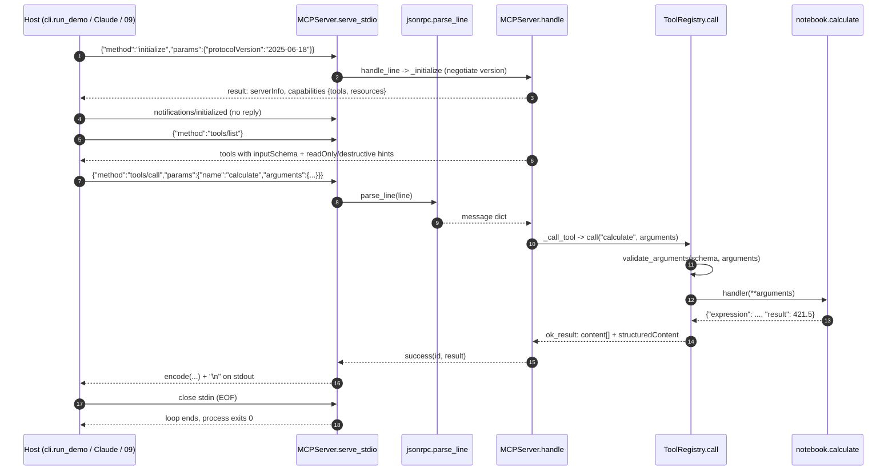

# Architecture · 08 MCP Server from Scratch

## Components

| Component | File | Responsibility |
|---|---|---|
| stdio entry | `server.py` | `build_server().serve_stdio()`: what MCP hosts (Claude Desktop, project 09) launch |
| CLI | `src/mcp_from_scratch/cli.py` | `serve` (stdio server) and `demo` (traced session against `server.py`) |
| Settings | `src/mcp_from_scratch/config.py` | `MCP_NOTES_FILE`, `MCP_HANDBOOK_FILE` with defaults in `examples/` |
| JSON-RPC envelope | `src/mcp_from_scratch/jsonrpc.py` | `parse_line`, `success`, `failure`, `encode`, error codes |
| `MCPServer` | `src/mcp_from_scratch/server.py` | Lifecycle (`initialize`, version negotiation), method router `handle()`, `serve_stdio()` loop |
| Registries | `src/mcp_from_scratch/registry.py` | `ToolRegistry` (schemas from type hints, argument validation), `ResourceRegistry` (static + URI templates) |
| Domain | `src/mcp_from_scratch/notebook.py` | `build_server()`: 4 tools + 3 resources over an in-memory notes list; `safe_eval` calculator |
| Demo host | `src/mcp_from_scratch/host.py` | `StdioConnection` (spawns `server.py`) and a keyword `MockLLM` that picks tools |
| `trace` | `src/mcp_from_scratch/trace.py` | `box`, `row`, `wire` ASCII printers |

## Data flow

The host owns the server process. Each line on **stdin** is one JSON-RPC message; each reply is one line on **stdout**.
Human-readable logs go to **stderr** so they can never corrupt the protocol stream. `MCPServer.handle()` is a pure
function (message in, at most one message out), so the transport is a thin loop and every protocol rule is unit-tested
in-process.

## One full request

## Design decisions

- **Schemas from signatures.** `schema_from_signature()` builds `inputSchema` from type hints and the docstring's
  `Args:` section, so the contract the model sees cannot drift from the code.
- **Two kinds of errors.** Unknown method / unknown tool / bad envelope are JSON-RPC errors (the *client* is wrong).
  Bad arguments or a failing tool are `isError: true` results (the *model* is wrong and can retry).
- **Version negotiation.** Echo the client's version if supported, otherwise offer the latest and let the client decide.
- **No batches.** JSON arrays were removed from MCP in 2025-06-18; `parse_line` rejects them with `-32600`.
- **No `eval()`.** `safe_eval` walks the AST and only allows numbers and arithmetic operators.
- **Domain isolated in `notebook.py`.** Swap it for orders or tickets; JSON-RPC, routing and registries stay unchanged.

## Failure modes and handling

| Failure | Handling |
|---|---|
| Garbage on the wire | `-32700` parse error with `id: null`; the loop keeps serving |
| Request before `initialize` | `-32600 Server not initialized` (only `ping` is allowed) |
| Unknown method | `-32601 Method not found` |
| Unknown tool / missing params | `-32602 Invalid params` |
| Wrong argument types / unknown argument | `isError: true` result listing each problem |
| Exception inside a handler | Logged to stderr, returned as `-32603 Internal error`; the server survives |
| Unknown resource URI | `-32002 Resource not found` with the URI in `data` |
| Host closes stdin | `serve_stdio` exits cleanly (exit code 0) |

## How to extend

- **New tool:** decorate a typed function with `@server.tools.tool(...)` inside `build_server()`; it appears in
  `tools/list` with no other change.
- **Prompts capability:** add `prompts/list` and `prompts/get` to `MCPServer._methods` and advertise it in `_initialize`.
- **Persistence:** replace the in-memory `notes` list with SQLite; tools keep the same signatures.
- **Another transport:** reuse `handle_line()` behind HTTP (Streamable HTTP) instead of `serve_stdio()`.
