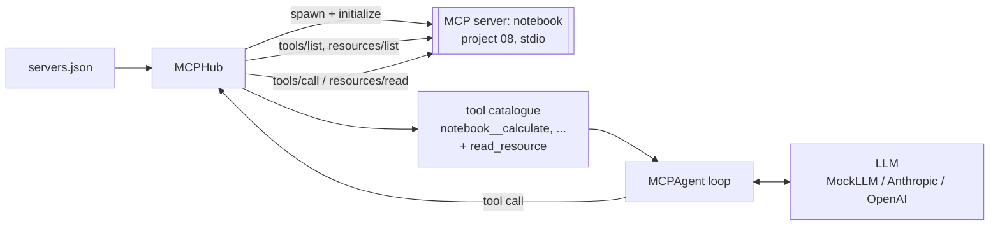
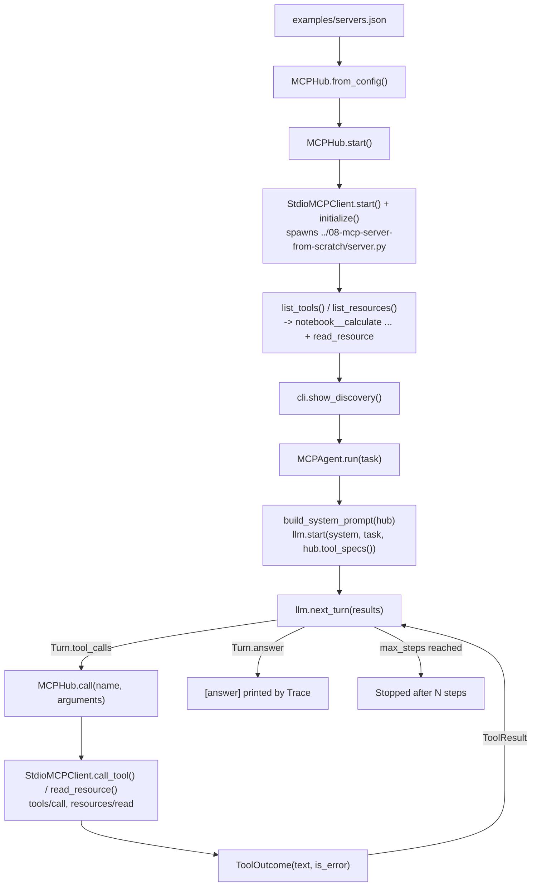

# 09 · MCP Client Agent

Build an agent that launches MCP servers as subprocesses, discovers their tools and resources at runtime, and uses them to answer questions, in ~600 lines of standard-library Python.

**Level:** Intermediate

**You'll learn:**
- How an MCP *client* works: spawn a server, handshake, match responses to requests by id, handle timeouts
- Runtime tool discovery: the agent has zero hard-coded tools; everything comes from `tools/list`
- How to merge several servers into one catalogue with namespaced names (`notebook__calculate`)
- How to expose MCP resources to the model through a single `read_resource` tool
- How an agent recovers from a tool error (`isError: true`) instead of crashing

## Why this matters

Claude Desktop, Claude Code and IDE assistants are MCP clients: you point them at a list of servers and they gain new abilities without a code change. The same pattern works inside your own product. An internal "ops copilot" can launch a Jira server, a Postgres server and a runbook server from a config file, and new teams add capabilities by shipping a server, not by editing the agent. This project builds that client side, so you can see exactly what happens between "config file" and "the model just called a tool".

## Architecture



`MCPHub` reads `servers.json`, launches each server with `subprocess.Popen` and runs the MCP handshake through `StdioMCPClient`. It then calls `tools/list` and `resources/list` and builds one catalogue where every tool is prefixed with its server's name. The agent passes that catalogue to the LLM, runs whatever tools the model asks for through the hub, and feeds the results back until the model answers or the step limit is hit. A background thread in each client reads the server's stdout and routes every response to the request waiting on that id.

## Flow

One task, mapped to the real functions (full sequence in [docs/ARCHITECTURE.md](docs/ARCHITECTURE.md)):



## Project structure

```
09-mcp-client-agent/
├── README.md                  # this tutorial
├── VIDEO.md                   # hooks + flow_steps for the video
├── docs/ARCHITECTURE.md       # components, sequence diagram, design decisions, failure modes
├── pyproject.toml             # package metadata, `mcp-client-agent` script, pytest + ruff config
├── requirements.txt           # pinned deps (stdlib-only runtime; pytest for tests)
├── Makefile                   # install / test / demo / docker / lint / clean
├── Dockerfile                 # build from projects/ so ../08 server is included
├── Dockerfile.dockerignore    # BuildKit ignore file for that parent-folder build context
├── .dockerignore, .gitignore
├── .env.example               # every setting the code reads
├── demo.py                    # one-command demo -> mcp_client_agent.cli.main()
├── src/mcp_client_agent/
│   ├── __init__.py            # public API + __version__
│   ├── config.py              # Settings.from_env(): LLM_*, MCP_*, AGENT_*
│   ├── cli.py                 # argparse entry: launch, discover, run tasks
│   ├── client.py              # StdioMCPClient: spawn, handshake, id-matched requests, timeouts
│   ├── hub.py                 # MCPHub: many servers, namespaced tools, read_resource, routing
│   ├── agent.py               # MCPAgent loop + build_system_prompt()
│   ├── llm.py                 # MockLLM, Anthropic/OpenAI tool calling, make_llm()
│   └── trace.py               # ASCII trace printer
├── tests/                     # client + agent tests on real subprocesses, test_e2e_demo.py
└── examples/                  # servers.json (points at project 08), tasks.txt
```

## Quickstart

This project launches the server from project 08, so keep both folders side by side (they are in this repo).

Windows (PowerShell):
```powershell
cd projects/09-mcp-client-agent
python -m venv .venv; .venv\Scripts\Activate.ps1
pip install -r requirements.txt
python demo.py
python -m pytest -q
```

macOS / Linux:
```bash
cd projects/09-mcp-client-agent
python3 -m venv .venv && source .venv/bin/activate
pip install -r requirements.txt
python demo.py
python -m pytest -q
```

Expected output (shortened):
```
| 1. LAUNCH + HANDSHAKE                                                                    |
| notebook: launched `server.py` -> team-notebook 1.0.0, protocol 2025-06-18               |
| 2. RUNTIME DISCOVERY  (nothing about these tools is hard-coded in the agent)             |
[tool  ] notebook__calculate      (expression        ) read-only
[tool  ] notebook__delete_note    (note_id           ) DESTRUCTIVE
[tool  ] read_resource            (uri               ) built-in -> resources/read
| 3. AGENT RUNS  (model: mock)                                                             |
[user  ] How many hours long is the refund window in our handbook policy?
[think ] (step 1) This is a policy question; read docs://handbook first.
[call  ] read_resource({'uri': 'docs://handbook'})  -> resources/read
[result] # Team handbook ## Refunds Customers can get a full refund within 30 days of ...
[think ] (step 2) The handbook says 30 days. Convert to hours.
[call  ] notebook__calculate({'expression': '30 * 24'})  -> notebook: tools/call calculate
[answer] The handbook gives a 30-day refund window, which is 720 hours.

[user  ] What is 17.5% of 2,340?
[call  ] notebook__calculate({'expression': '17.5% of 2,340'})  -> notebook: tools/call ...
[error ] Error: not a valid expression: '17.5% of 2,340'
[think ] (step 2) The tool rejected '% of'. Rewrite it as plain arithmetic: 2340 * 17.5 / 100.
[answer] The answer is 409.5.
```

## How it works

**1. The client (`client.py`).** `start()` launches the server and two daemon threads, one for stdout (protocol) and one for stderr (logs). `request()` gives each call a new id, parks a one-slot queue in `_pending[id]`, writes the line and waits:

```python
self._write({"jsonrpc": "2.0", "id": request_id, "method": method, "params": params or {}})
try:
    reply = inbox.get(timeout=timeout or self.timeout)
except queue.Empty:
    self.notify("notifications/cancelled", {"requestId": request_id, "reason": "client timeout"})
    raise TimeoutError(...)
```

The reader thread sorts incoming lines into three kinds: responses (routed by id), server requests such as `ping` (answered), and notifications such as `tools/list_changed` (stored). A JSON-RPC `error` becomes an `MCPError`.

**2. The handshake.** `initialize()` sends our protocol version and an empty capabilities object (this client offers no roots or sampling), checks the version the server picked, stores `serverInfo` and `instructions`, then sends `notifications/initialized`. `list_tools()` follows `nextCursor` so paginated servers work too.

**3. The hub (`hub.py`).** Tools are namespaced as `<server>__<tool>` so two servers can both have `search`. The hub keeps each tool's `readOnlyHint`/`destructiveHint` (a real product would ask the user before running destructive tools). Every failure path, whether an unknown tool, an MCP error, a timeout or `isError: true`, becomes a `ToolOutcome(text, is_error=True)` the model can read:

```python
except (MCPError, TimeoutError, ConnectionError) as exc:
    return ToolOutcome(f"{type(exc).__name__}: {exc}", True)
```

**4. Resources as a tool.** Resources are listed in the system prompt by URI and description. One built-in tool, `read_resource(uri)`, lets the model fetch the one it needs, instead of pasting every resource into every prompt.

**5. The loop (`agent.py`).** `start(system, task, tools)` then `next_turn(results)` until the model stops calling tools. All results of one turn go back together. `max_steps` stops a model that loops forever.

**6. MockLLM (`llm.py`).** A rule-based stand-in that finds tools *by suffix in the discovered list* (`*__calculate`), so it works with any server name and says "I don't have a tool" when none fits. It chains calls (handbook → calculator) and reads error text to retry, which is the behaviour you want from a real model too.

**Credits.** Design informed by our architecture study of Microsoft's Playwright MCP server ([research/rea-playwright-mcp.md](../../research/rea-playwright-mcp.md)): runtime discovery through `tools/list`, read-only/destructive hints, and tool failures returned as readable results rather than exceptions. The client follows the public MCP specification (modelcontextprotocol.io). All code here is original.

## Build it yourself

1. **Scaffold** `src/mcp_client_agent/`, `tests/`, `examples/`. Make sure project 08 sits next to this folder.
2. **Write `client.py`, part 1.** `start()` with `subprocess.Popen(..., stdin=PIPE, stdout=PIPE, stderr=PIPE, text=True)` and a reader thread. Print every line first, just to see the server talk.
3. **Write `client.py`, part 2.** Add `request()` with ids, a `_pending` dict of queues and a timeout; `notify()`; and routing in the reader thread (response / server request / notification).
4. **Add the MCP methods.** `initialize()` (version check + `notifications/initialized`), `list_tools()` with pagination, `call_tool()`, `list_resources()`, `read_resource()`, and `close()` that closes stdin first.
5. **Write `hub.py`.** Load `servers.json`, start every client, build `RemoteTool`s with qualified names, add the `read_resource` tool, and route `call()` back to the right server.
6. **Write `llm.py`.** Define `ToolCall`, `ToolResult`, `Turn` and the two-method interface. Write `MockLLM` rules for: read a resource, calculate, add a note, search, retry after an error, and "no tool fits".
7. **Write `agent.py`.** Build the system prompt from server info and resources, then loop `next_turn()` → run calls → collect results, with a step limit.
8. **Write `cli.py`** (called by a thin `demo.py`) with three sections (launch, discovery, runs) and **tests**: real handshake, a server that never answers (timeout), two servers with separate state, and the agent's chained and recovered runs.

## Use a real LLM

```bash
pip install anthropic                 # or: pip install openai
export LLM_PROVIDER=anthropic         # PowerShell: $env:LLM_PROVIDER="anthropic"
export ANTHROPIC_API_KEY=...          # PowerShell: $env:ANTHROPIC_API_KEY="..."
python demo.py
```

`LLM_MODEL` overrides the model (default `claude-opus-5-5`, or `gpt-4.1-mini` for OpenAI). The tool catalogue is already in the Anthropic shape (`name`, `description`, `input_schema`), and `AnthropicLLM` appends the model's full `response.content` to the history on every turn and returns all tool results in one user message. To add your own servers, copy `examples/servers.json`, add entries (`command` + `args`), and run `python demo.py --config your.json`.

## Production notes / pitfalls

- **Servers are code you run.** A stdio server runs with your user's permissions. Only launch servers you trust, pin their versions, and consider a sandbox or container.
- **Tool results are untrusted input.** A note or web page returned by a tool can contain "ignore your instructions". Keep tool output clearly separated from instructions (see project 13).
- **Gate destructive tools.** Use `destructiveHint` to require human approval (project 14). Hints come from the server, so do not treat them as a security boundary.
- **Too many tools hurts.** Each tool's schema costs prompt tokens on every turn, and models choose worse from huge lists. Filter tools per task or load them on demand.
- **Timeouts and restarts.** Servers crash and hang. Time out every request, send `notifications/cancelled`, and restart a dead server instead of failing the whole agent.
- **Watch `tools/list_changed`.** This client stores notifications. A long-running agent should re-list tools when a server says they changed.

## Extend it

1. Re-run discovery when a `notifications/tools/list_changed` arrives, and show the diff in the trace.
2. Add an approval prompt before any tool whose `destructiveHint` is true.
3. Add a Streamable HTTP transport so the hub can also connect to remote MCP servers by URL.

**Next project: 10 · Planner-Executor Agent**, which plans all the steps first, executes them, and re-plans when a step fails.

---
Part of [AI Agent Builds](../../README.md) by [exe_404.ai](https://www.youtube.com/@exe_404ai) — one agentic-AI project a day.
