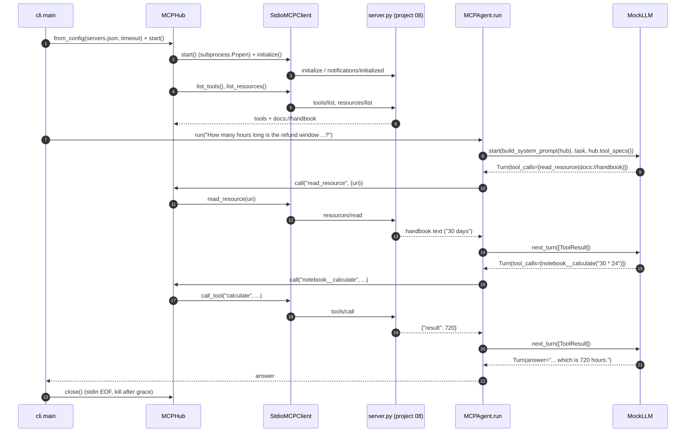

# Architecture · 09 MCP Client Agent

## Components

| Component | File | Responsibility |
|---|---|---|
| CLI | `src/mcp_client_agent/cli.py` | `--config` / `--tasks`; opens the hub, prints discovery, runs each task |
| Settings | `src/mcp_client_agent/config.py` | `LLM_PROVIDER`, `LLM_MODEL`, `MCP_SERVERS_CONFIG`, `MCP_TIMEOUT`, `AGENT_MAX_STEPS`, `AGENT_TASKS_FILE` |
| `StdioMCPClient` | `src/mcp_client_agent/client.py` | Spawn one server, handshake, id-matched requests via a reader thread, timeouts + cancellation |
| `MCPHub` | `src/mcp_client_agent/hub.py` | Start every server in `servers.json`, namespace tools as `<server>__<tool>`, add `read_resource`, route calls |
| `MCPAgent` | `src/mcp_client_agent/agent.py` | Tool-calling loop with a step budget; `build_system_prompt()` lists servers and resources |
| LLMs | `src/mcp_client_agent/llm.py` | `MockLLM` (rule-based, only uses discovered tools), `AnthropicLLM`, `OpenAILLM`, `make_llm()` |
| `Trace` | `src/mcp_client_agent/trace.py` | ASCII boxes and `[tag]` rows |
| MCP server | `../08-mcp-server-from-scratch/server.py` | The team-notebook server launched by `examples/servers.json` |

## Data flow

`servers.json` → `MCPHub.from_config()` builds one `StdioMCPClient` per entry (relative `.py` args resolve next to the
config file, `python` maps to the current interpreter). `MCPHub.start()` launches, initializes and discovers each
server. The agent hands the merged catalogue to the LLM and loops: model turn → `MCPHub.call()` → server → result text
back to the model, until the model answers or `AGENT_MAX_STEPS` is reached.

## One full request

## Design decisions

- **Runtime discovery only.** The agent has zero hard-coded tools; `MockLLM` finds tools by suffix (`*__calculate`)
  so it behaves like a real model that only knows what it was given.
- **Namespacing.** `<server>__<tool>` lets two servers expose the same tool name; the hub routes back by prefix.
- **Resources as one tool.** `read_resource` lets the model pull context on demand instead of stuffing it all into the prompt.
- **Reader thread + per-id queues.** Responses are matched by id, so out-of-order replies and server→client requests
  (`ping`) are handled correctly.
- **Errors become text.** `MCPError`, `TimeoutError` and `ConnectionError` are turned into `ToolOutcome(is_error=True)`
  so the model can read them and recover instead of the agent crashing.

## Failure modes and handling

| Failure | Handling |
|---|---|
| Server never replies | `request()` times out after `MCP_TIMEOUT`, sends `notifications/cancelled`, raises `TimeoutError` |
| Server ignores stdin EOF | `close()` waits `grace` seconds, then kills the process |
| Unsupported protocol version | `initialize()` closes the client and raises `MCPError(-32600)` |
| Non-JSON on server stdout | Kept in `stderr_tail` for debugging, not parsed as a message |
| Unknown tool name from the model | `ToolOutcome("Unknown tool ... Available: ...", is_error=True)` |
| Tool returns `isError` (e.g. bad expression) | Passed back to the model; `MockLLM._recover()` rewrites and retries once |
| Model loops forever | `MCPAgent` stops after `max_steps` with a clear message |
| Server asks for sampling/roots | Answered with `-32601` (no client capabilities declared) |

## How to extend

- **More servers:** add entries to `servers.json`; tools appear as `<name>__<tool>` with no code change.
- **Approvals:** in `MCPAgent.run`, pause before calling tools whose `RemoteTool.destructive` is true.
- **HTTP transport:** add a client with the same `request()/notify()` interface and let `from_config` pick it by `url`.
- **list_changed:** watch `client.notifications` for `notifications/tools/list_changed` and re-run discovery.
