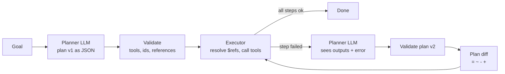
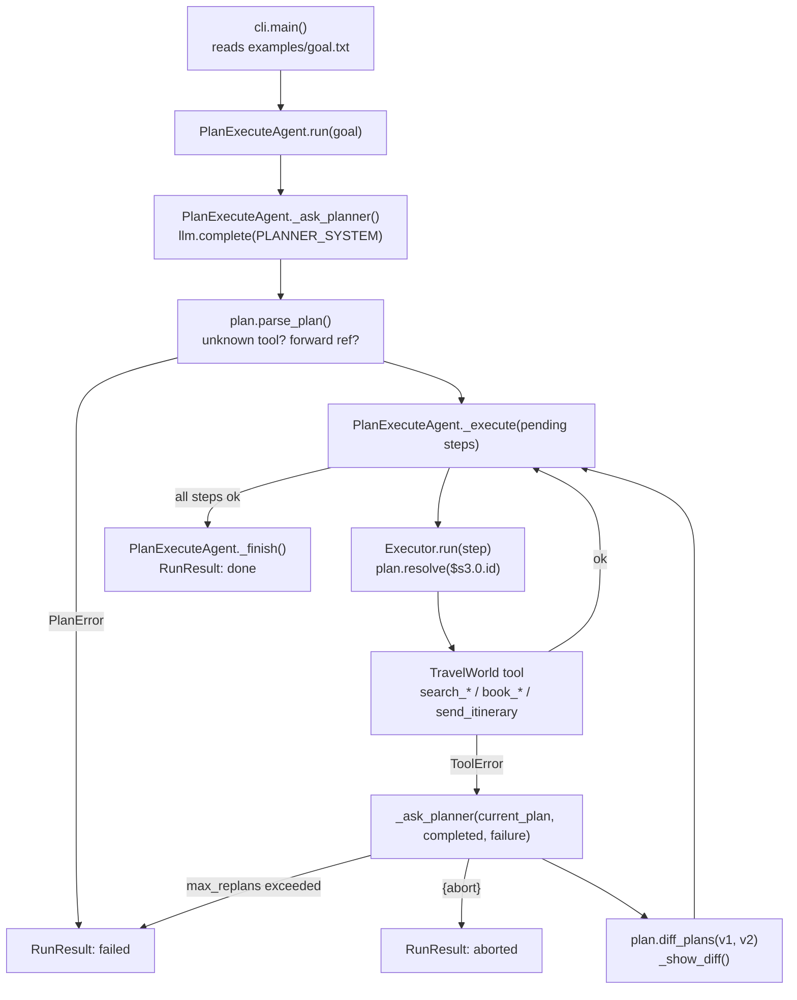

# 10 · Planner-Executor Agent

Build an agent that writes a whole plan first, executes it step by step, and re-plans with a readable plan diff when something breaks, in ~580 lines of plain Python.

**Level:** Intermediate

**You'll learn:**
- The plan-then-execute pattern and how it differs from a step-by-step ReAct loop (project 03)
- How to represent a plan as validated JSON data, with `$s1.0.id` references between steps
- How to re-plan on failure without re-running steps that already succeeded
- How to show what changed between plan v1 and v2 with a `git diff`-style view (`difflib`)
- Why validating a plan *before* running it stops a bad model output from causing side effects

## Why this matters

A travel agent booking a conference trip doesn't improvise each click. They plan: flight, hotel, then email the itinerary. When the hotel is sold out they don't cancel the flight and start over. They change only the broken part of the plan and keep going. Ops runbooks, data pipelines and "book me a trip" assistants all work the same way. A plan you can see up front can be checked by code and approved by a human, and a plan diff shows a reviewer exactly what the agent changed.

## Architecture



The planner returns a full plan as JSON. Each step names a tool, its arguments, and (optionally) references to earlier outputs such as `"$s3.0.id"`. `parse_plan()` rejects unknown tools, duplicate ids and forward references before anything runs. The executor runs pending steps in order. On the first failure it asks the planner again, this time with the current plan, every completed output and the error. The new plan is validated, diffed against the old one and executed from where things stopped. Completed steps are never run twice, and after `max_replans` the agent gives up instead of looping forever.

## Flow

One goal, mapped to the real functions (full sequence in [docs/ARCHITECTURE.md](docs/ARCHITECTURE.md)):



## Project structure

```
10-planner-executor-agent/
├── README.md                  # this tutorial
├── VIDEO.md                   # hooks + flow_steps for the video
├── docs/ARCHITECTURE.md       # components, sequence diagram, design decisions, failure modes
├── pyproject.toml             # package metadata, `planner-executor` script, pytest + ruff config
├── requirements.txt           # pinned deps (stdlib-only runtime; pytest for tests)
├── Makefile                   # install / test / demo / lint / clean
├── Dockerfile, .dockerignore  # run the offline demo in a slim non-root container
├── .env.example               # every setting the code reads
├── demo.py                    # one-command demo -> planner_executor.cli.main()
├── src/planner_executor/
│   ├── __init__.py            # public API + __version__
│   ├── config.py              # Settings.from_env(): LLM_*, AGENT_MAX_REPLANS, AGENT_GOAL_FILE
│   ├── cli.py                 # argparse entry: --goal / --goal-file
│   ├── agent.py               # PlanExecuteAgent loop + Executor
│   ├── plan.py                # Step, Plan, parse_plan, resolve, diff_plans
│   ├── tools.py               # TravelWorld (simulated flights/hotels) + ToolSpec
│   ├── llm.py                 # MockPlannerLLM, Anthropic/OpenAI clients, make_llm()
│   └── trace.py               # ASCII trace printer
├── tests/                     # plan + agent tests, test_e2e_demo.py (runs demo.py end to end)
└── examples/goal.txt          # the demo goal
```

## Quickstart

Windows (PowerShell):
```powershell
cd projects/10-planner-executor-agent
python -m venv .venv; .venv\Scripts\Activate.ps1
pip install -r requirements.txt
python demo.py
python -m pytest -q
```

macOS / Linux:
```bash
cd projects/10-planner-executor-agent
python3 -m venv .venv && source .venv/bin/activate
pip install -r requirements.txt
python demo.py
python -m pytest -q
```

Expected output (shortened):
```
[plan  ] v1  (5 steps)
         s3   search_hotels(city=Lisbon, check_in=2026-11-12, nights=2)   # find hotels
         s4   book_hotel(hotel_id=$s3.0.id, nights=2)   # cheapest hotel
[run   ] s3   search_hotels(city=Lisbon, check_in=2026-11-12, nights=2)
         -> 3 results; top: id=H-ALFAMA, name=Alfama Patio Hotel, price_per_night=95
[FAIL  ] s4   book_hotel(hotel_id=H-ALFAMA, nights=2)
         x Alfama Patio Hotel is sold out for those dates
[think ] step s4 failed -> asking the planner for plan v2
[diff  ] plan v1 -> v2   (= kept  ~ changed  - removed  + added)
         = s3   search_hotels(city=Lisbon, check_in=2026-11-12, nights=2)   (done)
         - s4   book_hotel(hotel_id=$s3.0.id, nights=2)
         + s3b  search_hotels(city=Lisbon, check_in=2026-11-12, nights=2, exclude=[H-ALFAMA])
         + s4b  book_hotel(hotel_id=$s3b.0.id, nights=2)
         ~ s5   send_itinerary(to=sam@example.com, confirmations=[$s2.confirmation, $s4b.confirmation])
[run   ] s4b  book_hotel(hotel_id=H-BAIXA, nights=2)
         -> confirmation=CONF-H-BAIXA, what=Baixa House x2 nights, price=236
| status: DONE                                                                                         |
| plans used: 2 | steps run: 7 | failures: 1                                                         |
Booked: TAP 07:05; Baixa House x2 nights  |  total 378 EUR
```

## How it works

**Plans are data** (`plan.py`). A `Step` is `id`, `tool`, `args`, `why`. References are plain strings matched by one regex:

```python
REF = re.compile(r"^\$(\w+)((?:\.\w+)*)$")   # "$s3.0.id" -> step s3, path [0, "id"]
```

`parse_plan()` walks the steps in order and only allows references to steps it has already seen, so a plan that uses a result before it exists is rejected before it runs.

**The executor is boring on purpose** (`agent.py`). It resolves references, calls the tool and records `StepResult(ok, output | error)`. It never calls the model:

```python
args = {k: resolve(v, outputs) for k, v in step.args.items()}
return StepResult(step.id, True, self.tools[step.tool].fn(**args), args=args)
```

**Re-planning gets the full picture.** The planner request contains the current plan, the outputs of completed steps, the failed step with both its raw and resolved args, and the error text. The system prompt says to keep completed steps unchanged and give new steps new ids, so the agent can skip what is already done:

```python
pending = [s for s in plan.steps if s.id not in outputs]
```

**Plan diff.** `diff_plans()` lines up step ids with `difflib.SequenceMatcher`. Matching ids become `=` (identical) or `~` (args changed), and the rest become `-` or `+`. It is a few lines of code, and the trace becomes easy to review.

**Bounded autonomy.** `max_replans` caps the loop. An `{"abort": "..."}` reply lets the planner say "this can't be fixed with my tools" (try `Atlantis` as the destination).

The plan-and-execute idea follows public write-ups of "Plan-and-Solve" prompting and LLM-compiler-style task graphs. All code here is original.

## Build it yourself

1. **Scaffold** `src/planner_executor/`, `tests/`, `examples/goal.txt`, and copy `trace.py` from an earlier project.
2. **Write `tools.py`.** A `TravelWorld` with five tools and a `ToolSpec` registry. Make the cheapest hotel `SOLD_OUT` so failure is guaranteed and repeatable.
3. **Write `plan.py`.** `Step`, `Plan`, `parse_plan()` with validation, `resolve()` for references. Unit-test forward references and unknown tools first.
4. **Add `diff_plans()`** using `difflib.SequenceMatcher` over step ids.
5. **Write `llm.py`.** The `complete(system, prompt)` interface and a `MockPlannerLLM` that reads the JSON request: first plan from the goal text, and on a "sold out" failure, search again with `exclude` and repoint later references.
6. **Write `Executor`.** Resolve args, call the tool, turn `ToolError` into a failed `StepResult`.
7. **Write `PlanExecuteAgent.run()`.** Plan → validate → execute pending steps → on failure re-plan, diff, continue. Stop on success, abort or the re-plan cap.
8. **Write `cli.py` (called by a thin `demo.py`) and tests.** Cover the happy re-plan, "no step runs twice", the re-plan cap, an invalid plan that never touches a tool, and an abort.

## Use a real LLM

```bash
pip install anthropic                 # or: pip install openai
export LLM_PROVIDER=anthropic         # PowerShell: $env:LLM_PROVIDER="anthropic"
export ANTHROPIC_API_KEY=...          # PowerShell: $env:ANTHROPIC_API_KEY="..."
python demo.py
```

`LLM_MODEL` overrides the model (default `claude-opus-5-5`, or `gpt-4.1-mini` for OpenAI). The planner prompt is a JSON document listing the tools and their params, and `PLANNER_SYSTEM` spells out the reference syntax and re-plan rules. Whatever the model returns still goes through `parse_plan()`, so an invalid plan from a real model fails safely instead of running.

## Production notes / pitfalls

- **Validate, then show a human.** Plans are a natural approval point. Pair this with project 14 (human-in-the-loop) for anything that spends money.
- **Idempotency.** If the agent crashes between "book" and "record result", a retry may book twice. Use idempotency keys per step id (project 25).
- **Don't let re-plans undo work silently.** The diff shows `-` on completed steps. In production, refuse plans that drop or change completed side-effecting steps.
- **Cost and latency:** planning is one big call, and execution needs no model calls. That is usually cheaper than ReAct for long, predictable tasks, and worse for exploratory ones.
- **Stale plans.** The world changes while you execute. Re-check prices or availability right before the side-effecting step.

## Extend it

1. Add a budget guard: refuse a plan whose known prices exceed the trip budget, and feed the reason back to the planner.
2. Run independent steps in parallel (flight search and hotel search don't depend on each other). Build a DAG from the references.
3. Add a `requires_approval` flag on `book_*` steps and pause the executor until a human says yes.

**Next project: 11 · Router Agent**, an intent router that dispatches to specialist agents with confidence scores and a fallback.

---
Part of [AI Agent Builds](../../README.md) by [exe_404.ai](https://www.youtube.com/@exe_404ai) — one agentic-AI project a day.
