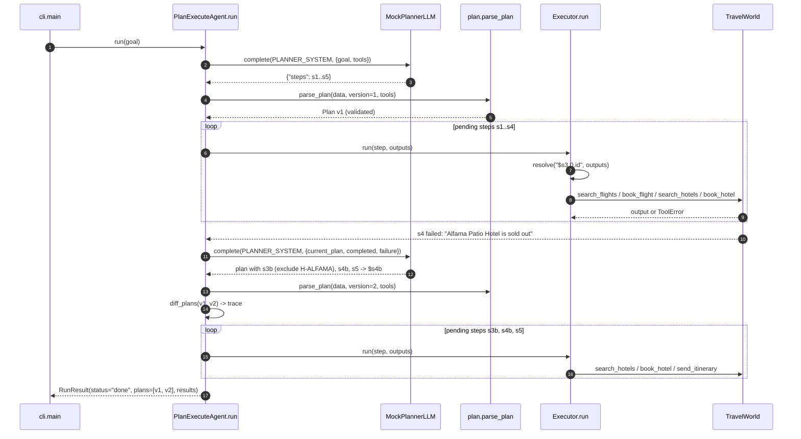

# Architecture · 10 Planner-Executor Agent

## Components

| Component | File | Responsibility |
|---|---|---|
| CLI | `src/planner_executor/cli.py` | `--goal` / `--goal-file`; builds `TravelWorld` + agent, prints bookings; exit 0 only when done |
| Settings | `src/planner_executor/config.py` | `LLM_PROVIDER`, `LLM_MODEL`, `AGENT_MAX_REPLANS`, `AGENT_GOAL_FILE` |
| `PlanExecuteAgent` | `src/planner_executor/agent.py` | Ask planner → validate → execute pending steps → on failure, ask for plan v+1 and diff it |
| `Executor` | `src/planner_executor/agent.py` | One step: `resolve()` `$references`, call the tool, capture `StepResult` |
| Plans as data | `src/planner_executor/plan.py` | `Step`, `Plan`, `parse_plan` (validation), `resolve`, `diff_plans` |
| Tools / world | `src/planner_executor/tools.py` | `TravelWorld` with flights, hotels (one sold out), bookings and email; `ToolSpec` schemas |
| LLMs | `src/planner_executor/llm.py` | `MockPlannerLLM` (first plan + repair rule), Anthropic/OpenAI clients, `make_llm()` |
| `Trace` | `src/planner_executor/trace.py` | ASCII boxes and `[tag]` events |

## Data flow

The planner returns the **whole plan as JSON** before anything runs. `parse_plan()` rejects unknown tools, duplicate
ids and forward references, so a bad plan never causes a side effect. The executor runs steps in order and stores
outputs by step id; later steps read them through reference strings like `"$s3.0.id"`. When a step fails, the planner
receives the current plan, completed outputs and the failure, and returns a new version that keeps completed steps.
Only steps whose id has no output yet are executed, so nothing is booked twice.

## One full request

## Design decisions

- **Plan first, then act.** A full plan can be validated, shown to a human and diffed before any side effect, unlike
  a ReAct loop (project 03) that decides one step at a time.
- **References as plain strings.** `"$s1.0.id"` keeps plans pure JSON, so they validate statically and diff cleanly.
- **Code executes, the model plans.** The executor never calls the LLM; the model is used only to plan and repair.
- **Completed steps are immutable.** Re-plans must keep done steps; the agent skips any step id that already has output.
- **Bounded repair.** `max_replans` (env `AGENT_MAX_REPLANS`) stops a planner that keeps producing failing plans.

## Failure modes and handling

| Failure | Handling |
|---|---|
| Planner uses an unknown tool / bad reference / duplicate id | `PlanError` → run `failed` before any tool runs |
| Model wraps JSON in prose | `extract_json()` takes the first `{...}` object |
| Tool raises `ToolError` (sold out, unknown id, bad email) | `StepResult(ok=False)` → re-plan with the error text |
| Reference cannot be resolved | `StepResult(ok=False, error="could not resolve arguments")` → re-plan |
| Failure the planner cannot fix | Planner returns `{"abort": reason}` → run `aborted` |
| Every option sold out | After `max_replans` the run is `failed`; nothing is emailed |

## How to extend

- **Human approval:** show `Plan` v1 and require a yes before `_execute` runs any `book_*` step.
- **Parallel steps:** steps without references to each other can run concurrently.
- **Budget guard:** reject a plan whose estimated spend exceeds a limit, during `parse_plan`.
- **Real tools:** replace `TravelWorld` methods with API calls; keep the same `ToolSpec` shape.
