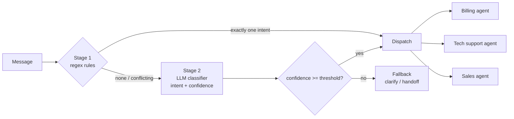
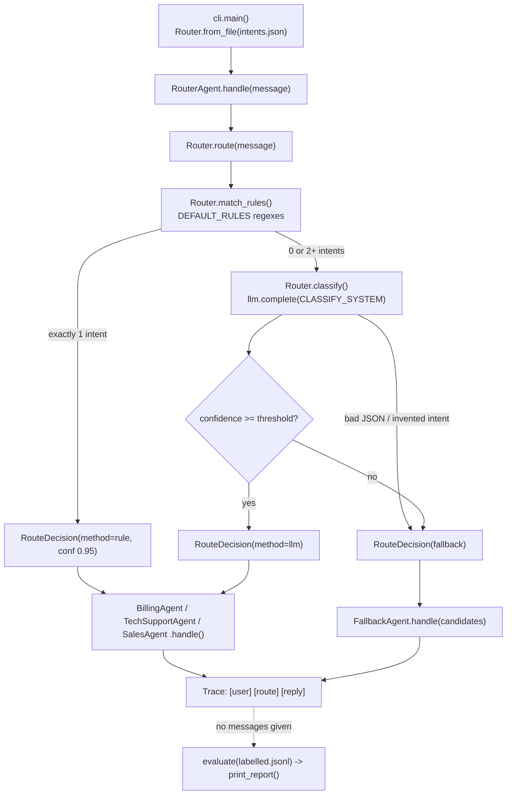

# 11 · Router Agent

Build an intent router that sends each message to the right specialist agent, with confidence scores, a fallback and an accuracy eval, in ~460 lines of plain Python.

**Level:** Intermediate

**You'll learn:**
- The two-stage router pattern: cheap regex rules first, an LLM classifier for the long tail
- How to get a *calibrated confidence* from a classifier, and how a threshold turns it into "dispatch" or "ask"
- How to handle conflicting signals ("I can't log in **and** I want a refund") without guessing
- How to defend against invented intents and unparseable model output
- How to evaluate a router like any classifier, using a labelled set that includes "should fall back" cases

## Why this matters

A SaaS company's support inbox gets thousands of messages a day: duplicate charges, app crashes, pricing questions, and the occasional "tell me a joke". One giant prompt that does everything gets expensive and confused. Sending every message to a human is slow. A router sends billing questions to an agent that can see invoices, bugs to one that knows the knowledge base, and leads to sales. When it isn't sure, it asks the customer. Each specialist then has a smaller prompt, fewer tools and fewer permissions, and that is a security win as well as a quality one.

## Architecture



Stage 1 runs a handful of high-precision regexes (`INV-1234`, `refund`, `crash`, `pricing`). If exactly one intent fires, we route instantly with no model call. If none fire, or several disagree, Stage 2 asks the model to pick one intent from a list of descriptions and few-shot examples and to return a confidence. The policy then dispatches only if that confidence clears the threshold. Otherwise the fallback agent asks a clarifying question, naming the candidate teams when the rules disagreed. `evaluate()` replays a labelled set so you can see the effect of every change to rules, examples or threshold.

## Flow

One message, mapped to the real functions (full sequence in [docs/ARCHITECTURE.md](docs/ARCHITECTURE.md)):



## Project structure

```
11-router-agent/
├── README.md                  # this tutorial
├── VIDEO.md                   # hooks + flow_steps for the video
├── docs/ARCHITECTURE.md       # components, sequence diagram, design decisions, failure modes
├── pyproject.toml             # package metadata, `router-agent` script, pytest + ruff config
├── requirements.txt           # pinned deps (stdlib-only runtime; pytest for tests)
├── Makefile                   # install / test / demo / lint / clean
├── Dockerfile, .dockerignore  # run the offline demo in a slim non-root container
├── .env.example               # every setting the code reads
├── demo.py                    # one-command demo -> router_agent.cli.main()
├── src/router_agent/
│   ├── __init__.py            # public API + __version__
│   ├── config.py              # Settings.from_env(): LLM_*, ROUTER_*
│   ├── cli.py                 # argparse entry: route messages, then eval
│   ├── router.py              # Router: rules -> LLM classifier -> threshold policy
│   ├── agent.py               # RouterAgent dispatch + evaluate / print_report
│   ├── specialists.py         # Billing, TechSupport, Sales, Fallback agents
│   ├── llm.py                 # MockRouterLLM, Anthropic/OpenAI clients, make_llm()
│   └── trace.py               # ASCII trace printer
├── tests/                     # router + agent tests, test_e2e_demo.py (runs demo.py end to end)
└── examples/                  # intents.json (descriptions + few-shot), labelled.jsonl (eval set)
```

## Quickstart

Windows (PowerShell):
```powershell
cd projects/11-router-agent
python -m venv .venv; .venv\Scripts\Activate.ps1
pip install -r requirements.txt
python demo.py
python -m pytest -q
```

macOS / Linux:
```bash
cd projects/11-router-agent
python3 -m venv .venv && source .venv/bin/activate
pip install -r requirements.txt
python demo.py
python -m pytest -q
```

Expected output (shortened):
```
[user  ] I was charged twice on invoice INV-1042
[route ] billing       conf 0.95  via rule
         rule /\bINV-\d+\b/ matched
[reply ] (billing) INV-1042 (49.00 USD, 2026-10-02) was charged twice. I've filed a refund
         for the duplicate; expect it in 5 business days.

[user  ] Do you offer discounts for teams of 50 people?
[route ] sales         conf 0.94  via llm
         closest example: "Do you offer a discount for nonprofits?"

[user  ] I can't log in and I also want a refund
[route ] fallback      conf 0.31  via fallback
         best guess billing (0.31) is below threshold 0.6
[reply ] (fallback) I can help with that. Is this mainly about billing or tech support?

| ROUTER EVAL  accuracy 16/17 = 94%   (fallback 4, llm 5, rule 8)                        |
| XX  billing       sales         0.95  rule     Why did my price go up after the up...  |
```

Route your own message: `python demo.py "Can I pay by bank transfer?"`

## How it works

**Rules are trusted only when unambiguous** (`router.py`):

```python
hits = self.match_rules(message)
if len(hits) == 1:
    (intent, pattern), = hits.items()
    return RouteDecision(intent, 0.95, "rule", f"rule /{pattern}/ matched")
```

**The classifier prompt** lists every intent with a description and labelled examples, plus an explicit `fallback` option. The model must reply with `{"intent", "confidence", "reason"}`. Output is never trusted blindly: unparseable JSON or an intent that doesn't exist becomes a fallback with a clear reason.

**The mock classifier** (`llm.py`) is a few-shot nearest-neighbour model. It reads the examples *from the prompt*, scores them with bag-of-words cosine, and derives confidence from both the best match and its margin over the runner-up:

```python
confidence = min(0.99, 0.5 * top_score + 0.5 * (top_score - second_score) / top_score + 0.2)
```

Two intents scoring almost the same gives low confidence, so the message goes to the fallback. That is exactly what happens with "can't log in **and** want a refund".

**The eval is part of the product** (`agent.py`). `examples/labelled.jsonl` includes the cases that *should* fall back. One case is deliberately hard: "Why did my **price** go up?" is a billing question, but the `pricing` rule sends it to sales. The eval prints `XX` so you can see the classic weakness of keyword rules. Try fixing it by tightening the rule and re-running.

The rules-then-model cascade and confidence-gated fallback are common patterns described in public guides on routing workflows (e.g. Anthropic's "Building effective agents"). All code here is original.

## Build it yourself

1. **Scaffold** `src/router_agent/`, `tests/`, `examples/` and copy `trace.py` from an earlier project.
2. **Write `examples/intents.json`** with a description and 5 examples per intent, and `labelled.jsonl` with 4+ messages per intent, including fallback cases.
3. **Write `specialists.py`.** Three tiny agents with a `handle(message)` method, plus a `FallbackAgent` that asks instead of guessing.
4. **Write `llm.py`.** The `complete(system, prompt)` interface and `MockRouterLLM`, which parses `example (intent): ...` lines from the prompt and returns JSON with a confidence.
5. **Write `router.py`.** Stage 1 `match_rules()`, Stage 2 `classify()` with output validation, then `route()` with the threshold policy.
6. **Write `agent.py`.** `RouterAgent.handle()` dispatches and traces. `evaluate()` and `print_report()` measure accuracy.
7. **Write `cli.py`** (called by a thin `demo.py`) to route six messages and print the eval table.
8. **Write tests.** Check that rules skip the model, conflicts fall back with candidates, garbage output falls back, the threshold works, and accuracy stays at 90% or above (a regression gate).

## Use a real LLM

```bash
pip install anthropic                 # or: pip install openai
export LLM_PROVIDER=anthropic         # PowerShell: $env:LLM_PROVIDER="anthropic"
export ANTHROPIC_API_KEY=...          # PowerShell: $env:ANTHROPIC_API_KEY="..."
python demo.py
```

`LLM_MODEL` overrides the model (default `claude-opus-5-5`, or `gpt-4.1-mini` for OpenAI). For routing, a small, fast model is usually enough. Measure it with the eval before switching. Real models' self-reported confidence is often over-confident, so tune the threshold against `labelled.jsonl` rather than trusting the number.

## Production notes / pitfalls

- **Latency and cost:** the rules stage handled 8 of 17 eval messages for free. Log the share of traffic each stage handles.
- **Calibrate the threshold with data.** Too high and everything falls back (annoyed users). Too low and messages are misrouted (wrong answers). Plot accuracy vs. fallback rate at several thresholds.
- **Multi-intent messages are common.** Either ask (as here) or split the message and route each part.
- **Least privilege:** only the billing agent should hold billing tools. The router itself needs no tools at all.
- **Keep the eval set growing.** Every misroute reported in production becomes a new labelled line.

## Extend it

1. Sweep thresholds from 0.3 to 0.9 and print accuracy vs. fallback rate to pick the best one.
2. Handle multi-intent messages: split "I can't log in and I want a refund" into two parts and answer both.
3. Add a "sticky" route: in a multi-turn chat, keep the current specialist unless confidence for a new intent is high.

**Next project: 12 · Evaluator-Optimizer**, a writer + critic loop with a rubric, scores and stop criteria.

---
Part of [AI Agent Builds](../../README.md) by [exe_404.ai](https://www.youtube.com/@exe_404ai) — one agentic-AI project a day.
