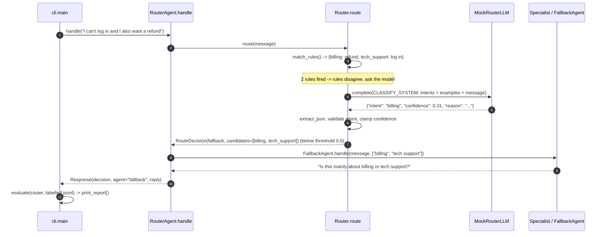

# Architecture · 11 Router Agent

## Components

| Component | File | Responsibility |
|---|---|---|
| CLI | `src/router_agent/cli.py` | Routes sample (or given) messages; prints the eval report when run without messages |
| Settings | `src/router_agent/config.py` | `LLM_PROVIDER`, `LLM_MODEL`, `ROUTER_THRESHOLD`, `ROUTER_INTENTS_FILE`, `ROUTER_LABELLED_FILE` |
| `Router` | `src/router_agent/router.py` | Stage 1 `match_rules()`, stage 2 `classify()` (LLM), policy `route()` with threshold |
| `RouterAgent` | `src/router_agent/agent.py` | `handle()`: route, then dispatch to a specialist or `FallbackAgent` |
| Eval | `src/router_agent/agent.py` | `load_labelled()`, `evaluate()` → `EvalReport`, `print_report()` |
| Specialists | `src/router_agent/specialists.py` | `BillingAgent`, `TechSupportAgent`, `SalesAgent`, `FallbackAgent` |
| LLMs | `src/router_agent/llm.py` | `MockRouterLLM` (few-shot similarity classifier), Anthropic/OpenAI, `make_llm()` |
| `Trace` | `src/router_agent/trace.py` | ASCII boxes and `[tag]` events |

## Data flow

A message first meets cheap regex rules. If **exactly one** intent fires, it is routed at confidence 0.95 without a
model call. Otherwise the LLM classifier gets the intent descriptions and few-shot examples from `intents.json` and
returns `{"intent", "confidence", "reason"}`. The policy sends low-confidence, invented or unparsable answers to the
fallback, which asks a clarifying question (naming the candidate teams when the rules disagreed).

## One full request

## Design decisions

- **Rules before the model.** Precise regexes handle obvious traffic for free; they are only trusted when exactly one
  intent fires, so ambiguous messages still get the model.
- **Confidence + threshold.** Asking a clarifying question is cheaper than a wrong specialist acting on a message.
- **Closed intent set.** An invented intent (`"legal"`) is treated as fallback, never dispatched.
- **Startup check.** `RouterAgent` refuses to start if an intent has no specialist.
- **Router as a classifier.** A labelled set (with fallback cases) and an accuracy test guard against regressions.

## Failure modes and handling

| Failure | Handling |
|---|---|
| Model output is not JSON / misses fields | `RouteDecision(fallback, 0.0, "classifier returned unusable output")` |
| Model invents an intent | Fallback with reason `classifier invented intent '...'` |
| Confidence out of range | Clamped to `[0, 1]` |
| Confidence below `ROUTER_THRESHOLD` | Fallback; reason states best guess and threshold |
| Message needs two teams | Rules disagree → candidates passed to `FallbackAgent` |
| Intent without a specialist | `ValueError` at `RouterAgent` construction |
| Accuracy regression | `test_router_accuracy_on_labelled_set_does_not_regress` (≥ 90%) |

## How to extend

- **New intent:** add it to `intents.json`, optionally a rule in `DEFAULT_RULES`, a specialist class, and labelled rows.
- **Embedding router:** replace stage 2 with nearest-example search to cut cost; keep the same `RouteDecision`.
- **Multi-intent:** return several intents and run specialists in sequence instead of falling back.
- **Calibration:** pick `ROUTER_THRESHOLD` from the eval set (accuracy vs fallback rate curve).
