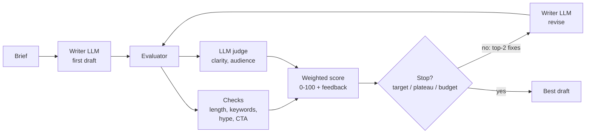
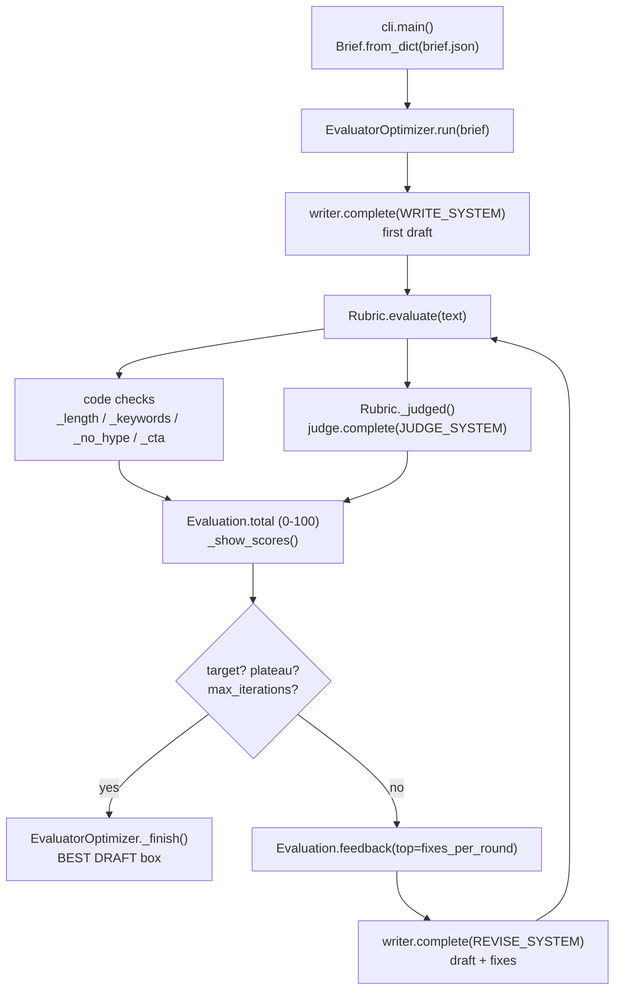

# 12 · Evaluator-Optimizer

Build a writer + critic loop that scores every draft against a weighted rubric, feeds back the most costly issues and stops at the right time, in ~460 lines of plain Python.

**Level:** Intermediate

**You'll learn:**
- The evaluator-optimizer pattern: one model generates, another (or the same one, with a different prompt) grades
- How to write a rubric that mixes deterministic checks (cheap, exact) with LLM-judged criteria (fuzzy qualities)
- Why *actionable, ranked* feedback matters more than a single score
- Three stop criteria: target reached, plateau, hard iteration budget
- Why you return the **best** draft, not the last one

## Why this matters

A startup's marketing lead needs launch copy that hits brand rules: no hype words, under 80 words, mentions the price, ends with a call to action. A first LLM draft rarely passes all of them. An editor marks it up, the writer revises, and that repeats until it's good enough. The same loop powers code generation with tests as the critic, translation with a fluency judge, and SQL generation with a validator. The skill is making the critic precise and knowing when to stop paying for more rounds.

## Architecture



The brief (`examples/brief.json`) defines the task, the allowed facts, required keywords, banned phrases and a word range. The rubric scores each draft 1–5 on six weighted criteria. Four are plain Python checks, and two are graded by an LLM judge that must explain any score below 5. The weighted average becomes a 0–100 total. Feedback is ranked by *points lost* (weight × missing score), and only the top two items go back to the writer, because focused feedback beats a wall of comments. The loop stops when the total reaches the target, when it stops improving, or when the iteration budget runs out, and it always returns the best-scoring draft.

## Flow

One optimisation run, mapped to the real functions (full sequence in [docs/ARCHITECTURE.md](docs/ARCHITECTURE.md)):



## Project structure

```
12-evaluator-optimizer/
├── README.md                  # this tutorial
├── VIDEO.md                   # hooks + flow_steps for the video
├── docs/ARCHITECTURE.md       # components, sequence diagram, design decisions, failure modes
├── pyproject.toml             # package metadata, `eval-optimizer` script, pytest + ruff config
├── requirements.txt           # pinned deps (stdlib-only runtime; pytest for tests)
├── Makefile                   # install / test / demo / lint / clean
├── Dockerfile, .dockerignore  # run the offline demo in a slim non-root container
├── .env.example               # every setting the code reads
├── demo.py                    # one-command demo -> eval_optimizer.cli.main()
├── src/eval_optimizer/
│   ├── __init__.py            # public API + __version__
│   ├── config.py              # Settings.from_env(): LLM_*, OPT_*
│   ├── cli.py                 # argparse entry: --brief
│   ├── optimizer.py           # EvaluatorOptimizer loop + stop criteria
│   ├── rubric.py              # Brief, Rubric (checks + judge), Evaluation, Score
│   ├── llm.py                 # MockLLM writer/judge, Anthropic/OpenAI clients, make_llm()
│   └── trace.py               # ASCII trace printer
├── tests/                     # rubric + optimizer tests, test_e2e_demo.py (runs demo.py end to end)
└── examples/brief.json        # the launch-announcement brief
```

## Quickstart

Windows (PowerShell):
```powershell
cd projects/12-evaluator-optimizer
python -m venv .venv; .venv\Scripts\Activate.ps1
pip install -r requirements.txt
python demo.py
python -m pytest -q
```

macOS / Linux:
```bash
cd projects/12-evaluator-optimizer
python3 -m venv .venv && source .venv/bin/activate
pip install -r requirements.txt
python demo.py
python -m pytest -q
```

Expected output (shortened):
```
[score ] iter  total    length  keywords   no_hype       cta   clarity  audience   words
[score ]    1   26.6         5         2         1         1         2         2      69
[fix   ] writer gets the top 2 issue(s)
         - Mention '10 seconds' (required). Mention 'free' (required).
         - Remove hype phrase 'revolutionary'. Remove hype phrase 'game-changing'. ...
[score ]    2   65.6         4         5         5         1         3         2      82
[fix   ] writer gets the top 2 issue(s)
         - End with a call to action starting with 'Try'.
         - Split sentences longer than 22 words (longest: 28).
[score ]    3   78.1         4         5         5         5         3         2      90
[score ]    4   96.9         4         5         5         5         5         5      35
| BEST DRAFT  iteration 4  score 96.9/100                                                |
| Snapshots saves your whole dev environment in one click. You can restore any snapshot  |
| in under 10 seconds. Snapshots is free on all plans, including Free. Try it today: run |
| `snap save` in any project.                                                            |
| stopped: target reached (96.9 >= 90)                                                   |
```

Notice that the final draft is 35 words, just under the 40-word minimum (`length` = 4). The loop stopped anyway because 96.9 beat the target of 90. "Good enough" is a decision you make with the target, not a bug.

## How it works

**Checks are code** (`rubric.py`). Anything you can verify deterministically, verify with code. It's free, exact, and the feedback names the problem precisely:

```python
used = [p for p in self.brief.banned_phrases if p.lower() in text.lower()]
feedback = " ".join(f"Remove hype phrase '{p}'." for p in used)
return self._score("no_hype", 5 - 2 * len(used), feedback)
```

**The judge handles the fuzzy parts.** It gets the criteria and the text and must return `{"clarity": {"score", "feedback"}, ...}`. A malformed answer scores 1 instead of crashing the loop (see `BrokenJudge` in the tests).

**Ranked feedback.** Each `Score` knows how many weighted points it lost. The writer only sees the top `fixes_per_round` items:

```python
ranked = sorted((s for s in self.scores if s.score < 5), key=lambda s: s.points_lost, reverse=True)
```

**Stop criteria and best-so-far** (`optimizer.py`):

```python
if best is None or evaluation.total >= best.evaluation.total + self.min_delta:
    best, stale = attempt, 0
else:
    stale += 1
```

The tests prove all three exits. `StubbornWriter` ignores feedback, so the loop stops on a plateau after 2 rounds. `RegressingWriter` gets worse after one revision, so the loop returns iteration 2, not the last draft. A target of 101 runs until the iteration budget is spent.

**The mock writer only follows feedback.** Each revision applies one edit rule per feedback line (remove the phrase, insert the fact, append a CTA, split sentences...). If the feedback were vague, nothing would improve. That is the main lesson of this project.

The evaluator-optimizer workflow is described in Anthropic's public guide "Building effective agents". The rubric design and code here are original.

## Build it yourself

1. **Scaffold** `src/eval_optimizer/`, `tests/`, `examples/brief.json`, and copy `trace.py` from an earlier project.
2. **Write the brief.** Task, facts, required keywords, banned phrases, word range. These become your checks.
3. **Write `rubric.py`.** `Brief`, `Score` (with `points_lost`), `Evaluation` (weighted total, ranked feedback), and `Rubric` with four checks plus `_judged()` for the LLM criteria.
4. **Write `llm.py`.** The `complete(system, prompt)` interface and `MockLLM` with WRITE (a flawed first draft), REVISE (one edit rule per feedback line) and JUDGE (sentence length, you vs. we).
5. **Write `optimizer.py`.** First draft → evaluate → stop checks → top-N feedback → revise → repeat. Track `best` and a `stale` counter.
6. **Add the score table** to the trace: one row per iteration with every criterion, so viewers see *which* score moved.
7. **Write `cli.py`** (called by a thin `demo.py`) to load the brief and run the loop.
8. **Write tests.** Cover scoring of good and bad text, feedback ranking, a broken judge, reaching the target, the iteration budget, the plateau, and best-not-last.

## Use a real LLM

```bash
pip install anthropic                 # or: pip install openai
export LLM_PROVIDER=anthropic         # PowerShell: $env:LLM_PROVIDER="anthropic"
export ANTHROPIC_API_KEY=...          # PowerShell: $env:ANTHROPIC_API_KEY="..."
python demo.py
```

`LLM_MODEL` overrides the model (default `claude-opus-5-5`, or `gpt-4.1-mini` for OpenAI). `cli.py` uses one client for both roles. To use a separate judge, build two clients and pass the second as `Rubric(brief, judge=...)`. A judge from a different model family reduces "grading your own homework" bias.

## Production notes / pitfalls

- **Prefer checks over judges.** Every criterion you can turn into code is cheaper, faster and more reliable than an LLM opinion.
- **Calibrate the judge.** Score 20 human-rated examples with it before trusting it. Judges drift toward generous scores and toward longer text.
- **Cost grows linearly with rounds.** Each round costs one writer call plus one judge call. Set `max_iterations` from your budget, not from optimism.
- **Goodhart's law.** The writer will optimise exactly what you measure. If the rubric doesn't mention accuracy, you may get beautifully phrased false claims. Restricting the writer to brief facts helps.
- **Log every attempt.** The score history shows where your rubric is weak (a criterion that never moves, or one that fights another).

## Extend it

1. Add a factuality check: every sentence must overlap strongly with one of the brief's facts, or it gets flagged.
2. Generate 3 first drafts in parallel and optimise only the best one (best-of-N + refine).
3. Let the judge propose a *rewrite* of the worst sentence instead of just feedback, and compare convergence speed.

**Next project: 13 · Guardrails & Prompt Injection**, which covers input/output guardrails, injection detection in tool results, allow-lists and red-team tests.

---
Part of [AI Agent Builds](../../README.md) by [exe_404.ai](https://www.youtube.com/@exe_404ai) — one agentic-AI project a day.
