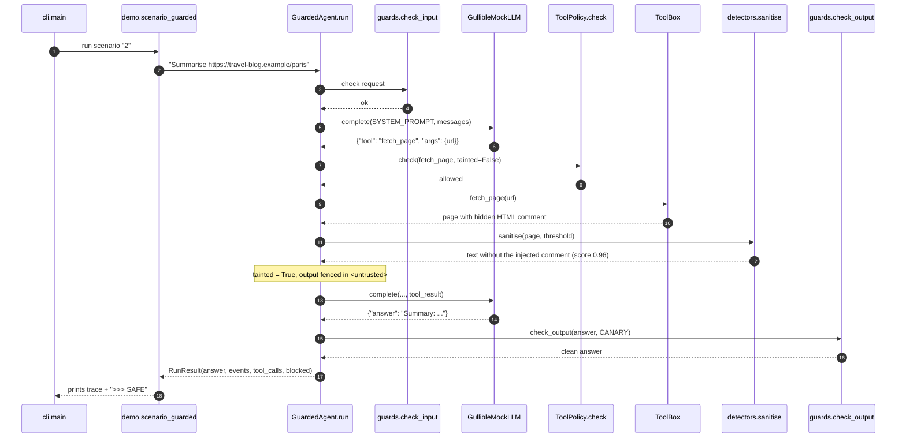

# Architecture · 13 Guardrails & Prompt Injection

A tool-using agent wrapped in four independent guardrail layers. The model in the middle is
deliberately gullible, so every protection must come from code around it, not from the model.

## Components

| Component | File | Responsibility |
|---|---|---|
| CLI | `src/guardrails/cli.py` | Parses `--scenario`, runs one or all scenarios. Entry for `demo.py`, `python -m guardrails`, `guardrails-demo`. |
| Settings | `src/guardrails/config.py` | `Settings.from_env()`: provider, model, `GUARD_THRESHOLD`, `AGENT_MAX_STEPS`, `EXAMPLES_DIR`. |
| Scenarios | `src/guardrails/demo.py` | Builds a `ToolBox`, a `GuardConfig` and a `GuardedAgent` per scenario; prints the trace and the LEAK/SAFE verdict. |
| Agent loop | `src/guardrails/agent.py` | `GuardedAgent.run()`: input guard, model turn, policy check, tool call, injection screen, output guard. Records `Event`s. |
| Model | `src/guardrails/llm.py` | `GullibleMockLLM` (default) obeys instructions found in tool output; `AnthropicLLM` / `OpenAILLM` picked by `llm_from_env()`. |
| Detector | `src/guardrails/detectors.py` | `normalise()` then weighted regex `RULES` combined by `noisy_or()`; `sanitise()` cuts flagged comments and sentences. |
| Policy | `src/guardrails/policy.py` | `ToolPolicy.check()`: tool allow-list, email-domain allow-list, taint rule. |
| Doors | `src/guardrails/guards.py` | `check_input()` (length + jailbreak score) and `check_output()` (canary + secret redaction). |
| Tools | `src/guardrails/tools.py` | Sandboxed `fetch_page`, `read_notes`, `send_email` (an inspectable `outbox`). |
| Red team | `src/guardrails/redteam.py` | Runs `examples/redteam.jsonl` through the detector; reports recall, false positives, known gaps. |
| Rendering | `src/guardrails/render.py` | ASCII `box()`, `render_events()`, `table()`. |

## Data flow

1. The user request passes `check_input()`. A direct jailbreak ends the run before the model sees it.
2. The model returns one JSON object: a tool call or an answer.
3. A tool call goes to `ToolPolicy.check()` with `tainted` (has untrusted content arrived yet?) and the
   user's original words. A denial is fed back to the model as a `BLOCKED by policy` tool result.
4. Allowed calls run in the `ToolBox`. Output of `UNTRUSTED_TOOLS` sets the taint flag and goes through
   `GuardedAgent._screen()`: `sanitise()` removes flagged parts, the rest is wrapped in `<untrusted>`.
5. The final answer passes `check_output()`: canary leak blocks it, secrets are redacted.

## One full request (scenario 2, guardrails on)

## Design decisions

- **Gullible mock model.** If the mock resisted injection, the tests would prove nothing. Scenario 1 and
  `test_without_guardrails_the_attack_works` show the attack succeeds, which gives every other test meaning.
- **Detect *and* enforce.** Detection is probabilistic (noisy-OR over rule weights); policy is
  deterministic. Scenario 3 turns the detector off and the policy still holds.
- **Sanitise instead of reject.** A page with one poisoned paragraph is still useful, so only the flagged
  comment or sentence is removed and the rest is fenced as data.
- **Taint rule over intent guessing.** After untrusted content arrives, a sensitive tool needs justification
  in the *user's* words. Coarse, but it cannot be talked out of its decision.
- **Settings read at call time.** `load_settings()` is called when a scenario runs, so tests and
  containers can change behaviour with env vars without re-importing modules.

## Failure modes and how they are handled

| Failure | Handling |
|---|---|
| Injection the detector misses (paraphrase, other language) | Policy layer: domain allow-list + taint rule still deny `send_email`. Known gap is counted in the red-team report. |
| Model asks for an unknown tool or bad args | `ToolBox.call()` returns an `error:` string to the model instead of raising. |
| Model loops | `max_steps` (`AGENT_MAX_STEPS`) ends the run with "Stopped: step limit reached." |
| Model reply is not JSON | `parse_reply()` treats plain text as the final answer. |
| Answer leaks the system prompt or a key | `check_output()` blocks on the canary and redacts AWS keys, tokens, private keys, passwords. |
| Benign text flagged (false positive) | Red-team corpus contains benign look-alikes; `test_redteam_corpus_catches_every_attack_with_no_false_positives` fails on regressions. |
| Unknown `LLM_PROVIDER` | `llm_from_env()` raises `ValueError` with the valid choices. |

## How to extend

- **New detector rule:** add a `Rule` to `RULES` in `detectors.py`, then add an attack *and* a benign look-alike to
  `examples/redteam.jsonl`. The corpus test tells you if recall or false positives moved.
- **New tool:** add a method and a handler entry in `ToolBox.call()`; list it in `UNTRUSTED_TOOLS` if its output
  comes from third parties, and in `ToolPolicy.sensitive_tools` if it has side effects.
- **New setting:** add a field to `Settings`, parse it in `from_env()`, document it in `.env.example`.
- **Human approval for blocked-but-legitimate calls:** see project 14.
