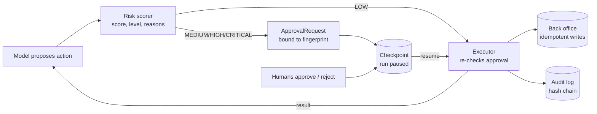
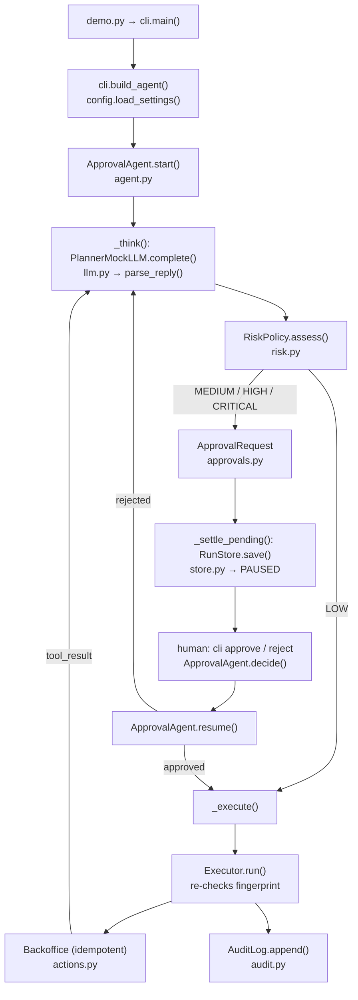

# 14 · Human-in-the-Loop Approvals

Build an agent that scores the risk of every action, pauses for a human on the risky ones, resumes days later from a checkpoint and keeps a tamper-evident audit log, in ~900 lines of stdlib Python.

**Level:** Intermediate

**You'll learn:**
- How to turn "is this dangerous?" into a risk **score, level and reasons** a human can act on
- Why an approval must be **bound to a fingerprint** of the exact action
- Separation of duties, written reasons and two-person rules for CRITICAL actions
- **Resumable runs:** checkpoint, exit, resume in a new process, never repeat a side effect
- A **hash-chained audit log** that shows exactly which line was edited

## Why this matters

A support team lets an agent handle "I was charged twice" tickets. Looking up the order is harmless. Refunding 1,249.00 is not, and deleting a customer's data can't be undone. The team wants the agent to do the boring parts on its own, stop at the risky parts, and show a reviewer exactly what it wants to do and why. Finance wants proof afterwards of who approved what. That's this project. The same pattern guards deployments, database migrations, wire transfers and anything else an agent should never do unsupervised.

## Architecture



The model only **proposes** JSON actions. The risk scorer adds points for money, external recipients, irreversibility and data deletion, then maps the score to LOW (runs), MEDIUM/HIGH (one approver; HIGH needs a written reason) or CRITICAL (two different approvers). A risky proposal becomes an `ApprovalRequest`, the run is written to disk and the process can exit. Humans decide later from any process; `resume()` loads the checkpoint and carries on. The `Executor` is the only code that touches the back office, and it checks the approval again at that boundary. Every step is written to an append-only, hash-chained audit log.

## Flow

One run, as the code executes it (box names are real functions and files):



## Project structure

```
14-human-in-the-loop-approvals/
├── README.md                 # this tutorial
├── docs/ARCHITECTURE.md      # components, sequence diagram, design decisions, failure modes
├── pyproject.toml            # package metadata, `hitl` script, pytest + ruff config
├── requirements.txt          # pinned deps (runtime is stdlib only)
├── Makefile                  # install / test / demo / pending / audit / lint / docker / clean
├── Dockerfile                # python:3.12-slim, non-root, state in /data
├── .env.example              # every setting config.py reads
├── demo.py                   # one-command demo, no install needed
├── src/hitl/
│   ├── __init__.py           # public API + __version__
│   ├── config.py             # typed Settings loaded from env
│   ├── cli.py                # story + start/pending/approve/reject/resume/audit
│   ├── agent.py              # ApprovalAgent state machine + Executor
│   ├── risk.py               # RiskPolicy: score, level, reasons
│   ├── approvals.py          # ApprovalRequest and the decision rules
│   ├── store.py              # RunState checkpoints (atomic JSON)
│   ├── actions.py            # Action, TOOL_SPECS, idempotent Backoffice
│   ├── audit.py              # hash-chained AuditLog
│   ├── llm.py                # PlannerMockLLM, Anthropic/OpenAI adapters
│   └── render.py             # trace lines, approval cards, audit table
└── tests/                    # unit tests + test_e2e_demo.py (story and subcommands)
```

Run it the "team" way: `make test`, `make demo`, or `docker build -t hitl . && docker run --rm hitl`.

## Quickstart

Windows (PowerShell):
```powershell
cd projects/14-human-in-the-loop-approvals
python -m venv .venv; .venv\Scripts\Activate.ps1
pip install -r requirements.txt
python demo.py
python -m pytest -q
```

macOS / Linux:
```bash
cd projects/14-human-in-the-loop-approvals
python3 -m venv .venv && source .venv/bin/activate
pip install -r requirements.txt
python demo.py
python -m pytest -q
```

Expected output (shortened):
```
[model]  step 1: lookup_order(order_id='A-1042')
            risk LOW (5/100)
[tool]   lookup_order -> {"order_id": "A-1042", "customer_id": "C-77", "email": "dana...
[model]  step 2: issue_refund(order_id='A-1042', amount=1249.0)
            risk HIGH (60/100)
[PAUSE]  PAUSED: req-2 needs approval
+-- APPROVAL NEEDED  req-2  (run-2f4f6d39) ----------------------------------+
| action      : issue_refund(order_id='A-1042', amount=1249.0)               |
| risk        : HIGH (60/100)                                                |
|   - amount 1249.00 > 1000.00: +35                                          |
| needs       : 1 approver(s), written reason   [0/1 so far]                 |
| fingerprint : caefff80207d13b0                                             |
+----------------------------------------------------------------------------+
[refused] sam -> sam started this run and cannot approve it
[refused] alice (no reason) -> HIGH risk approvals need a written reason
[tool]   issue_refund -> refund rf_0001 of 1249.00 issued for A-1042
[model]  step 4: close_account(customer_id='C-78', purge_data=True)
            risk CRITICAL (80/100)
[human+] alice approved   -> request is still pending (1/2)
[human-] req-4 rejected by bob
[done]   Finished. lookup_order: ok; issue_refund: ok; send_email: ok; close_account: rejected.
verify(): audit chain intact
verify() after someone edits bob's rejection: entry 19 was modified
```

Drive it by hand across separate processes:
```bash
python demo.py start --by sam            # prints the run id and the approval card
python demo.py pending
python demo.py approve RUN_ID --by alice --comment "ledger shows two captures"
python demo.py resume RUN_ID
python demo.py audit
```

## How it works

**1. Risk with reasons** (`risk.py`). Points stack up and every point comes with a reason the approver will read:

```python
if not spec.reversible:
    score += 25
    reasons.append("cannot be undone: +25")
```

**2. Approvals bound to the action** (`actions.py`, `approvals.py`). The fingerprint is a hash of the tool plus its canonical JSON arguments. A decision for a different fingerprint is refused, so "approve 12.00" can never be replayed as "refund 9,999.00":

```python
canonical = json.dumps({"tool": self.tool, "args": self.args}, sort_keys=True, separators=(",", ":"))
return hashlib.sha256(canonical.encode()).hexdigest()[:16]
```

`decide()` also enforces separation of duties (the requester can't approve), one vote per person, and a written reason for HIGH and CRITICAL. Any rejection wins.

**3. Enforce twice** (`agent.py`). The loop only moves a risky action to execution after it is approved, and `Executor.run` checks again:

```python
if risk.required_approvals:
    if approval is None or approval.status != "approved" or approval.fingerprint != action.fingerprint():
        raise PermissionError(...)
```

**4. Pause and resume.** A run is a JSON file (`store.py`, written atomically with `os.replace`). When an approval is pending the agent saves and returns, and the process can exit. `resume(run_id)` rebuilds everything from disk.

**5. Crash safety.** Before a side effect the agent saves `in_flight` (the intent). Every write in the back office takes an idempotency key (`run_id:req-2`), so if the process dies after the refund but before the checkpoint, resuming replays the same key and gets the first result back instead of refunding twice. `test_crash_between_side_effect_and_checkpoint_never_double_refunds` proves it.

**6. Audit log** (`audit.py`). Each JSONL entry stores the previous entry's hash and its own. Changing one historic line breaks the chain from that point, and `verify()` names the entry.

## Build it yourself

1. **The world.** Write `Backoffice` with `lookup_order`, `issue_refund`, `send_email`, `close_account`. Give every write an `idempotency_key` and remember results by key.
2. **Actions + fingerprints.** A frozen `Action(tool, args)` with a SHA-256 over canonical JSON.
3. **Risk policy.** Base risk per tool plus modifiers; map scores to four levels and a number of required approvers.
4. **Approval requests.** Status is *computed* from decisions (pending / approved / rejected). Add the rules: fingerprint match, no self-approval, one vote each, reasons for HIGH+.
5. **Checkpoints.** A `RunState` dataclass, JSON round-trip, atomic save.
6. **The loop.** think -> score -> (run | request approval and pause). Feed rejections back to the model as `status="rejected"` tool results so it can change plan.
7. **The executor boundary.** Re-check approval right where the tool runs.
8. **Audit chain + tests.** Hash-link entries; write tests for each safety property, including a fake crash right after a side effect.

## Use a real LLM

```bash
pip install anthropic            # or: pip install openai
export LLM_PROVIDER=anthropic    # PowerShell: $env:LLM_PROVIDER="anthropic"
export ANTHROPIC_API_KEY=...     # or OPENAI_API_KEY with LLM_PROVIDER=openai
python demo.py start --by sam
```

The default Anthropic model is `claude-opus-5-5` (override with `LLM_MODEL`). The real model only changes *which* actions get proposed; risk scoring, approvals and execution are the same deterministic code. Tests always use the mock.

## Production notes / pitfalls

- **Approval fatigue is the real risk.** If everything needs a click, people click "yes" without reading. Tune the policy so most actions are LOW, and show reasons, not just a level.
- **Never let the model write the approval card.** The card is generated from the action itself; a model's summary can be wrong or manipulated (see project 13).
- **Expire requests.** A refund approved last month should not run today. Add a TTL and re-request.
- **Idempotency keys belong in the downstream API** (payments providers support them). A local cache only protects you from yourself.
- Keep the audit log somewhere the agent can't write to (WORM storage, a separate service). A hash chain shows tampering; it does not stop it.

## Extend it

1. Add request expiry and a `python demo.py expire` sweep.
2. Send approval cards to Slack/email via a webhook and accept decisions over a small FastAPI endpoint.
3. Let approvers **edit** arguments (e.g. lower the refund), which creates a new fingerprint and a new request.

Next project: [15 · Agent evals harness](../15-agent-evals-harness/README.md).

---
Part of [AI Agent Builds](../../README.md) by [exe_404.ai](https://www.youtube.com/@exe_404ai) — one agentic-AI project a day.
