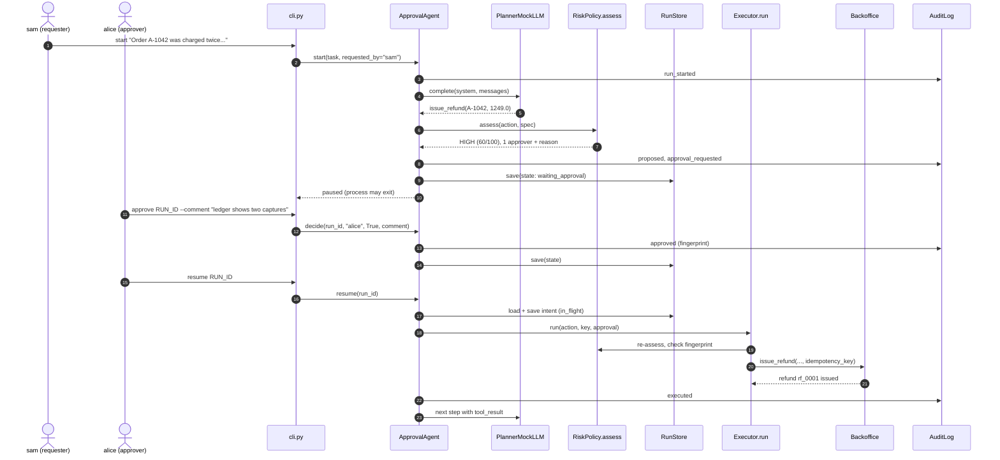

# Architecture · 14 Human-in-the-Loop Approvals

The model proposes actions; code decides whether they may run. Risky actions turn into approval
requests, the run is checkpointed to disk and paused, humans decide from any process, and `resume()`
continues exactly where the run stopped. Every step lands in a hash-chained audit log.

## Components

| Component | File | Responsibility |
|---|---|---|
| CLI | `src/hitl/cli.py` | Scripted `story()` plus `start / pending / approve / reject / resume / audit` subcommands. `build_agent()` wires everything from disk. |
| Settings | `src/hitl/config.py` | `Settings.from_env()`: provider, model, `HITL_STATE_DIR`, `AGENT_MAX_STEPS`, risk thresholds and company domains. |
| Agent | `src/hitl/agent.py` | `ApprovalAgent.start / resume / decide` and the `_drive()` state machine (`_think`, `_settle_pending`, `_execute`). |
| Executor | `src/hitl/agent.py` | `Executor.run()`: the only code that touches the back office; re-checks the approval and fingerprint. |
| Risk | `src/hitl/risk.py` | `RiskPolicy.assess()` turns an `Action` into a score, `Level` and readable reasons. |
| Approvals | `src/hitl/approvals.py` | `ApprovalRequest.decide()`: fingerprint binding, separation of duties, two approvers for CRITICAL, reasons for HIGH+. |
| Checkpoints | `src/hitl/store.py` | `RunState` + `RunStore`: atomic JSON checkpoints (`os.replace`). |
| Back office | `src/hitl/actions.py` | `Action`, `TOOL_SPECS`, `Backoffice` with idempotency keys on every write. |
| Audit | `src/hitl/audit.py` | `AuditLog.append()` / `verify()`: append-only JSONL, each entry hashes the previous one. |
| Model | `src/hitl/llm.py` | `PlannerMockLLM` (default) adapts to rejections; `AnthropicLLM` / `OpenAILLM` via `llm_from_env()`. |
| Rendering | `src/hitl/render.py` | `print_event`, `approval_card`, `audit_table`, `box`. |

## Data flow

1. `start()` creates a `RunState` and logs `run_started`.
2. `_think()` asks the model for one JSON action, scores it with `RiskPolicy.assess()` and logs `proposed`.
3. LOW risk goes straight to `in_flight`. Anything else becomes an `ApprovalRequest`; `_settle_pending()`
   saves the checkpoint, sets `waiting_approval` and returns, so the process can exit.
4. `decide()` (any later process) records a decision after the approval rules pass, or logs `decision_refused`.
5. `resume()` reloads the checkpoint. Approved requests move to `in_flight`; rejections are fed back to
   the model as a `status="rejected"` tool result so it can adapt.
6. `_execute()` saves the intent *before* the side effect, then `Executor.run()` performs it with an
   idempotency key and the result is logged as `executed` (or `blocked`).

## One full request (the refund that needs approval)

## Design decisions

- **Two gates.** The agent loop never moves a risky action to execution without an approved request, and
  `Executor.run()` checks again at the boundary, so no other code path can skip approval.
- **Approvals bound to a fingerprint.** `Action.fingerprint()` hashes tool + args; changing one argument
  after review invalidates the approval.
- **Separation of duties.** The requester cannot approve their own run; CRITICAL needs two distinct people
  and any single "no" wins.
- **Checkpoint, don't block.** A paused run is a JSON file, so approvals can take days and survive restarts.
- **Intent before side effect + idempotency keys.** If the process dies between the refund and the checkpoint,
  resuming replays the same key and the back office returns the first result instead of refunding twice.
- **Hash-chained audit.** Editing any past entry breaks every later hash; `verify()` names the entry.

## Failure modes and how they are handled

| Failure | Handling |
|---|---|
| Crash after a side effect, before the checkpoint | `in_flight` is saved first; replay hits `Backoffice._once()` with the same idempotency key. |
| Crash mid-checkpoint write | `RunStore.save()` writes a `.tmp` file then `os.replace()`: old checkpoint or new, never half. |
| Requester approves own run / same person twice / no reason on HIGH | `ApprovalRequest.decide()` raises `ApprovalError`; logged as `decision_refused`. |
| Arguments changed after review | Fingerprint mismatch: `decide()` refuses, `Executor.run()` raises `PermissionError` (logged `blocked`). |
| Human rejects | Rejection is fed back as a tool result; `PlannerMockLLM` adapts instead of retrying. |
| Model proposes unknown tool / loops | Unknown tool returns an `error` result; `AGENT_MAX_STEPS` fails the run. |
| Audit log tampered | `AuditLog.verify()` reports the first modified entry or broken chain. |

## How to extend

- **New tool:** add a `ToolSpec` to `TOOL_SPECS` and a `Backoffice` method that wraps its write in `_once()`.
- **New risk signal:** add a rule in `RiskPolicy.assess()` with a readable reason; expose thresholds in `config.py`.
- **Approval expiry / Slack approvals:** add `created_at` checks in `ApprovalRequest.decide()`, or call `decide()` from
  a webhook instead of the CLI; the run state already lives on disk.
- **Production storage:** swap `RunStore` and `AuditLog` for a database with the same methods.
