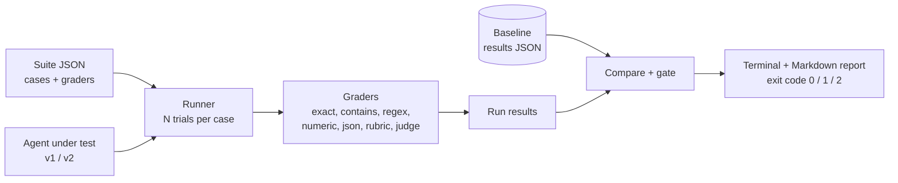
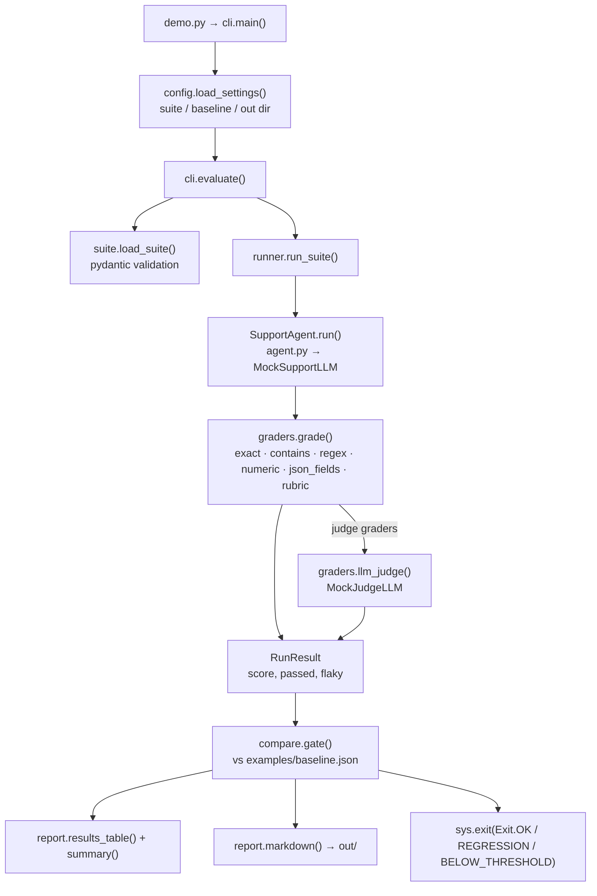

# 15 · Agent Evals Harness

Build an eval harness that catches a "friendlier" prompt quietly breaking three answers, and fails CI with exit code 1, in ~700 lines of Python.

**Level:** Intermediate

**You'll learn:**
- How to write an eval **suite** as data (JSON validated by pydantic), not as ad-hoc scripts
- Six grader types, from free and exact (`exact`, `contains`, `numeric`, ...) to `rubric` and **LLM-as-judge**
- Why you gate on **case flips** against a baseline, not just on the average
- How repeated trials expose **flaky** cases
- How to wire it into CI with meaningful **exit codes** (0 ok, 1 regression, 2 below threshold)

## Why this matters

A shop's support bot works. Someone rewrites the prompt to sound warmer and the demo looks great: angry customers now get an apology. What nobody noticed is that the new prompt also says returns are 14 days (policy is 30), charges shipping on the first item twice, and turned a two-line answer into a paragraph. The average score barely moves. A regression gate that compares **case by case** against the released baseline catches all three before customers do. Every team shipping an LLM feature needs this the day they change a prompt or a model.

## Architecture



A suite is a JSON file of cases; each case has an input, tags and one or more graders. The runner sends each input to the agent (optionally several times), grades every output, and records a weighted score and pass/fail per case. The comparison step lines the run up against a saved baseline and lists **regressions** (passed before, fails now) and **fixes**. The gate turns that into an exit code your CI understands. The agent is a black box: swap the mock for a real model and nothing else changes.

## Flow

One CI run, as the code executes it (box names are real functions and files):



## Project structure

```
15-agent-evals-harness/
├── README.md                 # this tutorial
├── docs/ARCHITECTURE.md      # components, sequence diagram, design decisions, failure modes
├── pyproject.toml            # package metadata, `evalkit` script, pytest + ruff config
├── requirements.txt          # pinned deps (pydantic + pytest)
├── Makefile                  # install / test / demo / eval / baseline / lint / docker / clean
├── Dockerfile                # python:3.12-slim, non-root, runs the story or the CI gate
├── .env.example              # every setting config.py reads
├── demo.py                   # one-command demo, no install needed
├── src/evalkit/
│   ├── __init__.py           # public API + __version__
│   ├── config.py             # typed Settings loaded from env
│   ├── cli.py                # story + `run` CI mode, evaluate()
│   ├── suite.py              # pydantic Suite / Case / GraderSpec
│   ├── agent.py              # SupportAgent: the system under test
│   ├── llm.py                # MockSupportLLM v1/v2, MockJudgeLLM, real adapters
│   ├── runner.py             # run_suite → RunResult / CaseResult
│   ├── graders.py            # deterministic graders + llm_judge
│   ├── compare.py            # compare() + gate() → exit codes
│   └── report.py             # terminal table + Markdown report
├── tests/                    # unit tests + test_e2e_demo.py (story + CI subprocess)
└── examples/                 # support_suite.json, baseline.json
```

Run it the "team" way: `make test`, `make eval AGENT=v2`, or `docker build -t evalkit . && docker run --rm evalkit`.

## Quickstart

Windows (PowerShell):
```powershell
cd projects/15-agent-evals-harness
python -m venv .venv; .venv\Scripts\Activate.ps1
pip install -r requirements.txt
python demo.py
python -m pytest -q
```

macOS / Linux:
```bash
cd projects/15-agent-evals-harness
python3 -m venv .venv && source .venv/bin/activate
pip install -r requirements.txt
python demo.py
python -m pytest -q
```

Expected output (shortened):
```
+-- v2 (new prompt: 'friendlier') vs baseline -------------------------------+
  case                   score  status     why
  ----------------------------------------------------------------------------
  refund_window           0.00  REGRESSED  missing '30 days'
  shipping_cost           0.00  REGRESSED  got 9.49, expected 7.99 +/- 0.01
  order_shipped           1.00  pass
  broken_package          0.75  REGRESSED  failed: under 60 words
  angry_customer          1.00  FIXED
  pass rate 70%   mean score 0.775   agent mock:support-v2
  vs baseline: 3 regressed, 1 fixed, score -0.125, pass rate -20%
  GATE: REGRESSION (exit code 1)
    - 3 case(s) regressed: refund_window, shipping_cost, broken_package
```

CI mode (the process exit code is the gate):
```bash
python demo.py run --agent v2 --baseline examples/baseline.json   # exits 1
python demo.py run --agent v1 --save-baseline examples/baseline.json
python demo.py run --agent v1 --trials 5                           # flakiness check
```

Each run also writes `out/results-<agent>.json` and `out/report-<agent>.md` (paste the Markdown into a PR comment).

## How it works

**1. Suites are validated data** (`suite.py`). A misspelt grader type or a duplicate id fails at load time:

```python
class GraderSpec(BaseModel):
    type: GraderType          # Literal["exact", "contains", "regex", "numeric", "json_fields", "rubric", "llm_judge"]
    params: dict[str, Any] = Field(default_factory=dict)
    weight: float = Field(default=1.0, gt=0)
```

**2. Graders return a score, a verdict and a reason** (`graders.py`). The reason is what makes a failing report actionable. Even graders have bugs: the first version of `numeric` read the **first** number, so "Shipping for **3** items costs $7.99" was graded as 3. It now reads the last number by default, and that case is a unit test.

**3. LLM-as-judge, parsed defensively.** The judge gets a fixed prompt and must reply `SCORE: n`. Anything else is a failing grade with the raw reply in the detail, never a crash and never a silent pass:

```python
match = re.search(r"SCORE:\s*([1-5])", reply)
if not match:
    return Grade(0.0, False, f"unparseable judge reply: {reply[:40]!r}")
```

**4. Gate on flips, then on averages** (`compare.py`):

```python
if comparison and comparison.regressions:
    reasons.append(f"{len(comparison.regressions)} case(s) regressed: ...")
if comparison and comparison.score_delta < -score_tolerance:
    reasons.append(f"mean score dropped ...")
```

v2 *fixed* `angry_customer`; a gate based only on "did the average go up" could let it through. Case flips can't hide.

**5. Trials expose flakiness** (`runner.py`). With `--trials N` a case passes only if every trial passes, and a case that passes some trials is marked `(flaky)`. `test_repeated_trials_expose_flaky_cases` uses a model that is right every other call.

## Build it yourself

1. **The agent under test.** Any `run(question) -> answer` works. Here: a JSON-protocol support agent with one `order_status` tool and two mock "prompt versions".
2. **Suite schema.** pydantic models for `Case`, `GraderSpec`, `Suite`; write 10 cases with tags.
3. **Simple graders.** `exact`, `contains` (with forbidden phrases), `regex`, `numeric`, `json_fields`. Unit-test each one, including the ways it can be wrong.
4. **Rubric grader.** Weighted criteria built from the simple checks plus `max_words`.
5. **Judge grader.** A fixed prompt, a strict reply format, defensive parsing. Start with a mock judge so tests are deterministic.
6. **Runner.** Loop cases x trials, time each call, compute weighted scores, store outputs.
7. **Baseline + compare.** Save a run as JSON; compute regressions, fixes and deltas.
8. **Gate + CLI.** Map the comparison to exit codes and print a report a human can read in five seconds.

## Use a real LLM

```bash
pip install anthropic            # or: pip install openai
export LLM_PROVIDER=anthropic    # PowerShell: $env:LLM_PROVIDER="anthropic"
export ANTHROPIC_API_KEY=...     # or OPENAI_API_KEY with LLM_PROVIDER=openai
python demo.py run --agent v1 --no-baseline --trials 3
```

With a provider set, the *agent under test* uses the real model (default Anthropic model `claude-opus-5-5`, override with `LLM_MODEL`); the judge stays the deterministic mock so grading is reproducible. To use a real judge, pass `llm_from_env(...)` as `judge` in `cli.evaluate`. Save a new baseline for the real model before gating on it.

## Production notes / pitfalls

- **Grade your graders.** A buggy grader (like `numeric` reading the first number) makes every run look wrong or right. Unit-test graders with known-good and known-bad outputs.
- **LLM judges drift and cost money.** Pin the judge model and prompt, keep the judge's own small eval set, and prefer deterministic graders wherever they measure the thing you care about.
- **Run trials on real models.** Sampling makes outputs vary; a case that passes 3/5 times is a bug report, not a pass.
- **Version the suite.** When you change cases, re-baseline deliberately and say so in the PR, or the gate compares apples to pears.
- Keep the suite fast (seconds) so it runs on every PR; put the slow, expensive suite on a nightly job.

## Extend it

1. Add a `tool_calls` grader that checks the agent called `order_status` exactly once.
2. Track cost and latency per case and gate on "p95 latency up more than 20%".
3. Write a pairwise judge (A vs B) and show where v2 is preferred despite failing hard checks.

Next project: [16 · Agent tracing & observability](../16-agent-tracing-observability/README.md).

---
Part of [AI Agent Builds](../../README.md) by [exe_404.ai](https://www.youtube.com/@exe_404ai) — one agentic-AI project a day.
