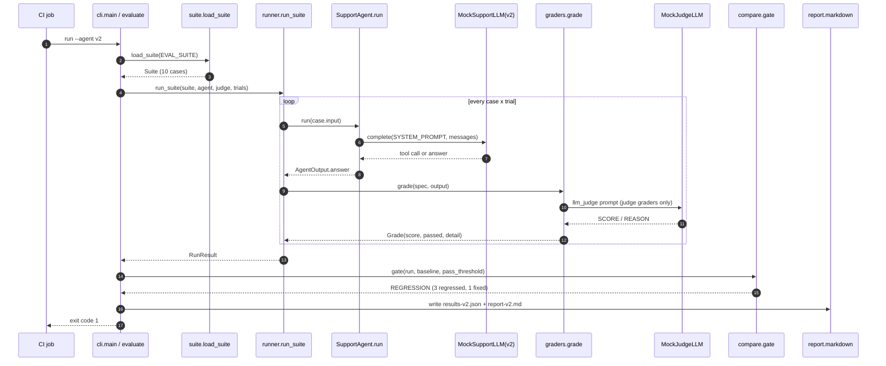

# Architecture · 15 Agent Evals Harness

An evals harness treats the agent as a black box: feed it every case in a suite, grade each output
with deterministic graders (and an LLM judge where words matter), compare the run with a saved
baseline, and turn the result into an exit code CI can act on.

## Components

| Component | File | Responsibility |
|---|---|---|
| CLI | `src/evalkit/cli.py` | `story()` (v1 then v2 vs baseline) and `run` (CI mode). `evaluate()` wires suite, agent, runner, gate and reports. |
| Settings | `src/evalkit/config.py` | `Settings.from_env()`: provider, model, `EVAL_SUITE`, `EVAL_BASELINE`, `EVAL_OUT_DIR`, `EVAL_TRIALS`, `AGENT_MAX_STEPS`. |
| Suite | `src/evalkit/suite.py` | Pydantic `Suite` / `Case` / `GraderSpec`; `load_suite()` validates the JSON before anything runs. |
| Agent under test | `src/evalkit/agent.py` | `SupportAgent.run()`: a small tool-using loop with one tool (`order_status`). |
| Models | `src/evalkit/llm.py` | `MockSupportLLM("v1"/"v2")` (system under test), `MockJudgeLLM`, and real adapters via `llm_from_env()`. |
| Runner | `src/evalkit/runner.py` | `run_suite()`: N trials per case, weighted score, pass/fail, flakiness, latency → `RunResult`. |
| Graders | `src/evalkit/graders.py` | `exact`, `contains`, `regex`, `numeric`, `json_fields`, `rubric`, `llm_judge`, dispatched by `grade()`. |
| Gate | `src/evalkit/compare.py` | `compare()` finds regressions and fixes; `gate()` maps them to `Exit.OK / REGRESSION / BELOW_THRESHOLD`. |
| Reports | `src/evalkit/report.py` | Terminal `banner`, `results_table`, `summary`; `markdown()` for a PR comment or CI artifact. |

## Data flow

1. `load_suite()` validates `examples/support_suite.json` (cases, tags, graders, weights, pass threshold).
2. `run_suite()` sends each case input to `SupportAgent.run()` (`trials` times) and grades every output.
3. Each case gets a weighted score in [0, 1] and passes only if every grader passed in every trial.
4. `gate()` loads the baseline `RunResult`, lists regressions (passed before, fails now) and fixes,
   checks the score tolerance and the absolute pass threshold, and picks the exit code.
5. `evaluate()` writes `results-<version>.json` and `report-<version>.md`; the CLI prints the table and exits.

## One full request (`python demo.py run --agent v2`)

## Design decisions

- **Regressions beat averages.** v2 fixes one case and breaks three; a mean score could hide that. The gate fails on
  any case that passed in the baseline and fails now.
- **Deterministic graders first, judge last.** Exact, numeric and JSON checks are free and never flaky; the LLM judge
  is reserved for tone and coverage and its output is parsed defensively.
- **Suites are validated data.** Pydantic rejects bad suites up front, so a typo cannot silently skip a grader.
- **Trials expose flakiness.** A case that passes 2 of 4 trials is reported as flaky and fails the gate.
- **Exit codes are the API.** `0` pass, `1` regression, `2` below the absolute threshold: any CI system understands them.

## Failure modes and how they are handled

| Failure | Handling |
|---|---|
| Malformed suite, unknown grader type, duplicate case ids | `load_suite()` raises a pydantic `ValidationError` before any agent call. |
| Agent never answers | `SupportAgent` stops at `AGENT_MAX_STEPS` with `[no answer: step limit]`, which graders fail. |
| Judge returns garbage | `llm_judge()` returns score 0, failed, with `unparseable judge reply: ...` as the detail. |
| Non-JSON output where JSON is expected | `json_fields()` scores 0 with a readable detail instead of raising. |
| Missing baseline file | `evaluate()` gates on the absolute threshold only. |
| Flaky case | `CaseResult.flaky` is true; `passed` requires every trial to pass. |

## How to extend

- **New grader:** write `def my_grader(output, params) -> Grade` in `graders.py`, register it in the `SIMPLE` table used by
  `grade()`, and add the name to the `GraderType` literal in `suite.py`.
- **New case:** add it to `examples/support_suite.json`, run `make eval AGENT=v1`, then `make baseline` when you accept it.
- **Real agent:** set `LLM_PROVIDER=anthropic`; nothing else changes because the agent is a black box.
- **New setting:** add a field to `Settings`, parse it in `from_env()`, document it in `.env.example`.
