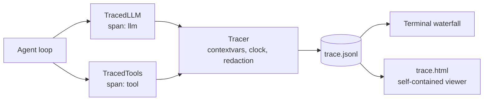
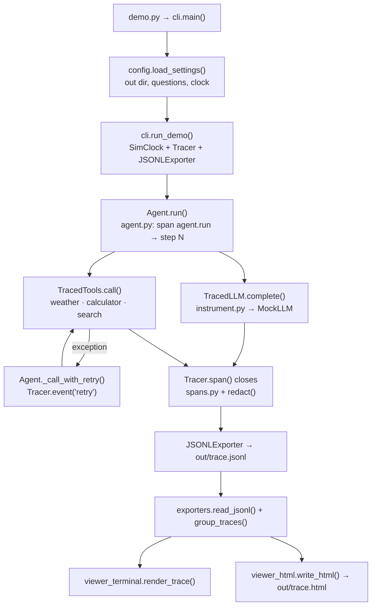

# 16 · Agent Tracing & Observability

Build span-based tracing for an agent, so every model and tool call ends up in a JSONL file, a terminal waterfall and a single-file HTML viewer, in ~800 lines of stdlib Python.

**Level:** Intermediate

**You'll learn:**
- What traces, spans, parents and events are, and why an agent run is a **tree**
- How `contextvars` give every span the right parent without passing it around
- How to instrument at **two seams** (model + tools) so no call can go untraced
- How to turn token usage into **cost per run** and find the slowest call
- How to export to JSONL and render a **self-contained HTML viewer** safely

## Why this matters

A user says "the assistant took 12 seconds and gave a wrong answer". Without traces you have a log line saying `200 OK`. With traces you open the run and see: three model calls, a search tool that timed out after 1.5 s and was retried, 1,880 ms in tools, $0.0014 spent, and exactly which tool output the model saw before answering. Every team running agents in production needs this, for debugging, latency budgets, cost control and evals (project 15 grades the output; tracing shows *how* the agent got there).

## Architecture



The `Tracer` opens a span with a context manager. The current span lives in a `ContextVar`, so a span opened inside another one automatically becomes its child. The agent opens only two kinds of span itself (`agent.run` and `step N`); the model and the tools are wrapped once (`TracedLLM`, `TracedTools`), and every call through them becomes an `llm` or `tool` span with inputs, outputs, token usage and cost. Errors are recorded as span status plus an `exception` event, and retries are events on the step. Finished spans stream to a JSONL exporter; the two viewers read that file.

## Flow

One traced run, as the code executes it (box names are real functions and files):



## Project structure

```
16-agent-tracing-observability/
├── README.md                 # this tutorial
├── docs/ARCHITECTURE.md      # components, sequence diagram, design decisions, failure modes
├── pyproject.toml            # package metadata, `tracekit` script, pytest + ruff config
├── requirements.txt          # pinned deps (runtime is stdlib only)
├── Makefile                  # install / test / demo / view / lint / docker / clean
├── Dockerfile                # python:3.12-slim, non-root, traces written to /data
├── .env.example              # every setting config.py reads
├── demo.py                   # one-command demo, no install needed
├── src/tracekit/
│   ├── __init__.py           # public API + __version__
│   ├── config.py             # typed Settings loaded from env
│   ├── cli.py                # run_demo() + --out / --questions / --real-clock / --view
│   ├── agent.py              # tool-using Agent with retries
│   ├── instrument.py         # TracedLLM (tokens, cost) + TracedTools
│   ├── spans.py              # Span, Tracer (ContextVar), clocks, redact()
│   ├── exporters.py          # JSONL export, grouping, summaries
│   ├── viewer_terminal.py    # ASCII waterfall
│   ├── viewer_html.py        # self-contained HTML viewer
│   └── llm.py                # MockLLM with usage, Anthropic/OpenAI adapters
├── tests/                    # unit tests + test_e2e_demo.py (full demo + --view)
└── examples/questions.txt    # the demo's questions
```

Run it the "team" way: `make test`, `make demo`, or `docker run --rm -v "$PWD/out:/data" $(docker build -q .)`.

## Quickstart

Windows (PowerShell):
```powershell
cd projects/16-agent-tracing-observability
python -m venv .venv; .venv\Scripts\Activate.ps1
pip install -r requirements.txt
python demo.py
start out\trace.html
python -m pytest -q
```

macOS / Linux:
```bash
cd projects/16-agent-tracing-observability
python3 -m venv .venv && source .venv/bin/activate
pip install -r requirements.txt
python demo.py
open out/trace.html        # Linux: xdg-open out/trace.html
python -m pytest -q
```

Expected output (shortened):
```
TRACE 000000000000000b  "Find the latest news about solar batteries."
  total 2,767 ms | llm 2 calls 887 ms | tools 2 calls 1,880 ms | tokens 147 in / 43 out | $0.0014 | errors 1
  span                            start  dur ms  |waterfall                         |
  agent.run                           0    2767  |##################################|
    step 1                            0    2256  |############################      |
      * retry: TimeoutError
      llm mock-llm                    0     376  |#####                             |
      tool search                   376    1500  |    !!!!!!!!!!!!!!!!!!            |
        * exception: TimeoutError search backend did not answer within 1500 ms
      tool search                  1876     380  |                       #####      |
    step 2                         2256     511  |                           ###### |
      llm mock-llm                 2256     511  |                           ###### |
  slowest: tool search (1500 ms)

16 spans exported | HTML viewer: out/trace.html
```

The HTML file has a tab per trace, stat tiles (total time, calls, tokens, cost, errors), a colour-coded waterfall and a details panel for any span you click. It works offline and follows your light/dark setting. Re-render an existing export with `python demo.py --view out/trace.jsonl`.

## How it works

**1. A span is a timed node with a parent** (`spans.py`). The tracer remembers the current span in a `ContextVar` and restores the previous one when the block ends, even on exceptions:

```python
parent = self._current.get()
span = Span(trace_id=parent.trace_id if parent else self._new_id(8),
            span_id=self._new_id(4), parent_id=parent.span_id if parent else None, ...)
token = self._current.set(span)
try:
    yield span
except BaseException as exc:
    span.status = "error"
    span.add_event("exception", self.clock.now(), type=type(exc).__name__, message=str(exc), ...)
    raise
finally:
    span.end_ms = self.clock.now()
    self._current.reset(token)
```

**2. Instrument the seams** (`instrument.py`). `TracedLLM.complete` wraps every model call and records `usage.input_tokens`, `usage.output_tokens` and `cost_usd` from a price table. `TracedTools.call` wraps every tool call, including the ones that raise. The agent (`agent.py`) contains almost no tracing code, which is the point.

**3. Simulated time for a reproducible demo.** The mocks "sleep" by advancing a `SimClock`, so the waterfall is identical on every machine and the tests can assert exact durations. With a real model the tracer uses `time.perf_counter`.

**4. Redact before you store.** `Span.set` passes every attribute through `redact()`: keys like `api_key` or `authorization` and values that look like `sk-...` / `AKIA...` become `[REDACTED]`, and long values are truncated. Traces get pasted into tickets and dashboards; secrets must never get there.

**5. A safe single-file viewer** (`viewer_html.py`). Spans are embedded as JSON with `<`, `>` and `&` escaped as `<`, and the page builds the DOM with `textContent`, so a model output containing `</script><script>` is shown as text and never runs. `test_html_viewer_is_self_contained_and_escapes_hostile_text` proves both.

## Build it yourself

1. **Span + Tracer.** A dataclass with ids, parent, kind, start/end, status, attributes and events; a `span()` context manager over a `ContextVar`.
2. **Clock.** A `Clock` protocol with `RealClock` and `SimClock`; inject it into the tracer and the mocks.
3. **Model with usage.** Make `complete()` return text *and* token counts (the mock estimates ~4 chars per token).
4. **Wrap the seams.** `TracedLLM` and `TracedTools` that open a span per call and set inputs, outputs, usage and cost.
5. **Agent loop.** Spans for the run and each step; retry a failing tool once and record a `retry` event.
6. **Exporter.** Write each finished span as one JSON line; write `read_jsonl` and check the round trip.
7. **Terminal viewer.** Build the tree from `parent_id`, then draw a bar per span scaled to the root duration.
8. **HTML viewer.** Embed escaped JSON in one HTML file and render the waterfall with plain DOM code.

## Use a real LLM

```bash
pip install anthropic            # or: pip install openai
export LLM_PROVIDER=anthropic    # PowerShell: $env:LLM_PROVIDER="anthropic"
export ANTHROPIC_API_KEY=...     # or OPENAI_API_KEY with LLM_PROVIDER=openai
python demo.py
```

With a real provider the tracer switches to wall-clock time and records the provider's own token usage (`response.usage`). The default Anthropic model is `claude-opus-5-5` (override with `LLM_MODEL`); add other models to `PRICES` in `instrument.py` to see their cost. Tests always use the mock and the simulated clock.

## Production notes / pitfalls

- **Use OpenTelemetry in production.** This project teaches the model behind it (traces, spans, attributes, events, exporters). OTel adds standard attribute names, sampling and exporters to every backend.
- **Truncate and redact by default.** Full prompts and tool outputs are large and often sensitive. Store previews and hashes; keep full payloads only where access is controlled.
- **Sample, but never drop errors.** Keep 100% of failed or slow traces and a sample of the healthy ones.
- **Prices change.** Keep the price table in config and record model + token counts on each span, so cost can be recomputed later.
- Tracing must never break the agent: exporters should swallow and count their own failures rather than raise into the run.

## Extend it

1. Add an OTLP/JSON exporter and send spans to a local Jaeger or any OpenTelemetry collector.
2. Add a latency budget: mark a trace red when any `llm` span exceeds N ms, and show it in the HTML tiles.
3. Trace an `asyncio.gather` of tools and check that the parallel tool spans overlap in the waterfall.

Next project: [17 · Code review agent](../17-code-review-agent/README.md).

---
Part of [AI Agent Builds](../../README.md) by [exe_404.ai](https://www.youtube.com/@exe_404ai) — one agentic-AI project a day.
