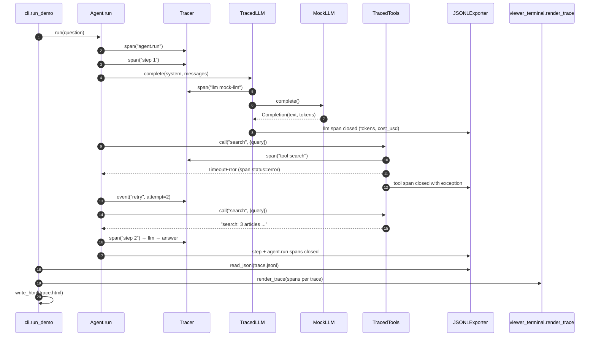

# Architecture · 16 Agent Tracing & Observability

Every model call and tool call becomes a timed **span**; spans nest into one tree per agent run (a
**trace**). Spans are exported as JSONL the moment they finish, and both viewers (terminal waterfall
and self-contained HTML) render from that export alone.

## Components

| Component | File | Responsibility |
|---|---|---|
| CLI | `src/tracekit/cli.py` | `main()` parses `--out / --questions / --real-clock / --view`; `run_demo()` wires clock, tracer, instrumented model and tools. |
| Settings | `src/tracekit/config.py` | `Settings.from_env()`: provider, model, `TRACE_OUT_DIR`, `TRACE_QUESTIONS`, `TRACE_REAL_CLOCK`, `AGENT_MAX_STEPS`, `AGENT_TOOL_RETRIES`. |
| Agent | `src/tracekit/agent.py` | `Agent.run()`: a plain tool-using loop with `_call_with_retry()`. Almost no tracing code. |
| Instrumentation | `src/tracekit/instrument.py` | `TracedLLM` (tokens, cost from `PRICES`, input/output) and `TracedTools` (args, result, errors). |
| Tracer | `src/tracekit/spans.py` | `Tracer.span()` context manager on a `ContextVar`, `Tracer.event()`, `Span`, `SimClock` / `RealClock`, `redact()`. |
| Exporters | `src/tracekit/exporters.py` | `JSONLExporter`, `read_jsonl()`, `group_traces()`, `summarise()` (totals, cost, slowest span). |
| Terminal viewer | `src/tracekit/viewer_terminal.py` | `render_trace()`: waterfall with bars, events and exceptions. |
| HTML viewer | `src/tracekit/viewer_html.py` | `render_html()` / `write_html()`: one self-contained file, hostile text escaped. |
| Model | `src/tracekit/llm.py` | `MockLLM` (simulated latency + token usage), `AnthropicLLM`, `OpenAILLM` via `llm_from_env()`. |

## Data flow

1. `run_demo()` picks a `SimClock` for the mock (deterministic timings and ids) or a `RealClock`.
2. `Agent.run()` opens the root span `agent.run`, then one `step N` span per loop iteration.
3. `TracedLLM.complete()` opens an `llm` child span, records usage and cost; `TracedTools.call()` opens a `tool`
   child span. Exceptions are recorded on the span (status `error`) and re-raised; the agent retries.
4. When a span closes, `Tracer` passes it to every exporter; `JSONLExporter` appends one line.
5. The CLI reads the JSONL back, `group_traces()` splits it per run, and `render_trace()` / `write_html()` draw it.

## One full request ("Find the latest news about solar batteries.")

## Design decisions

- **Instrument the seams, not the agent.** Wrapping the model and the tool registry once means there is no untraced
  way to make a call, and the agent code stays readable.
- **ContextVar for the current span.** Nested code (and asyncio tasks) get the right parent automatically.
- **Simulated clock for the mock.** Demo output and tests are byte-for-byte deterministic, including span ids.
- **Export on close, render from the export.** The viewers read only the JSONL, which proves the export is complete.
- **Redact at write time.** `redact()` masks secret-looking keys and values (API keys, AWS keys) before a span
  attribute is stored, because traces end up in tickets and chat.
- **Cost on every model span.** Usage × `PRICES` makes "why was this run expensive?" a lookup, not a guess.

## Failure modes and how they are handled

| Failure | Handling |
|---|---|
| Tool raises (timeout) | Span records the exception and `status=error`; `Agent._call_with_retry()` emits a `retry` event and tries again. |
| Tool keeps failing | After `AGENT_TOOL_RETRIES`, the model receives `error: <tool> failed: ...` instead of a crash. |
| Exception escapes a span | `Tracer.span()` records the exception, then closes and exports the span in `finally` before re-raising. |
| Agent loops | `AGENT_MAX_STEPS` marks the root span `error` with `step limit reached`. |
| Secrets in prompts or args | `redact()` replaces them with `[REDACTED]`; huge values are truncated at 500 chars. |
| Unknown model price | Cost is 0 and the span gets `cost_note: no price configured for this model`. |
| Hostile text in the HTML viewer | `render_html()` embeds JSON with `<`, `>`, `&` escaped and builds the DOM with `textContent` only. |

## How to extend

- **New exporter (e.g. OTLP):** write any callable `(span) -> None` (like `JSONLExporter`) and pass it in
  `Tracer(exporters=[...])`.
- **New tool:** add a method and an entry in `TracedTools.handlers`; it is traced automatically.
- **Latency budgets:** read a threshold from `config.py` and flag spans in `render_trace()`.
- **New model price:** add it to `PRICES` in `instrument.py`.
