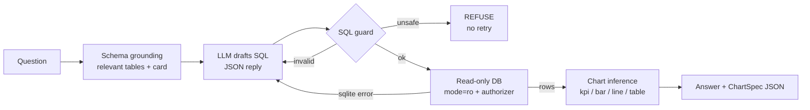
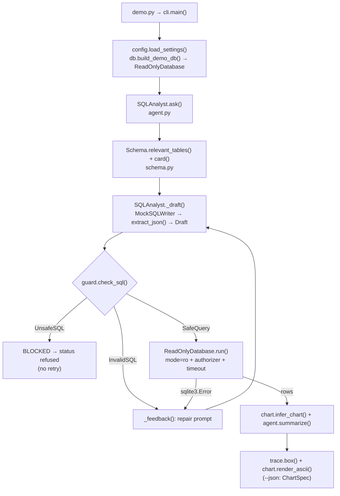

# 18 · SQL Data Analyst Agent

Build an agent that turns plain-English questions into **safe, read-only SQL**, repairs its own mistakes from the
database error, and returns **chart-ready output** - in ~750 lines of Python and zero API keys.

**Level:** Advanced

**You'll learn:**
- How to *ground* a model in a real schema (types, foreign keys, sample values) so it stops inventing columns
- Defence in depth for read-only access: SQL guard + `mode=ro` + `PRAGMA query_only` + a SQLite authorizer
- The difference between "refuse" (unsafe) and "repair" (wrong) - and why you never repair a `DELETE`
- A self-repair loop that feeds the exact database error back to the model
- Shape-based chart inference (kpi / bar / line / table) with a JSON spec any frontend can draw

## Why this matters

Every company has a database and a queue of people asking the data team "how much did we sell in March?". A
text-to-SQL agent lets a sales manager ask that question directly. The catch: the agent is now executing
model-written code against production data. One hallucinated column breaks the answer; one `DELETE` breaks the
company. This project shows the engineering that makes the idea safe enough to ship.

## Architecture



The question is first matched against the live schema so the model only sees the tables it needs, with foreign keys
and example values. The model replies with JSON (`{"sql", "rationale"}`), which is validated with pydantic. The
guard classifies the SQL: **unsafe** (writes, multiple statements, file access) ends the run with a refusal;
**invalid** (unknown table) and real SQLite errors go back to the model as a repair prompt. Execution happens on a
connection that cannot write even if the guard had a bug. Finally the result's *shape* picks a chart type, and every
number in the answer comes from the database - never from the model's prose.

## Flow

One question, as the code executes it (box names are real functions and files):



## Project structure

```
18-sql-data-analyst-agent/
├── README.md                 # this tutorial
├── docs/ARCHITECTURE.md      # components, sequence diagram, design decisions, failure modes
├── pyproject.toml            # package metadata, `sql-analyst` script, pytest + ruff config
├── requirements.txt          # pinned deps (pydantic + pytest)
├── Makefile                  # install / test / demo / ask / lint / docker / clean
├── Dockerfile                # python:3.12-slim, non-root, runs the demo
├── .env.example              # every setting config.py reads
├── demo.py                   # one-command demo, no install needed
├── src/sql_analyst/
│   ├── __init__.py           # public API + __version__
│   ├── config.py             # typed Settings loaded from env
│   ├── cli.py                # argparse entry: demo set or your own question, --json
│   ├── agent.py              # SQLAnalyst: ground → draft → guard → run → repair → chart
│   ├── schema.py             # introspection, relevant tables, schema card
│   ├── guard.py              # check_sql: UnsafeSQL vs InvalidSQL, LIMIT
│   ├── db.py                 # build_demo_db + ReadOnlyDatabase (ro, authorizer, timeout)
│   ├── llm.py                # MockSQLWriter, ProviderLLM, extract_json
│   ├── chart.py              # infer_chart, ChartSpec, ASCII charts
│   └── trace.py              # step trace + boxes
├── tests/                    # unit tests + test_e2e_demo.py (full demo, own question, subprocess)
└── examples/                 # shop.sql seed + questions.txt
```

Run it the "team" way: `make test`, `make ask Q="How many customers do we have?"`, or `make docker`.

## Quickstart

**Windows (PowerShell)**
```powershell
cd projects/18-sql-data-analyst-agent
python -m venv .venv; .venv\Scripts\Activate.ps1
pip install -r requirements.txt
python demo.py
python -m pytest -q
```

**macOS / Linux**
```bash
cd projects/18-sql-data-analyst-agent
python3 -m venv .venv && source .venv/bin/activate
pip install -r requirements.txt
python demo.py
python -m pytest -q
```

Ask your own question with `python demo.py "How many customers do we have?"`, and add `--json` to print the chart spec.

Expected output (shortened):
```text
Q: What is the average order value by country?
  GROUND   | tables: customers, order_items, orders
  DRAFT    | Average the order total per country.
             SELECT c.country, ROUND(AVG(o.total), 2) AS avg_order_value ...
  GUARD    | read-only: ok; added LIMIT 200
  ERROR    | sqlite: no such column: o.total
  REPAIR   | orders has no total column; compute totals from order_items first.
             WITH order_totals AS ( ... )
  EXECUTE  | 5 row(s) x 2 col(s) in 1.5 ms
  CHART    | bar (x=country, y=avg_order_value)
+-- OK after 2 attempt(s) ---------------------------------------------------+
| Germany | ############################## 218.25                            |
| USA     | #########################      184.00                            |
...
Q: Delete all refunded orders to clean up the data
  DRAFT    | DELETE FROM orders WHERE status = 'refunded'
  BLOCKED  | only SELECT queries are allowed, got DELETE - refusing, no retry
```

## How it works

```
src/sql_analyst/
  schema.py   introspect SQLite -> Schema; relevant_tables(); card()
  db.py       ReadOnlyDatabase: mode=ro, query_only, authorizer, timeout
  guard.py    check_sql(): UnsafeSQL vs InvalidSQL, LIMIT enforcement
  llm.py      LLM protocol, MockSQLWriter, optional real provider
  agent.py    SQLAnalyst.ask(): the ground/draft/guard/execute/repair loop
  chart.py    ChartSpec + infer_chart() + ASCII preview
  trace.py    the step-by-step trace you see in the terminal
```

**1. Grounding.** `introspect()` reads `sqlite_master`, `PRAGMA table_info` and `PRAGMA foreign_key_list`, and lists
the distinct values of low-cardinality text columns. That last part matters more than it looks:

```text
TABLE orders (18 rows): id INTEGER PK, customer_id INTEGER, order_date TEXT, status TEXT
  FK orders.customer_id -> customers.id
  orders.status values: 'paid', 'refunded'
```

**2. The guard separates two failure kinds.** Comments and string literals are masked first, so
`WHERE name = 'drop table'` is fine but `SELECT 1; DROP TABLE orders` is not:

```python
if ";" in masked:
    raise UnsafeSQL("multiple statements are not allowed")
if first_word not in ("select", "with"):
    raise UnsafeSQL(f"only SELECT queries are allowed, got {first_word.upper()}")
...
if unknown:
    raise InvalidSQL(f"unknown table(s): ...")   # safe to retry
```

`replace(...)` the string function is allowed; `REPLACE INTO` is not (a negative look-ahead for `(`). If there's no
trailing `LIMIT`, the query is wrapped as `SELECT * FROM (...) LIMIT 200`.

**3. The database can't write anyway.** Guards are regex; regex has bugs. So the connection itself is read-only,
three times over:

```python
self.conn = sqlite3.connect(f"file:{path}?mode=ro", uri=True)
self.conn.execute("PRAGMA query_only = ON")
self.conn.set_authorizer(self._authorize)   # only SELECT, READ, FUNCTION, RECURSIVE
```

A progress handler aborts queries that run past the time budget (try a runaway recursive CTE in the tests).

**4. Refuse vs repair.** In `agent.py`, an `UnsafeSQL` returns `status="refused"` immediately. An `InvalidSQL` or a
`sqlite3.Error` becomes a repair prompt containing the failed SQL and the exact error text:

```text
PREVIOUS ATTEMPT FAILED
SQL: SELECT c.country, ROUND(AVG(o.total), 2) ...
ERROR: no such column: o.total
```

**5. Chart-ready output.** `infer_chart()` looks only at the result: one numeric cell is a `kpi`; label + number is
a `bar`, or a `line` if every label looks like a date period (`2026-03`); anything else is a `table`. The
`ChartSpec` is plain JSON, ready for Vega-Lite, Chart.js or a BI tool.

Credits: the layered read-only design follows SQLite's own documentation for URI `mode=ro`, `PRAGMA query_only` and
`sqlite3_set_authorizer`; the "schema card with sample values" idea is common practice in public text-to-SQL write-ups.
All code here is original.

## Build it yourself

1. **Make the data.** Write `examples/shop.sql` with four tables (customers, products, orders, order_items) and ~20
   orders. Put the business rule in a comment ("revenue counts only paid orders") - you'll want it in the prompt too.
2. **Introspect.** Write `schema.py`: a `Schema` of `Table`s built from `sqlite_master` and the two `PRAGMA`s. Add
   `card()` to render it as text. Print it - this is exactly what the model will see.
3. **Lock the database.** Write `ReadOnlyDatabase` in `db.py`. Open with `mode=ro`, turn on `query_only`,
   introspect, *then* install the authorizer (introspection needs PRAGMAs). Add `run()` with a progress-handler timeout.
   Prove it: `db.run("DELETE FROM orders")` must raise.
4. **Write the guard.** In `guard.py`, mask comments/strings, reject `;`, require `SELECT`/`WITH`, scan for write
   keywords and dangerous functions, check tables against the schema, enforce a `LIMIT`. Two exception classes.
5. **Define the model contract.** In `llm.py`, one method: `complete(system, prompt) -> str`. Write `MockSQLWriter`
   that maps a few question patterns to SQL - including one deliberately broken query - and returns JSON.
6. **Write the loop.** In `agent.py`, `ask()` grounds, drafts (validate with a pydantic `Draft`), guards, executes,
   and on `InvalidSQL`/`sqlite3.Error` builds a repair prompt. On `UnsafeSQL`, refuse and stop.
7. **Shape the answer.** Write `chart.py`: `infer_chart()` from result shape and `render_ascii()` for the terminal.
   Summaries are templated from the rows, so numbers can't be hallucinated.
8. **Trace it.** A `Tracer` records each step (`GROUND`, `DRAFT`, `GUARD`, `EXECUTE`, `ERROR`, `REPAIR`, `BLOCKED`).
   Tests assert on the trace, e.g. "the refusal never triggered a REPAIR".
9. **Test the safety claims.** Parametrize every write you can think of against the guard, and run writes directly
   against the database to prove the second layer holds on its own.

## Use a real LLM

```powershell
pip install anthropic                  # or: pip install openai
$env:LLM_PROVIDER = "anthropic"        # or "openai"
$env:ANTHROPIC_API_KEY = "sk-ant-..."  # or $env:OPENAI_API_KEY
python demo.py "Which country has the most refunded orders?"
```

`LLM_MODEL` overrides the default model (`claude-opus-5-5` for Anthropic). Nothing else changes: the real model
gets the same system prompt and schema card, and its JSON goes through the same guard. Copy `.env.example` for
reference; never commit a real `.env`.

## Production notes / pitfalls

- **Use a database role, not just code.** In Postgres/MySQL, connect as a user with `SELECT` grants only, on a read
  replica. The guard is for good error messages; permissions are the real control.
- **Row-level data access.** A read-only agent can still read salaries. Expose curated views (or a semantic layer)
  rather than raw tables, and filter by the asking user's permissions.
- **Cost of big schemas.** Real warehouses have thousands of tables. Grounding must retrieve (embed table
  descriptions, rank) instead of dumping the whole schema into the prompt.
- **Timeouts and limits everywhere.** Enforce a statement timeout server-side as well; `LIMIT` protects memory, not
  CPU (a cartesian join with `LIMIT 10` can still be slow).
- **Evaluate with golden questions.** Keep a set of questions with known-correct result sets and compare results,
  not SQL text - many different queries are correct.

## Extend it

1. Add a "clarify" step: if two columns could match ("date" - order or signup?), ask the user instead of guessing.
2. Add `EXPLAIN QUERY PLAN` before execution and refuse full scans on tables above a size threshold.
3. Render the `ChartSpec` as a Vega-Lite HTML file and open it in the browser.

Next project: [19 · Multi-Agent Supervisor](../19-multi-agent-supervisor/README.md)

---
Part of [AI Agent Builds](../../README.md) by [exe_404.ai](https://www.youtube.com/@exe_404ai) — one agentic-AI project a day.
