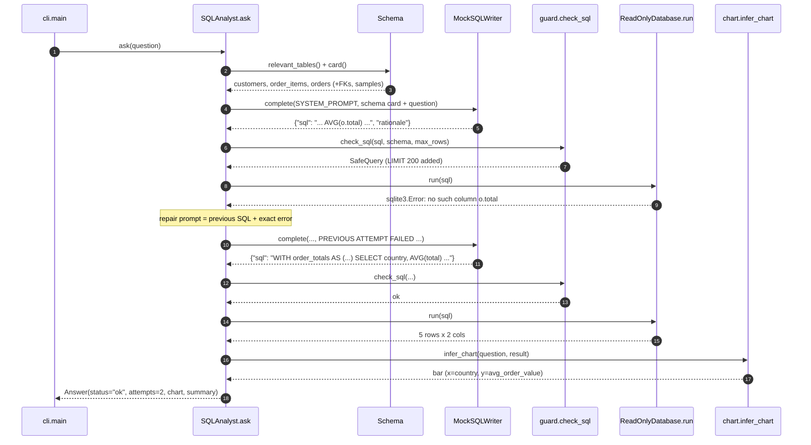

# Architecture · 18 SQL Data Analyst Agent

Natural-language questions become model-written SQL, but only safe, read-only SQL reaches the
database, and only the database supplies numbers. Two independent layers enforce read-only access:
a SQL guard before execution and a SQLite connection that physically cannot write.

## Components

| Component | File | Responsibility |
|---|---|---|
| CLI | `src/sql_analyst/cli.py` | Builds the demo DB, asks the demo questions (or yours), prints the trace, answer box and optional chart JSON. |
| Settings | `src/sql_analyst/config.py` | `Settings.from_env()`: provider, model, `SQL_DB_PATH`, `SQL_SEED`, `SQL_QUESTIONS`, `SQL_MAX_ATTEMPTS`, `SQL_MAX_ROWS`, `SQL_TIMEOUT_MS`. |
| Schema | `src/sql_analyst/schema.py` | `introspect()` reads tables, columns, foreign keys, row counts, sample values; `Schema.relevant_tables()` and `Schema.card()` ground the prompt. |
| Agent | `src/sql_analyst/agent.py` | `SQLAnalyst.ask()`: ground → `_draft()` → `check_sql()` → `db.run()` → repair loop → `infer_chart()` + `summarize()`. |
| Guard | `src/sql_analyst/guard.py` | `check_sql()`: `UnsafeSQL` (writes, multiple statements, file functions) vs `InvalidSQL` (empty, unknown tables); adds/caps `LIMIT`. |
| Database | `src/sql_analyst/db.py` | `build_demo_db()`; `ReadOnlyDatabase`: `mode=ro`, `PRAGMA query_only`, an authorizer allow-list, and a progress-handler timeout (`QueryTimeout`). |
| Model | `src/sql_analyst/llm.py` | `MockSQLWriter` (writes one broken query on purpose, then repairs it; drafts a DELETE when asked); `ProviderLLM` via `llm_from_env()`; `extract_json()`. |
| Charts | `src/sql_analyst/chart.py` | `infer_chart()` picks kpi / bar / line / table from the result shape; `ChartSpec` JSON; `render_ascii()`. |
| Trace | `src/sql_analyst/trace.py` | `Tracer.log()` step lines (`GROUND`, `DRAFT`, `GUARD`, `ERROR`, `REPAIR`, `EXECUTE`, `CHART`, `BLOCKED`) and `box()`. |

## Data flow

1. `Schema.relevant_tables()` matches the question to tables (plus FK bridge tables needed for the JOIN); `Schema.card()` renders them with
   columns, keys and example values.
2. `_draft()` sends the card + question; the reply must validate as `Draft {sql, rationale}`.
3. `check_sql()` classifies the SQL. **Unsafe** ends the run as `refused`, with no retry. **Invalid** becomes repair feedback.
4. `ReadOnlyDatabase.run()` executes with a time budget. Any `sqlite3.Error` (bad column, timeout) becomes repair
   feedback showing the model its own SQL and the exact error.
5. On success, `infer_chart()` and `summarize()` build the answer from the rows only.

## One full request ("What is the average order value by country?")

## Design decisions

- **Refuse vs repair.** Unsafe SQL is a policy violation, so it is refused immediately; retrying would just give the model
  more chances to find a bypass. Invalid SQL and database errors are honest mistakes, so they get a repair loop.
- **Defence in depth for read-only.** The guard is a parser-free heuristic; the connection (`mode=ro`, `query_only`,
  authorizer allow-list) is the guarantee that holds even if the guard has a bug.
- **Schema grounding, not the whole schema.** Only relevant tables (with FKs and sample values) go into the prompt, which
  keeps prompts small and steers the model to real column names.
- **Numbers from the database only.** `summarize()` and the chart are built from rows; the model's prose never carries numbers.
- **Chart from result shape.** One number → KPI, category + number → bar, period + number → line, otherwise a table.
  The `ChartSpec` JSON is ready for any frontend.

## Failure modes and how they are handled

| Failure | Handling |
|---|---|
| Model drafts DELETE / UPDATE / multiple statements / file functions | `UnsafeSQL` → `BLOCKED`, status `refused`, no retry. |
| Unknown table or empty query | `InvalidSQL` → repair feedback (`INVALID` in the trace). |
| Wrong column, syntax error | `sqlite3.Error` → repair feedback with the exact error (`ERROR`, then `REPAIR`). |
| Runaway query | Progress handler interrupts after `SQL_TIMEOUT_MS`; `QueryTimeout` is a `sqlite3.Error`, so it is repaired too. |
| Guard misses a write | Read-only connection and authorizer deny it at the database. |
| Huge result | `check_sql()` adds or caps `LIMIT` at `SQL_MAX_ROWS`. |
| Model reply is not valid JSON | `_draft()` returns `None` → `GIVE UP`, status `failed`. |
| Still broken after `SQL_MAX_ATTEMPTS` | `GIVE UP` with "I couldn't produce a working query." |

## How to extend

- **Your own database:** open it with `ReadOnlyDatabase(path)` and pass it to `SQLAnalyst` (do not point
  `SQL_DB_PATH` at it: the CLI rebuilds that file from `SQL_SEED` on every run), or implement the same
  interface for Postgres with a read-only role.
- **New guard rule:** add a keyword to `FORBIDDEN_KEYWORDS` / `FORBIDDEN_FUNCTIONS` in `guard.py` with a test.
- **New chart kind:** extend `ChartKind` and the shape rules in `infer_chart()`.
- **Real model:** `LLM_PROVIDER=anthropic`; the guard, executor and repair loop are unchanged.
