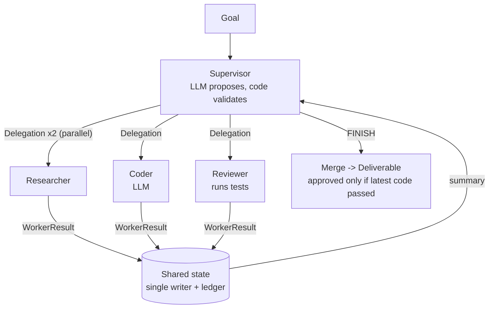
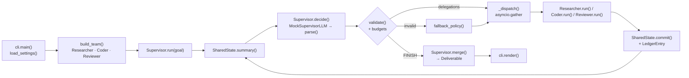

# 19 · Multi-Agent Supervisor

Build a supervisor agent that delegates to a **researcher**, a **coder** and a **reviewer**, runs independent work in
parallel, and only ships when the evidence says so. About 800 lines of Python, no API key needed.

**Level:** Advanced

**You'll learn:**
- The supervisor pattern: one agent decides, specialists do the work
- Typed messages between agents (pydantic), so no agent ever has to parse another agent's prose
- Shared state with a **single writer**: workers propose, the supervisor commits, and every change is attributed
- Validating model decisions (unknown worker, unsafe parallelism, budgets) with a deterministic fallback
- Why "done" comes from evidence (a passing review of the *latest* version), not from the model saying so

## Why this matters

Real work is multi-skill. A ticket like "add slugs to our blog URLs" needs someone to check the style guide, someone
to write the code, and someone to test it. One giant prompt doing all three loses track; three agents with clear
roles and a coordinator scale better and fail more visibly. Coding assistants, research copilots and support
desks all use some version of this supervisor/worker shape.

## Architecture



Each turn, the supervisor's model sees a five-line summary of shared state and replies with JSON: who acts next
and with what instruction. The supervisor validates that proposal: the worker must exist, only parallel-safe
workers may run side by side, and each worker has a visit budget. If the proposal is unusable, a rule-based
policy takes over for that turn. Workers return typed `WorkerResult`s, which the supervisor commits to shared
state; parallel research results are merged and de-duplicated. At the end, `merge()` builds the deliverable and
marks it **approved** only if the latest code version has a passing review.

## Flow



A request enters at `cli.main()`, which wires the team in `build_team()`. `Supervisor.run()` loops: summarise state,
let the model propose, validate (or fall back), dispatch workers, commit their results. `merge()` turns the final
state into a `Deliverable`. See [docs/ARCHITECTURE.md](docs/ARCHITECTURE.md) for the full sequence and failure modes.

## Project structure

```
19-multi-agent-supervisor/
├── README.md
├── VIDEO.md                  # hooks + flow_steps for the video
├── docs/ARCHITECTURE.md      # components, sequence diagram, design decisions, failure modes
├── pyproject.toml            # package metadata, `multi-agent-supervisor` CLI, pytest + ruff config
├── requirements.txt          # pinned runtime/test deps
├── Makefile                  # install · test · demo · lint · docker · clean
├── Dockerfile / .dockerignore
├── .env.example              # every setting config.py reads
├── demo.py                   # `python demo.py`, no install needed
├── src/supervisor/
│   ├── __init__.py           # public API + __version__
│   ├── config.py             # Settings / load_settings(): the only place env vars are read
│   ├── cli.py                # main(), build_team(), render()
│   ├── supervisor.py         # Supervisor: decide → validate → dispatch → merge, fallback_policy()
│   ├── messages.py           # Decision, Delegation, WorkerResult and payload models
│   ├── state.py              # SharedState (single writer) + ledger
│   ├── llm.py                # LLM protocol, mocks, ProviderLLM, llm_from_env()
│   ├── trace.py              # Tracer + ASCII boxes
│   └── workers/              # researcher.py · coder.py · reviewer.py · base.py (Worker protocol)
├── tests/                    # supervisor, workers, end-to-end demo
└── examples/kb/              # the knowledge base the researcher searches
```

## Quickstart

**Windows (PowerShell)**
```powershell
cd projects/19-multi-agent-supervisor
python -m venv .venv; .venv\Scripts\Activate.ps1
pip install -r requirements.txt
python demo.py
python -m pytest -q
```

**macOS / Linux**
```bash
cd projects/19-multi-agent-supervisor
python3 -m venv .venv && source .venv/bin/activate
pip install -r requirements.txt
python demo.py
python -m pytest -q
```

Expected output (shortened):
```text
  STEP 1       | -> researcher x2 in parallel  [llm]
    researcher | "Find our URL slug style guide rules"
                 => url-style-guide: 5 rules, 0 examples
    researcher | "Find slug examples we must match (acceptance tests)"
                 => slug-examples: 0 rules, 5 examples
    merge      | research now 5 rules, 5 examples from 2 sources
  STEP 2       | -> coder  [llm]                     => wrote v1 (3 lines)
  STEP 3       | -> reviewer  [llm]
                 => v1 FAILED 4/6, e.g. slugify('Hello, World!') returned
                 'hello,-world!', expected 'hello-world'
  STEP 4       | -> coder  [llm]                     => wrote v2 (10 lines)
  STEP 5       | -> reviewer  [llm]                  => v2 PASSED
  FINISH       | [llm] Latest code passed review.
+-- DELIVERABLE -------------------------------------------------------------+
| status : APPROVED   (Latest code passed review.)                           |
| checks : 6 passed on v2                                                    |
```

## How it works

```
src/supervisor/
  messages.py     Delegation, Decision, WorkerResult, ResearchNotes, CodeArtifact, Review
  state.py        SharedState: commit() (single writer), summary(), ledger
  supervisor.py   decide -> validate -> dispatch (asyncio.gather) -> commit -> merge
  llm.py          LLM protocol, MockSupervisorLLM, MockCoderLLM, optional real provider
  workers/
    researcher.py KnowledgeBase search + rule/example extraction (no LLM)
    coder.py      prompt with rules, examples and review failures -> code
    reviewer.py   execute the code against every example (restricted builtins)
```

**1. Typed messages.** The supervisor's reply must become a `Decision`, which must either finish or delegate:

```python
class Decision(BaseModel):
    delegations: list[Delegation] = []
    finish: bool = False
    reason: str = ""

    @model_validator(mode="after")
    def _finish_or_delegate(self) -> Decision:
        if self.finish == bool(self.delegations):
            raise ValueError("a decision must either finish or delegate (not both, not neither)")
        return self
```

`Delegation.worker` is a `Literal["researcher", "coder", "reviewer"]`, so `"deployer"` fails validation before
anything runs.

**2. Propose, validate, fall back.** `decide()` wraps the model call:

```python
try:
    decision = self.parse(self.llm.complete(self.system_prompt, prompt))
    self.validate(decision)            # known worker? parallel-safe?
    return decision
except ValueError as exc:
    self.trace.log("FALLBACK", ...)
    return fallback_policy(state)      # deterministic routing for this turn
```

**3. Parallel only where it's safe.** Workers declare `parallel_safe`. Two researchers reading docs can run at
once (`asyncio.gather`); two coders editing the same file can't, so that proposal is rejected.

**4. Single-writer shared state.** Workers get read access to `SharedState` but return proposals.
`state.commit(step, result)` merges research (`ResearchNotes.merge` de-duplicates rules, examples and sources),
replaces code by version, appends reviews, and writes a ledger line, so "who did what" is always answerable.

**5. Evidence beats claims.** The reviewer executes the code against every acceptance example and refuses to pass
anything when there are no examples. `merge()` approves only if `review.version == code.version` and it passed.
A model that says `FINISH` on step one gets an `incomplete` deliverable.

Credits: the supervisor/worker split and the "blackboard" shared-state idea are long-standing multi-agent patterns
described in public agent-framework documentation; this implementation is original.

## Build it yourself

1. **Write the knowledge base.** Four markdown files in `examples/kb/`, each with a `tags:` line. Two matter (style
   guide, examples), two are distractors so retrieval has to work.
2. **Define the messages.** In `messages.py`, create `Delegation`, `Decision`, `WorkerResult` and the three
   payloads. Add `ResearchNotes.merge()` now; you'll need it for parallel results.
3. **Build shared state.** `SharedState.commit()` is the only mutator. `summary()` renders the five lines the
   supervisor's model will see. Keep it short: the supervisor needs status, not raw content.
4. **Write the researcher.** Keyword search over tags and titles, then parse `## Rules` bullets and
   `"a" -> "b"` example lines. No LLM: retrieval can't hallucinate.
5. **Write the coder.** Build a prompt from rules, examples and, if the last review failed, the current code plus
   the failure list. Extract the ```python block from the reply.
6. **Write the reviewer.** `exec` the code with restricted builtins and an import allow-list, run each example,
   require a docstring. Return a `Review` tagged with the version it checked.
7. **Write the supervisor loop.** `decide()` (model + validation + fallback), `_dispatch()` (`asyncio.gather` over
   delegations, then commit in order), budgets (`max_steps`, per-worker `max_visits`), and `merge()`.
8. **Script the mocks.** `MockSupervisorLLM` routes from the summary lines; `MockCoderLLM` writes a naive v1 and
   a correct v2 when it sees `REVIEW FEEDBACK`. Now the demo shows a full fix loop offline.
9. **Test the failure modes.** Garbage output, unknown workers, parallel coders, premature `FINISH`, and a coder
   that never improves. Each should end safely, and the tests prove it.

## Use a real LLM

```powershell
pip install anthropic                  # or: pip install openai
$env:LLM_PROVIDER = "anthropic"        # or "openai"
$env:ANTHROPIC_API_KEY = "sk-ant-..."  # or $env:OPENAI_API_KEY
python demo.py
```

Both the supervisor and the coder switch to the real model (`LLM_MODEL` overrides the default `claude-opus-5-5`).
The validation and fallback logic is exactly what keeps a real model's occasional odd reply from derailing the run.
In production, use a smaller, cheaper model for routing and a stronger one for coding.

## Production notes / pitfalls

- **The reviewer's `exec` is not a sandbox.** Restricted builtins stop accidents, not attackers. Run generated code
  in a separate process or container with no network, a CPU/memory limit and a hard kill timeout.
- **Budgets are mandatory.** Without `max_steps` and per-worker visit limits, two agents can ping-pong forever
  (coder fixes A, breaks B, coder fixes B, breaks A...). Every loop costs tokens.
- **Keep the supervisor's context small.** Give it a status summary, not every artifact. The coder needs the code;
  the supervisor needs "v2 FAILED 1/6".
- **Log the ledger.** When a multi-agent run produces something wrong, the first question is "which agent said
  that, and why?". Record worker, instruction and result for every step.
- **Evaluate routing separately.** Test the supervisor's decisions on recorded states (like these tests do) before
  you evaluate the end-to-end output.

## Extend it

1. Add a `docs_writer` worker that writes a README section for the function once it's approved.
2. Let the reviewer also run a linter (e.g. `compile()` + an AST check for `print` calls) and report style issues.
3. Persist `SharedState` to JSON after every commit so a crashed run can resume (see project 25).

Next project: [20 · Agent-to-Agent Protocol](../20-agent-to-agent-protocol/README.md)

---
Part of [AI Agent Builds](../../README.md) by [exe_404.ai](https://www.youtube.com/@exe_404ai) — one agentic-AI project a day.
