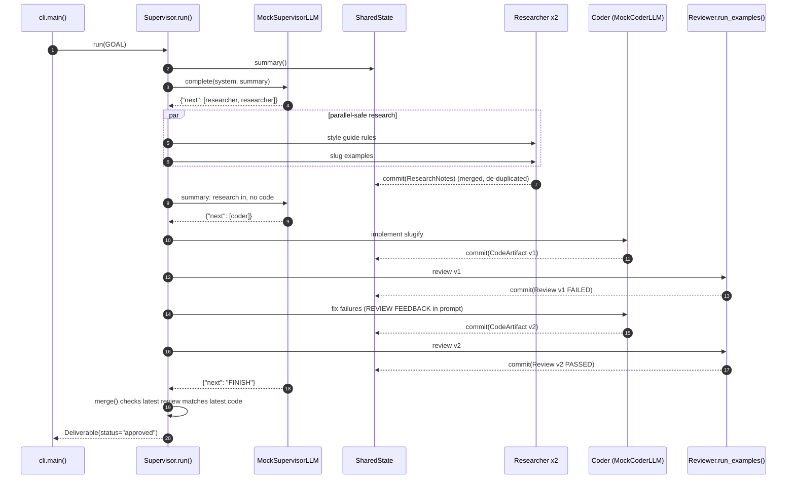

# Architecture · 19 Multi-Agent Supervisor

One supervisor decides, three specialist workers act, and a single-writer shared state records everything.
The model only *proposes* routing; code validates it and owns the final verdict.

## Components

| Component | File | Responsibility |
|---|---|---|
| CLI | `src/supervisor/cli.py` | `main()` parses flags, `build_team()` wires workers + models from settings, `render()` prints the deliverable |
| Settings | `src/supervisor/config.py` | `Settings` / `load_settings()`: provider, model, step and visit budgets, review timeout, KB folder |
| Supervisor | `src/supervisor/supervisor.py` | `Supervisor.run()` loop: `decide()` → `validate()` → `_dispatch()` → `merge()`; `fallback_policy()` |
| Messages | `src/supervisor/messages.py` | pydantic `Decision`, `Delegation`, `WorkerResult`, `ResearchNotes`, `CodeArtifact`, `Review` |
| Shared state | `src/supervisor/state.py` | `SharedState.commit()` (the only writer), `summary()` for the model, the `LedgerEntry` audit log |
| Researcher | `src/supervisor/workers/researcher.py` | `KnowledgeBase` keyword search over `examples/kb/*.md`, extracts rules and examples (no LLM) |
| Coder | `src/supervisor/workers/coder.py` | `build_prompt()` from rules, examples and review failures → LLM → `CodeArtifact` |
| Reviewer | `src/supervisor/workers/reviewer.py` | `run_examples()` executes the code with restricted builtins and a timeout → `Review` |
| LLM adapters | `src/supervisor/llm.py` | `MockSupervisorLLM`, `MockCoderLLM`, `ProviderLLM`, `llm_from_env()` |
| Trace | `src/supervisor/trace.py` | `Tracer.log()` and `box()` for the terminal trace |

## Data flow

1. `cli.main()` loads `Settings`, builds the team and calls `Supervisor.run(goal)`.
2. Each turn, `SharedState.summary()` produces a five-line status; the supervisor model replies with JSON.
3. `Supervisor.parse()` turns it into a `Decision`; `validate()` checks worker names and parallel safety; budgets
   are checked in `run()`. Anything invalid falls back to `fallback_policy()` for that turn.
4. `_dispatch()` runs the delegations with `asyncio.gather` (parallel only for `parallel_safe` workers).
5. Every `WorkerResult` goes through `SharedState.commit()`: research merges, code replaces, reviews append,
   and the ledger records who did what.
6. On `FINISH` or budget exhaustion, `merge()` builds the `Deliverable`: **approved** only if the latest code version
   has a passing review.

## One full request

## Design decisions

- **Model proposes, code disposes.** Routing JSON is validated against the real roster and budgets, so a hallucinated
  worker or an unsafe parallel coder can never execute.
- **Single writer.** Workers only *return* results; the supervisor commits them. Parallel workers cannot clobber each
  other, and every change is attributable through the ledger.
- **Typed messages.** pydantic models at every hop replace prose hand-offs between agents.
- **Evidence-based completion.** "Approved" is computed from state (latest review passed for the latest version), not
  taken from the model's `FINISH`.
- **Cheap where possible.** The researcher and reviewer use no model at all: retrieval and test execution cannot
  hallucinate.
- **Settings in one place.** `config.py` is the only module that reads the environment.

## Failure modes and handling

| Failure | Handling |
|---|---|
| Model returns garbage / no JSON | `decide()` catches the `ValueError`, logs `FALLBACK`, uses `fallback_policy()` |
| Unknown worker or parallel coders | `validate()` raises `InvalidDecision` → fallback for that turn |
| Premature `FINISH` | `merge()` still marks the run `incomplete` unless the latest code passed review |
| Coder never improves | per-worker visit budget (`SUPERVISOR_MAX_CODER_VISITS`) stops the loop |
| Endless loop | step budget (`SUPERVISOR_MAX_STEPS` / `--max-steps`) |
| Candidate code hangs or imports `os` | reviewer timeout and import allow-list turn it into a failed review |
| No acceptance examples | reviewer refuses to approve ("no evidence, no approval") |

## How to extend

- **New worker:** implement the `Worker` protocol (`name`, `description`, `parallel_safe`, `async run()`), add its name
  to `WorkerName` in `messages.py`, and pass it to `Supervisor` in `build_team()`.
- **New payload:** add a field to `WorkerResult` and teach `SharedState.commit()` and `summary()` about it.
- **Real model:** set `LLM_PROVIDER` and a key; nothing else changes.
- **Persistence:** serialise `SharedState` after each `commit()` to resume crashed runs (see project 25).
