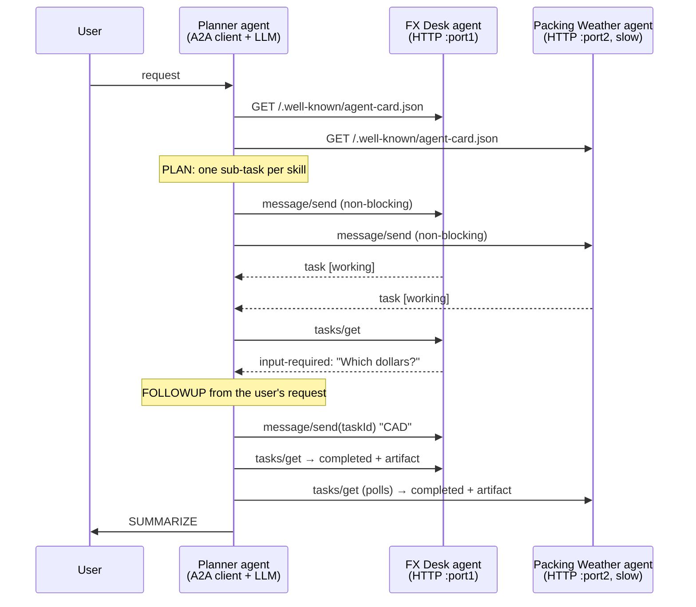
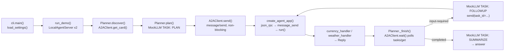

# 20 · Agent-to-Agent Protocol

Build a planner agent that discovers two specialist agents by their **agent cards** and delegates work to them over local HTTP using A2A-style JSON-RPC tasks, follow-up questions and polling, in ~800 lines of Python.

**Level:** Advanced

**You'll learn:**
- What an **agent card** is and why discovery (`/.well-known/agent-card.json`) beats hard-coded integrations
- The A2A **task** model: ids, `contextId`, and the state machine `submitted → working → input-required → completed | failed | canceled`
- Multi-turn delegation: a remote agent asks a question, and the answer goes back to the *same* task
- Non-blocking sends plus `tasks/get` polling, so slow agents work in parallel
- How MCP (agent ↔ tools) and A2A (agent ↔ agent) fit together

## Why this matters

MCP connects one agent to tools. But companies are starting to run *many* agents, built by different teams or vendors: an expenses agent, a travel agent, an HR agent. They need to work together without sharing code or prompts. A travel company's booking assistant might ask a partner bank's FX agent for a quote and a weather provider's agent for a packing list. Neither side exposes its internals; they only agree on a protocol. A2A (Agent2Agent, an open protocol started by Google and now hosted by the Linux Foundation) is that agreement, and this project builds its core ideas from scratch.

## Architecture



Each remote agent is a FastAPI app made by `create_agent_app(card, handler)`: the card describes it and the handler holds its skill. The server owns the protocol: JSON-RPC routing, a thread-safe task store, the state machine, blocking and non-blocking execution, cancellation and error codes. The planner only knows a list of base URLs. It reads each card, lets the LLM split the request into one sub-task per skill, sends them all at once, then polls each task. When a task stops in `input-required`, the planner answers from the user's request and continues the same task.

## Flow



`cli.run_demo()` starts both specialists on real ports, then the `Planner` reads their cards, plans one sub-task per
skill, fans them out over JSON-RPC, and polls each task. An `input-required` task gets a FOLLOWUP answer on the same
task id. See [docs/ARCHITECTURE.md](docs/ARCHITECTURE.md) for the full sequence and failure modes.

## Project structure

```
20-agent-to-agent-protocol/
├── README.md
├── VIDEO.md                  # hooks + flow_steps for the video
├── docs/ARCHITECTURE.md      # components, sequence diagram, design decisions, failure modes
├── pyproject.toml            # package metadata, `a2a-demo` CLI, pytest + ruff config
├── requirements.txt          # pinned runtime/test deps
├── Makefile                  # install · test · demo · lint · serve · docker · clean
├── Dockerfile / .dockerignore
├── .env.example              # every setting config.py reads
├── demo.py                   # `python demo.py ["request"]`, no install needed
├── src/a2a_local/
│   ├── __init__.py           # public API + __version__
│   ├── config.py             # Settings / load_settings(): the only place env vars are read
│   ├── cli.py                # main(), run_demo(), serve(), agent_builders()
│   ├── planner.py            # Planner: discover → plan → fan out → follow up → summarise
│   ├── client.py             # A2AClient: cards, message/send, tasks/get, tasks/cancel, wait()
│   ├── server.py             # create_agent_app(): JSON-RPC, TaskStore, state machine, error codes
│   ├── agents.py             # FX Desk + Packing Weather cards and handlers
│   ├── models.py             # AgentCard, Message, Task, TaskState, parts, artifacts
│   ├── serve.py              # LocalAgentServer: uvicorn on a free port in a thread
│   ├── llm.py                # MockLLM, AnthropicLLM, OpenAILLM, make_llm()
│   └── trace.py              # ASCII boxes and [tag] rows
├── tests/                    # protocol, planner, end-to-end demo over real HTTP
└── examples/                 # rates.json, climate.json (the specialists' data)
```

## Quickstart

Windows (PowerShell):
```powershell
cd projects/20-agent-to-agent-protocol
python -m venv .venv; .venv\Scripts\Activate.ps1
pip install -r requirements.txt
python demo.py
python -m pytest -q
```

macOS / Linux:
```bash
cd projects/20-agent-to-agent-protocol
python3 -m venv .venv && source .venv/bin/activate
pip install -r requirements.txt
python demo.py
python -m pytest -q
```

Try your own trip: `python demo.py "I live in Sydney and I'm flying to Lisbon in July with 1200 dollars. What's that in euros and what should I pack?"`

Expected output (shortened, ports and ids vary):
```
| FX Desk          http://127.0.0.1:61513   (instant)                                      |
| Packing Weather  http://127.0.0.1:53088   (slow: ~0.4 s per task)                        |
[-->   ] FX Desk: GET http://127.0.0.1:61513/.well-known/agent-card.json
[<--   ] FX Desk: card: FX Desk v1.0.0, skills: convert_currency
[plan  ] convert_currency  -> FX Desk          "Convert 500 dollars to JPY."
[plan  ] packing_forecast  -> Packing Weather  "What should I pack for Tokyo in April?"
[-->   ] FX Desk: message/send (non-blocking): Convert 500 dollars to JPY.
[<--   ] FX Desk: task f3e45611d117 [working]
[<--   ] FX Desk: tasks/get x1 -> task f3e45611d117: input-required: Which dollars do you
         mean: USD, CAD, AUD?
[think ] FX Desk needs input. From the request, the answer is: CAD
[-->   ] FX Desk: message/send (non-blocking, task f3e45611d117): CAD
[<--   ] FX Desk: tasks/get x1 -> task f3e45611d117: completed: 500 CAD = 54,562 JPY
[<--   ] Weather: tasks/get x3 -> task 32ed00b1366e: completed: Tokyo in April: 19C / 10C,
         about 10 rainy days. Pack: comfortable walking shoes, light layers, a warm jacket,
         a compact umbrella.
[answer] Here's your trip brief: 500 CAD = 54,562 JPY; Tokyo in April: 19C / 10C, ...
```

## How it works

**1. The data model (`models.py`).** Pydantic models with A2A's field names: `AgentCard` (name, url, capabilities, skills with tags and examples), `Message` (role + a list of `parts`, either `TextPart` or `DataPart`), `Task` (id, contextId, status, history, artifacts) and `TaskState`. Parts use a discriminated union on `kind`, so `{"kind": "data", ...}` always parses as `DataPart`.

**2. The server (`server.py`).** One JSON-RPC endpoint with three methods. `message/send` either starts a task or, if the message carries a `taskId`, continues one:

```python
if message.taskId:  # a follow-up turn on an existing task (e.g. after input-required)
    task = store.get(message.taskId)
    if task.status.state.is_final:
        raise RpcError(INVALID_PARAMS, f"Task {task.id} is already {task.status.state.value}")
...
if request.configuration.blocking:
    return run(task)
threading.Thread(target=run, args=(task,), daemon=True).start()
return task  # returned immediately in "working"; the caller polls tasks/get
```

A handler is just `Task -> Reply(state, text, artifacts)`. It sees the whole history, which is how the FX agent understands "CAD" as the answer to its own question. A crashing handler becomes a `failed` task instead of an HTTP 500. A2A-specific errors use their own codes: `-32001` task not found, `-32002` task not cancelable.

**3. The specialists (`agents.py`).** Deliberately deterministic lookups (fixed FX rates, a climate table) so the protocol is what you watch. The FX agent asks for clarification when "dollars" is ambiguous. The weather agent is slow on purpose (`work_seconds`) to make polling visible.

**4. The client (`client.py`).** `get_card()`, `send()`, `get_task()`, `cancel()` and `wait()`, which polls until a task is final *or* needs input. It takes any `httpx.Client`, so the tests pass FastAPI's `TestClient` and run without opening a port.

**5. The planner (`planner.py`).** Discovery builds a skill directory from the cards. The LLM has three jobs: PLAN (JSON sub-tasks, and unknown skill ids are dropped), FOLLOWUP (answer a remote question using only facts from the request; the mock says "I don't know" rather than invent) and SUMMARIZE. Sub-tasks are fanned out non-blocking, then collected:

```python
for d in delegations:  # fan out: every agent starts working at once
    d.task = d.client.send(d.text, blocking=False)
for d in delegations:
    d.task = self._finish(d, request)   # wait, answer input-required, wait again
```

**MCP vs A2A.** MCP (projects 08 and 09) gives an agent *tools*: stateless functions with schemas. A2A connects *agents*: opaque peers with their own reasoning, long-running tasks and the ability to ask questions back. A real system often uses both: each specialist here could use MCP servers internally.

**Credits.** The protocol shapes follow the public A2A specification (a2a-protocol.org). The general approach of a protocol layer kept separate from the skill backend, discovery documents, and errors returned as data the caller can act on is informed by our architecture study of the Playwright MCP server ([research/rea-playwright-mcp.md](../../research/rea-playwright-mcp.md)). All code here is original. This is an educational subset of A2A: no streaming (SSE), push notifications or authentication.

## Build it yourself

1. **Scaffold** `src/a2a_local/`, `tests/`, `examples/` (add `rates.json` and `climate.json`).
2. **Write `models.py`.** Define the card, skill, part, message, task-status and task models, plus a `TaskState` enum with an `is_final` property.
3. **Write `server.py`.** Add a `TaskStore` with a lock, then `create_agent_app(card, handler)` with the card route and a JSON-RPC route that maps JSON-RPC and A2A error codes. Implement `message/send` (new task or continue), `tasks/get` and `tasks/cancel`.
4. **Add non-blocking mode.** Run the handler in a thread, return the task in `working`, and make the worker respect a cancel that arrives first.
5. **Write `agents.py`.** Two cards and two handlers. Make one ask a clarifying question (`input-required`) and one slow.
6. **Write `client.py`.** Card fetch, `send()` with `taskId`/`contextId`, `get_task()`, `cancel()` and a `wait()` polling loop with a timeout.
7. **Write `llm.py`.** `MockLLM` with PLAN, FOLLOWUP and SUMMARIZE jobs, plus optional Anthropic/OpenAI clients behind `make_llm()`.
8. **Write `planner.py`.** Discover, plan, fan out, finish each delegation (with a follow-up limit), summarise.
9. **Write `serve.py` and `demo.py`.** Start each agent with uvicorn on a free port in a background thread, then run the planner against the real URLs.
10. **Test** with `TestClient`: the card, blocking, non-blocking, multi-turn, cancel, every error code, and the planner end to end.

## Use a real LLM

```bash
pip install anthropic                 # or: pip install openai
export LLM_PROVIDER=anthropic         # PowerShell: $env:LLM_PROVIDER="anthropic"
export ANTHROPIC_API_KEY=...          # PowerShell: $env:ANTHROPIC_API_KEY="..."
python demo.py
```

`LLM_MODEL` overrides the model (default `claude-opus-5-5`, or `gpt-4.1-mini` for OpenAI). Only the planner uses the LLM. The PLAN prompt lists the discovered skills and asks for JSON, `extract_json()` tolerates prose around it, and skill ids the model invents are ignored. To make a specialist LLM-powered too, replace its handler with one that calls a model. The protocol code does not change.

## Production notes / pitfalls

- **Authenticate both directions.** Real A2A cards declare security schemes (API key, OAuth2, mTLS). Never let an unauthenticated agent start tasks that spend money or touch data.
- **Remote agents are untrusted.** Their messages and artifacts are input, not instructions. A malicious agent can try prompt injection through a "result".
- **Share the minimum.** The planner sends each specialist only its sub-task, not the whole conversation. FOLLOWUP answers are limited to facts in the request, so the agent does not leak or invent personal data.
- **Bound everything.** Cap follow-up rounds, polling time and total cost per request. Two agents asking each other questions can loop forever.
- **Polling vs push.** Polling is simple but wasteful at scale. A2A also defines streaming (SSE) and push notifications (webhooks) for long tasks.
- **Persist tasks.** This task store is in memory, so a restart loses every task. Production agents store tasks in a database so callers can resume.

## Extend it

1. Add `message/stream` with Server-Sent Events so the planner sees `working` updates live instead of polling.
2. Add an API-key security scheme to the cards and check the header in `create_agent_app`.
3. Turn the planner itself into an A2A agent (serve its own card) so another agent can delegate whole trips to it.

**Next project: 21 · Debate and Consensus**, where several agents argue, a judge aggregates, and disagreement is surfaced rather than hidden.

---
Part of [AI Agent Builds](../../README.md) by [exe_404.ai](https://www.youtube.com/@exe_404ai) — one agentic-AI project a day.
