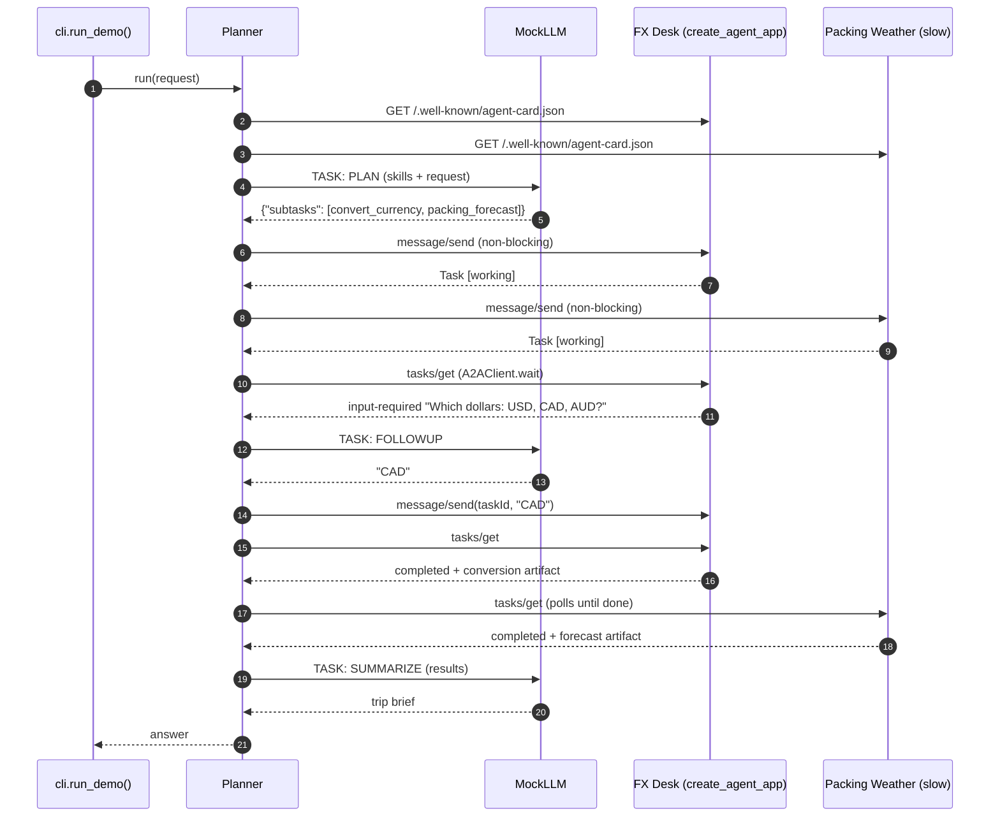

# Architecture · 20 Agent-to-Agent Protocol

A planner agent discovers two independent specialist agents by their **agent cards**, delegates sub-tasks to them
over **JSON-RPC 2.0**, polls long-running **tasks**, and answers their follow-up questions on the same task id.
The protocol shapes follow the public A2A specification (educational subset: no streaming, push or auth).

## Components

| Component | File | Responsibility |
|---|---|---|
| CLI | `src/a2a_local/cli.py` | `main()` parses flags; `run_demo()` starts both agents and the planner; `serve()` runs one agent; `agent_builders()` |
| Settings | `src/a2a_local/config.py` | `Settings` / `load_settings()`: provider, model, weather latency, follow-up limit, serve host/port |
| Planner | `src/a2a_local/planner.py` | `Planner.discover()` → `plan()` → fan-out `send()` → `_finish()` (poll + FOLLOWUP) → SUMMARIZE |
| Client | `src/a2a_local/client.py` | `A2AClient.get_card()`, `send()`, `get_task()`, `cancel()`, `wait()` over any `httpx.Client` |
| Server | `src/a2a_local/server.py` | `create_agent_app(card, handler)`: card route, JSON-RPC route, `TaskStore`, state machine, error codes |
| Specialists | `src/a2a_local/agents.py` | `build_currency_agent()` (asks "which dollars?"), `build_weather_agent()` (slow on purpose) |
| Models | `src/a2a_local/models.py` | pydantic `AgentCard`, `Message`, `Task`, `TaskState`, `TextPart` / `DataPart`, `Artifact` |
| Local servers | `src/a2a_local/serve.py` | `LocalAgentServer`: uvicorn on a free port in a background thread |
| LLM | `src/a2a_local/llm.py` | `MockLLM` (PLAN / FOLLOWUP / SUMMARIZE), `AnthropicLLM`, `OpenAILLM`, `make_llm()` |
| Trace | `src/a2a_local/trace.py` | `Trace.box()`, `row()`, `wire()` for every HTTP hop |

## Data flow

1. `cli.run_demo()` starts the FX Desk and Packing Weather apps with `LocalAgentServer` and builds one `A2AClient` each.
2. `Planner.discover()` fetches `/.well-known/agent-card.json` from every URL and indexes clients by skill id.
3. `Planner.plan()` asks the LLM for JSON sub-tasks; unknown skill ids are dropped.
4. Every sub-task is sent with `message/send` (non-blocking); the server returns a `working` task at once and runs
   the handler in a thread.
5. `Planner._finish()` polls with `A2AClient.wait()`. On `input-required` it asks the LLM (FOLLOWUP) and sends the
   answer with the **same `taskId`**, then waits again (bounded by `max_followups`).
6. The completed tasks' artifacts are summarised by the LLM (SUMMARIZE) into the final answer.

## One full request

## Design decisions

- **Protocol layer separate from skills.** A specialist is just `AgentCard` + `Task -> Reply`; `create_agent_app()`
  owns JSON-RPC, task storage, state transitions and errors, so every agent speaks the protocol identically.
- **Discovery, not hard-coding.** The planner knows only base URLs; capabilities come from the cards.
- **Tasks are stateful.** Follow-ups continue the same task, so the remote agent sees the whole history.
- **Non-blocking fan-out + polling.** Slow agents work in parallel; polling is the simplest correct transport.
- **Transport-agnostic client.** `A2AClient` accepts any `httpx.Client`, so tests use FastAPI's `TestClient`
  (no ports) while the demo uses real HTTP.
- **Deterministic specialists.** Lookup tables, not LLMs, so the protocol is what you watch.
- **Settings in one place.** `config.py` is the only module that reads the environment.

## Failure modes and handling

| Failure | Handling |
|---|---|
| Malformed JSON / bad envelope / unknown method / bad params | JSON-RPC errors `-32700`, `-32600`, `-32601`, `-32602` |
| Unknown task id / cancel a finished task | A2A errors `-32001` task not found, `-32002` not cancelable |
| Skill handler crashes | caught in `run()`, task becomes `failed` (never an HTTP 500) |
| Follow-up to a finished task | rejected with `-32602` |
| Remote agent keeps asking questions | `max_followups` (`PLANNER_MAX_FOLLOWUPS`) bounds the rounds |
| Remote agent never finishes | `A2AClient.wait()` raises `TimeoutError` after its deadline |
| Model invents a skill | `Planner.plan()` logs `skip` and ignores it |
| Model would invent personal facts | FOLLOWUP prompt allows only facts from the request; the mock says "I don't know" |

## How to extend

- **New specialist:** write a card and a handler in `agents.py`, add it to `agent_builders()` in `cli.py`, and pass
  its URL to the planner. The planner needs no change.
- **Streaming:** add `message/stream` (SSE) next to `message/send` in `server.py`.
- **Security:** declare a scheme on the card and check a header in `create_agent_app()`.
- **Persistence:** swap `TaskStore` for a database-backed store so tasks survive restarts.
