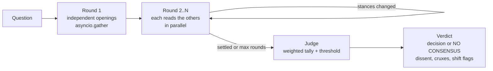
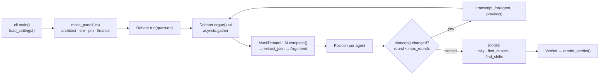

# 21 · Debate and Consensus

Build a panel of AI agents that argue in rounds, plus a judge that tallies the result **and surfaces the
disagreement instead of hiding it**. About 475 lines of Python, no API key needed.

**Level:** Advanced

**You'll learn:**
- How to run a multi-round debate with `asyncio`: independent openings, then rebuttals in parallel
- Why the judge should be plain arithmetic (confidence-weighted tally + threshold), not "LLM, summarise the consensus"
- How to keep dissent, find **cruxes** (the topics where sides actually clash) and flag unexplained stance changes
- How to handle a debater that returns garbage: one corrective retry, then an abstention that doesn't vote
- When to stop: early termination once no stance changes between rounds

## Why this matters

Ask one model a hard judgement call ("should we migrate to microservices?") and you get one confident answer.
Ask four personas (architect, SRE, product, finance) and you see the trade-offs. The danger is the last step: if
a model "summarises the consensus", the minority view usually disappears. Engineering decision records, investment
committees and incident reviews all need the same thing: what most people think, **who disagrees and why**, and
where the real argument is.

## Architecture



Every debater is a persona plus a model and must reply with a validated `Argument`: a stance (`for`, `against`,
`conditional`), a confidence, and claims written as `topic: text`. Round 1 runs all debaters concurrently and
nobody sees anybody, which avoids anchoring on whoever spoke first. From round 2, each agent reads everyone
else's latest claims, and the debate stops as soon as a round changes no stance. The judge then tallies the
final positions by confidence. It declares consensus only above a threshold (66% by default), lists every
dissenter, finds cruxes from the topic tags, and flags stance changes that came with no reason.

## Flow



`cli.main()` builds a four-persona panel, and `Debate.run()` runs every `Debater.argue()` in parallel each round. From
round 2, each agent reads the others through `transcript_for()`. When no stance changes, `judge()` turns the final
positions into a `Verdict`. See [docs/ARCHITECTURE.md](docs/ARCHITECTURE.md) for the full sequence and failure modes.

## Project structure

```
21-debate-and-consensus/
├── README.md
├── VIDEO.md                  # hooks + flow_steps for the video
├── docs/ARCHITECTURE.md      # components, sequence diagram, design decisions, failure modes
├── pyproject.toml            # package metadata, `debate` CLI, pytest + ruff config
├── requirements.txt          # pinned runtime/test deps
├── Makefile                  # install · test · demo · lint · docker · clean
├── Dockerfile / .dockerignore
├── .env.example              # every setting config.py reads
├── demo.py                   # `python demo.py`, no install needed
├── src/debate/
│   ├── __init__.py           # public API + __version__
│   ├── config.py             # Settings / load_settings(): the only place env vars are read
│   ├── cli.py                # main(), printer()
│   ├── debate.py             # Debate.run(), transcript_for(), stances()
│   ├── debater.py            # Debater.argue() with retry/abstain, PANEL, make_panel()
│   ├── judge.py              # judge(), find_cruxes(), find_shifts(), final_positions()
│   ├── messages.py           # Argument, Position, Shift, Crux, Verdict
│   ├── llm.py                # MockDebateLLM, ProviderLLM, llm_from_env()
│   └── render.py             # round tables, verdict box
├── tests/                    # debate behaviour + end-to-end demo
└── examples/debates.json     # two scripted debates (one converges, one doesn't)
```

## Quickstart

**Windows (PowerShell)**
```powershell
cd projects/21-debate-and-consensus
python -m venv .venv; .venv\Scripts\Activate.ps1
pip install -r requirements.txt
python demo.py
python -m pytest -q
```

**macOS / Linux**
```bash
cd projects/21-debate-and-consensus
python3 -m venv .venv && source .venv/bin/activate
pip install -r requirements.txt
python demo.py
python -m pytest -q
```

Expected output (shortened, second debate):
```text
ROUND 2  (rebuttals - each agent read the others)
  architect  FOR          0.70  security: patching faster closes known CVEs sooner
  sre        AGAINST      0.80  supply-chain: a compromised package would s...
  pm         CONDITIONAL  0.60  toil: auto-merge only patch releases
             ^ shifted from FOR, because: (no reason given!)
ROUND 3  ...
  -> no stance changed this round: debate has settled
+-- JUDGE -------------------------------------------------------------------+
| NO CONSENSUS  (strongest side only 43%, after 3 rounds)                    |
|   conditional  #############                  1.15                         |
|   against      #########                      0.80                         |
|   for          ########                       0.70                         |
| cruxes (topics argued from different sides):                               |
|   - security: against=sre; for=architect                                   |
| stance shifts:                                                             |
|   - pm r2: for -> conditional   [FLAG: unexplained - possible herding]     |
```

## How it works

```
src/debate/
  messages.py   Argument (validated reply), Position, Shift, Crux, Verdict
  debater.py    Debater.argue(): prompt -> JSON -> Argument, retry once, else abstain
  debate.py     Debate.run(): rounds with asyncio.gather, stability check
  judge.py      tally, threshold, dissent, cruxes, shifts (pure functions)
  llm.py        LLM protocol, MockDebateLLM (replays examples/debates.json), real provider
  render.py     round tables and the verdict box
```

**1. A strict reply contract.** Claims must carry a topic, so the judge can line arguments up later:

```python
class Argument(BaseModel):
    stance: Literal["for", "against", "conditional"]
    confidence: float = Field(ge=0.0, le=1.0)
    claims: list[str] = Field(min_length=1)      # each "topic: text"
    changed_because: str = ""
```

**2. Parallel rounds, independent openings.** In `debate.py`:

```python
positions = list(await asyncio.gather(*(
    d.argue(question, round_no, transcript_for(d.name, previous)) for d in self.debaters)))
stable = bool(previous) and stances(positions) == stances(previous)
```

`transcript_for` gives each agent everyone *else's* last claims. In round 1 `previous` is empty, so nobody
anchors on anybody.

**3. Fail closed on bad output.** `Debater.argue` validates the reply; on failure it retries once, telling the
model what was wrong. If that fails too, the agent **abstains**. Abstentions are reported and never counted as votes.

**4. A judge you can audit.** `judge()` is pure arithmetic over final positions:

```python
tally[p.argument.stance] += p.argument.confidence
agreement = tally[leader] / total
consensus = agreement >= threshold
decision = leader if consensus else "no consensus"
```

Dissent lists everyone not on the winning side (everyone, if there's no consensus) with their strongest claim.
A **crux** is a topic argued by at least two agents from at least two stances. A **shift** without
`changed_because` is flagged as possible herding, which is a common failure mode of LLM debates.

Credits: multi-agent debate as a way to improve reasoning is described in public research (e.g. "Improving
Factuality and Reasoning in Language Models through Multiagent Debate", Du et al., 2023); the crux and
herding-flag design here is our own. All code is original.

## Build it yourself

1. **Write the contract.** `messages.py`: `Argument` with a validator that requires `topic: text` claims. Add
   `Position` (an `argument` or an `error`) and `Verdict`.
2. **Script two debates.** `examples/debates.json`: per question, per agent, per round. Design one that converges
   and one that splits. A missing round repeats the agent's last one.
3. **Write the mock.** `MockDebateLLM` reads `QUESTION`, `AGENT`, `ROUND` from the prompt and returns the scripted
   JSON. A real model gets the same prompt.
4. **Write a debater.** Build the prompt (opening vs rebuttal), call the model in a thread
   (`asyncio.to_thread`), validate, retry once with the error, else abstain.
5. **Write the loop.** `Debate.run()` gathers all debaters per round, passes each the others' claims, and stops
   when stances repeat or `max_rounds` is hit.
6. **Write the judge.** Final positions -> weighted tally -> agreement -> threshold. Then dissent, cruxes (group
   claims by topic; keep topics with 2+ agents and 2+ stances) and shifts.
7. **Render.** One table per round with shift markers; a verdict box with tally bars.
8. **Test the honesty properties.** Minority kept, split debates say "no consensus", unexplained shifts are
   flagged, abstainers don't vote, round 1 prompts contain no one else's words.

## Use a real LLM

```powershell
pip install anthropic                  # or: pip install openai
$env:LLM_PROVIDER = "anthropic"        # or "openai"
$env:ANTHROPIC_API_KEY = "sk-ant-..."  # or $env:OPENAI_API_KEY
python demo.py "Should we rewrite our Python backend in Rust?"
```

The scripted questions only exist for the mock; with a real provider you can debate anything. `LLM_MODEL`
overrides the default (`claude-opus-5-5`). For real diversity, give each debater a *different* model or
temperature, not only a different persona.

## Production notes / pitfalls

- **Cost scales as agents x rounds.** Four agents for three rounds is twelve calls. Early stopping matters; so
  does choosing which decisions deserve a debate at all.
- **Same model, same blind spots.** Personas on one model often share the same errors. Mix models, or ground
  debaters in different evidence (one gets incident data, one gets the cost sheet).
- **Herding is real.** Models tend to agree with the most recent confident voice. Independent openings and the
  `changed_because` requirement make it visible. Consider hiding confidences from other debaters.
- **Calibrate the threshold.** 66% is a policy choice. For irreversible decisions, require a higher bar and
  escalate "no consensus" to a human.
- **Keep the transcript.** The verdict is only as trustworthy as the arguments behind it. Store all rounds next to
  the decision record.

## Extend it

1. Add an "evidence" field to claims and let the judge down-weight claims with no evidence.
2. Add a devil's-advocate agent that is required to argue the minority side when everyone agrees in round 1.
3. Let a human join as a fifth debater from the terminal (`input()` in place of a model).

Next project: [22 · Parallel Research Swarm](../22-parallel-research-swarm/README.md)

---
Part of [AI Agent Builds](../../README.md) by [exe_404.ai](https://www.youtube.com/@exe_404ai) — one agentic-AI project a day.
