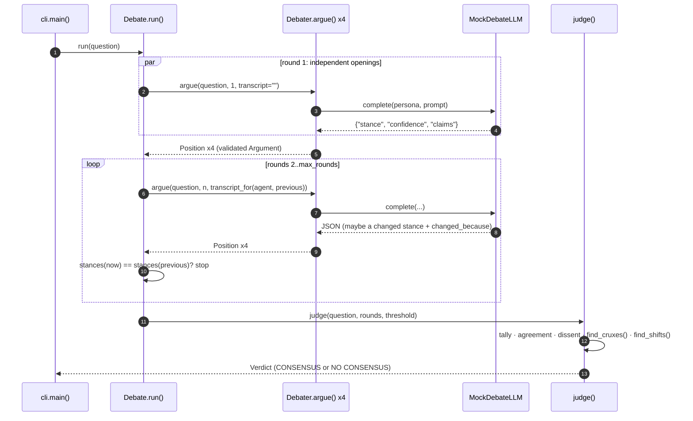

# Architecture · 21 Debate and Consensus

Four persona agents argue a question in rounds; a **deterministic judge** turns their final positions into a verdict
that keeps the dissent, names the cruxes and flags unexplained stance changes. No model is asked "what's the
consensus?".

## Components

| Component | File | Responsibility |
|---|---|---|
| CLI | `src/debate/cli.py` | `main()` loads settings, builds the panel per question, `printer()` streams each round |
| Settings | `src/debate/config.py` | `Settings` / `load_settings()`: provider, model, max rounds, consensus threshold, script path |
| Debate loop | `src/debate/debate.py` | `Debate.run()`: rounds via `asyncio.gather`, `transcript_for()`, stop when `stances()` settle |
| Debater | `src/debate/debater.py` | `Debater.argue()`: persona prompt → JSON → validated `Argument`, one corrective retry, else abstain; `make_panel()` |
| Judge | `src/debate/judge.py` | `judge()`: weighted tally, threshold, dissent, `find_cruxes()`, `find_shifts()` |
| Messages | `src/debate/messages.py` | pydantic `Argument`, `Position`, `Shift`, `Crux`, `Verdict` |
| LLM | `src/debate/llm.py` | `MockDebateLLM` (replays `examples/debates.json`), `ProviderLLM`, `llm_from_env()` |
| Render | `src/debate/render.py` | `render_round()`, `render_verdict()`, `box()` |

## Data flow

1. `cli.main()` loads `Settings`, picks the LLM (`llm_from_env`) and reads the questions from the script.
2. `Debate.run()` round 1: every `Debater.argue()` runs concurrently with **no transcript** (independent openings).
3. Rounds 2..N: each debater gets `transcript_for(agent, previous)` (everyone *else's* last stance and claims).
4. Each reply is parsed by `extract_json()` and validated as an `Argument`; invalid replies get one corrective retry,
   then the agent abstains for that round.
5. The loop stops when a round changes no stance, or at `max_rounds`.
6. `judge()` aggregates the final positions into a `Verdict`; `render_verdict()` prints it.

## One full request

## Design decisions

- **Independent openings.** Nobody sees anybody in round 1, which avoids anchoring on whoever speaks first.
- **Parallel rounds.** All debaters in a round run concurrently; a round costs one model latency, not four.
- **Deterministic judge.** Plain arithmetic is auditable and cannot quietly drop the minority view.
- **Disagreement is output.** Dissent, cruxes (topics argued from different sides) and shifts are part of the
  verdict, not noise to average away.
- **Herding detection.** A stance change without `changed_because` is flagged.
- **Typed arguments.** `Argument` validation (stance enum, confidence 0–1, `topic: claim` format) keeps model output
  machine-readable.
- **Settings in one place.** `config.py` is the only module that reads the environment.

## Failure modes and handling

| Failure | Handling |
|---|---|
| Model returns prose / invalid JSON | one retry with the error appended, then the agent abstains for that round |
| Agent abstains every round | listed under `abstained` in the verdict, excluded from the tally |
| Agents never settle | `max_rounds` (`DEBATE_MAX_ROUNDS` / `--max-rounds`) |
| Narrow majority | below `threshold` (`CONSENSUS_THRESHOLD`) the verdict is `no consensus` |
| Agent caves without a reason | shift flagged as "unexplained - possible herding" |
| Duplicate debater names | `Debate.__init__` raises `ValueError` |

## How to extend

- **New persona:** add an entry to `PANEL` in `debater.py` (and a script for it in `examples/debates.json` for offline runs).
- **Weighted experts:** multiply confidence by a per-agent weight in `judge()`.
- **Moderator:** add a step in `Debate.run()` that summarises cruxes between rounds and feeds them to every debater.
- **Real model:** set `LLM_PROVIDER` and a key, then pass your own question on the command line.
