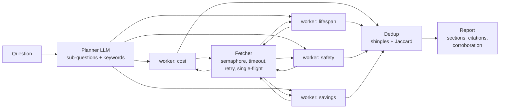

# 22 · Parallel Research Swarm

Build a map-reduce research swarm: a planner splits the question, **asyncio workers research in parallel**, and a
reducer **deduplicates** what they found into one cited report. About 550 lines of Python, no API key needed.

**Level:** Advanced

**You'll learn:**
- Map-reduce for agents: plan -> parallel workers -> merge
- Bounded concurrency with `asyncio.Semaphore`, timeouts that don't count queueing time, retries with backoff
- **Single-flight** fetching: five workers want the same page, one request goes out
- Near-duplicate detection with word shingles + Jaccard, turning "five mirrors" into "one fact, five sources"
- A grounding check that drops any claim the extractor can't point to in the source text

## Why this matters

"Research X" is the most common agent task, and it parallelises well: costs, lifespan, safety and savings are
independent questions. Run them one after another and you wait for every slow website in turn. Run them at once
and you hit three new problems: you hammer servers, you fetch the same page twice, and syndicated copies make one
press release look like five independent confirmations. Analyst tools, due-diligence bots and "deep research"
features all have to solve exactly these.

## Architecture



The planner model turns the question into sub-questions, each with search keywords; its JSON is validated, and a
broken plan falls back to a single worker. Each worker searches a TF-IDF index over the local corpus, fetches its
top documents through a shared `Fetcher`, and asks the extractor model to quote relevant sentences. Every claim is
checked against the source text before it's kept. The reducer clusters near-duplicate claims across all workers,
counts distinct sources per cluster as corroboration, and renders a markdown brief with numbered citations and a
list of sources that failed.

## Flow

```mermaid
flowchart LR
    A["cli.main()<br/>load_settings()"] --> B["build_swarm()<br/>load_corpus · SearchIndex · Fetcher"]
    B --> C["Swarm.run(question)"]
    C --> D["Swarm.plan()<br/>MockPlanner → Plan"]
    D --> E["Swarm.worker() x N<br/>asyncio.gather"]
    E --> F["SearchIndex.search()"]
    F --> G["Fetcher.fetch()<br/>semaphore · timeout · retry · single-flight"]
    G --> H["Swarm.extract()<br/>MockExtractor + grounded()"]
    H --> I["deduplicate()<br/>shingles + Jaccard"]
    I --> J["Report → render_markdown()<br/>+ render_stats()"]
```



`cli.main()` builds the swarm in `build_swarm()`, `Swarm.plan()` splits the question, and one `Swarm.worker()` per
sub-question runs in parallel: search, fetch through the shared `Fetcher`, extract grounded claims. `deduplicate()`
merges the findings and the report is rendered with citations. See [docs/ARCHITECTURE.md](docs/ARCHITECTURE.md) for
the full sequence and failure modes.

## Project structure

```
22-parallel-research-swarm/
├── README.md
├── VIDEO.md                  # hooks + flow_steps for the video
├── docs/ARCHITECTURE.md      # components, sequence diagram, design decisions, failure modes
├── pyproject.toml            # package metadata, `research-swarm` CLI, pytest + ruff config
├── requirements.txt          # pinned runtime/test deps
├── Makefile                  # install · test · demo · lint · docker · clean
├── Dockerfile / .dockerignore
├── .env.example              # every setting config.py reads
├── demo.py                   # `python demo.py`, no install needed
├── src/swarm/
│   ├── __init__.py           # public API + __version__
│   ├── config.py             # Settings / load_settings(): the only place env vars are read
│   ├── cli.py                # main(), build_swarm()
│   ├── swarm.py              # Swarm: plan → parallel workers → reduce; grounded()
│   ├── corpus.py             # load_corpus(), SearchIndex (TF-IDF), Fetcher (bounded, retrying, single-flight)
│   ├── dedup.py              # deduplicate(), shingles(), jaccard()
│   ├── models.py             # Plan, SubQuestion, Doc, Finding, Cluster, WorkerReport, Report
│   ├── llm.py                # MockPlanner, MockExtractor, ProviderLLM, llm_from_env()
│   └── report.py             # render_markdown(), render_stats()
├── tests/                    # swarm behaviour + end-to-end demo
└── examples/corpus/          # the local "web": 10 docs with latency, a flaky one and a slow one
```

## Quickstart

**Windows (PowerShell)**
```powershell
cd projects/22-parallel-research-swarm
python -m venv .venv; .venv\Scripts\Activate.ps1
pip install -r requirements.txt
python demo.py
python -m pytest -q
```

**macOS / Linux**
```bash
cd projects/22-parallel-research-swarm
python3 -m venv .venv && source .venv/bin/activate
pip install -r requirements.txt
python demo.py
python -m pytest -q
```

Try `python demo.py --concurrency 1` to feel the difference, and `--out report.md` to save the brief.

Expected output (shortened):
```text
[ 0.04s] planner  | 4 sub-questions: cost, lifespan, safety, savings
[ 0.04s] safety   | search -> chemistry-safety, fire-safety-notes, slow-blog
[ 0.17s] cost     | done: 4 findings from 3 docs in 130 ms
[ 0.40s] lifespan | done: 6 findings from 3 docs in 355 ms
[ 0.92s] safety   | FAILED slow-blog: gave up after 2 attempts (TimeoutError)
[ 0.92s] reducer  | 18 findings -> 16 unique claims from 8 sources

## How much does a home battery cost?
- A typical 10 kWh home battery costs between $8,000 and $14,000 installed in 2026. [2][3] (corroborated by 2 sources)
...
+-- SWARM STATS -------------------------------------------------------------+
| network requests : 11 (peak 3 at once)                                     |
| retried / shared : 2 retried, 2 fetches shared via single-flight           |
| wall time        :     912 ms                                              |
| time in requests :    1465 ms  (what a one-at-a-time crawler would wait)   |
```

## How it works

```
src/swarm/
  models.py   SubQuestion, Plan, Doc, Finding, Cluster, WorkerReport, Report (pydantic)
  corpus.py   load_corpus, SearchIndex (TF-IDF), Fetcher (semaphore/timeout/retry/single-flight)
  llm.py      LLM protocol, MockPlanner, MockExtractor, optional real provider
  swarm.py    Swarm.run(): plan -> gather(workers) -> dedup -> Report; grounding check
  dedup.py    shingles, jaccard, deduplicate()
  report.py   markdown brief + stats box
```

**1. Map: one worker per sub-question, all at once.**

```python
workers = await asyncio.gather(*(self.worker(sq) for sq in plan.subquestions))
```

Inside a worker, its document fetches are also gathered (`return_exceptions=True`), so one dead website only
removes that document and gets reported under "Not included".

**2. The fetcher is where politeness and reliability live.** The concurrency slot is taken *before* the timeout
clock starts, so waiting in line never looks like a slow server:

```python
async with self.limit:                                   # at most N requests in flight
    try:
        return await asyncio.wait_for(self._request(doc_id), self.timeout_s)
    except (TransientFetchError, TimeoutError) as exc:
        last = exc
await asyncio.sleep(self.backoff_s * 2 ** attempt)       # back off without holding a slot
```

**3. Single-flight.** The first caller for a URL creates a task; everyone else awaits the same task:

```python
if doc_id in self.inflight:
    self.deduplicated_requests += 1
else:
    self.inflight[doc_id] = asyncio.ensure_future(self._fetch_with_retries(doc_id))
return await asyncio.shield(self.inflight[doc_id])
```

**4. Grounding.** The extractor is told to quote verbatim, and `grounded()` enforces it: a claim survives only if
its words appear in order in the document. A model that "helpfully" adds a fact gets filtered out.

**5. Reduce: dedup into clusters.** Claims become sets of 3-word shingles. A claim joins an existing cluster if
the Jaccard similarity is at least 0.5, so `"... installed in 2026."` and `"... installed, as of 2026."` (0.67)
merge, while different facts score near 0. Each cluster keeps the union of its sources, and sections are sorted
by corroboration.

Credits: map-reduce and single-flight (request coalescing) are classic distributed-systems patterns; shingling with
Jaccard similarity is the textbook near-duplicate technique (Broder, 1997). All code here is original.

## Build it yourself

1. **Make a fake web.** Write ~10 markdown files in `examples/corpus/` with a header (`title`, `url`,
   `latency_ms`, optional `flaky: true`) and one fact per line. Include a syndicated near-copy, a slow site and
   an off-topic page.
2. **Index it.** `SearchIndex` builds TF-IDF counts with a tiny plural stemmer. Search takes keywords and returns
   the top-k doc ids.
3. **Write the fetcher.** Simulate latency with `asyncio.sleep`, fail flaky docs on their first attempt, add the
   semaphore, `wait_for` timeout, exponential backoff and the `inflight` task map. Test each property separately.
4. **Define the records.** `SubQuestion`, `Plan`, `Finding`, `Cluster`, `Report` in `models.py`. Validation on
   `Plan` catches a planner that returns 40 sub-questions or none.
5. **Mock the two model roles.** `MockPlanner` returns four sub-questions with keywords; `MockExtractor` quotes the
   lines containing a keyword. Both reply in the same JSON a real model would.
6. **Write a worker.** Search -> gather fetches -> extract per document -> ground -> `WorkerReport` (findings,
   fetched, failed, elapsed).
7. **Write dedup.** Shingles, Jaccard, greedy clustering in plan order. Keep the shortest wording and every source.
8. **Assemble and render.** `Swarm.run()` ties it together; `report.py` numbers the sources and prints the stats
   that prove the parallel speed-up.
9. **Test the claims.** Peak concurrency never exceeds the limit, five concurrent fetches make one request,
   mirrors merge, hallucinated claims vanish, wall time < total request time.

## Use a real LLM

```powershell
pip install anthropic                  # or: pip install openai
$env:LLM_PROVIDER = "anthropic"        # or "openai"
$env:ANTHROPIC_API_KEY = "sk-ant-..."  # or $env:OPENAI_API_KEY
python demo.py "Is a heat pump worth it in a cold climate?"
```

Both the planner and the extractor switch (`LLM_MODEL` overrides the default `claude-opus-5-5`). The corpus is
still local; to research the real web, replace `SearchIndex` and `Fetcher._request` with a search API and an
HTTP client (`httpx.AsyncClient`), and keep everything else.

## Production notes / pitfalls

- **Respect the sites you crawl.** Limit concurrency per domain (not just globally), honour `robots.txt` and
  `Retry-After`, and cache responses.
- **Shingles catch copies, not paraphrases.** "Costs $8-14k" and "priced from eight to fourteen thousand dollars"
  won't merge. Use embeddings for semantic dedup, and keep Jaccard as a cheap first pass.
- **Corroboration is not truth.** Two sources that copy each other are one source. Track the origin (canonical
  URL, publisher) before counting confirmations.
- **Cost scales with fan-out.** Extraction is one model call per document per worker. Cap docs per worker,
  reuse extractions across workers for shared docs, and use a small model for extraction.
- **Timeouts bound the damage.** Every network call needs one, plus an overall deadline for the whole swarm, so
  one slow site can't hold the report hostage.

## Extend it

1. Add a "conflicts" pass: claims in the same section with different numbers ("$400-900" vs "$650") get flagged.
2. Add a second wave: let the planner read the first report and spawn follow-up sub-questions for thin sections.
3. Add per-domain semaphores so two pages from `energyhub.example` never load at the same time.

Next project: [23 · Browser Automation Agent](../23-browser-automation-agent/README.md)

---
Part of [AI Agent Builds](../../README.md) by [exe_404.ai](https://www.youtube.com/@exe_404ai) — one agentic-AI project a day.
