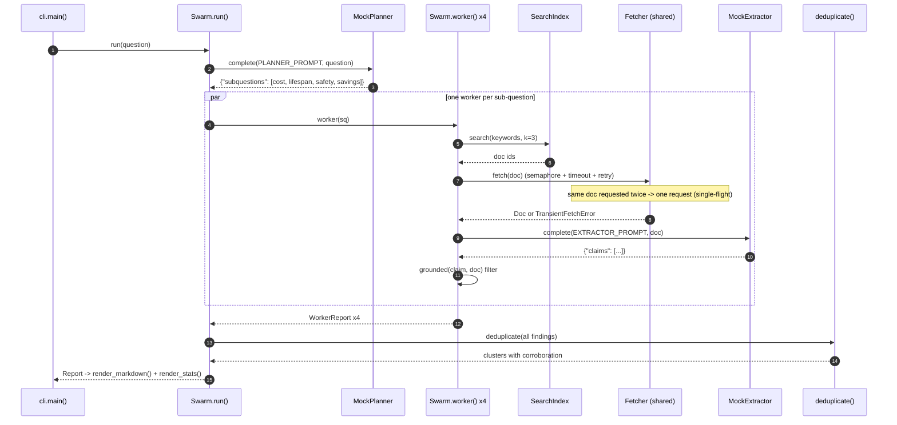

# Architecture · 22 Parallel Research Swarm

A map-reduce research system: a planner splits the question, one worker per sub-question searches, fetches and
extracts **in parallel** through a shared, bounded fetcher, and a reducer de-duplicates the findings into a cited brief.

## Components

| Component | File | Responsibility |
|---|---|---|
| CLI | `src/swarm/cli.py` | `main()` parses flags and prints the timed log; `build_swarm()` wires everything from settings |
| Settings | `src/swarm/config.py` | `Settings` / `load_settings()`: provider, model, concurrency, timeout, retries, docs per worker, corpus folder |
| Swarm | `src/swarm/swarm.py` | `Swarm.run()`: `plan()` → `asyncio.gather(worker())` → `deduplicate()` → `Report`; `extract()`, `grounded()` |
| Corpus | `src/swarm/corpus.py` | `load_corpus()`, `SearchIndex` (TF-IDF), `Fetcher` (semaphore, timeout, retries, single-flight) |
| Dedup | `src/swarm/dedup.py` | `deduplicate()`: word-shingle Jaccard clustering, corroboration counts |
| Models | `src/swarm/models.py` | pydantic `Plan`, `SubQuestion`, `Doc`, `Finding`, `Cluster`, `WorkerReport`, `Report` |
| LLM | `src/swarm/llm.py` | `MockPlanner`, `MockExtractor`, `ProviderLLM`, `llm_from_env()` |
| Report | `src/swarm/report.py` | `render_markdown()` (sections + numbered citations), `render_stats()` |

## Data flow

1. `cli.main()` loads `Settings`; `build_swarm()` loads the corpus, builds the `SearchIndex`, a shared `Fetcher`
   and the planner/extractor models.
2. `Swarm.plan()` asks the planner model for JSON sub-questions and validates it as a `Plan` (fallback: one worker on
   the whole question).
3. **Map:** `asyncio.gather` starts one `Swarm.worker()` per sub-question. Each searches the index, then fetches its
   top-k docs through the shared `Fetcher`.
4. `Fetcher.fetch()` is single-flight (concurrent requests for one doc share one task), bounded by a semaphore, with a
   per-attempt timeout and retries with backoff. Persistent failures are recorded, not raised.
5. `Swarm.extract()` asks the extractor to quote claims; `grounded()` drops anything not literally in the document.
6. **Reduce:** `deduplicate()` clusters near-duplicate claims across workers; distinct sources become corroboration.
   `render_markdown()` and `render_stats()` print the brief and the swarm's statistics.

## One full request

## Design decisions

- **Map-reduce over a shared fetcher.** Workers are independent; the `Fetcher`'s semaphore is the one global limit,
  so adding workers never overloads the sources.
- **Single-flight.** Two workers reading the same page cost one request.
- **Timeout after the slot.** The clock starts once a concurrency slot is held, so queueing is not mistaken for a slow
  server.
- **Grounding check.** Claims must appear verbatim (after normalisation) in the source: no invented facts reach the
  report.
- **Dedup with corroboration.** Five mirrors of one fact are one claim with five sources, not five claims.
- **Partial results beat no results.** A failed source is listed under "Not included"; the rest of the report ships.
- **Settings in one place.** `config.py` is the only module that reads the environment.

## Failure modes and handling

| Failure | Handling |
|---|---|
| Planner returns invalid JSON | `Swarm.plan()` falls back to a single worker on the whole question |
| Source returns 503 once (`flaky`) | retried with exponential backoff (`FETCH_RETRIES`) |
| Source never answers in time | per-attempt timeout (`FETCH_TIMEOUT_S`), then recorded in `WorkerReport.failed` |
| Too many parallel requests | semaphore (`SWARM_CONCURRENCY` / `--concurrency`) |
| Extractor returns prose | logged and skipped for that document |
| Extractor invents a claim | dropped by `grounded()` and logged |
| Non-transient bug in a fetch | re-raised so it is not silently swallowed |

## How to extend

- **Real web:** replace `Fetcher._request()` with an `httpx.AsyncClient` call; keep the semaphore, timeout and
  single-flight logic as is.
- **Better search:** swap `SearchIndex` for embeddings; workers only need `search(keywords, k)`.
- **Smarter dedup:** replace shingles with embedding similarity in `deduplicate()`, keeping the `Cluster` contract.
- **Budgets:** cap total requests or tokens in `Swarm.run()` and cancel workers that exceed it.
