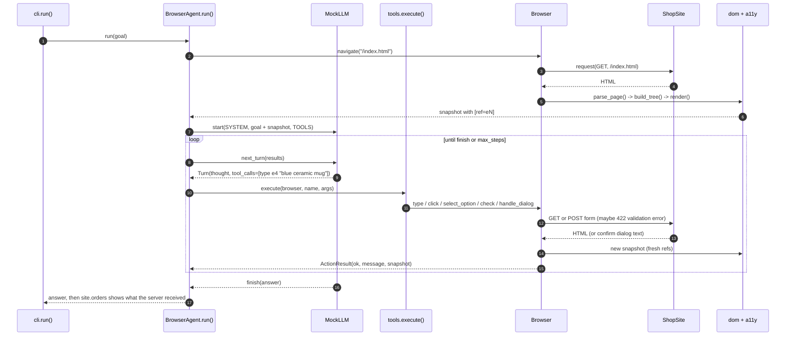

# Architecture · 23 Browser Automation Agent

An observe → act agent that drives a (simulated, offline) browser. The model never sees HTML: it reads an
**accessibility snapshot** where every interactive element has a ref (`[ref=e16]`), and it acts by calling tools
with those refs. Every action returns `OK/ERROR` plus the new snapshot.

## Components

| Component | File | Responsibility |
|---|---|---|
| CLI | `src/browser_agent/cli.py` | `main()` parses flags; `run()` builds site, browser, model and agent, prints the server-side order |
| Settings | `src/browser_agent/config.py` | `Settings` / `load_settings()`: provider, model, step budget, shop folder |
| Agent loop | `src/browser_agent/agent.py` | `BrowserAgent.run()`: snapshot → `llm.next_turn()` → `tools.execute()` → new snapshot; `describe()` |
| Tools | `src/browser_agent/tools.py` | `TOOLS` JSON Schemas (click, type, select_option, check, handle_dialog, navigate, go_back, finish), `execute()` |
| Browser | `src/browser_agent/browser.py` | `Browser`: navigation history, form state, link clicks, GET/POST submit with redirect, dialogs, `ActionResult` |
| Accessibility | `src/browser_agent/a11y.py` | `build_tree()` (roles, accessible names, values), `RefRegistry`, `render()` → snapshot text |
| DOM | `src/browser_agent/dom.py` | `parse_page()` with the stdlib `HTMLParser`, `Node`, `is_hidden()` |
| Sites | `src/browser_agent/site.py` | `ShopSite` (search, product, cart, checkout with server-side validation), `FileSite` (folder of .html) |
| LLM | `src/browser_agent/llm.py` | `MockLLM` (reads the snapshot like a careful user), `AnthropicLLM`, `OpenAILLM`, `make_llm()`, `parse_snapshot()` |
| Trace | `src/browser_agent/trace.py` | `Trace.box()`, `row()`, `snapshot()` |

## Data flow

1. `cli.run()` creates a `ShopSite`, wraps it in a `Browser`, picks the model with `make_llm()` and starts
   `BrowserAgent.run(goal)`.
2. `Browser.navigate("/index.html")` asks the site for HTML; `dom.parse_page()` builds a DOM; `a11y.build_tree()` +
   `render()` turn it into the snapshot with fresh refs.
3. The model gets the system prompt, the goal, the snapshot and the `TOOLS` schemas, and returns a `Turn`
   (thought + tool calls, or a final answer).
4. `tools.execute()` maps each tool call to a `Browser` method. Bad refs, missing arguments and unknown tools become
   `ERROR` results the model can read; they never crash the loop.
5. The `ActionResult` (`OK/ERROR: message` + new snapshot) goes back to the model as a tool result.
6. The loop ends when the model calls `finish`, answers without a tool call, or `max_steps` is reached.

## One full request

## Design decisions

- **Accessibility tree, not HTML.** Roles and names are what a human sees; the snapshot is a fraction of the tokens
  and hides layout noise and hidden elements.
- **Refs instead of selectors.** The model says `click e16`; the browser resolves it. Refs are reassigned on every page
  load, so stale refs fail loudly instead of clicking the wrong element.
- **Errors are observations.** `execute()` turns every failure into text the model reads and fixes (the 422 "accept the
  terms" error is part of the demo).
- **Verify before committing.** The confirmation dialog shows the total; the agent compares it with what it expects
  and refuses a mismatch.
- **Stdlib-only browser.** `HTMLParser` + a small form engine keeps the mechanism visible; the same loop works with a
  real browser.
- **Settings in one place.** `config.py` is the only module that reads the environment.

## Failure modes and handling

| Failure | Handling |
|---|---|
| Stale or unknown ref | `Browser._element()` raises, returned as `ERROR` with the current snapshot |
| Missing tool argument / unknown tool | `execute()` returns an `ERROR` result |
| Server-side validation error (HTTP 422) | the alert appears in the snapshot; the model fixes the form and retries |
| Dialog text does not match the cart ("dark pattern") | the agent dismisses it instead of confirming |
| Out-of-stock product (disabled button) | the agent finishes with an explanation instead of looping |
| Agent never finishes | `max_steps` (`AGENT_MAX_STEPS` / `--max-steps`) |
| Model declines (Anthropic `refusal`) | `AnthropicLLM` raises a clear `RuntimeError` |

## How to extend

- **Real browser:** implement the `Browser` methods on top of Playwright and build the snapshot from its
  accessibility API; `BrowserAgent` and `tools.py` stay the same.
- **New tool:** add a schema to `TOOLS` and a branch in `execute()` (e.g. `scroll`, `upload_file`).
- **New site:** point `FileSite` at a folder of pages, or set `SHOP_SITE_DIR` to a different catalog.
- **Approvals:** require a human confirmation in `execute()` before `handle_dialog(accept=True)` (see project 14).
