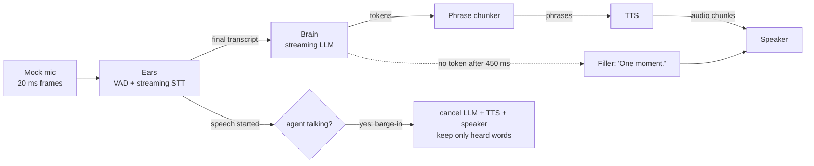
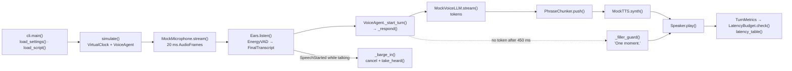

# 24 · Voice Agent Pipeline

Build the engine of a voice assistant: **VAD + speech-to-text -> streaming LLM -> text-to-speech**, with
**barge-in**, a **filler phrase** for slow tools, and a **latency budget** you can test. Mock audio, a virtual clock,
about 775 lines of Python, and no audio libraries or API keys.

**Level:** Advanced

**You'll learn:**
- Why voice agents stream everything, and how much latency that saves (800 ms vs 2160 ms here)
- Voice activity detection: speech start (for barge-in) vs end-of-turn (the "endpoint" you wait for)
- Barge-in: cancel LLM, TTS and playback together with `asyncio` task cancellation, and remember only what was heard
- Splitting voice-to-voice latency into stage budgets, so a regression points at the guilty component
- Testing real-time systems deterministically with a virtual "autojump" clock

## Why this matters

Phone support lines, drive-throughs, in-car assistants and voice notes are all moving to voice agents. Users judge
them in the first second: if the agent is silent for two seconds, they say "hello?"; if it keeps talking after
they interrupt, it feels like a machine. Those two behaviours, low latency and graceful interruption, come from
pipeline engineering, not from the model, and they're what this project teaches.

## Architecture



The microphone emits 20 ms frames carrying an energy level and, on a word's first frame, the word itself. That's
all a pipeline needs from audio. The VAD turns energy into "speech started" and "turn ended" events, and the STT
produces a final transcript 120 ms after the endpoint. The agent's response is three concurrent tasks joined by
queues: the LLM streams tokens, the chunker cuts them into phrases, TTS synthesises each phrase, and the speaker
plays them in order. If the user starts talking mid-answer, the response task is cancelled, which cancels all
three at once. Everything runs on a virtual clock, so a 17-second call simulates in about 0.1 s with exact,
repeatable timings.

## Flow



`cli.main()` runs one simulated call through `simulate()`. Frames from `MockMicrophone` become transcripts in
`Ears.listen()`; each transcript starts a `VoiceAgent` response where LLM tokens, phrases, TTS and playback flow
concurrently. A filler covers slow answers, and `_barge_in()` cancels everything when the user interrupts. See
[docs/ARCHITECTURE.md](docs/ARCHITECTURE.md) for the full sequence and failure modes.

## Project structure

```
24-voice-agent-pipeline/
├── README.md
├── VIDEO.md                  # hooks + flow_steps for the video
├── docs/ARCHITECTURE.md      # components, sequence diagram, design decisions, failure modes
├── pyproject.toml            # package metadata, `voice-agent` CLI, pytest + ruff config
├── requirements.txt          # pinned test deps (runtime is stdlib only)
├── Makefile                  # install · test · demo · lint · docker · clean
├── Dockerfile / .dockerignore
├── .env.example              # every setting config.py reads
├── demo.py                   # `python demo.py [--mode batch] [--no-filler]`, no install needed
├── src/voice/
│   ├── __init__.py           # public API + __version__
│   ├── config.py             # Settings / load_settings(): the only place env vars are read
│   ├── cli.py                # main(), load_script(), simulate(), latency_table()
│   ├── pipeline.py           # VoiceAgent: turns, streaming/batch answers, barge-in, filler; Timeline
│   ├── audio.py              # MockMicrophone, AudioFrame, Utterance
│   ├── ears.py               # EnergyVAD, Ears (SpeechStarted / FinalTranscript)
│   ├── brain.py              # MockVoiceLLM, ProviderStreamer, provider_from_env()
│   ├── mouth.py              # PhraseChunker, MockTTS, Speaker
│   ├── budget.py             # TurnMetrics, LatencyBudget
│   └── clock.py              # VirtualClock (deterministic), RealClock
├── tests/                    # pipeline behaviour + end-to-end demo
└── examples/conversation.json  # the scripted caller
```

## Quickstart

**Windows (PowerShell)**
```powershell
cd projects/24-voice-agent-pipeline
python -m venv .venv; .venv\Scripts\Activate.ps1
pip install -r requirements.txt
python demo.py
python -m pytest -q
```

**macOS / Linux**
```bash
cd projects/24-voice-agent-pipeline
python3 -m venv .venv && source .venv/bin/activate
pip install -r requirements.txt
python demo.py
python -m pytest -q
```

Also try `python demo.py --mode batch` and `python demo.py --no-filler`.

Expected output (shortened):
```text
    2.940s  stt     | final "hi can you tell me your opening hours please"  (endpoint +300 ms, stt +120 ms)
    3.190s  llm     | first token  (+250 ms after transcript)
    3.320s  speaker | "Sure!" (300 ms)  <- voice-to-voice 800 ms
    3.620s  speaker | "We're open from nine to six," (1800 ms)
    5.420s  speaker | "Monday to Saturday." (900 ms)
    6.040s  user    | starts speaking
    6.040s  barge-in| user talked over the agent -> stopped after 40 ms; user heard: "Sure! We're open from nine to six, Monday to"
   ...
   13.830s  speaker | filler "One moment." (600 ms)  <- voice-to-voice 870 ms
   14.330s  llm     | first token  (+950 ms after transcript)

turn  user said                           heard after  endpoint  stt   llm   tts   verdict
   1  hi can you tell me your opening...   800 ms        300   120   250   130  PASS
   2  sorry what about sundays             920 ms        300   120   250   250  PASS
   3  and what will the weather be to...   870 ms        300   120   950   210  PASS via filler (llm 950 ms > 300 ms)

same call in batch mode -> first turn heard after 2160 ms (vs 800 ms in streaming mode)
```

## How it works

```
src/voice/
  clock.py     VirtualClock (autojump, deadlock detection) and RealClock
  audio.py     AudioFrame, Utterance, MockMicrophone
  ears.py      EnergyVAD + Ears (streaming STT -> SpeechStarted / FinalTranscript)
  brain.py     MockVoiceLLM (TTFT + per-token delay, slow tool), real provider streamer
  mouth.py     PhraseChunker, MockTTS, interruptible Speaker
  budget.py    TurnMetrics (stage breakdown) and LatencyBudget
  pipeline.py  VoiceAgent: event loop, streaming/batch answers, barge-in, filler
```

**1. A clock you can test with.** Every component sleeps via `clock.sleep(ms)`. The virtual clock lets all ready
tasks run, then jumps to the earliest pending wake-up:

```python
wake_at = self._sleepers[0][0]
self._now = wake_at
while self._sleepers and self._sleepers[0][0] == wake_at:
    _, _, future = heapq.heappop(self._sleepers)
    future.set_result(None)
```

If tasks are waiting but nobody is sleeping, nothing can ever happen, so it raises `Deadlock` instead of hanging.

**2. Endpointing is part of latency.** `EnergyVAD` declares end-of-turn after 300 ms of silence. That 300 ms is
the first line of the budget, and the hardest trade-off in voice UX: shorter feels snappier but cuts people off.

**3. Streaming is a pipeline of queues.** In `_stream_answer`, three coroutines run concurrently:

```python
async def think():                       # LLM tokens -> phrases
    async for token in self.llm.stream(self.history):
        if phrase := chunker.push(token):
            await phrases.put(phrase)
async def synthesise():                  # phrases -> audio chunks
    while (phrase := await phrases.get()) is not None:
        await chunks.put(await self.tts.synth(phrase))
async def speak():                       # audio chunks -> speaker
    while (chunk := await chunks.get()) is not None:
        await self._play(turn, chunk)
```

Audio starts after the *first phrase* ("Sure!"), while the LLM is still writing. Batch mode waits for the full
reply and synthesises it in one go: 2160 ms instead of 800 ms.

**4. Barge-in is task cancellation.** When the VAD reports speech while a response is running:

```python
self._response.cancel()                  # cancels think, synthesise, speak and the filler guard
```

The speaker catches `CancelledError`, works out how far into the current chunk it got, and records only the
audible words. The conversation history stores `"Sure! We're open from nine to six, Monday to [interrupted]"`, not
the full reply. If you skip this, the model "remembers" saying things the user never heard.

**5. Budgets per stage.** `TurnMetrics.stages` splits voice-to-voice latency into endpoint, STT, LLM
(time-to-first-token) and TTS (first token to first audio). `LatencyBudget.check` fails a turn over 1000 ms total
and lists any stage over its own limit, even when the total passes.

**6. Fillers buy time honestly.** If no token arrives within 450 ms of the transcript (the weather question needs a
700 ms tool call), a pre-synthesised "One moment." plays. Perceived latency stays at 870 ms; the slow LLM stage is
still reported.

Credits: the autojump virtual clock follows the idea of Trio's `MockClock(autojump_threshold=0)`; the stage-by-stage
latency budget mirrors how public voice-agent platform docs describe end-to-end latency. All code here is original.

## Build it yourself

1. **Start with the clock.** Write `VirtualClock.sleep()` (a future in a heap) and `run()` (let tasks settle, jump
   to the next wake-up). Test that `gather(sleep(5000), sleep(3000))` ends at 5000, instantly.
2. **Fake the microphone.** `Utterance(start_ms, text)` -> frames every 20 ms: loud while speaking, quiet otherwise,
   with the word on its first frame.
3. **Write the VAD.** Two loud frames in a row = speech start; 300 ms of quiet after speech = end of turn.
4. **Write the ears.** Collect words; at end of turn, emit `FinalTranscript` after the STT delay, plus
   `SpeechStarted` immediately on speech start.
5. **Write the brain.** `MockVoiceLLM.stream()` is an async generator: sleep TTFT (plus tool time for some
   questions), then yield a word every 30 ms.
6. **Write the mouth.** `PhraseChunker` (break on punctuation or 6 words), `MockTTS.synth()` (latency, then a chunk
   with a duration) and a `Speaker` that records partially played chunks when cancelled.
7. **Wire the agent.** An event loop over ears events: final transcript -> start a response task; speech start
   while responding -> cancel it. Implement streaming and batch answers and the filler guard.
8. **Measure.** Stamp `final`, `first_token`, `first_audio`, `answer_audio` on each turn; derive stages; check them
   against `LatencyBudget`.
9. **Test the behaviours.** Budget met in streaming and blown in batch, reaction to barge-in <= 40 ms, nothing plays
   after barge-in, memory holds only heard words, identical timelines on repeat runs.

## Use a real LLM

```powershell
pip install anthropic                  # or: pip install openai
$env:LLM_PROVIDER = "anthropic"        # or "openai"
$env:ANTHROPIC_API_KEY = "sk-ant-..."  # or $env:OPENAI_API_KEY
python demo.py
```

With a real provider the demo switches to `RealClock`, so the latency table shows your real model's
time-to-first-token. `ProviderStreamer` fetches the reply and then streams it word by word to keep the code short;
for production, use the SDK's streaming API so the first phrase can be spoken before the reply is finished.
`LLM_MODEL` overrides the default (`claude-opus-5-5`); for voice, a smaller, faster model is often the right
trade. Real STT/TTS plug in by replacing `Ears` and `MockTTS` with streaming speech services.

## Production notes / pitfalls

- **Echo cancellation.** On a real device the mic hears the agent's own voice. Without acoustic echo cancellation,
  the agent barges in on itself. Phone and WebRTC stacks provide AEC; use it.
- **Barge-in false positives.** Coughs, "uh-huh" and background TV trigger energy VADs. Use a model-based VAD, require
  a minimum duration, or ignore backchannels.
- **Endpointing is adaptive in good systems.** Wait less after a complete-sounding sentence and longer after "um,
  so...". A semantic endpoint model can save 100-200 ms per turn.
- **Measure p95, not averages.** One slow LLM call in twenty is what users remember. Log stage timings per turn and
  alert on the tail.
- **Cost of streaming TTS.** Many small synthesis requests cost more than one large one, and they can't be cached.
  Pre-synthesise fixed phrases (greetings, fillers).

## Extend it

1. Add backchannel filtering: ignore user speech shorter than 300 ms ("mm-hm") instead of barging in.
2. Add an adaptive endpoint: 150 ms of silence after a word ending in `?` or `.`, 500 ms otherwise.
3. Speak the first phrase from a fast model and the rest from a strong one (speculative "fast start").

Next project: [25 · Durable Agent Workflows](../25-durable-agent-workflows/README.md)

---
Part of [AI Agent Builds](../../README.md) by [exe_404.ai](https://www.youtube.com/@exe_404ai) — one agentic-AI project a day.
