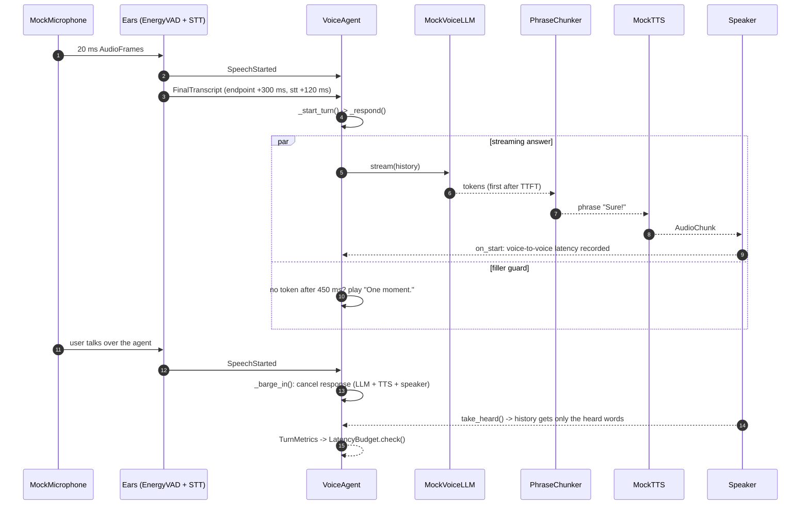

# Architecture · 24 Voice Agent Pipeline

A streaming voice agent: **ears** (VAD + speech-to-text) → **brain** (streaming LLM) → **mouth** (phrase chunker →
TTS → speaker), wired as concurrent asyncio tasks joined by queues. It supports barge-in, a filler phrase for slow
answers, and a per-stage latency budget. Audio is mocked and time is virtual, so a 17-second call simulates in about
0.1 s with exact, repeatable timings.

## Components

| Component | File | Responsibility |
|---|---|---|
| CLI | `src/voice/cli.py` | `main()` parses flags; `load_script()`, `simulate()` (one session), `latency_table()` |
| Settings | `src/voice/config.py` | `Settings` / `load_settings()`: provider, model, mode, filler delay, latency budget, caller script |
| Pipeline | `src/voice/pipeline.py` | `VoiceAgent.run()`: turn management, `_barge_in()`, `_respond()`, `_stream_answer()` / `_batch_answer()`, `_filler_guard()`; `Timeline` |
| Audio | `src/voice/audio.py` | `MockMicrophone` emits 20 ms `AudioFrame`s from scripted `Utterance`s |
| Ears | `src/voice/ears.py` | `EnergyVAD` (speech start / end-of-turn), `Ears.listen()` → `SpeechStarted`, `FinalTranscript` |
| Brain | `src/voice/brain.py` | `MockVoiceLLM` (TTFT + per-token delay, slow "tool" questions), `ProviderStreamer`, `provider_from_env()` |
| Mouth | `src/voice/mouth.py` | `PhraseChunker`, `MockTTS.synth()`, `Speaker.play()` / `take_heard()` |
| Budget | `src/voice/budget.py` | `TurnMetrics` (stage timings, perceived latency, barge-in reaction), `LatencyBudget.check()` |
| Clock | `src/voice/clock.py` | `VirtualClock` (jumps to the next timer, detects deadlocks), `RealClock` |

## Data flow

1. `cli.main()` loads `Settings` and the caller script; `simulate()` builds a `VoiceAgent` on a `VirtualClock`
   (or a `RealClock` when a real model is plugged in).
2. `MockMicrophone.stream()` pushes frames into a queue; `Ears.listen()` runs the VAD and emits `SpeechStarted` and,
   120 ms after the endpoint, a `FinalTranscript`.
3. `VoiceAgent._start_turn()` records a `TurnMetrics`, appends the user text to history and starts `_respond()`.
4. In **streaming** mode three tasks run at once: `think()` streams tokens through the `PhraseChunker`, `synthesise()`
   turns each phrase into an `AudioChunk`, `speak()` plays them in order. **Batch** mode waits for the whole reply.
5. `_filler_guard()` plays "One moment." if no token arrived after `filler_after_ms`.
6. A `SpeechStarted` while the agent is talking triggers `_barge_in()`: cancelling the response task cancels LLM, TTS
   and speaker together, and history keeps only the words the user actually heard.
7. `latency_table()` checks every turn against `LatencyBudget`; the CLI also replays the call in the other mode.

## One full request

## Design decisions

- **Streaming end to end.** Audio starts after the *first phrase*, not the whole reply: 800 ms vs 2160 ms
  voice-to-voice on the first turn of the demo.
- **One task per response.** Cancelling a single asyncio task stops LLM, TTS and playback at once, so barge-in reacts
  within one frame (40 ms).
- **Memory of what was heard.** After an interruption, history stores the heard prefix plus `[interrupted]`, so the
  model doesn't think the user heard the whole answer.
- **Filler phrase.** A pre-synthesised "One moment." covers slow tool calls without blowing the budget.
- **Per-stage budget.** Endpoint, STT, LLM and TTS each have a limit, so a regression points at the guilty stage.
- **Virtual clock.** Deterministic, instant simulations make latency testable in CI.
- **Settings in one place.** `config.py` is the only module that reads the environment.

## Failure modes and handling

| Failure | Handling |
|---|---|
| Model slow to first token (tool call) | filler phrase after `FILLER_AFTER_MS`; the turn passes "via filler" |
| User interrupts | `_barge_in()` cancels the response; only heard words go to history |
| A stage exceeds its budget | `LatencyBudget.check()` reports `stage N ms > limit` in the table |
| Agent never speaks | reported as "agent never spoke" (turn fails) |
| Tasks wait on each other forever | `VirtualClock` raises `Deadlock` instead of hanging |
| Invalid `VOICE_MODE` | `load_settings()` raises a clear `ValueError` |

## How to extend

- **Real audio:** replace `MockMicrophone` with a microphone stream and `MockTTS`/`Speaker` with a TTS SDK and an
  audio device; the queues and cancellation stay the same.
- **Real STT:** feed frames to a streaming STT service inside `Ears.listen()` and emit the same events.
- **True token streaming:** use the provider SDK's streaming API in `ProviderStreamer.stream()`.
- **Smarter endpointing:** tune `EnergyVAD.end_silence_ms`, or add a semantic end-of-turn model.
