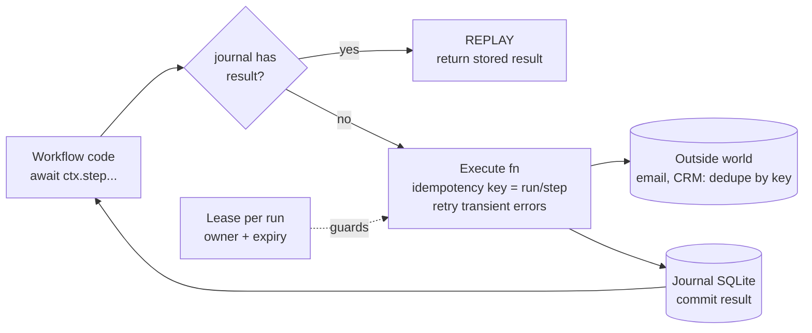
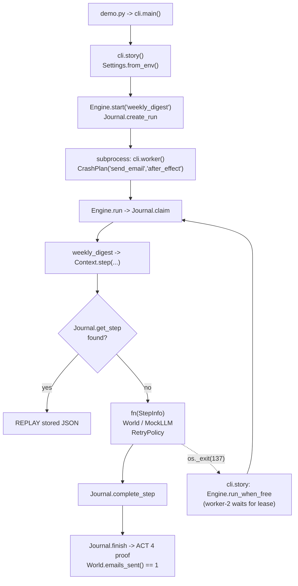

# 25 · Durable Agent Workflows

Build a tiny durable-execution engine for long-running agent jobs: **journaled steps, retries, leases and
idempotent side effects**, so a worker can be killed mid-job and another one finishes it **without sending the
email twice**. About 650 lines of Python on SQLite, no API key needed.

**Level:** Advanced

**You'll learn:**
- The core rule of durable execution: a step is done when its result is *committed*, not when its code returns
- Replay: resume by returning journaled results (including LLM outputs) instead of re-running steps
- Idempotency keys: why "run the interrupted step again" is only safe if the outside world dedupes
- Retries with backoff for transient errors, and no retries for permanent ones
- Leases: how a crashed worker's job is safely taken over, and never run twice at once

## Why this matters

Agent jobs are long: a nightly digest, a 40-step research task, an onboarding flow that waits for a human. Long
jobs meet crashes, deploys, OOM kills and flaky APIs. If your agent restarts from scratch, it re-asks the model
(more cost, *different* answers) and repeats side effects: two emails to the customer, two refunds, two tickets.
Workflow engines like Temporal, AWS Step Functions and Azure Durable Functions exist for exactly this. This
project builds the essential mechanism in one file you can read in ten minutes.

## Architecture



A workflow is plain `async` Python; every interaction with the world goes through `ctx.step(name, fn)`. Before
running a step, the engine checks the journal: if a result exists, it is returned (replay). Otherwise the
function runs with an idempotency key derived from `run_id/step`, transient errors are retried with backoff, and
the JSON result is committed. Each run carries a lease (owner + expiry) that is renewed after every step; a new
worker can only take over once the lease has expired. The outside world (email, CRM) is a separate database that
dedupes by idempotency key, just like real payment and messaging APIs.

## Flow



## Project structure

```
25-durable-agent-workflows/
├── README.md               # this file
├── VIDEO.md                # hooks + flow_steps for the video
├── docs/ARCHITECTURE.md    # components, sequence diagram, design decisions, failure modes
├── pyproject.toml          # package metadata, `durable` CLI entry, pytest + ruff config
├── requirements.txt        # pinned dev deps (runtime is stdlib only)
├── Makefile                # install / test / demo / lint / docker / clean
├── Dockerfile              # python:3.12-slim, non-root, runs the demo
├── .dockerignore / .gitignore / .env.example
├── demo.py                 # one-command demo, no install needed
├── src/durable/
│   ├── __init__.py         # public API + __version__
│   ├── __main__.py         # `python -m durable` (used for the worker subprocess)
│   ├── config.py           # Settings: LLM_PROVIDER, LLM_MODEL, DURABLE_DATA_DIR, DURABLE_LEASE_S
│   ├── cli.py              # argparse: four-act story + `worker` subcommand; build_engine wiring
│   ├── engine.py           # Context.step (replay/execute/retry/commit), Engine, CrashPlan, RetryPolicy
│   ├── store.py            # Journal: runs + steps + leases in SQLite
│   ├── world.py            # outside world: flaky tickets API, idempotent email + CRM
│   ├── llm.py              # LLM protocol, MockLLM (counts calls), ProviderLLM, llm_from_env
│   └── workflows.py        # weekly_digest: fetch -> summarize -> draft -> send -> CRM
└── tests/
    ├── test_durable.py     # crash at every step x phase, retries, leases, idempotency, real kill
    └── test_e2e_demo.py    # runs `python demo.py` end to end + settings parsing
```

## Quickstart

**Windows (PowerShell)**
```powershell
cd projects/25-durable-agent-workflows
python -m venv .venv; .venv\Scripts\Activate.ps1
pip install -r requirements.txt
python demo.py
python -m pytest -q
```

**macOS / Linux**
```bash
cd projects/25-durable-agent-workflows
python3 -m venv .venv && source .venv/bin/activate
pip install -r requirements.txt
python demo.py
python -m pytest -q
```

With make: `make demo`, `make test`; in a container: `make docker`.

Try other crash points: `python demo.py --crash-at summarize:before` or `--crash-at update_crm:after_effect`.

Expected output (shortened):
```text
  [worker-1] RETRY  | fetch_tickets  attempt 1 failed (503 from ticket API); backing off 0.02s
  [worker-1] STEP   | fetch_tickets  done (attempt 3) -> journaled
  [worker-1] STEP   | summarize      done (attempt 1) -> journaled
  [worker-1] STEP   | draft_email    done (attempt 1) -> journaled
  [worker-1] CRASH  | send_email     worker dies after the side effect, before the commit
  worker-1 exited with code 137 (killed)
| outside world: emails sent = 1, CRM notes = 0                              |
  The email went out, but the journal never heard about it. A naive retry would send it again.
  [worker-2] WAIT   | run-... is leased by worker-1 for another 0.9s; a crashed worker never renews, so we wait
  [worker-2] REPLAY | fetch_tickets  result from journal, not re-executed
  [worker-2] REPLAY | summarize      result from journal, not re-executed
  [worker-2] REPLAY | draft_email    result from journal, not re-executed
  [worker-2] STEP   | send_email     done (attempt 1) -> journaled
  [worker-2] DEDUP  | email service recognised the idempotency key -> original receipt msg-..., no second email
| LLM calls made by worker-2: 0 (all model outputs replayed from journal)    |
| exactly-once effects: YES                                                  |
```

The first worker is a real subprocess killed with `os._exit(137)`: no `finally` blocks, no cleanup.

## How it works

```
src/durable/
  store.py      Journal: runs (status, lease) + steps (result JSON, attempts) in SQLite
  engine.py     Context.step(): replay / execute / retry / commit; Engine: start, run, run_when_free
  world.py      the outside world: flaky ticket API, idempotent email + CRM services
  llm.py        LLM protocol, MockLLM (counts calls), optional real provider
  workflows.py  weekly_digest: fetch -> summarize -> draft -> send -> CRM note
  cli.py        the four-act demo + the `worker` subcommand
```

**1. The workflow is ordinary code.** Every effect is wrapped in a named step:

```python
tickets = await ctx.step("fetch_tickets", lambda s: world.fetch_tickets(account))
summary = await ctx.step("summarize", lambda s: ask(SUMMARY_PROMPT, ...))
receipt = await ctx.step("send_email", lambda s: world.send_email(
    recipient, email["subject"], email["body"], idempotency_key=s.idempotency_key))
```

**2. Replay, execute, commit.** The heart of `Context.step`:

```python
found, result = self.journal.get_step(self.run_id, name)
if found:
    return result                                    # REPLAY: no tool call, no LLM call
...
result = await asyncio.wait_for(fn(StepInfo(self.run_id, name, attempt)), timeout_s)
self.journal.complete_step(self.run_id, name, result, attempt)   # only now is it "done"
```

**3. The dangerous window.** Between `fn` returning and `complete_step`, the effect has happened but the journal
doesn't know. A crash there means the step *will* run again. That's unavoidable, so we make it harmless:
`StepInfo.idempotency_key` is `f"{run_id}/{name}"`, identical on every retry and in every process, and the email
service returns the original receipt for a key it has seen. `CrashPlan("send_email", "after_effect")` lets you aim
a crash at exactly this window. The tests do it for every step and both phases.

**4. Retries know the difference.** `RetryPolicy` retries `TransientError` and timeouts with exponential backoff
(0.02 s, 0.04 s, ...) up to 4 attempts. Anything else, such as `PermanentError("unknown account")`, fails the step
on the first attempt and marks the run `failed`, and a failed run is never silently re-executed.

**5. Leases instead of locks.** `Journal.claim` is one atomic `UPDATE ... WHERE owner IS NULL OR owner = ? OR
lease_until < now`. The owner renews after each step. A crashed worker stops renewing, its lease expires, and
`run_when_free` takes over. A live worker's lease can't be stolen.

**6. LLM calls are journaled like any effect.** Model output is non-deterministic and costs money. On resume,
`summarize` and `draft_email` replay the stored JSON (`LLM calls made by worker-2: 0`), so the email that finally
goes out matches the draft that was approved.

Credits: the replay-from-history model follows the public documentation of durable-execution systems such as
Temporal and Azure Durable Functions; idempotency keys follow the pattern popularised by payment APIs (e.g.
Stripe). All code here is original.

## Build it yourself

1. **Model the outside world first.** `world.py`: a flaky read-only API, plus email and CRM services in their own
   SQLite file that store each idempotency key and return the original receipt on a repeat.
2. **Write the journal.** `store.py`: a `runs` table (status, owner, lease_until, result) and a `steps` table
   (result JSON, attempts). Autocommit mode, so each write is durable when it returns.
3. **Write `Context.step`.** Look up the journal; if missing, run `fn(StepInfo)` under a timeout; commit the JSON
   result. Reject duplicate step names; they would make replay ambiguous.
4. **Add retries.** `RetryPolicy(max_attempts, base_delay_s, retry_on)`. Catch only the retryable exceptions; record
   permanent failures and raise `StepFailed`.
5. **Add crash injection.** `CrashPlan(step, phase, hard)` raises `SimulatedCrash` (a `BaseException`, so nothing
   swallows it) or calls `os._exit` for a real kill.
6. **Add leases.** `claim()` as a single conditional `UPDATE`; renew after each step; `run_when_free()` polls until
   a dead worker's lease expires.
7. **Write the workflow.** `weekly_digest` in five steps. Pass `s.idempotency_key` to every side effect.
8. **Prove it.** Crash at every step x phase, resume, and assert exactly one email and one CRM note; assert the
   resumed worker made zero LLM calls; kill a real subprocess and resume.

## Use a real LLM

```powershell
pip install anthropic                  # or: pip install openai
$env:LLM_PROVIDER = "anthropic"        # or "openai"
$env:ANTHROPIC_API_KEY = "sk-ant-..."  # or $env:OPENAI_API_KEY
python demo.py
```

The summarize and draft steps then call a real model (`LLM_MODEL` overrides the default `claude-opus-5-5`). This is
where durability pays: a resumed run reuses the journaled reply instead of paying for, and possibly getting a
different, second answer.

## Production notes / pitfalls

- **Workflow code must be deterministic.** No `random()`, `datetime.now()` or reading files *outside* steps.
  On replay the same code must ask for the same steps in the same order. Put anything non-deterministic in a step.
- **Every side effect needs an idempotency key the other side honours.** If an API has no idempotency support,
  write a "pending" record before calling it and reconcile on resume (check whether the effect happened).
- **Leases need fencing.** A paused (not dead) worker can wake up after its lease expired. The heartbeat `claim()`
  after each step makes it fail fast; in production also pass a fencing token to downstream writes.
- **Version your workflows.** Changing step order or names breaks replay of in-flight runs. Keep old versions
  until their runs drain.
- **Durability settings.** WAL + `synchronous=NORMAL` survives process crashes; use `FULL` (or a server database)
  if you must survive power loss. Use Postgres or a real workflow engine when many machines share the journal.

## Extend it

1. Add `ctx.sleep(name, seconds)`: a durable timer stored in the journal, so "wait 3 days for approval" survives restarts.
2. Add a human-approval step that pauses the run until `approve(run_id)` is called (see project 14).
3. Add a compensation ("saga") step: if `update_crm` fails permanently, send a correction email.

Next project: [26 · Customer Support Agent (Production)](../26-customer-support-agent-prod/README.md)

---
Part of [AI Agent Builds](../../README.md) by [exe_404.ai](https://www.youtube.com/@exe_404ai) — one agentic-AI project a day.
