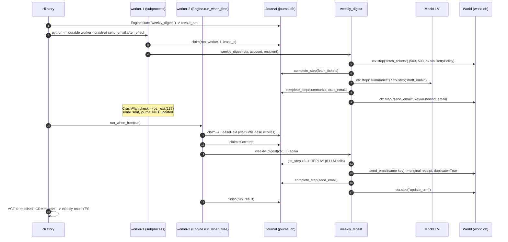

# Architecture · 25 Durable Agent Workflows

## Components

| Component | File | Responsibility |
|---|---|---|
| `Settings` | `src/durable/config.py` | Typed env settings: `LLM_PROVIDER`, `LLM_MODEL`, `DURABLE_DATA_DIR`, `DURABLE_LEASE_S`. |
| `main` / `story` / `worker` | `src/durable/cli.py` | Argparse entry (`durable`, `python demo.py`). `story` runs the four-act demo; `worker` is the subprocess that gets killed. |
| `build_engine` | `src/durable/cli.py` | Composition root: wires `World`, `make_workflows`, `llm_from_env` and `Engine` from `Settings`. |
| `Engine` | `src/durable/engine.py` | `start()` creates a run, `run()` executes/resumes it under a lease, `run_when_free()` waits out a dead worker's lease. |
| `Context.step` | `src/durable/engine.py` | The durability primitive: replay from journal, else execute with idempotency key + `RetryPolicy`, then commit. |
| `CrashPlan` | `src/durable/engine.py` | Fault injection at `before` or `after_effect` of any step (soft `SimulatedCrash` or hard `os._exit(137)`). |
| `Journal` | `src/durable/store.py` | SQLite (WAL, autocommit): `runs` (status, owner, lease) and `steps` (result JSON, attempts). |
| `World` | `src/durable/world.py` | The outside world in its own SQLite file: flaky ticket API, email + CRM services that dedupe by idempotency key. |
| `make_workflows` / `weekly_digest` | `src/durable/workflows.py` | The example job: fetch → summarize → draft → send → CRM note. |
| `MockLLM` / `ProviderLLM` / `llm_from_env` | `src/durable/llm.py` | Deterministic, call-counting offline model; optional real provider. |

## Data flow

A run is a row in `runs`. Each `ctx.step(name, fn)` call becomes, at most once, a row in `steps`. The outside
world is a separate database because it does not crash when our worker does. The only state shared between
worker processes is the journal file.

## One full request: crash and resume

## Design decisions

- **Commit defines "done".** A step's code finishing means nothing until `Journal.complete_step` returns. This is
  the single rule that makes replay correct.
- **Idempotency key = `run_id/step`.** Deterministic across retries and processes, so a re-executed side effect
  is recognised by the receiving service. A random key would defeat the purpose.
- **Leases, not locks.** A lock held by a dead process is never released; a lease simply expires. `claim()` is one
  conditional `UPDATE`, so it is atomic without explicit transactions.
- **LLM output is journaled.** It is non-deterministic and costs money; replaying it keeps the resumed run
  consistent with what was already decided.
- **SQLite with WAL + autocommit.** Survives process crashes, needs no server, and is easy to inspect.
- **Settings in one place.** `config.Settings` is read once in `build_engine`, and the worker subprocess inherits
  the same environment, so both workers agree on data dir, lease and provider.

## Failure modes and how they are handled

| Failure | Handling |
|---|---|
| Transient tool error (503, timeout) | `RetryPolicy`: exponential backoff, up to 4 attempts, attempts recorded in `steps`. |
| Permanent error (unknown account) | No retry; `fail_step` + `Journal.fail`; the run stays `failed` and is never silently re-run. |
| Crash before a step | Step re-runs on resume; nothing happened yet. |
| Crash after the effect, before commit | Step re-runs with the same idempotency key; the service returns the original receipt. |
| Two workers on one run | `claim()` raises `LeaseHeld` for the second until the first's lease expires. |
| Non-JSON step result | `json.dumps` in `complete_step` raises immediately, before anything is marked done. |
| Duplicate step name | `Context.step` raises `ValueError`; replay would be ambiguous. |

## How to extend

- **New workflow:** add an `async def my_flow(ctx, ...)` in `workflows.py`, wrap every effect in `ctx.step`, and
  register it in the dict returned by `make_workflows`.
- **New side effect:** give the service an idempotency key parameter and pass `s.idempotency_key`.
- **Durable timers / approvals:** store a wake-up time or approval flag as a step result (see README "Extend it").
- **Many machines:** swap `Journal` for a Postgres-backed class with the same methods.
