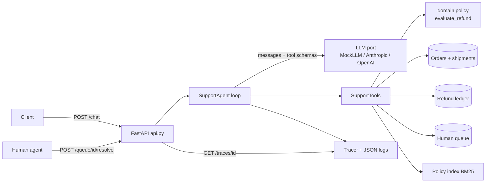
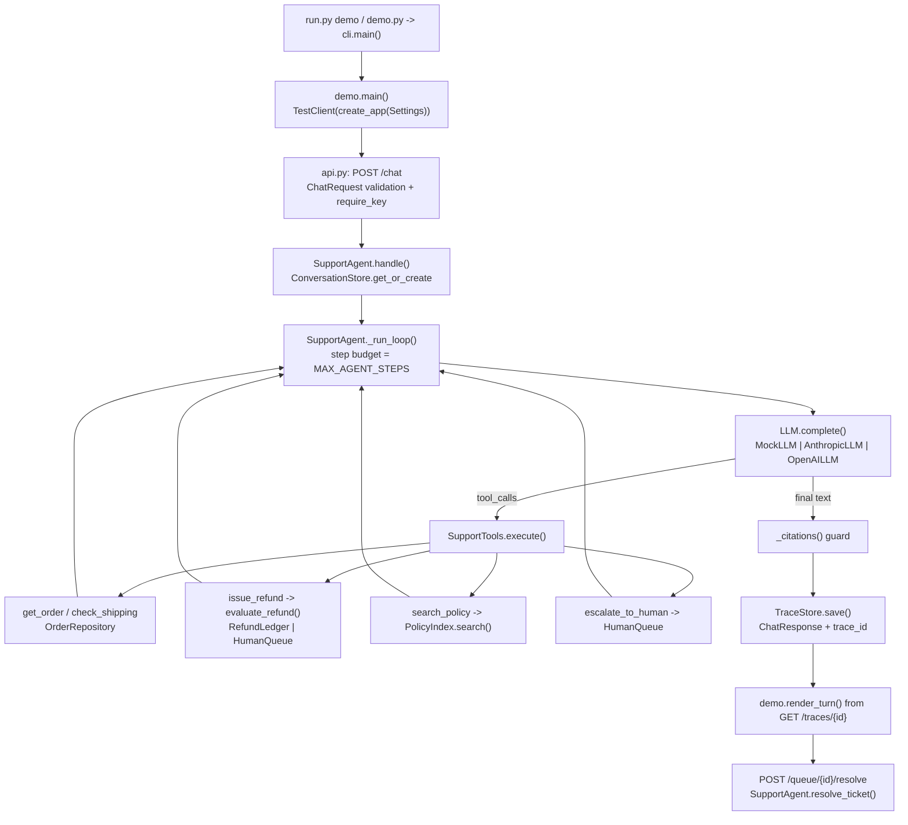

# 26 · Production Customer Support Agent

Ship a FastAPI support agent that looks up orders, issues refunds under hard policy limits, answers
policy questions with citations, escalates to humans, and proves it all with traces and evals, in about 1,000 lines of Python.

**Level:** Production
**You'll learn:**
- How to keep money-moving decisions in code (a policy engine) while the LLM only *asks*
- How to bind tools to the authenticated customer so the model can't read someone else's order
- Policy RAG with stable, verifiable citations (and how to drop citations the model invents)
- Human-in-the-loop: an approval queue for big refunds and a clean handoff for escalations
- Tracing, structured logs and an eval suite that can block a bad deploy

## Why this matters
Support is where most companies first put an agent in front of customers, and it's also where an agent
can do the most damage: refunding the wrong order, promising things the policy forbids, or arguing with an
angry customer. Imagine an online electronics store with 3,000 tickets a day. "Where is my parcel?" and
"Can I return this?" make up about 60% of them. This agent answers those in seconds, refunds small orders
on its own, sends anything over $200 to a person for approval, and hands angry customers to a human
without trying to argue. Every turn produces a trace, so when a manager asks "why did the bot refund
that?" there's an answer.

## Architecture



The code has three layers. `domain/` holds pure models and the refund policy, with no I/O. `adapters/` covers
the edges: the order repository, the refund ledger, the human queue and the LLM providers. `services/`
holds the logic that ties them together: retrieval, tools and the agent loop. `api.py` is a thin HTTP shell,
and `bootstrap.py` is the only file that knows how everything is wired. Each `/chat` call runs the
think → tool → observe loop inside a trace with a fixed step budget, and conversation state is stored per
conversation and tied to the customer who started it.

| Endpoint | Purpose |
|---|---|
| `POST /chat` | `{customer_id, message, conversation_id?}` → reply, citations, tool calls, escalation, `trace_id` |
| `GET /health` | liveness + provider + data counts (stays open for load balancers) |
| `GET /traces/{id}` | every span of a turn: model decisions, tool args/results, guards, timings |
| `GET /queue` | open escalations and refund approvals |
| `POST /queue/{id}/resolve` | a human approves/rejects a refund (money moves only then) |

## Flow



## Project structure

```
26-customer-support-agent-prod/
├── README.md                    # this file
├── VIDEO.md                     # hooks + flow_steps for the video
├── docs/ARCHITECTURE.md         # components, sequence diagram, design decisions, failure modes
├── pyproject.toml               # deps, `support-agent` CLI entry, pytest + ruff config
├── requirements.txt             # pinned runtime + test deps
├── Makefile                     # install / test / demo / evals / serve / lint / docker / clean
├── Dockerfile                   # python:3.12-slim, non-root, uvicorn on :8000 with healthcheck
├── .dockerignore / .gitignore / .env.example
├── run.py                       # `python run.py demo | evals | serve` (no install needed)
├── demo.py                      # shortcut for `python run.py demo`
├── src/support_agent/
│   ├── __init__.py              # __version__
│   ├── config.py                # Settings.from_env(): every env var in one typed dataclass
│   ├── cli.py                   # argparse entry: demo / evals / serve
│   ├── bootstrap.py             # build_agent(): the composition root
│   ├── api.py                   # FastAPI app factory: /chat, /health, /traces, /queue
│   ├── demo.py                  # five scripted conversations rendered from traces
│   ├── evals.py                 # eval runner + report (deploy gate)
│   ├── observability.py         # TraceRecorder, TraceStore, JSON logging
│   ├── domain/                  # models.py (pydantic), policy.py (evaluate_refund, pure)
│   ├── services/                # agent.py (loop), tools.py (SupportTools), retrieval.py (BM25)
│   └── adapters/                # llm.py (MockLLM), providers.py, repository.py, human_queue.py
├── examples/                    # orders.json, evals.json, policies/*.md
└── tests/                       # policy, retrieval, tools, agent, API, evals, e2e demo
```

## Quickstart

**Windows (PowerShell)**
```powershell
cd projects/26-customer-support-agent-prod
python -m venv .venv; .\.venv\Scripts\Activate.ps1
pip install -r requirements.txt
python run.py demo        # five scripted conversations over real HTTP, rendered from traces (or: python demo.py)
python run.py evals       # 14 support conversations, pass/fail, exit code 1 on any failure
python -m pytest -q
$env:SUPPORT_TODAY="2026-10-20"; python run.py serve   # http://127.0.0.1:8000/docs
```

**macOS / Linux**
```bash
cd projects/26-customer-support-agent-prod
python -m venv .venv && source .venv/bin/activate
pip install -r requirements.txt
python run.py demo
python run.py evals
python -m pytest -q
SUPPORT_TODAY=2026-10-20 python run.py serve
```

With make: `make demo`, `make evals`, `make test`, `make serve`.

**Docker**
```bash
docker build -t support-agent . && docker run -p 8000:8000 support-agent
curl -s localhost:8000/chat -H 'content-type: application/json' \
  -d '{"customer_id":"C-100","message":"Where is my order ORD-1002?"}'
```

Expected demo output (shortened):
```
=== Big refund -> human approval  (customer C-200) ===
+-- trace 66c21b26171147fa (13.3 ms) ------------------------------------------------------+
| USER    I want a refund for my laptop, order ORD-2001                                    |
| THINK   Intent 'refund' on ORD-2001: load the order first.                               |
| TOOL    get_order({"order_id": "ORD-2001"}) -> ok: delivered, total 899.00               |
| THINK   Request the refund; the policy engine decides the outcome.                       |
| TOOL    issue_refund({"order_id": "ORD-2001", ...}) -> ok: pending_approval 899.00      |
| REPLY   Your $899.00 refund for ORD-2001 is above our automatic limit, so a specialist   |
|         will review it (ticket T-0001). You'll hear back within one business day         |
|         [refunds.md#approvals]                                                           |
| CITE    refunds.md#approvals  (Approvals)                                                |
+------------------------------------------------------------------------------------------+
...
POST /queue/T-0001/resolve -> approved by maria, refund R-0002 for $899.00
```

## How it works

**1. Policy as code.** The LLM never decides whether a refund happens. `issue_refund` calls a pure function:

```python
if order.final_sale:
    return deny("Final-sale items are not refundable.", "refunds.md#final-sale-items")
age = (today - order.delivered_on).days
if age > policy.window_days:
    return deny(f"Delivered {age} days ago; ...", "refunds.md#refund-window")
...
if amount > policy.auto_approve_limit:
    return RefundDecision(status=RefundStatus.PENDING_APPROVAL, ...)
```

Every decision includes a `policy_ref`, so the reply can cite the paragraph that justifies it.

**2. Identity comes from the session, not from the model.** Tools receive a `ToolContext(conversation_id,
customer_id)` built by the server. The model only passes an `order_id`, and the repository checks ownership.
If the order belongs to someone else, the tool says it doesn't exist, so it doesn't reveal that the order is real:

```python
def get_for_customer(self, order_id, customer_id):
    order = self._orders.get(order_id.upper())
    return order if order and order.customer_id == customer_id else None
```

**3. Validated tool calls.** Each tool has a pydantic argument model. A bad argument such as
`"1001; DROP TABLE"` becomes a readable error that the model can recover from, instead of an exception.

**4. The loop with guards** (`services/agent.py`). Each step is a `llm.complete` span followed by
`tool.*` spans. If the model is still calling tools after `MAX_AGENT_STEPS`, the agent escalates
instead of spinning forever. Citations like `[refunds.md#approvals]` are checked against the index,
and any the model made up are dropped and recorded in a `guard.citations` span.

**5. Policy RAG.** Policy markdown is split per `##` section into chunks with stable ids
(`refunds.md#refund-window`) and scored with BM25. The evals caught a real retrieval miss while this
project was being built: "How long do I have to return something?" was retrieving the "How to return an item"
section. The fix was to write the refund-window paragraph the way customers actually ask the question.

**6. Human in the loop.** Refunds over the limit open a `refund_approval` ticket and move no money.
`POST /queue/{id}/resolve` records the refund under the approver's name and posts an update into the
conversation. Escalations set `conversation.escalated`, and after that the bot stops answering for itself.

**7. Observability.** Every log line is JSON and carries the `trace_id`. `GET /traces/{id}` returns the
full span tree, which is what the demo renders.

**8. Evals** (`examples/evals.json`, `evals.py`). There are 14 realistic conversations: auto refund, approval
refund, out-of-window, final sale, partial, over-balance, multi-turn missing id, shipping, policy
question, human request, frustration, cross-customer probe, and post-handoff silence. Each case runs on a
fresh agent and checks the tools called, the refund outcome, escalation, reply text and citations.

Credits: the "policy as code, model as caller" split and the step budget follow guidance in the public
Anthropic *Building effective agents* write-up and common OpenTelemetry span conventions. All code is original.

## Build it yourself
1. **Domain models.** In `domain/models.py`, write `Order`, `Shipment`, `RefundDecision`, `Ticket`,
   `Message`, `ToolCall` and `Conversation` as pydantic models. Having types first makes every later layer easier to test.
2. **Refund policy.** Write `evaluate_refund(order, amount, already_refunded, today, policy)` with the
   checks for delivered, final sale, window, balance and approval limit. Table-test it before anything else.
3. **Adapters.** Build an `OrderRepository` loaded from `examples/orders.json` with `get_for_customer`, a
   `RefundLedger`, and a `HumanQueue`. Keep them in memory but behind small interfaces, so they can later wrap real systems.
4. **Retrieval.** Chunk policy markdown by `##` heading, give each chunk a slug id, and score chunks with BM25. Write a test that
   the refund-window question retrieves `refunds.md#refund-window`.
5. **Tools.** For each tool, write a pydantic args model and a handler that takes a `ToolContext`. `execute()`
   validates the arguments and turns failures into data. Export JSON schemas for the model.
6. **MockLLM.** Write a rule-based model that reads the transcript, picks the intent (human → anger →
   refund → shipping → policy), calls one tool per step and writes a final answer from the tool results. Give it
   a `thought` so traces can teach.
7. **Agent loop.** `handle()` appends the user message, loops `llm.complete` → `tools.execute` within a
   step budget, updates conversation state, validates citations and saves the trace.
8. **API.** Write `create_app(settings)` with `/chat`, `/health`, `/traces/{id}`, `/queue` and `/queue/{id}/resolve`.
   Add an optional `X-API-Key` check and return 403 when someone tries to continue another customer's conversation.
9. **Evals + tests.** Write the conversations in JSON with expectations, a `check()` that lists failures, and
   a runner that exits non-zero. Add API tests with `TestClient`.
10. **Ship.** Add a Dockerfile (non-root user, healthcheck), `.env.example`, and structured logs.

## Use a real LLM
The agent depends on the `LLM` protocol in `adapters/llm.py`, so swapping providers is a configuration change:

```bash
pip install anthropic
export LLM_PROVIDER=anthropic ANTHROPIC_API_KEY=...   # model defaults to claude-opus-5-5
python run.py evals                                    # run the same evals against the real model
```

For OpenAI: `pip install openai`, then set `LLM_PROVIDER=openai OPENAI_API_KEY=... LLM_MODEL=<model>`.
The Anthropic adapter sends server-side refusal fallbacks (`fallbacks="default"`) and replays the
model's raw content blocks unchanged on later turns. Run the eval suite before and after any prompt or model change.

## Production notes / pitfalls
- **Never let the prompt be the policy.** Prompt rules can be talked around, but `evaluate_refund` can't. Put
  every limit (amounts, windows, approvals) in code and test it with tables.
- **Watch for IDOR through tools.** If the model can pass `customer_id`, a prompt injection can read
  someone else's data. Take identity from the session, and treat "not yours" the same as "not found".
- **Cost and latency.** A refund takes 3 model calls. Cache the system prompt and tool schemas (they're stable)
  and keep tool results small. The step budget also limits the worst-case cost of a turn.
- **Evals gate deploys.** Run `python run.py evals` in CI. Add every production incident as a new
  case. A 100% pass rate on 14 cases says the agent works, not that it's safe; grow the suite from real transcripts.
- **State lives in memory here.** For multiple replicas, move conversations, the ledger and the queue to
  Postgres/Redis, and make `issue_refund` idempotent (keyed by conversation + order) so a retried request can't refund twice.
- **PII in logs.** Logs include customer ids but not message text. Keep it that way or redact the text.

## Extend it
1. Add idempotency keys to `issue_refund` and a test that sends the same request twice.
2. Add a `cancel_order` tool for processing orders, with its own policy function and evals.
3. Export spans to an OTLP collector and build a dashboard of escalation rate and refund amount per day.

Next project: **27 · Document Intake (FDE)**, an end-to-end invoice/PO pipeline built the way a forward-deployed engineer ships it to a customer.

---
Part of [AI Agent Builds](../../README.md) by [exe_404.ai](https://www.youtube.com/@exe_404ai) — one agentic-AI project a day.
