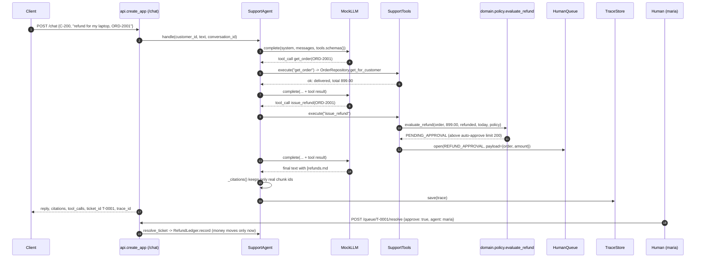

# Architecture · 26 Production Customer Support Agent

## Components

| Layer | Component | File | Responsibility |
|---|---|---|---|
| entry | `main` | `src/support_agent/cli.py` | `demo`, `evals`, `serve` subcommands (used by `run.py`, `demo.py`, `support-agent`). |
| config | `Settings` | `src/support_agent/config.py` | Typed env settings: provider, refund policy numbers, step budget, API key, pinned date, data dir, trace capacity. |
| wiring | `build_agent` | `src/support_agent/bootstrap.py` | Composition root: the only place that knows how adapters and services fit together. |
| http | `create_app` | `src/support_agent/api.py` | FastAPI: `/chat`, `/health`, `/traces/{id}`, `/queue`, `/queue/{id}/resolve`; pydantic validation, optional `X-API-Key`. |
| service | `SupportAgent` | `src/support_agent/services/agent.py` | Per-turn think → tool → observe loop with a step budget, conversation state, citation guard, ticket resolution. |
| service | `SupportTools` | `src/support_agent/services/tools.py` | `get_order`, `check_shipping`, `search_policy`, `issue_refund`, `escalate_to_human`; validates args, returns errors as data. |
| service | `PolicyIndex` | `src/support_agent/services/retrieval.py` | BM25 over markdown policy chunks (`refunds.md#refund-window`). |
| domain | `evaluate_refund`, `RefundPolicy` | `src/support_agent/domain/policy.py` | Pure policy-as-code: the model never decides whether money moves. |
| domain | models | `src/support_agent/domain/models.py` | `Order`, `Ticket`, `Message`, `LLMResponse`, `Citation`, ... |
| adapter | `MockLLM`, `AnthropicLLM`, `OpenAILLM`, `build_llm` | `src/support_agent/adapters/llm.py`, `providers.py` | The LLM port and its implementations. |
| adapter | `OrderRepository`, `RefundLedger`, `HumanQueue` | `src/support_agent/adapters/` | In-memory stand-ins for the order DB, payments ledger and ticketing system. |
| ops | `TraceRecorder`, `TraceStore`, `log_event` | `src/support_agent/observability.py` | Spans per turn, bounded trace store, JSON logs. |
| quality | `run_suite`, `check` | `src/support_agent/evals.py` | 14 scripted conversations with explicit expectations; deploy gate. |

## Data flow

`POST /chat` → `SupportAgent.handle` looks up (or creates) the conversation and checks it belongs to the customer →
`_run_loop` asks the LLM for the next action with the tool schemas → each tool call goes through
`SupportTools.execute` (pydantic validation, then the handler) → results are appended to the conversation as
`tool` messages → when the model answers without tools, `_citations` keeps only citations that exist in
`PolicyIndex` → the trace is saved and the response returned with its `trace_id`.

## One full request: a refund that needs a human

## Design decisions

- **Policy as code.** `evaluate_refund` is a pure function; the LLM can only *request* a refund. Limits come from
  `Settings` (`REFUND_WINDOW_DAYS`, `REFUND_AUTO_APPROVE_LIMIT`), so ops can change them without a prompt edit.
- **Hexagonal layout.** `domain/` has no I/O, `adapters/` are swappable edges, `services/` hold the logic,
  `bootstrap.build_agent` is the only wiring point. Tests build an agent the same way the API does.
- **Errors are data.** Invalid tool arguments or unknown orders return `ToolResult(ok=False, ...)` so the model can
  recover, instead of crashing the request.
- **Step budget.** `MAX_AGENT_STEPS` bounds cost and latency; when exhausted, the agent escalates instead of looping.
- **Citations are verified.** Only chunk ids present in `PolicyIndex` survive; invented ones are logged in the trace.
- **Every turn is traced.** `GET /traces/{id}` shows each model decision and tool call, which is also what the demo renders.

## Failure modes and how they are handled

| Failure | Handling |
|---|---|
| Customer reuses another customer's `conversation_id` | `ConversationForbidden` → HTTP 403. |
| Order not on this account | Tool returns `not found`; the model asks again or explains. |
| Refund outside window / final sale / over-refund | `evaluate_refund` denies with a policy reference. |
| Large refund | `PENDING_APPROVAL` → `HumanQueue`; money moves only after `/queue/{id}/resolve`. |
| Angry customer or asks for a human | Model calls `escalate_to_human`; later turns go to the ticket, not the bot. |
| Model loops | Step budget guard escalates with "agent step budget exhausted". |
| Model invents a citation | `_citations` drops it and records it in the `guard.citations` span. |
| Missing / wrong API key | `require_key` → HTTP 401 (only when `SUPPORT_API_KEY` is set; `/health` stays open). |

## How to extend

- **New tool:** add an args model and handler to `SupportTools`, register it in `self.tools`, teach `MockLLM` when
  to call it, and add eval cases to `examples/evals.json`.
- **Real storage:** implement `OrderRepository` / `RefundLedger` / `HumanQueue` against your DB or ticketing API
  and swap them in `bootstrap.build_agent`.
- **New provider:** implement the `LLM` protocol in `adapters/providers.py` and add a branch to `build_llm`.
