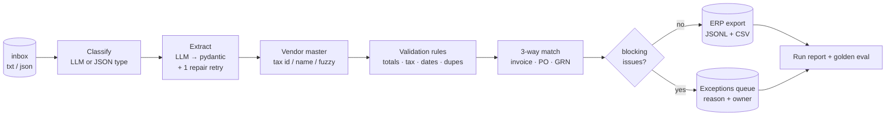
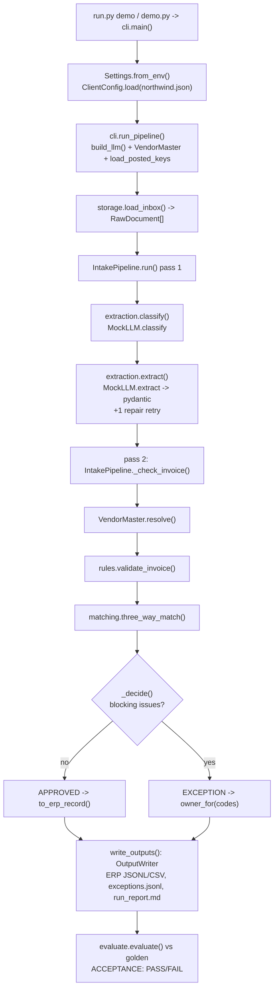

# 27 · Document Intake Pipeline (Forward-Deployed Engineer edition)

Build an end-to-end accounts-payable intake pipeline (classify → extract → validate → 3-way match →
exceptions queue → ERP export → run report), set up per client by config and accepted against a golden set, in about 1,000 lines of Python.

**Level:** Production
**You'll learn:**
- How to turn messy text documents into validated pydantic schemas, with a repair retry and a clean failure path
- How to write business validation rules (totals, tax, dates, vendor master, duplicates) as small pure functions
- How a three-way match (invoice ↔ purchase order ↔ goods receipt) works, with tolerances
- How to route exceptions to the team that can fix them, and export only clean data to an ERP
- How an FDE onboards a new customer with a mapping config, a golden set and acceptance metrics

## Why this matters
Every mid-size company has an accounts-payable team that keys invoices into an ERP by hand. Take a manufacturer
that receives 4,000 supplier invoices a month as PDFs, emails and EDI files. Most of the work is
checking: is this vendor real, did we order this, did it arrive, is the price right, have we already paid it?
"AI for invoices" is easy to demo and hard to ship. What gets a contract signed is a pipeline
that posts clean invoices on its own, explains every one it holds back, never pays the same invoice twice,
and comes with numbers the customer agreed to before go-live. That is the job of a forward-deployed engineer (FDE),
and this project is a working, simplified version of what one would ship.

## Architecture



The pipeline makes three passes. Pass 1 classifies and extracts every document. Pass 2 checks invoices, but only after every PO and
goods receipt (GRN) in the batch is known, so a PO that arrives after its invoice is still matched. Pass 3 writes outputs.
The model is used in only two places, classification and extraction. Everything after that is deterministic code in
`domain/` (`rules.py`, `matching.py`, `vendors.py`), so a decision can be explained and tested.
Everything specific to one customer (tolerances, date formats, routing, ERP column names, acceptance targets)
lives in `examples/clients/<client>.json`.

```
src/intake/
  domain/      models.py (schemas) · rules.py · matching.py · vendors.py     ← pure, no I/O
  adapters/    llm.py (port + MockLLM) · providers.py · storage.py (inbox, ERP, queue)
  services/    extraction.py · pipeline.py · report.py · evaluate.py
  cli.py       demo / run / eval
```

## Flow



## Project structure

```
27-document-intake-fde/
├── README.md                  # this file
├── VIDEO.md                   # hooks + flow_steps for the video
├── docs/ARCHITECTURE.md       # components, sequence diagram, design decisions, failure modes
├── pyproject.toml             # deps, `intake` CLI entry, pytest + ruff config
├── requirements.txt           # pinned runtime + test deps
├── Makefile                   # install / test / demo / run / eval / lint / docker / clean
├── Dockerfile                 # python:3.12-slim, non-root, runs the demo
├── .dockerignore / .gitignore / .env.example
├── run.py                     # `python run.py demo | run | eval` (no install needed)
├── demo.py                    # shortcut for `python run.py demo`
├── src/intake/
│   ├── __init__.py            # __version__
│   ├── config.py              # Settings (env: provider, model, paths) + ClientConfig (per-client JSON)
│   ├── cli.py                 # argparse entry, run_pipeline(), terminal rendering
│   ├── domain/                # models.py, rules.py, matching.py, vendors.py (pure, no I/O)
│   ├── services/              # extraction.py, pipeline.py, report.py, evaluate.py
│   └── adapters/              # llm.py (port + MockLLM), providers.py, storage.py
├── examples/
│   ├── inbox/                 # 18 sample invoices, POs, GRNs and junk
│   ├── clients/northwind.json # one client's tolerances, routing, ERP mapping, acceptance targets
│   ├── master/                # vendor master + already-posted invoices
│   └── golden/expected.json   # labelled answers for the acceptance gate
└── tests/                     # domain, extraction, pipeline, e2e demo
```

## Quickstart

**Windows (PowerShell)**
```powershell
cd projects/27-document-intake-fde
python -m venv .venv; .\.venv\Scripts\Activate.ps1
pip install -r requirements.txt
python run.py demo      # trace for every document + run summary + golden-set acceptance (or: python demo.py)
python run.py run       # batch mode: writes out/ and prints the summary
python run.py eval      # acceptance gate only; exit code 1 if below target
python -m pytest -q
```

**macOS / Linux**
```bash
cd projects/27-document-intake-fde
python -m venv .venv && source .venv/bin/activate
pip install -r requirements.txt
python run.py demo
python -m pytest -q
```

With make: `make demo`, `make eval`, `make test`; in a container: `make docker`.

Expected demo output (shortened):
```
+-- INV-1002.txt [EXCEPTION] ------------------------------------------------------------------+
|  classify  invoice (1.00) keywords: invoice, amount due, bill to, remit to, payment due      |
|  extract   mock LLM: GX-30417, 2 line(s), total 226.80 (100% of required fields)             |
|  vendor    V-002 Globex Office Products (matched by name)                                    |
|  validate  all rules passed                                                                  |
| !match     PO-5002 + GRN-7002: PRICE_VARIANCE: PAPER-A4: billed 4.10 vs PO 3.80 (+7.9%)      |
| !decide    EXCEPTION -> buyer: PRICE_VARIANCE                                                |
+----------------------------------------------------------------------------------------------+
...
== Run summary ==
  straight-through (posted to ERP)   2  (22%)  USD 456.89
  held in exceptions queue           8 documents, USD 1,924.94 of invoices
    INV-1003.txt                     -> receiving: QTY_EXCEEDS_RECEIVED
    INV-1008.txt                     -> ap_clerk: DUPLICATE_INVOICE
== Golden-set acceptance ==
  field_accuracy               1.000    0.980  PASS
  ACCEPTANCE: PASS
```

The sample inbox is designed so that almost every failure mode appears once. It holds 9 invoices (text and JSON), 4 POs, 4 goods
receipts and a newsletter that landed in the AP mailbox by mistake. Only 2 invoices are clean, which is why the STP rate is 22%.

## How it works

**1. Structured input never goes through the LLM.** A `.json` (EDI-like) document declares its type and is
validated directly. Only unstructured text is sent to the model. This keeps it cheaper, faster and fully deterministic.

**2. Extraction = model output → client normalisation → pydantic, with one repair retry.**

```python
for attempt in range(2):
    data = normalize_dates(data, cfg.date_formats)       # '10/05/2026' -> '2026-10-05' (per client)
    try:
        doc = schema.model_validate(data)
    except ValidationError as exc:
        ...
        data = llm.extract(raw.text, doc_type.value, schema.model_json_schema(), feedback=_errors(exc))
```

If the second attempt also fails, the document goes to `data_entry` with the exact validation errors
(see `scan_0042.txt`, an OCR'd scan with `Tota1 Due: ____`). The pipeline never guesses a missing total.

**3. Business rules are a list of small functions** in `domain/rules.py`: `line_math`,
`subtotal_matches_lines`, `total_matches`, `tax_rate` (checked against the vendor's rate), `dates`,
`known_vendor`, `has_po` ("no PO, no pay") and `not_duplicate` (checked against ERP history *and*
earlier invoices in the same batch). Each one returns `Issue(code, message, severity)`.

**4. Three-way match** (`domain/matching.py`) sums every receipt for the PO, then checks each invoice line:
it must be on the PO, the price must be within `price_pct`, the quantity must not exceed what was ordered, and it must not exceed what was received.

**5. Vendor resolution** tries tax id first, then a normalised name or alias, then a fuzzy match. The trace shows which
one worked, because "matched by fuzzy 0.89" is something a reviewer may want to double-check.

**6. Decisions and routing.** No blocking issues → `APPROVED` → ERP. Anything else → `EXCEPTION`, with an owner
taken from `exception_routing` (price problems go to the buyer, quantity problems to receiving, unknown vendors to the
vendor-master team). POs and GRNs become `REFERENCE`.

**7. ERP export is pure mapping.** `to_erp_record` builds each row from `erp_mapping`, e.g.
`"GLAccount": "vendor.gl_code"` and `"date_format": "%d.%m.%Y"`. A different ERP means a different JSON file, not different code.

**8. Golden-set evaluation.** `examples/golden/expected.json` holds hand-labelled answers. `evaluate()` reports
classification accuracy, field accuracy, decision accuracy, exception precision and exception recall, and compares them with the
client's `acceptance` block.

Credits: three-way matching and "no PO, no pay" are standard accounts-payable practice. The schema-validate-then-repair
pattern follows public guidance on structured LLM output. All code is original.

## Customer onboarding (how an FDE adapts this to a new client)

Assume the new customer is Contoso Foods: SAP, European dates, 5% price tolerance on produce.

1. **Collect a sample, not a spec.** Ask for 50–200 real documents from the last quarter, spread across their top
   vendors and including the ugly ones (scans, credit notes, multi-page invoices). Ask for the vendor master export,
   open POs, recent goods receipts, and the list of invoices already posted (for duplicate checks).
2. **Write the mapping config** as `examples/clients/contoso.json`:
   - `date_formats`: e.g. `["%d.%m.%Y", "%Y-%m-%d"]`
   - `tolerances`: get their price and rounding tolerances *from the AP manager in writing*
   - `require_po`: some clients allow non-PO invoices (utilities, rent) and route them to approvers instead
   - `exception_routing`: map each code to a real team or queue name in their ticketing tool
   - `erp_mapping`: copy the column names from their ERP import template (for SAP, e.g. `LIFNR`, `XBLNR`, `BLDAT`)
3. **Build the golden set with the customer.** Label 50+ documents together (type, key fields, expected
   status, expected exception codes). Their AP lead signs off on the labels. These become `golden/expected.json`, and
   any disagreement found while labelling is a policy question you've answered before go-live.
4. **Agree on acceptance metrics before you tune anything.** Put them in `acceptance`. Typical targets: classification
   ≥ 99%, field accuracy ≥ 98%, decision accuracy ≥ 97%, exception recall ≥ 95%. Recall matters most, because
   a missed exception means a wrong payment.
5. **Run, read the mismatches, fix the right layer.** If a field is wrong, fix the prompt or extractor. If a decision is wrong, check the rule
   or the config. If the label itself is wrong, fix the golden set with the customer. `python run.py eval --client contoso.json --golden ...`
   exits non-zero until the agreed numbers are met, so put it in CI.
6. **Go live in shadow mode.** Run in parallel with the human team for 2–4 weeks and compare outcomes daily using the run
   report. Increase straight-through processing one vendor at a time.

`tests/test_pipeline.py::test_onboarding_a_different_client_is_config_only` shows this in code: a looser config
(10% price tolerance, no PO requirement, `%Y%m%d` ERP dates) changes the outcomes without any code change.

## Build it yourself
1. **Schemas first.** Write `Invoice`, `PurchaseOrder`, `GoodsReceipt` and `LineItem` in pydantic. Required fields
   define what "extracted" means.
2. **Rules.** Write one function per AP rule returning `Issue`s, plus a `RuleContext` (vendor, today, tolerances,
   already-posted keys). Table-test each rule.
3. **Three-way match.** Sum receipts per SKU, then compare every invoice line with the PO and the receipts.
4. **Vendor master.** Normalise names (drop punctuation and Inc/Co/LLC), resolve by tax id → name → fuzzy.
5. **LLM port + MockLLM.** Define `classify(text, labels)` and `extract(text, doc_type, schema, feedback)`. The mock
   uses keyword votes and label regexes and returns raw strings, the same way a model would.
6. **Extraction service.** Skip the model for JSON, normalise dates from config, validate, retry once with the errors, then fail cleanly.
7. **Pipeline.** Pass 1 extracts everything. Pass 2 resolves the vendor, validates, matches and decides. Track posted keys so
   duplicates within the batch are caught.
8. **Adapters out.** Map approved invoices to the ERP layout from config, write the JSONL/CSV, the exceptions JSONL and a Markdown report.
9. **Golden set + acceptance.** Label the sample inbox, score the run, and return exit code 1 below target.
10. **Onboard a second client** by copying the config and changing it. If you had to edit Python to do that, move the setting into config.

## Use a real LLM
```bash
pip install anthropic
export LLM_PROVIDER=anthropic ANTHROPIC_API_KEY=...     # model defaults to claude-opus-5-5 (override with LLM_MODEL)
python run.py eval                                      # same golden set, real extractor
```
For OpenAI: `pip install openai`, then set `LLM_PROVIDER=openai OPENAI_API_KEY=... LLM_MODEL=<model>`. Both adapters send the
pydantic JSON Schema in the prompt and return JSON. The pipeline's validation and repair retry work the same way for any provider.

## Production notes / pitfalls
- **Recall over precision.** A missed exception (paying a duplicate or an over-billed invoice) costs real money. A
  false exception costs a clerk two minutes. Set the acceptance targets with that in mind.
- **Never let the model invent numbers.** Prompt with "null if absent", validate, and send failures to a human. The
  model should never be asked to "fix" a total.
- **Cost.** JSON/EDI documents skip the model. Only scanned or emailed text pays for tokens. Batch the documents and cache the
  stable prompt prefix (instructions + schema).
- **Idempotency.** Duplicate detection uses `(vendor_id, invoice_number)` against ERP history and the current batch. In
  production, also make the ERP import idempotent on that key.
- **PII and retention.** Invoices contain bank details and addresses. Keep raw documents in the customer's tenant
  and log document ids, not contents.
- **Drift.** Vendors change templates. Track field accuracy per vendor over time and add every new failure to the golden set.

## Extend it
1. Add credit notes as a fourth document type with negative totals and a rule that links them to an invoice.
2. Track quantities already billed per PO line across batches, so partial invoices can't add up to more than was received.
3. Add a tiny FastAPI review UI for the exceptions queue that lets a clerk fix a field and re-run the rules.

Next project: **28 · Agent Gateway Platform**, a multi-tenant agent API with auth keys, rate limits, cost budgets and model fallback.

---
Part of [AI Agent Builds](../../README.md) by [exe_404.ai](https://www.youtube.com/@exe_404ai) — one agentic-AI project a day.
