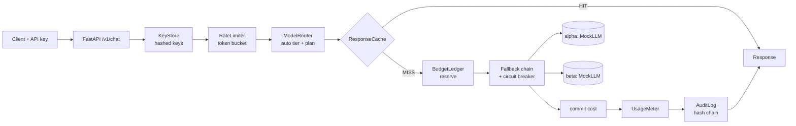
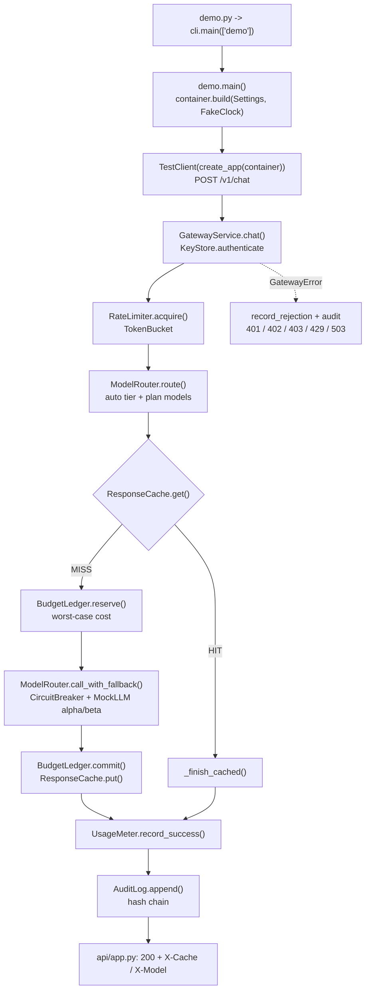

# 28 · Agent Gateway Platform

Build a multi-tenant LLM gateway with API keys, rate limits, hard budget stops, caching, model fallback, metering and a tamper-evident audit log, in ~1,500 lines of FastAPI (tests included).

**Level:** Production

**You'll learn:**
- How a **token bucket** rate limiter works, and why it needs a lock and an injectable clock
- How to enforce a **hard spend cap** with *reserve → commit/release* so concurrent requests can't overspend
- **Model routing** by difficulty, **fallback** across providers, and a **circuit breaker** that stops hammering a dead one
- **Per-tenant response caching** that can't leak one customer's answers to another
- **Usage metering** and a **hash-chained audit log** that shows when someone edited history

## Why this matters

Once more than one team (or customer) uses your agents, someone asks: *"Who spent $4,000 on GPT last night?"* An
agent gateway is the one place every model call passes through. Companies like Acme Robotics put one in front of
their agents so a free-tier user can't run up the bill, a provider outage at 2 a.m. fails over on its own, the same
FAQ answer isn't paid for 10,000 times, and finance gets usage numbers per customer. API platforms, internal "AI
platform" teams and SaaS companies that resell LLM features all build this layer.

## Architecture



The code is split into three layers. `domain/` holds plain data (tenants, plans, model specs, the request/response
contract) and typed errors that know their HTTP status. `services/` holds the rules: one small class per concern,
each thread-safe, each taking a `Clock` so tests can move time by hand. `adapters/` are the edges: the clock, the
key store, and LLM providers (`MockLLM` by default, Anthropic/OpenAI over `httpx` when you opt in).
`services/gateway.py` wires the pipeline in one readable method, and `api/app.py` is a thin HTTP mapper.

## Flow



## Project structure

```
28-agent-gateway-platform/
├── README.md                # this file
├── VIDEO.md                 # hooks + flow_steps for the video
├── docs/ARCHITECTURE.md     # components, sequence diagram, design decisions, failure modes
├── pyproject.toml           # deps, `gateway` CLI entry, pytest + ruff config
├── requirements.txt         # pinned runtime + test deps
├── Makefile                 # install / test / demo / serve / lint / docker / clean
├── Dockerfile               # python:3.12-slim, non-root, uvicorn on :8000 with healthcheck
├── .dockerignore / .gitignore / .env.example
├── demo.py                  # one-command demo, no install needed
├── src/gateway/
│   ├── __init__.py          # __version__
│   ├── config.py            # Settings.from_env(): provider, keys, MODEL_MAP, cache, breaker, host/port
│   ├── cli.py               # argparse entry: demo / serve
│   ├── demo.py              # the nine-scene teaching trace
│   ├── container.py         # build(): the composition root
│   ├── serve.py             # ASGI app for uvicorn
│   ├── api/app.py           # FastAPI: /v1/chat, /v1/usage, /v1/audit, /healthz
│   ├── domain/              # models.py (tenants, plans, contract), errors.py (typed HTTP errors)
│   ├── services/            # gateway.py (pipeline), ratelimit, router, cache, budget, metering, audit
│   └── adapters/            # keystore.py, providers.py (MockLLM), real_llm.py (httpx), clock.py
├── examples/tenants.json    # tenants, plans, hashed demo keys
└── tests/                   # limits, cache/router/audit, API, e2e demo
```

## Quickstart

**Windows (PowerShell)**
```powershell
cd projects/28-agent-gateway-platform
python -m venv .venv; .\.venv\Scripts\Activate.ps1
pip install -r requirements.txt
python demo.py
python -m pytest -q
```

**macOS / Linux**
```bash
cd projects/28-agent-gateway-platform
python3 -m venv .venv && source .venv/bin/activate
pip install -r requirements.txt
python demo.py
python -m pytest -q
```

Run the real server (then try `curl -H "Authorization: Bearer sk-acme-demo-0001" ...`):
```bash
cd src && python -m uvicorn gateway.serve:app --port 8000
# or: make serve    |    docker build -t agent-gateway . && docker run -p 8000:8000 agent-gateway
```

Expected demo output (shortened):
```
[1a] acme   POST /v1/chat  "What is a token bucket?"
    auth       tenant=acme  plan=pro
    ratelimit  9.00 / 10 tokens left in bucket
    route      auto -> alpha-fast > beta-fast
    cache      MISS
    budget     reserved $0.000235 (worst case)   remaining $4.999765
    provider   alpha-fast  @alpha  ok
    commit     actual cost $0.000031   remaining $4.999968
    <- 200  MISS model=alpha-fast

    ...three more pro-tier requests while alpha is still down:
    #1  acme   -> 200  alpha-pro[FAIL] > beta-pro[ok]       $0.000681
    #2  acme   -> 200  alpha-pro[FAIL] > beta-pro[ok]       $0.000681
    #3  acme   -> 200  alpha-pro[OPEN] > beta-pro[ok]       $0.000677

| 5. Budget hard stop (free plan budget = $0.0012)                       |
    #1  hobby  -> 200  alpha-fast[ok]                       $0.000377
    #2  hobby  -> 200  alpha-fast[ok]                       $0.000377
    #3  hobby  -> 402  budget_exceeded

| 7. Load test: 200 concurrent requests from one tenant                  |
    200 requests, 32 threads -> 200: 10, 429: 190
    admitted 10 == burst 10?  YES

| 9. Tamper-evident audit log  GET /v1/audit                             |
    14 entries, hash chain verified: True
    after editing entry #3's cost -> verified: False, chain breaks at #3
```

## How it works

**1. The pipeline is one method.** `GatewayService._handle` reads top to bottom: the order *is* the policy. Rate
limiting comes before the cache (a cache hit is cheap but not free for your servers), and the budget check comes
after the cache (cache hits cost the customer nothing).

```python
left = self.limiter.acquire(tenant)
route = self.router.route(request, tenant)
key = cache_key(tenant.id, route[0].name, request) if is_cacheable(request) else None
if key and (hit := self.cache.get(key)):
    return self._finish_cached(request_id, tenant, hit)
reservation = self.budget.reserve(tenant, self.router.worst_case_cost(route, input_tokens, request.max_tokens))
try:
    routed = self.router.call_with_fallback(route, request)
except AllProvidersFailed:
    self.budget.release(reservation)
    raise
self.budget.commit(reservation, cost)
```

**2. Token bucket.** Each tenant has a bucket of `burst` tokens refilling at `rpm / 60` per second. The refill is
computed lazily from elapsed time, so there is no background thread. When it's empty, the exact wait is known,
which becomes the `Retry-After` header.

```python
def refill(self, now: float) -> None:
    elapsed = max(0.0, now - self.updated_at)
    self.tokens = min(self.capacity, self.tokens + elapsed * self.rate)
    self.updated_at = now
```

**3. Hard budget stop.** "Check, then call, then add cost" has a race: 50 parallel requests all pass the check. The
ledger *reserves* the worst case (priciest model in the route × `max_tokens`) under a lock, then commits the real
cost or releases the hold. `reserved + spent` can never cross the limit, and the load test in
`tests/test_limits.py` proves it with 400 requests on 40 threads.

**4. Routing, fallback, circuit breaker.** `model="auto"` sends long or reasoning-heavy prompts (`analyze`, `plan`,
`debug`, ...) to the `pro` tier. Each tier has a chain: same tier on the other provider first, then a cheaper tier.
After 3 consecutive failures a provider's circuit opens and it is skipped for 30 s, then one probe is allowed
(half-open). An outage costs you one slow failure, not one per request.

**5. Cache isolation.** The cache key is `sha256(tenant, model, max_tokens, messages)`. Leaving the tenant out is a
real-world data-leak bug: customer B would get customer A's cached answer. Only `temperature == 0` requests are cached.

**6. Audit chain.** Each entry stores `prev_hash` and `hash = sha256(prev_hash + entry)`. Change one byte of entry #3
and every hash from #3 onward stops matching. Prompts are stored only as a 16-hex-char fingerprint.

Credits: the token bucket, circuit breaker and hash-chained log are classic patterns (network traffic shaping,
Michael Nygard's *Release It!*, append-only ledgers). The code here is original.

## Build it yourself

1. **Domain first.** Write `domain/models.py` (`Plan`, `Tenant`, `ModelSpec` with a `cost()` method, and the pydantic
   `ChatRequest`/`ChatResponse`) and `domain/errors.py` where each error carries `status` and `code`. No I/O yet.
2. **A clock you control.** `adapters/clock.py` with `SystemClock` (monotonic) and `FakeClock.advance()`. Every
   time-based class takes a clock: that's what makes the rest testable.
3. **Keys.** `KeyStore` loads `examples/tenants.json` and keeps only `sha256(key)`. `authenticate()` raises
   `Unauthorized`.
4. **Rate limiter.** `TokenBucket.refill()` + `RateLimiter.acquire()` under a `threading.Lock`. Test: burst 3, the
   4th call raises with `retry_after_s == 10` for 6 rpm.
5. **Budget ledger.** `reserve / commit / release`. Write the concurrency test before the code and watch a naive
   version fail it.
6. **Providers + router.** A deterministic `MockLLM` with `set_down()`/`fail_next()`. A `ModelRouter` that builds a
   chain per tier, filters by plan, and loops over it catching `ProviderError`. Add the `CircuitBreaker`.
7. **Cache, meter, audit.** An `OrderedDict` LRU with TTL, a per-tenant usage counter, and the hash-chained log.
8. **Wire the pipeline** in `GatewayService.chat()` and the composition root in `container.py`.
9. **HTTP layer.** `create_app()` with one exception handler that turns any `GatewayError` into
   `{"error": {code, message}}` + headers. Add `/v1/usage` and admin-only `/v1/audit`.
10. **Demo + load tests.** Drive it with `TestClient` and a `FakeClock`, then blast 200 requests from 32 threads.

## Use a real LLM

The gateway talks to providers only through the `Provider` protocol. Set:

```bash
export LLM_PROVIDER=anthropic          # or openai
export ANTHROPIC_API_KEY=...           # or OPENAI_API_KEY
export MODEL_MAP="alpha-fast=claude-haiku-4-5,alpha-pro=claude-sonnet-4-5,beta-fast=claude-haiku-4-5,beta-pro=claude-sonnet-4-5"
cd src && python -m uvicorn gateway.serve:app
```

`adapters/real_llm.py` maps gateway names to real model ids and converts any HTTP or network error into
`ProviderError`, so fallback and the circuit breaker work the same as with the mock. Update the per-1k prices in
`router.DEFAULT_CATALOG` to your provider's current price list.

## Production notes / pitfalls

- **State lives in memory.** Buckets, ledger, cache and meter are per process. With more than one replica, move them
  to Redis (atomic `INCRBYFLOAT`/Lua scripts for reserve/commit) or a database, or limits multiply by replica count.
- **Budgets need a period.** This ledger never resets. Real billing keys the ledger by `(tenant, month)` and keeps the
  hard stop separate from soft alerts at 50/80/100 %.
- **Worst-case reservations can reject valid requests** near the limit. That's the price of a *hard* stop; tell users
  to lower `max_tokens` (the 402 message says how much the request could cost).
- **Never log prompts in the audit trail.** Fingerprints let you correlate incidents without spreading customer data.
  Ship the JSONL to write-once storage so the hash chain has an external anchor.
- **Retry storms.** Fallback multiplies load during an outage; the circuit breaker plus `Retry-After` keep clients
  and providers from melting each other.
- **Streaming** responses need the same reserve/commit flow, committing when the stream closes or is cancelled.

## Extend it

1. Add **semantic caching**: embed the prompt and reuse an answer when cosine similarity > 0.95 (with a per-tenant opt-in).
2. Add a `GET /v1/usage/export.csv` for finance, and soft-limit **webhooks** at 80 % of budget.
3. Replace the in-memory limiter and ledger with **SQLite or Redis** and run two uvicorn workers to prove limits still hold.

Next project: [29 · SRE Incident Agent](../29-sre-incident-agent/README.md).

---
Part of [AI Agent Builds](../../README.md) by [exe_404.ai](https://www.youtube.com/@exe_404ai) — one agentic-AI project a day.
