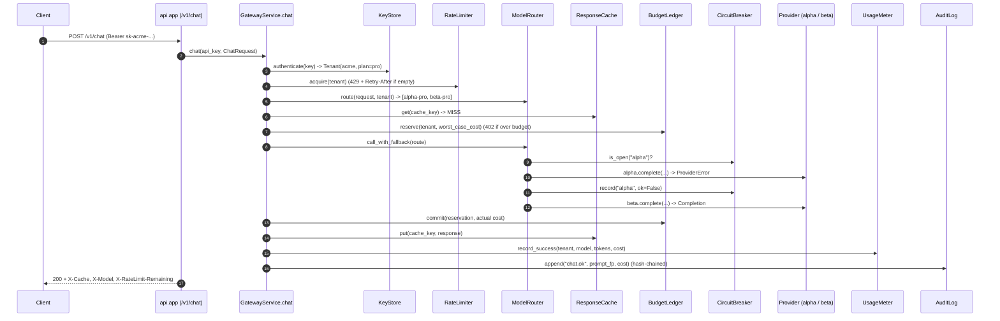

# Architecture · 28 Agent Gateway Platform

## Components

| Layer | Component | File | Responsibility |
|---|---|---|---|
| entry | `main` | `src/gateway/cli.py` | `gateway demo` / `gateway serve` (also used by `demo.py`). |
| entry | `demo.main` | `src/gateway/demo.py` | Nine scripted scenes over in-process HTTP with a fake clock and a teaching trace. |
| config | `Settings` | `src/gateway/config.py` | Every env var: provider, keys, `MODEL_MAP`, timeouts, tenants file, audit file, cache, breaker, host/port. |
| wiring | `build`, `default_providers` | `src/gateway/container.py` | Composition root: concrete adapters + services from `Settings`. |
| http | `create_app` | `src/gateway/api/app.py` | FastAPI: `/v1/chat`, `/v1/usage`, `/v1/audit`, `/healthz`; maps `GatewayError` to HTTP status + headers. |
| service | `GatewayService.chat` | `src/gateway/services/gateway.py` | The pipeline in one method: auth → rate limit → route → cache → reserve → call → commit → meter → audit. |
| service | `RateLimiter`, `TokenBucket` | `src/gateway/services/ratelimit.py` | Per-tenant token bucket (burst + per-minute refill), thread-safe. |
| service | `ModelRouter`, `CircuitBreaker` | `src/gateway/services/router.py` | `auto` tier selection, plan-allowed models, fallback chain, per-provider breaker. |
| service | `ResponseCache` | `src/gateway/services/cache.py` | TTL + LRU cache for deterministic requests (temperature 0), keyed per tenant. |
| service | `BudgetLedger` | `src/gateway/services/budget.py` | Reserve worst-case cost before the call, commit actual cost or release after. |
| service | `UsageMeter` | `src/gateway/services/metering.py` | Requests, cached hits, tokens, cost and rejections per tenant and model. |
| service | `AuditLog` | `src/gateway/services/audit.py` | Hash-chained, append-only log; `verify()` finds the first tampered entry. |
| adapter | `KeyStore` | `src/gateway/adapters/keystore.py` | Tenants and plans from JSON; API keys stored as hashes. |
| adapter | `MockLLM`, `HttpProvider` | `src/gateway/adapters/providers.py`, `real_llm.py` | Upstream providers: deterministic mock (can be set down) or Anthropic/OpenAI over httpx. |
| adapter | `SystemClock`, `FakeClock` | `src/gateway/adapters/clock.py` | Injected time so tests and the demo can advance it by hand. |

## Data flow

Every request carries an API key. `KeyStore.authenticate` turns it into a `Tenant` (401 before anything is spent).
The tenant's `Plan` drives everything after: burst and refill for the rate limiter, allowed models for the router,
monthly budget for the ledger. Errors are typed (`Unauthorized`, `Forbidden`, `RateLimited`, `BudgetExceeded`,
`AllProvidersFailed`) and carry their HTTP status and headers (`Retry-After`), so `api/app.py` stays a mapper.

## One full request

## Design decisions

- **One readable pipeline.** `GatewayService._handle` is the architecture; each concern is a small class with one job.
- **Reserve, then commit.** Budgets are checked against the *worst-case* cost before calling a provider, so
  concurrent requests cannot overspend; the unused part is returned on commit, everything on failure.
- **Token buckets.** Allow short bursts while bounding the average rate; each bucket has a lock, which is why the
  200-thread load test admits exactly `burst` requests.
- **Circuit breaker per provider.** After `BREAKER_THRESHOLD` consecutive failures the provider is skipped for
  `BREAKER_COOLDOWN_S`, so an outage costs one timeout per cooldown, not one per request.
- **Cache only deterministic calls.** Temperature > 0 is skipped; keys include the tenant so data never crosses tenants.
- **Audit stores fingerprints.** Prompts are hashed, not stored; each entry hashes the previous one, so edits are detectable.
- **Settings in one place.** `config.Settings` is read in `container.build` and `serve.py`; explicit `build()`
  arguments still win, which is how tests inject a `FakeClock` and fixtures.

## Failure modes and how they are handled

| Failure | Handling |
|---|---|
| Missing / unknown API key | 401 `invalid_api_key` before rate limiting or spending. |
| Burst exceeded | 429 `rate_limited` with `Retry-After`. |
| Model not in plan | 403 `forbidden`. |
| Budget would be exceeded | 402 `budget_exceeded`; nothing is called. |
| Provider error / timeout | Next model in the fallback chain; breaker records the failure. |
| All providers fail | 503 `all_providers_failed`; the budget reservation is released. |
| Non-admin reads usage of others / audit | 403 `forbidden`. |
| Someone edits audit history | `AuditLog.verify()` returns the first broken sequence number. |

## How to extend

- **New plan or tenant:** edit `examples/tenants.json` (or point `GATEWAY_TENANTS` elsewhere).
- **New provider:** implement the `Provider` protocol (`complete(model, messages, max_tokens, temperature)`) and
  return it from `default_providers`.
- **Shared state across replicas:** move `RateLimiter`, `BudgetLedger` and `ResponseCache` to Redis behind the same methods.
- **Semantic cache:** replace `cache_key` with an embedding lookup (see README "Extend it").
